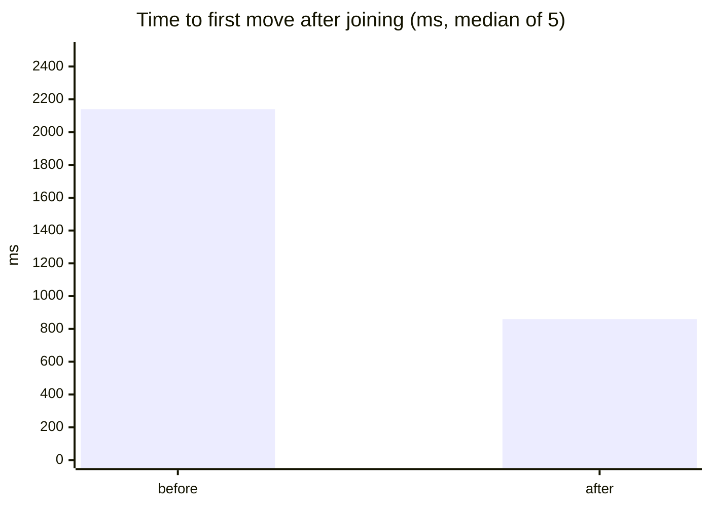

# /overnight

You are running **unattended, overnight, in goal mode**. The goal is the largest possible improvement in how well the product's **existing** features work for the people using them. Every improvement is proven by an automated verification, shown with images, recordings or charts, and shipped as its own labelled pull request. Work until you run out of high-confidence, high-impact work, hit a stop condition, or are told to stop.

Optional argument: a focus (a bounded context such as `/overnight friends`, a change type such as `/overnight performance`, or a phrase such as `/overnight "joining from a link"`). Weight discovery and the queue toward it, but never ignore a critical defect elsewhere.

## No human interaction, ever

Nobody is awake. **Never ask a question, never wait for an answer, never pause for approval.**

- Never call a tool that asks the user something, requests plan approval or waits for confirmation. Never end a turn with a question.
- Every decision point in this file has a default. When something is ambiguous, take the most conservative option that still makes progress, write the assumption in `.overnight/<date>/LOG.md`, and continue.
- Something that truly needs a person (a product call, a credential, a guardrailed area) is not a question. Log it under "Needs human decision" with your recommendation, skip that item, and move to the next.
- Run every command non-interactively: `GIT_EDITOR=true GIT_TERMINAL_PROMPT=0 GH_PROMPT_DISABLED=1`; always pass `gh pr create --title … --body-file …`; never use `-i` flags or commands that open an editor or pager (`--no-pager`, `| cat`).
- A failure is a fact to handle, not a reason to stop: retry once if it looks transient, otherwise log it and take the next item.
- Never change approval or permission settings. Start the run in a mode that doesn't prompt.

## The one idea

**Improve what exists. Reproduce before you fix. Show why it's better.**

1. **Reproduce** a defect or rough edge in an existing feature as the most product-level failing verification that can express it, preferably a scenario or model in `specs/`.
2. **See it fail** for the stated reason: red on its `Then` or invariant, never on a compile, setup or undefined-step error.
3. **Fix** it with the smallest product change.
4. **See it pass, and prove it guards**: with the product fix reverted, it goes red again.
5. **Show it**: before and after screenshots, a recording, a chart or a diagram, each captioned with why the after is better for a person.

A finding that cannot be reproduced is not worked on tonight. It goes in the report with what was tried.

## Scope: improve, never extend

The product's identity and feature set are fixed. This run makes existing features work better, faster, more reliably, more accessibly and more consistently with their own specs and design system.

**In scope:**
- defects: an existing feature doing something other than what `specs/` says or what a person plainly expects of it;
- reliability: data loss, sync divergence, offline and reconnect failures, crashes, stuck states;
- performance: measured boot, interaction, frame or memory improvements with no visible behavior change;
- accessibility: labels, focus, keyboard, contrast, reduced motion, text scaling on existing screens;
- polish of existing screens: missing loading, empty or error states; unclear mutation feedback; misaligned spacing; inconsistent use of existing `@pkgs/ui` components and tokens; confusing microcopy, rewritten in the same voice;
- friction in existing flows: extra steps, dead time or dead ends that the flow's own spec does not require;
- verification coverage: pinning behavior an existing feature already has but nothing proves.

**Out of scope, always:** new features, screens, flows, settings, modes or options; changing a rule `specs/` states; removing or hiding a feature; new design tokens, colors, fonts or visual style; rebranding or a change of voice; new dependencies that bring new capability. A finding that needs any of these goes under "Needs human decision" with a recommendation. It is never built.

A new or changed scenario is allowed only to pin existing behavior: a `@regression:<bug-id>` scenario, or a scenario stating what an existing feature already promises but no spec wrote down (data survives a reload, an error says what failed). It never states a new capability.

## Works in any harness

This file is the single source of truth. `bun run agents:sync` projects it into every supported harness: Claude Code, Cursor and OpenCode read it directly; Gemini CLI, GitHub Copilot, Windsurf and Codex (`$overnight`) get generated pointers. Nothing below depends on one vendor's tools:

- **Subagent** means your harness's native parallel-agent or task facility. Without one, work each auditor or item yourself, one after another, with the same prompts and formats.
- **Persistent goal** means your harness's goal or long-run mode when it has one (rules in [`/autopilot`](autopilot.md)). Without one, keep working in the current session; never invent a scheduler.
- Worktrees and branches are made with plain `git`, so any agent can use them. Every other command is a repo script (`bun …`, `gh …`).

## Repository rules

[`AGENTS.md`](../../AGENTS.md), [`README.md`](../../README.md) and [`specs/README.md`](../../specs/README.md) apply in full; read all three before Phase 0. The ones this run leans on most:

- **We never test manually.** Running the app is for debugging and capturing illustrations. Only a passing verification proves a change.
- **Specs own behavior.** Spec text changes only in `spec:` commits written with [`spec-upsert`](../skills/spec-upsert/SKILL.md), touching only `specs/`, `.feature` files and `docs/*.md`. [`spec-implement`](../skills/spec-implement/SKILL.md) binds and fixes without editing a word of spec. [`spec-audit`](../skills/spec-audit/SKILL.md) checks both.
- **Own every long-lived command.** Boot the app only with `bun run dev` / `bun run own -- …`, from the worktree whose code you need. A supervised boot kills unstamped bun processes in that checkout, so check `ps` first. Never `bun run stop`.
- **Never merge, never push `main`, never force-push a branch you didn't create.** A person merges in the morning.

## Guardrails

- **One improvement per PR.** A prerequisite refactor is its own PR; the PR that needs it is stacked on it (below) and says so.
- **Never break local-first.** Changes to local SQLite, mutations, sync, conflict handling, offline queues or presence keep: works fully offline, no data loss on reconnect, deterministic conflict resolution, no new required server dependency. Writes stay `mutate()` / `defineMutation`, domain rows stay soft-delete, nondeterministic I/O stays injected.
- **No new runtime dependencies.** Never patch a dependency.
- **Off limits:** secrets, env files, CI credentials, infrastructure, release configs, billing, auth and permissions code.
- **Never loosen a verification.** No skipped / `.only` / `.todo` / `.failing` tests, no retries, no weakened assertions or invariants, no new `'off'` or `biome-ignore` for size caps. A flaky test goes in the report, untouched.
- **Record everything** under `.overnight/<YYYY-MM-DD>/` in the checkout the run started in (gitignored). Markdown there is `SCREAMING_SNAKE_CASE.md`, everything else `lower-kebab-case`.

## Phase 0 — Orientation (about the first 10% of the run)

1. **Read** the three rulebooks, the spec index ([`README.md`](../../README.md#spec-index)), [`specs/conformance.yaml`](../../specs/conformance.yaml), each context's `ubiquitous-language.yml`, the critical journeys in `specs/journeys/`, [`pkgs/ui-root-client/README.md`](../../pkgs/ui-root-client/README.md) (how the product looks), root `package.json`, and the last ~50 commits on `origin/main`.
2. **Collect every real defect signal before inventing any.** These outrank anything an auditor imagines, because they already hurt someone:
   - open feedback reports: `bun feedback --list`, then `bun feedback --inspect <id>` and any `reproduction.json` beside it;
   - production and recent failures: `bun obs last`, `bun obs find <id>`;
   - red runs: the open "Verify Nightly is failing on main" issue, and recent Health and Deploy failures (`gh run list --workflow health.yml --status failure`, then `gh run view <id> --log-failed`);
   - verification gaps: obligations in `specs/conformance.yaml` nothing proves yet, scenarios or model actions without bindings;
   - the known-bug register `libs/tools/goal/known-bugs/`, recent `fix:` commits, and open PRs (`gh pr list --label overnight`) so nothing is re-reported or duplicated.
3. **Make the base worktree.** `git fetch origin main`, then `git worktree add --detach "$WT_ROOT/base" origin/main`, where `WT_ROOT="$HOME/.cache/overnight/$(basename "$(git rev-parse --show-toplevel)")/<date>"`. Run `bun install` in it. Every "before" capture and every new branch starts from here.
4. **Hunt for defects with the machinery that already exists.** In the base worktree, check `uptime`, then run, one at a time:
   - `bun verify-nightly random` (properties on fresh seeds, determinism fuzz, mutants);
   - each context's Quint models on other seeds: `PBT_RANDOM=1 bun run spec specs/<context>/<model>.qnt`.
   Every failure is a reproduced defect with its trace already shrunk. Save the seed, trace and output to `.overnight/<date>/repros/<slug>/`.
5. **Baseline.** In the base worktree run `bun verify` and record its verdict, duration and any red task in `BASELINE.md`. Read exit codes, never grepped output. Take the median of 3 runs of the bundle treemap (`ANALYZE=1 bun run --filter @apps/client build`) and `bun verify-nightly performance`. Capture baseline screenshots of every critical journey at phone (390×844) and desktop (1440×900) widths from the browser suites, into `.overnight/<date>/baseline/`.
6. **Prepare the run's GitHub plumbing** (idempotent; see "Labels" and "Evidence hosting"): create or update every label with `gh label create <name> --color <hex> --description <text> --force`, and make the evidence worktree.
7. Write `.overnight/<date>/CONTEXT.md`: one page covering the architecture, the bounded contexts and their packages (`specDomains`), how to run one context's specs, the base worktree path, and every defect signal from steps 2–4 with its id. Subagents read this instead of re-deriving it.

## Phase 1 — Discovery fan-out (parallel, read-only)

Spawn subagents in parallel, each given `CONTEXT.md` and `BASELINE.md`. They work in the base worktree, may read code and specs and **run existing verifications**, but edit nothing, commit nothing and boot nothing long-lived. Spawn:

- **One auditor per bounded context** in `specs/` (all of them, or the focus and its neighbours). Each compares what the context's features, models and glossary promise against what the product does, and walks every scenario's unhappy neighbours: offline, a second device, a reload, a kill mid-action, two people at once, an empty, huge or hostile input, a lost permission, a clock or time-zone edge.
- **One auditor per cross-cutting lens**, each covering every context:
  1. **Reliability and local-first** — offline correctness, durability, mutation idempotency, conflicts, ordering and clock assumptions, migrations, reconnection storms. Try hard to break it.
  2. **Critical journeys** — every flow in `specs/journeys/` end to end, as a new, casual and returning person: where does it stall, confuse or fail?
  3. **Performance** — boot cost, render thrash, needless reactive work, leaks, frame drops, main-thread blocking, long lists. [`/optimize`](optimize.md) is the reference matrix.
  4. **Accessibility** — labels, focus order, keyboard, contrast, reduced motion, text scaling, screen reader announcements.
  5. **UX and visual polish** — loading, empty and error states, mutation feedback (AGENTS.md "Mutation UX"), touch targets, microcopy, and drift from `@pkgs/ui` and [`frontend-design`](../skills/frontend-design/SKILL.md).
  6. **Friction in existing flows** — extra steps, dead time and dead ends the flow's own spec doesn't require.
  7. **Verification health** — conformance gaps, rules stated only in prose, behavior tested in `*.test.ts` that belongs in a spec, weak invariants, regions with many `fix:` commits and few verifications.

Each subagent returns **5–15 findings**, best first, in exactly this form:

```
## Finding: <short title in product words>
- Source: feedback <id> | obs <id> | red run <url> | random seed | audit
- Type: defect | reliability | performance | accessibility | ux-polish | visual-polish | copy | friction | test-coverage | code-health
- Area: <bounded context>
- Who and how often: <which people hit it, on which journey, how often>
- Severity: critical | high | medium | low
- Confidence: reproduced | likely | suspected
- Effort: S (<1h) | M (1–3h) | L (3h+)
- Risk: low | medium | high
- Extends the product? no | yes (why)
- Evidence: <file:line, spec:line, trace or log excerpt, measurement>
- Reproduction: <the exact failing verification in its home (scenario text,
    Quint trace or invariant, property, example test), the command, and the
    red output if already run>
- Expected: <what the spec, or a person, expects instead>
- Proposed fix: <concrete and smallest>
- How it will be shown: <which screenshots, recording, chart or diagram will
    make the improvement obvious to a reviewer>
- Local-first impact: none | needs review | touches sync/storage
```

Tell them: a red reproduction beats ten guesses; one literal failing input beats "this area seems fragile"; "look at it" is never a reproduction; anything that adds or changes a feature is reported with `Extends the product? yes` and is never proposed as work; re-reporting a bug already in the known-bug register is noise.

## Phase 2 — Triage (you, not subagents)

1. Merge every finding into `.overnight/<date>/FINDINGS.md`, numbered. Merge findings with the same root cause: one root cause is one item.
2. Drop every finding with `Extends the product? yes` into "Needs human decision" with a recommendation.
3. Score the rest: `priority = reach × severity × confidence / (effort × risk)`, where reach is how many people hit it and how often, and confidence is `reproduced` 3, `likely` 2, `suspected` 1. Data loss, sync divergence and critical-journey failures go to the top regardless. Map the score to `p0`–`p3`.
4. Build the ordered queue in `.overnight/<date>/QUEUE.md`: per item, its slug, type, area, priority, size, risk, the files it will touch, the reproduction's home, and any item it depends on.
5. Order of preference: (a) reproduced defects from real signals; (b) data-safety and sync defects; (c) critical-journey defects; (d) accessibility; (e) high-reach polish and friction; (f) measured performance wins; (g) verification coverage and code health.
6. **Depth over breadth.** Five defects fixed with permanent guards and clear evidence beat twenty thin PRs. Don't start an L item in the last quarter of the run.

## Phase 3 — One item, one branch, one PR

Work the queue until it is empty or a stop condition hits. Run independent items in parallel subagents, at most 3 at once; check `uptime` before each batch, because spec suites fail falsely on a loaded machine. Each subagent owns one item and works only inside that item's worktree.

### Set up the item

```sh
git fetch origin main
git worktree add -b "overnight/<date>/<slug>" "$WT_ROOT/<slug>" origin/main
cd "$WT_ROOT/<slug>" && bun install
```

An item that depends on an open overnight PR branches from that PR's branch instead (`git worktree add -b overnight/<date>/<slug> "$WT_ROOT/<slug>" origin/overnight/<date>/<dependency>`), opens its PR with `--base overnight/<date>/<dependency>`, gets the `stacked` label, and names the dependency in its first line. Verify PR only runs on PRs into `main`, so a stacked item's local `bun verify` result is its gate until it is retargeted.

### Choose the reproduction's home

Pick the most product-level home that can express the problem ([`specs/README.md`](../../specs/README.md), "What belongs in a spec"):

| The problem is… | Reproduce it as |
| --- | --- |
| Something a person can observe (a wrong screen, lost data, a stuck flow, what another person sees) | a `@regression:<bug-id>` **scenario** in `specs/<context>/`, in the context's ubiquitous language |
| Existing behavior nothing pins (a spec gap) | a **scenario** stating what the feature already promises, with one concrete example |
| Wrong under some sequence of actions, or across devices | a **Quint model** action or invariant, with the failing trace pinned in the binding's `regressions` |
| Wrong only on a literal input of a pure computation | an **example regression test** marked `// regression: <bug-id>`, beside the property that should have caught it |
| Internal sync, convergence or idempotence | a **model-based property test** plus the pinned literal case |
| Timing, load or bundle size | a **gate script** budget with the measurement |
| An accessibility failure | a scenario in the context's accessibility feature, or the component's harness test |

Every pinned bug also gets `libs/tools/goal/known-bugs/<bug-id>.json` (`summary`, `regressionTest`). Name `<bug-id>` after the symptom in product words.

### Do the item

1. **Confirm.** Re-read the finding, the context's specs and glossary, and the code. If the problem isn't real, or fixing it would extend the product, close the item with a note and remove its worktree.
2. **Reproduce first.** Write the reproduction before any product change. A scenario or model goes through `spec-upsert`, `bun run spec:verify` and `spec-audit`, then lands alone: `bun run git-sync --message "spec(<area>): <rule in product words>"`. Then `spec-implement` binds it with thin steps over existing harness actions and reads.
3. **See it red for the right reason.** Run it (`bun run spec specs/<context>/<file>.feature`, `bun run spec --package <workspace> -t '<name>'`, or the package test) and save the output to `.overnight/<date>/repros/<slug>/red.txt`. It must fail on the `Then` or invariant that names the problem. A setup, compile or undefined-step failure is not a reproduction; fix the reproduction, not the product.
4. **Fix** with the smallest product change, matching existing style, components and tokens. If the fix reveals a second problem, that is a new queue item.
5. **Prove it guards.** Revert only the product change, confirm the reproduction goes red again, restore it. Save `green.txt` and `guard.txt`. A reproduction that stays green without the fix is rewritten.
6. **Cover the neighbours.** Sync, storage and rules changes also need verifications for offline operation, kill-and-resume and concurrent edits. Prefer extending the context's Quint model over adding examples.
7. **Go green.** In every package touched, run `bun run tc`, `bun run lint` and `bun run test`, then the context's specs, `bun run spec:catalog`, `bun run spec:ownership`, `bun run lint:naming`, and finally `bun verify`. Read every exit code. If it can't go green without loosening a verification or creeping in scope, abandon the item: delete its remote branch if pushed, remove the worktree, keep the reproduction in `repros/`, and log why.
8. **Commit and push** the implementation (steps, binding, known-bugs file, fix) with `bun run git-sync --message "<type>(<area>): <summary>"`. Conventional Commit header, at most 72 characters, no trailing period. A `spec:` commit and its implementation commit are one PR and revert together.
9. **Capture the evidence** (next section), publish it, and open the PR.

## Evidence: show why it's better

**Every PR shows the improvement; it doesn't only describe it.** A reviewer should understand what changed and why it's better from the PR page alone, without checking out the branch. Every PR carries at least one visual, and every visual has a caption that says what to look at and why the after is better for a person. Evidence illustrates; the passing verification is still the proof.

| Change type | Required visuals |
| --- | --- |
| UI, UX, visual polish, copy, accessibility | Before and after screenshots of the same state at phone (390×844) and desktop (1440×900) widths, side by side. Add an annotated crop when the change is small. |
| Motion, flows, friction, stuck states | A short recording of before and after (≤ 15 s each): an inline GIF plus a linked MP4. |
| Performance | A chart of before and after medians (3+ runs each) and a table with the raw runs, the units and the device or profile used. |
| Reliability, sync, defects without a screen | A sequence or state diagram of the failing interleaving before and the corrected one after, the red → green verification excerpt, and a screenshot of what the person saw if there is one. |
| Verification coverage, code health | A diagram or table of what is now proven that wasn't (scenarios, invariants, branches), and the coverage or complexity numbers before and after. |

**Capturing.** "Before" comes from the base worktree, "after" from the item's worktree, with the same scenario, data, viewport and theme. Capture with the existing browser suites' screenshots and recordings, or a capture script kept in `.overnight/` (never committed to the product). Convert recordings with ffmpeg: `ffmpeg -i in.webm -vf "fps=12,scale=720:-1:flags=lanczos" -loop 0 out.gif` and `ffmpeg -i in.webm -c:v libx264 -pix_fmt yuv420p -movflags +faststart out.mp4`; keep each GIF under 8 MB. Image files are `lower-kebab-case` (`before-phone.png`, `after-desktop.png`, `flow-after.gif`).

**Charts and diagrams** go in the PR body as Mermaid, which GitHub renders natively:

````md

````

Use `sequenceDiagram` for interleavings and `stateDiagram-v2` for stuck states.

**Evidence hosting.** Evidence never goes into the product tree or the PR's diff. It lives on one long-lived orphan branch, `overnight-evidence`, that is never merged:

```sh
# once per run
git fetch origin overnight-evidence \
  && git worktree add "$WT_ROOT/evidence" overnight-evidence \
  || git worktree add --orphan -b overnight-evidence "$WT_ROOT/evidence"
# per item: copy files to "$WT_ROOT/evidence/<date>/<slug>/", then
git -C "$WT_ROOT/evidence" add "<date>/<slug>" \
  && git -C "$WT_ROOT/evidence" commit -m "chore(evidence): <slug>" \
  && git -C "$WT_ROOT/evidence" push origin overnight-evidence
```

Embed by commit SHA so links never move: `https://github.com/<owner>/<repo>/blob/<evidence-sha>/<date>/<slug>/<file>?raw=true` (`gh repo view --json nameWithOwner -q .nameWithOwner` gives `<owner>/<repo>`). Every image has alt text describing what it shows.

## Labels

Every PR gets labels from each group below, so the morning reader can filter with `gh pr list --label overnight --label type:accessibility` or sort with `gh pr list --label overnight --json number,title,labels`. Create them all in Phase 0 with `--force` (it creates or updates); add `area:<context>` labels for every context in `specs/`.

| Group | Labels | Meaning |
| --- | --- | --- |
| Run | `overnight`, `overnight:<YYYY-MM-DD>` | Opened by this command; which night |
| Type (exactly one) | `type:defect`, `type:reliability`, `type:performance`, `type:accessibility`, `type:ux-polish`, `type:visual-polish`, `type:copy`, `type:friction`, `type:test-coverage`, `type:code-health` | What kind of improvement |
| Area (one or more) | `area:<context>` | The bounded context(s) in `specs/` it touches |
| Priority (exactly one) | `priority:p0` … `priority:p3` | The triage score; p0 is data loss or a broken critical journey |
| Risk (exactly one) | `risk:low`, `risk:medium`, `risk:high` | Chance it breaks something else |
| Size (exactly one) | `size:s`, `size:m`, `size:l` | Diff and review effort |
| Flags (any) | `touches:specs`, `touches:sync`, `has:visuals`, `has:video`, `has:chart`, `stacked` | Includes a `spec:` commit; changes sync or storage; which evidence it carries; based on another overnight PR |

Give `type:*` one color per type, `priority:*` a red-to-grey ramp, and `risk:*` a green-to-red ramp, so the PR list reads at a glance. The PR title is the implementation commit's Conventional Commit header, and its type follows the label: `perf` for performance, `test` for test-coverage, `refactor` for code-health, and `fix` for everything else. Never `feat`; nothing here is a feature.

## The pull request

Open it as a draft with every label in one call:

```sh
gh pr create --draft --base main --head "overnight/<date>/<slug>" \
  --title "<type>(<area>): <summary>" --body-file .overnight/<date>/prs/<slug>.md \
  --label overnight --label "overnight:<date>" --label "type:<t>" --label "area:<a>" \
  --label "priority:<p>" --label "risk:<r>" --label "size:<s>" [--label <flag> …]
```

The body keeps every section of [`.github/PULL_REQUEST_TEMPLATE.md`](../../.github/PULL_REQUEST_TEMPLATE.md), short and above the checklist, then adds the evidence below it:

```md
## Summary
- <the outcome for a person, one line>

## Why
<one sentence: the problem a person hit, and its source (feedback id, obs id, red run, audit)>

## Scope
<areas touched>. Out: no new or changed features.

## Verification
<reproduction> failed on <step/invariant> before the fix and passes after; reverting the fix turns it red again. `verify:end` → <result>. Does not prove: <…>

## Risk
<low|medium|high>, <blast radius>, revert this PR (with its `spec:` commit).

## Provenance
`/overnight` <date>, <model>. Finding #<n>.

## Checklist
<the template's checklist, each box ticked only when true>

---

## Why this is better
<3–6 sentences for a non-engineer: what a person experienced before, what they experience now, who benefits, how often. Tie it to the spec rule or the measurement.>

## Before and after
| Before | After |
| --- | --- |
|  |  |

*<Caption: what to look at and why the after is better.>*

<recording, chart or diagram, each with its own caption>

## Reproduction
<the scenario text, model invariant or test; bug id; the command; red, green and guard excerpts>

## How to review in 5 minutes
1. <look at the visuals above>
2. <read the reproduction>
3. <the one file where the fix lives>
```

Then append to `.overnight/<date>/LOG.md`: PR number, title, labels, bug id, reproduction path, evidence links, effort, caveats.

## Phase 4 — Adversarial review

For every new PR, a **reviewer subagent that did not write it** works in that PR's worktree and:

1. re-runs the reproduction and confirms it passes;
2. reverts only the product change, confirms the reproduction fails on the stated step or invariant, and restores it;
3. checks the reproduction asserts what a person would see, not an implementation detail (B and D rules in `specs/README.md`), in the context's ubiquitous language;
4. checks the change improves an existing feature and doesn't add or change one;
5. checks every visual loads, shows the same state before and after, has alt text and a caption, and actually supports the "Why this is better" claim;
6. tries to break the fix with one neighbouring case (offline, a second device, a reload, a repeat) and files any failure as a new finding;
7. checks the labels match the change.

The reviewer posts its verdict as a PR comment (`gh pr comment <n> --body-file …`), headed `Overnight review: pass` or `Overnight review: changes needed`. Problems are fixed on the branch (push again, update the evidence) or the PR is closed with `gh pr close <n> --comment "<why>" --delete-branch`. Record the verdict in `LOG.md`.

## Phase 5 — Morning report and cleanup

1. Remove every item worktree and the base worktree (`git worktree remove "$WT_ROOT/<slug>"`, then `git worktree prune`). Remote branches stay for their open PRs.
2. Write `.overnight/<date>/REPORT.md` and open it as an issue labelled `overnight` and `overnight:<date>` (`gh issue create --title "Overnight run <date>" --body-file …`). Write for someone with coffee and ten minutes:
   1. **Summary** — PRs opened by type, defects fixed, new regression guards, headline wins with numbers and the people they help, and the top three visuals inline.
   2. **PRs** — one row each: number, title, type, area, priority, risk, size, reviewer verdict, one-line why. Suggested merge order, and which PRs are stacked.
   3. **Filters** — ready-to-paste `gh pr list` commands for this night by type, priority and risk.
   4. **Reproduced but not fixed** — the reproduction text, command, red output path in `repros/`, and why. The best place to start next.
   5. **Not reproduced** — suspected problems, with what was tried.
   6. **Needs human decision** — everything that would extend or change a feature, and every product call, each with a recommendation.
   7. **Problems encountered** — flaky tests, load, environment issues, anything that blocked work.
   8. **Suggested focus for the next run.**

## Stop conditions

Stop, clean up and write the report when:

- the queue is empty, or everything left needs a human decision;
- the same test or build failure blocks three consecutive items;
- you are going in circles (reverting your own work, reopening the same finding);
- every remaining item would touch a guardrailed area or extend the product;
- you are told to stop.

## Principles for the night

- Improve what exists; never extend it.
- Reproduce before you fix; prove the guard before you push.
- Show, don't tell: every PR makes its improvement visible.
- Real signals (feedback, production errors, red runs, random seeds) beat imagined ones.
- Specs are the product. A problem a person can observe ends the night as a scenario in `specs/`.
- When in doubt, don't ask. Take the conservative option, log it, and keep going.
