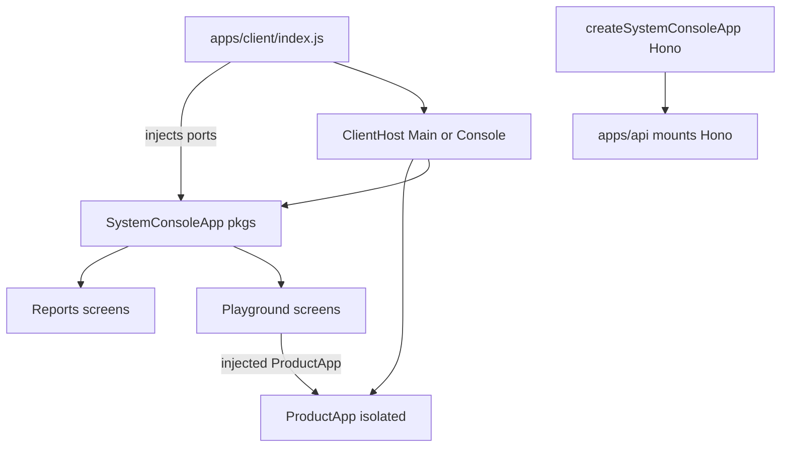

# Combine console + playground in pkgs, inject through ports

## Target shape



Two host tabs only: **Main | Console**. Playground is not a peer app — it is more screens inside the console.

`@pkgs/system-console` stays in **pkgs**. It never imports `@apps/*`, `@libs/*`, or `@test/*`. Product App, actor seams, and in-process/live API boot are **injected ports**.

Delete [`test/system-playground/`](test/system-playground/) (Expo entry, Metro, polyfill). No `apps → test` exception.

## 1. Ports in pkgs (the only coupling)

[`pkgs/system-console/src/shared/ports.ts`](pkgs/system-console/src/shared/ports.ts) — interfaces only, pkgs-legal types (`Io`, React component types, opaque `resources`):

```ts
export type EmbeddedProductAppProps<R = unknown> = {
  readonly io: Io
  readonly resources: R
  readonly embedded: true
}

export type PlaygroundActor<R = unknown> = {
  readonly id: string
  readonly io: Io
  readonly resources: R
}

export type PlaygroundSession<R = unknown> = {
  readonly actors: { readonly alice: PlaygroundActor<R>; readonly bob: PlaygroundActor<R> }
  dispose(): Promise<void>
}

export type SystemConsolePorts<R = unknown> = {
  readonly ProductApp: ComponentType<EmbeddedProductAppProps<R>>
  readonly bootPlayground: () => Promise<PlaygroundSession<R>>
}
```

`SystemConsoleApp` takes `ports: SystemConsolePorts`. No silent wall fallbacks; missing boot → playground screens show an empty/error state.

Writer/report APIs stay as they are (ObjectStore + Hono). The RN UI uses injected `Io.http` against the mounted console Hono.

## 2. Console screens (reports + playground)

Internal console nav (not host tabs), using `@pkgs/ui` + in-memory nav:

- **Reports** — existing runs / suite / test player (today’s SPA)
- **Playground** — two phone frames (Alice / Bob) mounting `ports.ProductApp` with `embedded`
- **Playground session** — boot/dispose status, actor ids, API target (thin status screen so playground is more than one view)

Reuse the existing console header/tab-bar pattern, rewritten to `Box`/`Text`/`Pressable` + `sx`.

## 3. `@pkgs/system-console` — library only (RN + Hono)

**Delete entry / DOM SPA:** `scripts/dev-server.ts`, `kill-dev.ts`, `ports.ts`, `src/web/index.html`, `src/web/main.tsx`, `src/build-web.ts`, `dev`/`build`/`kill`, root `system:console`. Drop `react-dom`. Add `@pkgs/ui` + `react-native`. Remove the `pkgs/system-console/` exemption in [`tools/scripts/check-no-rn-style-api.ts`](tools/scripts/check-no-rn-style-api.ts).

**Server → Hono:** `createSystemConsoleApp(options): Hono` from today’s [`api-routes.ts`](pkgs/system-console/src/server/api-routes.ts) (health, SSE, prune, delete run, frame data). No SPA `distStore`. Mount on [`apps/api/src/app/create-app.ts`](apps/api/src/app/create-app.ts) at `/system-console`.

**Client → `src/client/`:** convert `src/web/**` to RN + `sx`. History/document out; parse/serialize nav helpers stay. HTML preview web-only; sqlite-wasm web-only. Bare `fetch` / `EventSource` → `io.http`.

Exports:

- `.` — writer / types (unchanged for [`test/ui/src/setup/open-sim.ts`](test/ui/src/setup/open-sim.ts))
- `./client` — `SystemConsoleApp` + ports types
- `./server` — Hono factory

## 4. Injected playground boot (stays out of pkgs)

pkgs cannot import `@apps/api` / `@apps/room` / `@test/ui`. The **implementation** of `bootPlayground` lives in the client composition root.

[`apps/client`](apps/client) already talks to a live API (`bun run dev`). Default boot:

- Two isolated actor seams (move [`createActorClientSeams`](test/ui/src/setup/sim-actor-overrides.ts) usage to a client-side helper, or call an equivalent that already lives next to `ClientSystemResources`)
- Separate Expo SQLite DBs (`sim_alice` / `sim_bob`)
- `io.http` pointed at the configured API URL

That needs **no** `@apps/api` / `@apps/room` imports (avoids apps-not-apps). It is two embedded product Apps against the running API, which is the right fit once playground is a console screen inside the main Expo client.

Do **not** move `bootPlaygroundWorld` / `createPlaygroundProvide` (in-process `createWorld` + `apiResource` + `roomResource`) into pkgs — those imports are illegal in pkgs. DST Jest keeps its own in-process World via `@test/ui`.

## 5. `@apps/client` host — Main vs Console

Isolate today’s [`apps/client/src/app.tsx`](apps/client/src/app.tsx) to [`apps/client/src/product/app.tsx`](apps/client/src/product/app.tsx). Export `@apps/client/product`. Update [`test/ui/src/setup/product-impls.ts`](test/ui/src/setup/product-impls.ts).

```ts
// apps/client/src/host/hosted-sub-app.ts
export type HostedSubApp = {
  readonly id: string
  readonly title: string
  readonly App: ComponentType
}
```

Composition root ([`apps/client/index.js`](apps/client/index.js) + `compose-sub-apps.ts`):

```ts
const ports: SystemConsolePorts<ClientSystemResources> = {
  ProductApp,
  bootPlayground: () => bootTwoActorSessions({ ProductApp seams... }),
}

return [
  { id: 'main', title: 'Main', App: ProductApp },
  { id: 'console', title: 'Console', App: () => <SystemConsoleApp ports={ports} /> },
]
```

Host depends only on `HostedSubApp[]`. Console depends only on `SystemConsolePorts`. No circular package edge: pkgs never imports client; client imports pkgs.

## 6. Delete `@test/system-playground`

Remove the package, Expo configs, Metro shims, README, root tsconfig path `@test/system-playground/*`. No Metro shim merge unless the two-actor Expo SQLite boot still needs node stubs — if boot only uses `expo-sqlite` + HTTP, shims are unnecessary.

## 7. Remove first-party React-DOM (not Expo’s peer)

Keep `react-dom` on `@apps/client` / catalog for `react-native-web`. Remove first-party usage:

- Console `createRoot` (deleted with `main.tsx`)
- [`libs/spaces/.../space-open-rooms-entries-notify.test.tsx`](libs/spaces/src/client/room/space-open-rooms-entries-notify.test.tsx) → RNTL; drop `react-dom` from `@libs/spaces`
- Drop unused `react-dom` from `@pkgs/room-widgets`

## Out of scope

- Not moving ProductApp into pkgs/libs (it composes `@libs/*`)
- Not relocating in-process `createWorld` + api/room into pkgs
- Not rewriting `@test/ui` DST beyond pointing at `@apps/client/product`
