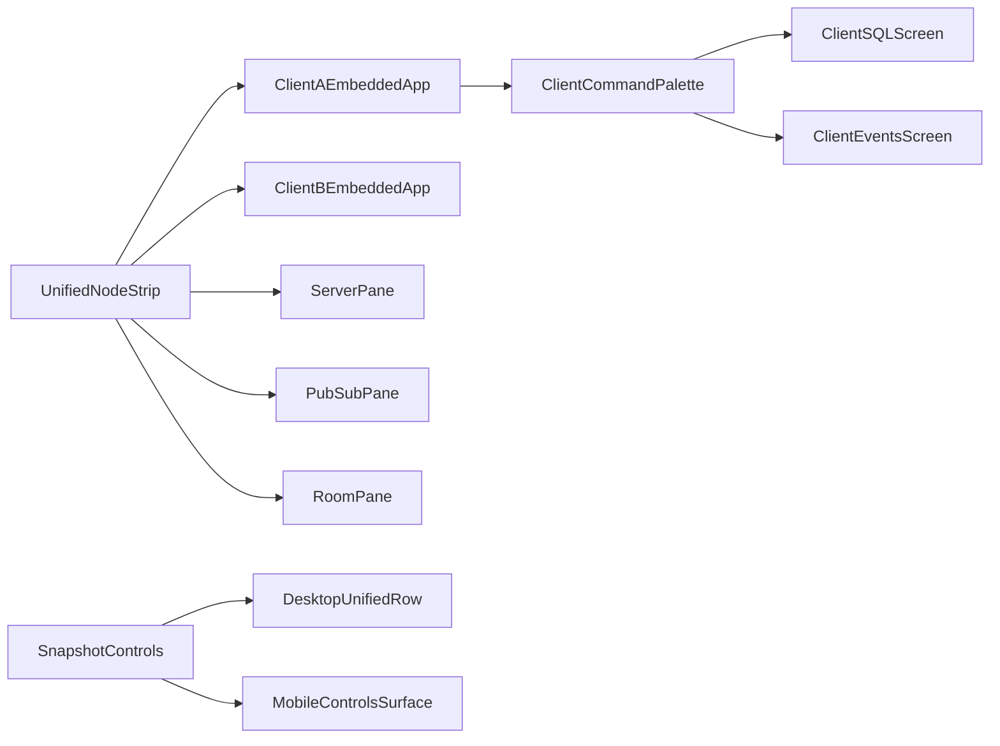

# Compress playground chrome

## Scope and behavior
- Remove the nested `Client views` tab strip from [`pkgs/sim-console/src/client/playground/playground-panel.tsx`](pkgs/sim-console/src/client/playground/playground-panel.tsx). Client UI remains the default embedded app screen; SQL and Events become dedicated client-app routes rather than debugger tabs.
- Add non-tab client routes in [`apps/client/src/routes/route-table.ts`](apps/client/src/routes/route-table.ts), following the existing lazy route-stub pattern. Register “Go to SQL” and “Go to Events” in [`apps/client/src/shell/commands/app-commands.tsx`](apps/client/src/shell/commands/app-commands.tsx), so the client app can navigate to them through its own command palette.
- Provide the route screens with the existing client-local data/UI ports instead of retaining debugger-only tabs. The embedded `MemoryRouter` in [`apps/client/src/shell/create-client.tsx`](apps/client/src/shell/create-client.tsx) keeps navigation isolated per simulated client.
- Replace the separate kind and client-instance chrome with one unified strip representing dynamic client instances plus `Server`, `PubSub`, and `Room` entries. Use the existing instance builders in [`pkgs/sim-console/src/client/debugger-chrome.ts`](pkgs/sim-console/src/client/debugger-chrome.ts) and session data from [`pkgs/sim-console/src/client/playground/playground-kind-pane.tsx`](pkgs/sim-console/src/client/playground/playground-kind-pane.tsx), while preserving the existing console navigation codec in [`apps/product/src/console/console-nav/console-nav.ts`](apps/product/src/console/console-nav/console-nav.ts).
- Rename the Events node label to `PubSub` in [`pkgs/sim-console/src/shared/sim-node.ts`](pkgs/sim-console/src/shared/sim-node.ts), while retaining the internal `events` kind/address for compatibility with current state and persistence.
- Keep the snapshot selector/actions on the unified Playground row via `kindTrailing` in [`pkgs/sim-console/src/client/playground/playground-screen.tsx`](pkgs/sim-console/src/client/playground/playground-screen.tsx). On compact screens, replace the full action group with a single controls icon that opens a responsive surface containing the snapshot selector/actions and client-layout controls; adjust [`pkgs/sim-console/src/client/debugger/debugger-shell.tsx`](pkgs/sim-console/src/client/debugger/debugger-shell.tsx) so the compact trailing content does not consume a separate permanent row.

## Navigation/state details
- Remove client `ui/db/events` pane entries from the client-facing debugger view model and update `resolvePlaygroundPane`, `viewsForKind`, and URL codec tests so client route navigation is no longer encoded as `cv=<client>:<view>`.
- Keep server, PubSub, and Room-specific debugger views available through their existing mechanisms unless they are covered by the unified-node-strip implementation; do not broaden the requested client-app route migration unnecessarily.
- Ensure selecting a client instance activates that client’s embedded app route, and that command-palette navigation to SQL/Events works in both normal and embedded client contexts.

## Verification
- Extend [`apps/product/src/console/console-nav/console-nav.test.ts`](apps/product/src/console/console-nav/console-nav.test.ts) for unified node selection and removal of client pane-tab state.
- Extend [`pkgs/sim-console/src/client/debugger/sim-console-layout.test.ts`](pkgs/sim-console/src/client/debugger/sim-console-layout.test.ts) for compact controls/overflow behavior.
- Add black-box tests for the new client routes/command registrations and for the unified strip, using the repository’s existing package test conventions.
- Run focused typechecks/tests for `@apps/client`, `@apps/product`, `@pkgs/sim-console`, and `@pkgs/ui`, then run the relevant lint checks.

