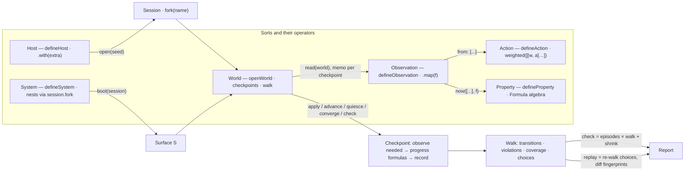

# DST redesign: an algebra of singular primitives

## Why

The current `@pkgs/dst` has the right seed but hard-codes non-primitives and lacks two primitives:

- **Topology is baked in.** `node` / `knob` / `nodes` / `edges` / `faults` / `ctx.peers` / `nodeIds(role)` are one way to build a multi-node system; single-node consumers carry them as dead weight.
- **Fidelity is not a framework concept.** `openWorld` mints virtual ports + model network itself; `sim`/`max` lives only in [sim/test/src/setup/open-sim.ts](sim/test/src/setup/open-sim.ts).
- **There is no named observation of state.** Properties are `check(surface) => boolean` doing ad-hoc live reads, so there is no recorded state sequence for temporal formulas, no `before → action → after` trace, no coverage, no replay divergence check. Bombadil solves this with `extract` cells: small, named, JSON-valued reads against the live system that are the only thing formulas see.
- **Properties are locked inside PBT.** Scripted sim tests assert one thing at the end; the invariants encoded in `properties<S>()` never run against the ~150 scripted sync / room / product scenarios.
- **Catalogs are plural records; surfaces leak the kernel; the API is wide and stale.** WeakMap runtime bags, `@deprecated` aliases, 25-member `WorldControls`, README documents a deleted API, `pkgs/dst/CONTEXT.md` missing.

## The algebra

Six sorts. Each has exactly one constructor (`defineX`) or is produced by a verb, and each has closed composition operators. Nothing else is public.



- **Host** (fidelity). `defineHost({ caps, open })`. Operator `host.with(session => extra)` adds ports (sql, ui, http). Laws: `h.with(f).with(g) ≡ h.with(s => ({ ...f(s), ...g(s) }))`; `h.with(() => ({})) ≡ h`.
- **Session** (opened Host). Kernel (`Clock`, `Scheduler`, `Rng`) + derived (`Timers`, `Network`, `Trace?`) + `caps`. Operator `session.fork(name)`: child Rng stream + network address `name`, shared scheduler / network / trace. Laws: forks are independent streams; adding a fork never perturbs siblings; deterministic per seed.
- **System** (recipe). `defineSystem({ id, knobs?, boot(session, knobs) → S, converge? })`. Composes by nesting: `boot` may call another System's `boot` on `session.fork(name)`.
- **Observation** (a named read of live state). `defineObservation({ id, read(world: World<S>) → Promise<T> })`, `T` JSON. Reads the real surface — a `SELECT count(*)`, one actor's screen name, one client's pending count — never a whole-state dump. Operator `observation.map(f) → Observation<S, U>` (pure, derived). Laws: memoised per checkpoint (one read per id per step however many formulas reference it); only observations referenced by attached properties or by the action being generated run at all; `o.map(f).map(g) ≡ o.map(g ∘ f)`. The observed values at a checkpoint are the recorded state, so `fingerprint`, transitions, coverage and replay divergence work on exactly the slice that was needed — Bombadil's `State` captured per step, with observations as the cells.
- **Action** (stimulus). `defineAction({ id, weight?, requires?, from: [o1, o2], generate(v1, v2) → Arbitrary<P> | null, apply(world, p) })`. `null` = not enabled in this state. Operator `weighted([[w, a], …]) → Action`. Laws: associative up to weight normalisation; `weighted([[1, a]]) ≡ a`; disabled leaves vanish. Observation and Action are duals: one looks at the world, the other acts on it.
- **Property** (observations over time). `defineProperty({ id, requires?, formula })`. `Formula<S>` algebra: `now(o | [o…], (…values) => boolean | Formula)`, `next(f)`, `always(f)`, `eventually(f)`, `sometimes(f)`, `not(f)`; methods `.and`, `.or`, `.implies`, `.within(ms)`. Laws: LTL progression `always(f) ≡ f ∧ next(always(f))`, `eventually(f) ≡ f ∨ next(eventually(f))`; at episode end pending `eventually` = violation, unmet `sometimes` across the campaign = vacuity failure.
- **World** (opened System, with properties attached). Every state-changing control is a **checkpoint**: `apply(action, payload?)`, `advance(ms)`, `quiesce()`, `converge()`, and explicit `check()`. A checkpoint runs the observations the attached properties need, progresses every formula, records a transition into `world.walk`, and throws `PropertyViolation` (default) or collects it. This is what makes properties a force multiplier: a scripted sync test, a `@sim/test` chess flow, a random walk and a replay are all just different ways of choosing actions; the properties are checked identically in all of them.
- **Verbs**. `openWorld(system, { host, seed, knobs?, properties? })`, `walk(world, { actions, … }) → Walk`, `check(system, …) → Report`, `replay(system, repro | walk, …) → Report`. `check ≡ shrink ∘ episodes ∘ (walk ∘ openWorld)`; `replay(walk(w)) ≡ walk(w)` up to fingerprints of observed state.

## Naming scheme (enforced by an export-snapshot contract test)

- **`defineX({ … }) → X`**, singular, one per sort: `defineHost`, `defineSystem`, `defineObservation`, `defineAction`, `defineProperty`. Every one takes one object with an `id` (except Host) and returns the noun type.
- **Bare lowercase operators and verbs**: `weighted`, `now`, `next`, `always`, `eventually`, `sometimes`, `not`, `openWorld`, `walk`, `check`, `replay`, `parseRepro`, `stringifyRepro`.
- **`std.<sort>.<name>`** for ready-made values: `std.host.virtual()`, `std.host.wall()`, `std.action.network()`, `std.action.time()`, and in `@pkgs/ui-testing/explore`: observations `std.ui.inventory()`, `std.ui.screen()`, `std.ui.errors()`; actions `std.ui.tap()`, `std.ui.type()`, `std.ui.back()`, `std.ui.scroll()`; properties `std.ui.noErrorBoundary()`, `std.ui.noConsoleError()`.
- **Bound spec constructors**: `System` exposes `defineObservation` / `defineAction` / `defineProperty` with `S` fixed; specs destructure them once (`const { defineObservation, defineAction, defineProperty } = kv`) and write no type arguments. The bare exports remain for library code generic over `S`.
- **Noun types only**: `Host`, `Session`, `System`, `World`, `Observation`, `Action`, `Property`, `Formula`, `Walk`, `Report`, `Repro`, `Capability`, `CapabilityError`, `PropertyViolation`, `Ports`, `Clock`, `Scheduler`, `Rng`. No plurals, no `Extractor` / `Cell`, no `*Def`, `*Catalog`, `*Extension`, `*Kit`, `*Controls`, `Base`, `Unbound*`, `Node*`, `Knob*`.

## Public API (the whole thing)

### `@pkgs/dst`

```ts
// kernel interfaces (impls in @pkgs/dst/kernel; hosts pick them)
type Clock = { now(): number }
type Scheduler = { schedule(task, atMs?): Disposable; advance(ms): Promise<void>; quiesce(): Promise<void>; virtual: boolean }
type Rng = { next(): number; fork(name: string): Rng }
type Ports = { clock; timers; rng; createId(); random(); network: Endpoint }
type Session<P extends Ports = Ports> = { ports: P; scheduler; network: Network; trace?: Trace; caps: ReadonlySet<Capability>; fork(name): Session<P>; dispose() }
type Capability = 'virtualTime' | 'partition' | 'trace'

// constructors — one per sort
defineHost<P>({ caps, open(seed): Promise<Session<P>> })                                                     → Host<P>
defineSystem<S, K = {}>({ id, knobs?: fc.Arbitrary<K>, boot(session, knobs): Promise<S>, converge?(world) })  → System<S, K>     // S inferred from boot
defineObservation<S, T extends JsonValue>({ id, read(world: World<S>): Promise<T> })                          → Observation<S, T>
defineAction<S, O extends Observation<S>[], P>({ id, weight?, requires?, from: O, generate(...values: ValuesOf<O>): fc.Arbitrary<P> | null, apply(world: World<S>, p: P) }) → Action<S>
defineProperty<S>({ id, requires?, formula: Formula<S> })                                                      → Property<S>

// System carries the three spec constructors pre-bound to its S — the same functions, S fixed:
type System<S, K> = { id; knobs; boot; converge?; defineObservation: <T>(def) => Observation<S, T>; defineAction: <O, P>(def) => Action<S>; defineProperty: (def) => Property<S> }
// Spec code:     const { defineObservation, defineAction, defineProperty } = kv;   // zero type annotations after this line
// Library code:  bare defineObservation<S> / defineAction<S> / defineProperty<S> for values generic over S (std.action.*, std.ui.*)
// Unification:   openWorld(kv, { properties }) / check(kv, { properties, actions }) require Property<S> / Action<S> for kv's S — mixing systems is a compile error.

// operators
Host.with<Q>(extra: (s: Session<P>) => Q)                                       → Host<P & Q>
Session.fork(name)                                                              → Session<P>
Observation.map<U>(f: (t: T) => U)                                              → Observation<S, U>
weighted<S>(branches: readonly [number, Action<S>][])                           → Action<S>
now<S, O>(from: O, f: (...values: ValuesOf<O>) => boolean | Formula<S>)         → Formula<S>
next(f) / always(f) / eventually(f) / sometimes(f) / not(f)                     → Formula<S>
Formula.and(f) / .or(f) / .implies(f) / .within(ms)                            → Formula<S>

// std
std.host.virtual({ network?: NetworkFaults, startTime? })    // caps: virtualTime, partition, trace
std.host.wall({ network: 'model' | 'none', settleMs? })       // caps: partition iff 'model'
std.action.network({ groups: Observation<S, string[][]> })   // partition / heal / healAll; requires ['partition']
std.action.time({ maxMs? })                                  // advance; requires ['virtualTime']

// instances
type World<S> = {
  seed, knobs, caps, session, surface: S, walk: Walk,
  observe<T>(o: Observation<S, T>): Promise<T>,                       // memoised within the current checkpoint
  apply(action, payload?), advance(ms), quiesce(), converge(), check(),   // checkpoints
  now(), waitUntil(pred, { withinMs }), never(pred, { forMs }), dispose(), [Symbol.asyncDispose]
}
type Walk = { transitions: readonly { t; before: Record<observationId, JsonValue>; action: { id; payload }; after: Record<observationId, JsonValue> }[]; violations: readonly { property; at; witness }[]; coverage: { states; actions: Record<string, number>; sometimes: Record<string, number> }; choices }

// verbs
openWorld(system, { host, seed, knobs?, properties?: readonly Property<S>[], onViolation?: 'throw' | 'collect' }) → World<S>
walk(world, { actions: readonly Action<S>[], steps? | budgetMs?, settle?, stopOnViolation? })                  → Walk
parseRepro / stringifyRepro                                                                                    // Repro v3: { seed, knobs, choices, meta: { system, host } }
```

Removed: `defineScenario`, `node`, `knob`, `nodeCount`, `extend`, `nodes`, `edges`, `faults`, whole-state `observe(world) → O` on the system, `actions<S>()`, `properties<S>()`, `property.*` namespace, `std.network` / `std.time` bags, `WorldPorts`, `createWorldPorts`, `applyActions`, `STEP_MS`, `bindActionKind`, `Base`, `ScenarioDef`, `NodeDef`, `CountedNodeDef`, `NodeEntry`, `KnobDef`, `ActionCatalog`, `UnboundActionDef`, `PropertyCatalog`, `PropertyDef`, `WorldControls`, `world.ports`, `world.nodes`, `world.nodeIds`, `world.partition`, `world.heal*`, `world.hold`, `world.release*`, `world.network*`, `world.edges`, `world.startTime`, `world.resolve`, `world.propertyCoverage`.

### `@pkgs/dst/kernel` — host authors and `sim/console` only

`createVirtualClock`, `createVirtualScheduler`, `createWallClock`, `createWallScheduler`, `createRng`, `createTimers`, `createNetwork` (+ `Network`, `Endpoint`, `NetworkFaults`, `RELIABLE_NETWORK`), `createTrace` (+ `Trace`), `fingerprint`, `canonicalJsonStringify`. Depcruise: only `pkgs/dst/**`, `sim/**`, `**/sim/**` may import it.

### `@pkgs/dst/pbt`

```ts
check(system, { host?, properties, actions, knobs?, episodes?, steps?, shrink?, swarm?, budgetMs?, stopOnViolation? }) → Report   // throws CheckFailedError
replay(system, repro | walk | readonly repro[], { host?, properties, actions })                                          → Report   // re-walk; diffs fingerprint(observed) per step; trace gate when caps has trace
arbSeed(), runProperty(name, property, params?)
```

### `@pkgs/ui-testing/explore` — Bombadil browser defaults for our drivers

```ts
Driver.inventory(): Promise<Inventory>                                   // fingerprinted pressables, inputs, back-able navigation
std.ui.inventory(actor) / std.ui.screen(actor) / std.ui.errors(actor)   → Observation<S, …>   // actor: (world) => Driver | null
std.ui.tap(actor) / std.ui.type(actor) / std.ui.back(actor) / std.ui.scroll(actor)   → Action<S>   // from: [std.ui.inventory(actor)]
std.ui.noErrorBoundary(actor) / std.ui.noConsoleError(actor)             → Property<S>           // always(now(std.ui.errors(actor), e => e.length === 0))
```

## A complete spec

```ts
const kv = defineSystem({
  id: 'kv',
  knobs: fc.record({ clients: fc.integer({ min: 1, max: 4 }) }),
  boot: async (session, { clients }) => {
    const server = startServer(session.fork('server'));
    return { server, clients: range(clients).map(i => startClient(session.fork(`client:${i}`), 'server')) };
  },
});
const { defineObservation, defineAction, defineProperty } = kv;   // constructors bound to this system's surface type; no <S> anywhere below

// observations: small, targeted reads of the live system
const clientIds  = defineObservation({ id: 'clientIds',  read: async ({ surface }) => surface.clients.map(c => c.id) });
const pending    = defineObservation({ id: 'pending',    read: async ({ surface }) => surface.clients.map(c => c.pending()) });
const serverHash = defineObservation({ id: 'serverHash', read: async ({ surface }) => surface.server.hash() });          // SELECT md5(...) — not a dump
const clientHash = defineObservation({ id: 'clientHash', read: async ({ surface }) => Promise.all(surface.clients.map(c => c.hash())) });
const quiet      = pending.map(p => p.every(n => n === 0));                                                            // Observation<Kv, boolean>

const put = defineAction({            // `apply` receives World<Kv>
  id: 'put',
  from: [clientIds],
  generate: ids => ids.length === 0 ? null : fc.record({ client: fc.constantFrom(...ids), key: fc.string(), value: fc.string() }),
  apply: ({ surface }, { client, key, value }) => surface.clients.find(c => c.id === client)!.put(key, value),
});
const faults = weighted([
  [3, std.action.network({ groups: clientIds.map(ids => [['server'], ids.map(id => `client:${id}`)]) })],
  [1, std.action.time({ maxMs: 5_000 })],
]);

const converges = defineProperty({
  id: 'converges',
  formula: always(now(quiet, q => q).implies(now([serverHash, clientHash], (s, cs) => cs.every(c => c === s)))),
});
const writesHappen = defineProperty({ id: 'writesHappen', formula: sometimes(now(serverHash, h => h !== EMPTY_HASH)) });
const KV_PROPERTIES = [converges, writesHappen];

// 1. scripted test — properties checked at every checkpoint
await using world = await openWorld(kv, { host: std.host.virtual(), seed: 7, properties: KV_PROPERTIES });
await world.apply(put, { client: 'client:0', key: 'a', value: '1' });
await world.session.network.partition(['server'], ['client:0']);
await world.apply(put, { client: 'client:0', key: 'a', value: '2' });
await world.session.network.healAll();
await world.converge();                                     // throws PropertyViolation if `converges` fails
expect(await world.observe(serverHash)).toBe(await world.observe(clientHash).then(h => h[0]));

// 2. exploration
await check(kv, { properties: KV_PROPERTIES, actions: [put, faults], episodes: 50, steps: 40 });

// 3. same system, wall host, headless walk + replay
await using wall = await openWorld(kv, { host: std.host.wall({ network: 'model' }), seed: 7, properties: KV_PROPERTIES, onViolation: 'collect' });
const run = await walk(wall, { actions: [put, faults], budgetMs: 10_000 });
await replay(kv, run, { host: std.host.wall({ network: 'model' }), properties: KV_PROPERTIES, actions: [put, faults] });
```

## A second spec: SQL observations, SQL actions (sync-engine shape)

Observations are queries — aggregates and hashes, never row dumps. Actions are writes through the real write path (`mutate`) or a server-side SQL write that must publish. Handles come from today's `SimClientHandle` (`db: SqlClient`, `mutate`) and `SimServer`.

```ts
const sync = defineSystem({
  id: 'sync',
  knobs: fc.record({ clients: fc.integer({ min: 1, max: 3 }) }),
  boot: async (session, { clients }) => {
    const server = await startSyncServer(session.fork('server'));                       // Postgres (pglite / embedded) via session.ports.sql
    const clientList = await Promise.all(range(clients).map(i => startSyncClient(session.fork(`client:${i}`), server)));   // local SQLite each
    return { server, clients: clientList };
  },
});
const { defineObservation, defineAction, defineProperty } = sync;

// --- observations: SQL against the live databases ------------------------------------------------
const clientIds   = defineObservation({ id: 'clientIds',   read: async ({ surface }) => surface.clients.map(c => c.id) });
const pending     = defineObservation({ id: 'pending',     read: async ({ surface }) =>
  Promise.all(surface.clients.map(c => c.db.query<{ n: number }>(sql`select count(*) as n from sync_engine_mutations where uploaded_at is null`).then(r => r[0].n))) });
const serverNotes = defineObservation({ id: 'serverNotes', read: async ({ surface }) =>
  surface.server.db.query<{ h: string; n: number }>(sql`select md5(string_agg(id || ':' || coalesce(body,'') || ':' || coalesce(deleted_at::text,''), ',' order by id)) as h, count(*) as n from notes`).then(r => r[0]) });
const clientNotes = defineObservation({ id: 'clientNotes', read: async ({ surface }) =>
  Promise.all(surface.clients.map(c => c.db.query<{ h: string; n: number }>(sql`select hex(md5(group_concat(id || ':' || coalesce(body,'') || ':' || coalesce(deleted_at,''), ','))) as h, count(*) as n from (select * from notes order by id)`).then(r => r[0]))) });
const liveNoteIds = defineObservation({ id: 'liveNoteIds', read: async ({ surface }) =>
  surface.server.db.query<{ id: string }>(sql`select id from notes where deleted_at is null order by id limit 50`).then(r => r.map(x => x.id)) });
const quiet       = pending.map(p => p.every(n => n === 0));

// --- actions: writes through the real paths ------------------------------------------------------
const createNote = defineAction({
  id: 'createNote',
  from: [clientIds],
  generate: ids => ids.length === 0 ? null : fc.record({ client: fc.constantFrom(...ids), body: fc.string({ maxLength: 20 }) }),
  apply: async ({ surface, session }, { client, body }) =>
    surface.clients.find(c => c.id === client)!.mutate(createNoteMutation, { id: session.ports.createId(), body }),
});
const editNote = defineAction({
  id: 'editNote',
  from: [clientIds, liveNoteIds],
  generate: (ids, notes) => ids.length === 0 || notes.length === 0 ? null
    : fc.record({ client: fc.constantFrom(...ids), id: fc.constantFrom(...notes), body: fc.string({ maxLength: 20 }) }),
  apply: async ({ surface }, { client, id, body }) => surface.clients.find(c => c.id === client)!.mutate(editNoteMutation, { id, body }),
});
const deleteNote = defineAction({
  id: 'deleteNote',
  from: [clientIds, liveNoteIds],
  generate: (ids, notes) => ids.length === 0 || notes.length === 0 ? null : fc.record({ client: fc.constantFrom(...ids), id: fc.constantFrom(...notes) }),
  apply: async ({ surface }, { client, id }) => surface.clients.find(c => c.id === client)!.mutate(deleteNoteMutation, { id }),   // soft delete
});
const serverEdit = defineAction({                    // server-initiated write: raw SQL in one tx + notifyChannels (the rule the sim must enforce)
  id: 'serverEdit',
  from: [liveNoteIds],
  generate: notes => notes.length === 0 ? null : fc.record({ id: fc.constantFrom(...notes), body: fc.string({ maxLength: 20 }) }),
  apply: async ({ surface, session }, { id, body }) => surface.server.db.transaction(async tx => {
    await tx.run(sql`update notes set body = ${body}, updated_at = ${session.ports.clock.now()} where id = ${id}`);
    await notifyChannels(tx, ['notes']);
  }),
});
const faults = weighted([
  [2, std.action.network({ groups: clientIds.map(ids => [['server'], ids.map(id => `client:${id}`)]) })],
  [1, std.action.time({ maxMs: 30_000 })],
]);

// --- properties: formulas over the SQL observations ----------------------------------------------
const converges = defineProperty({
  id: 'converges',
  formula: always(now(quiet, q => q).implies(now([serverNotes, clientNotes], (s, cs) => cs.every(c => c.h === s.h && c.n === s.n)))),
});
const eventuallyConverges = defineProperty({          // liveness with a bound: once writes stop, everyone matches within 10s of virtual time
  id: 'eventuallyConverges',
  formula: always(eventually(now(quiet, q => q).and(now([serverNotes, clientNotes], (s, cs) => cs.every(c => c.h === s.h)))).within(10_000)),
});
const noHardDelete = defineProperty({                 // row counts never shrink anywhere: deletes are tombstones
  id: 'noHardDelete',
  formula: always(now([serverNotes, clientNotes], (s, cs) => next(now([serverNotes, clientNotes], (s2, cs2) => s2.n >= s.n && cs2.every((c, i) => c.n >= cs[i].n))))),
});
const editsReachClients = defineProperty({ id: 'editsReachClients', formula: sometimes(now([serverNotes, clientNotes], (s, cs) => s.n > 0 && cs.some(c => c.h === s.h))) });
export const SYNC_PROPERTIES = [converges, eventuallyConverges, noHardDelete, editsReachClients];

// scripted sim test — same checkpoints, same properties
await using w = await openWorld(sync, { host: std.host.virtual(), seed: 3, knobs: { clients: 2 }, properties: SYNC_PROPERTIES });
await w.apply(createNote, { client: 'client:0', body: 'a' });
await w.session.network.partition(['server'], ['client:1']);
await w.apply(serverEdit, { id: (await w.observe(liveNoteIds))[0], body: 'b' });
await w.session.network.healAll();
await w.converge();
expect((await w.observe(clientNotes))[1].h).toBe((await w.observe(serverNotes)).h);

// exploration
await check(sync, { properties: SYNC_PROPERTIES, actions: [createNote, editNote, deleteNote, serverEdit, faults], episodes: 100, steps: 60 });
```

Only the observations referenced by `SYNC_PROPERTIES` run at a checkpoint (`pending`, `serverNotes`, `clientNotes` — four aggregate queries for two clients); `liveNoteIds` runs only when `walk` is generating an action that lists it in `from`.

## A third spec: an HTML counter app driven through the DOM (Bombadil's counter, in this algebra)

A static page with `#count`, `#increment`, `#decrement`. No network, no virtual time; a real browser, so the host is wall + Playwright. Observations read the DOM; actions click it; the state-machine property is Bombadil's counter example written with `now` / `next`.

```ts
const browserHost = std.host.wall({ network: 'none' }).with(async () => ({ ui: await playwrightDrivers({ headless: true }) }));   // caps: none of virtualTime / partition / trace

const counter = defineSystem({
  id: 'counter',
  boot: async session => {
    const web  = await serveStatic(session.fork('web'), { root: 'fixtures/counter' });     // @pkgs/static-file-server on a loopback port
    const page = await session.ports.ui.open(`${web.origin}/index.html`);                  // Driver for this page
    return { page, origin: web.origin };
  },
});
const { defineObservation, defineAction, defineProperty } = counter;
const actor = (w: World<{ page: Driver }>) => w.surface.page;   // adapter for std.ui.*; structural, so the resulting Observation/Action/Property attach to any surface with a `page`

// --- observations: DOM reads --------------------------------------------------------------------
const count  = defineObservation({ id: 'count',  read: async ({ surface }) => Number(await surface.page.text('#count')) });
const title  = defineObservation({ id: 'title',  read: async ({ surface }) => surface.page.title() });
const errors = std.ui.errors(actor);                                                      // uncaught exceptions + console.error since last checkpoint
const inventory = std.ui.inventory(actor);                                                // fingerprinted clickables / inputs — only runs when std.ui.tap is generating

// --- actions: DOM interactions ------------------------------------------------------------------
const increment = defineAction({ id: 'increment', from: [], generate: () => fc.constant(null), apply: ({ surface }) => surface.page.click('#increment') });
const decrement = defineAction({ id: 'decrement', from: [], generate: () => fc.constant(null), apply: ({ surface }) => surface.page.click('#decrement') });
const reload    = defineAction({ id: 'reload',    from: [], generate: () => fc.constant(null), apply: ({ surface }) => surface.page.reload() });
const anyClick  = std.ui.tap(actor);                                                      // Bombadil `clicks`: pick any clickable from `inventory`
const typing    = std.ui.type(actor);                                                     // Bombadil `inputs`: disabled here (no inputs) — generate returns null

// --- properties ---------------------------------------------------------------------------------
const unchanged = now(count, c => next(now(count, n => n === c)));
const up        = now(count, c => next(now(count, n => n === c + 1)));
const down      = now(count, c => next(now(count, n => n === c - 1)));
const stateMachine = defineProperty({ id: 'stateMachine', formula: always(unchanged.or(up).or(down)) });   // no jumps; `reload` violates this unless the app persists
const nonNegative  = defineProperty({ id: 'nonNegative',  formula: always(now(count, c => c >= 0)) });
const hasTitle     = defineProperty({ id: 'hasTitle',     formula: always(now(title, t => t !== '')) });
const noErrors     = std.ui.noConsoleError(actor);                                        // always(now(errors, e => e.length === 0))
const getsBusy     = defineProperty({ id: 'getsBusy',     formula: sometimes(now(count, c => c > 5)) });
const COUNTER_PROPERTIES = [stateMachine, nonNegative, hasTitle, noErrors, getsBusy];

// scripted
await using w = await openWorld(counter, { host: browserHost, seed: 1, properties: COUNTER_PROPERTIES });
await w.apply(increment);
await w.apply(increment);
await w.apply(decrement);
expect(await w.observe(count)).toBe(1);

// exploration on a real browser: `check` is refused (no virtualTime / trace) — use `walk` + `replay`
await using x = await openWorld(counter, { host: browserHost, seed: 42, properties: COUNTER_PROPERTIES, onViolation: 'collect' });
const run = await walk(x, { actions: [weighted([[5, increment], [5, decrement], [1, reload], [2, anyClick], [1, typing]]), std.action.time()], budgetMs: 60_000 });
//   std.action.time is dropped by `requires: ['virtualTime']`; `typing` is dropped because `generate` returns null (no inputs)
expect(run.violations).toEqual([]);
await replay(counter, run, { host: browserHost, properties: COUNTER_PROPERTIES, actions: [increment, decrement, reload, anyClick, typing] });   // diffs `count`/`title`/`errors` fingerprints per step
```

Same algebra, different sort instances: the "network" is a static file server, the "surface" is one Playwright page, and the only property that needs anything beyond `now` is the state machine. The same spec runs on `std.host.virtual().with(jsdom)` if a jsdom `Driver` is added later, at which point `check` with shrinking becomes available with no spec change.

The product spec is the same shape: `simHost = std.host.virtual().with(s => ({ sql: pglite(s), ui: rntl(s), http: hono(s) }))`; observations `std.ui.screen(actorA)`, `std.ui.inventory(actorA)`, `std.ui.errors(actorA)` plus domain ones like `defineObservation({ id: 'spaceMembers', read: w => w.session.ports.sql.query('select count(*) …') })`; `openSim` attaches `PRODUCT_PROPERTIES` so every existing chess / auth / spaces scenario checks `std.ui.noErrorBoundary(actorA)` and domain invariants on every `actor.tap` that goes through `world.apply(std.ui.tap(actorA), { fingerprint })`.

## The checkpoint and the explore loop

```
checkpoint(world, action?):
  before = observe(needed(attached properties) ∪ needed(action))     // memoised per id; nothing else is read
  progress every attached formula with `before`; record violations (throw unless collecting)
  if action: await action.apply(world, payload); await settle(world)
  after = observe(needed(attached properties))
  world.walk.transitions.push({ t, before, action, after }); coverage.states += fingerprint(after) unseen

walk(world, { actions }):
  loop until steps / budget / stopOnViolation:
    leaves = flatten(actions).filter(a => caps ⊇ a.requires)
    enabled = leaves.map(a => [a, a.generate(...observe(a.from))]).filter(gen != null)   // only these observations run
    pick (a, payload) by weight via session.ports.rng
    checkpoint(world, { a, payload })
```

Headless and headful differ only in which observations, actions and properties are in the lists.

## Design rules

1. **Observations are the only way state reaches formulas and generators.** Small, named, JSON, memoised per checkpoint, run on demand. No whole-state snapshot; `world.surface` is for `apply` and `read`.
2. **Properties attach to the World, not to a verb.** Every checkpoint checks them; scripted tests, sim drivers, walks and replays share the same step.
3. **Singular everything.** One `defineX` per sort; lists are the only aggregate; `weighted` is the only Action combinator; `map` is the only Observation combinator; Formula connectives are the only Property combinators.
4. **Surface is domain-only by construction.** `World` keeps `surface` and `session` separate.
5. **No runtime bags.** `bindSyncRuntime` / `bindRoomRuntime` deleted; `boot` returns handles.
6. **Capabilities, not fidelity strings.** `requires` filters leaves in `walk`; `advance` on a wall scheduler is a real wait; `partition` without the capability throws `CapabilityError`.
7. **Knobs are an arbitrary.** `check` samples `system.knobs`; `openWorld` derives from `seed` when omitted.
8. **Hierarchical determinism via `session.fork`.** Names are network addresses; systems nest by forking.
9. **`checkpoint` is the only step; `walk` is the only loop.** `apply`, `check`, `replay` compose them.
10. **The export list is a test.** `public-api.contract.test.ts` snapshots `@pkgs/dst`, `@pkgs/dst/pbt`, `@pkgs/dst/kernel`, `@pkgs/ui-testing/explore`.

## Package layout after

```
pkgs/dst/src/
  index.ts        define* + operators + std + types + openWorld + walk + repro (≈28 exports)
  kernel/         clock.ts, scheduler.ts (virtual + wall), rng.ts, timers.ts, network.ts, trace.ts, fingerprint.ts, json.ts → @pkgs/dst/kernel
  host/           host.ts (Host/Session/Capability/CapabilityError), define-host.ts, std-host.ts
  system/         define-system.ts, define-observation.ts, define-action.ts, weighted.ts, define-property.ts, formula.ts (progression), std-action.ts, repro.ts
  world/          open-world.ts, checkpoint.ts (observation memo + progress + record), controls.ts, walk.ts
  pbt/            check.ts, shrink.ts, replay.ts, arbs.ts, run-property.ts
  test/acme-kv/   the spec above, as fixture + contract tests
pkgs/ui-testing/src/explore/   inventory.ts (Driver.inventory), std-ui.ts
```

## Migration (all in one change)

Codemod-able: `defineScenario` → `defineSystem`; `extend:` → `boot` return; `node({ start })` → function called in `boot` with `session.fork(name)`; `knob(d, arb)` → entry in `knobs: fc.record({...})`; each key of `actions<S>()({ k: { generate(ctx), apply(surface, p) } })` → `defineAction({ id: 'k', from: [...], generate(...values), apply(world, p) })` with the reads `generate` did on `ctx.surface` turned into observations; each key of `properties<S>()({ k: property.always(check) })` → `defineProperty({ id: 'k', formula: always(now([...], f)) })` with `check`'s reads turned into observations; `world.<surfaceKey>` → `world.surface.<key>`; `world.ports.X` → `world.session.ports.X`; `world.partition(a, b)` → `world.session.network.partition(a, b)`; `std.network()` / `std.time()` → `std.action.network()` / `std.action.time()`; `runExamples` / `assertDeterministic` → `replay`.

- **acme-kv**: the spec above.
- **sync-engine** ([define-sync-system.ts](pkgs/sync-engine/src/sim/scenario/define-sync-system.ts), `system.ts`, `node-kinds.ts`, `world-boot*.ts`): `defineSyncSystem(opts)` returns `defineSystem(...)`; `sync-observations.ts` = `clientIds`, `pending`, `online`, `serverHash`, `clientHash`, `invariantViolations` (today's `checkInvariants` as a query returning `string[]`); `sync-actions.ts` one `defineAction` per stimulus (`mutate`, `addClient`, `crash`, `reconnect`); `sync-properties.ts` one `defineProperty` per invariant, exported as `SYNC_PROPERTIES`. Every sim test opens with `properties: SYNC_PROPERTIES` — the ~126 scripted scenarios become invariant monitors. WeakMap runtime + aliases deleted.
- **room** ([define-room-system.ts](pkgs/room/src/sim/scenario/define-room-system.ts), `world.ts`): observations `serverHash`, `clientState(id)`, `connected`; `ROOM_PROPERTIES` attached in sim tests; `RoomSurface` keeps `clients`, `server`, crash/restart; drops kernel fields. Chess inherits.
- **matchmaking**: kit reads `session` in `boot`; drop `openMatchmakingWorld`.
- **auth / db-schema / db-indexes / sql-client**: single-boot systems, small observations; existing PBT properties become `defineProperty` values.
- **@sim/test**: replace [open-sim.ts](sim/test/src/setup/open-sim.ts) with `sim/test/src/host/{sim-host,max-host}.ts` built with `.with`; `defineProductSystem` → `defineSystem`; `openSim(testId, ctx)` attaches `PRODUCT_PROPERTIES` and returns the World; driver helpers (`chess-flows.ts` etc.) go through `world.apply(std.ui.tap(actor), …)` so each interaction is a checkpoint; add `product-walk.sim.test.tsx` (`walk` with `std.ui.*` + `std.action.network`, `steps: 40`) on both tiers; `topology-partition.sim.test.tsx` uses `requires` / `world.caps`.
- **@pkgs/ui-testing**: add `inventory()` to the `Driver` contract (RNTL from the host tree; Playwright from the DOM; same fingerprint shape: `testId`, `role`, `accessibleName`, `text`, `structuralPath`), plus `explore/std-ui.ts`.
- **sim/console**: `createSim` takes a `Session`; Reports get a transitions view over `Walk` (observed state before / action / after) — the Bombadil `inspect` analog on the existing reporting UI.
- **Repro fixtures**: v3 `{ seed, knobs, choices, meta: { system, host } }`; parse rejects v<3.

## Docs and guards

- Rewrite [pkgs/dst/README.md](pkgs/dst/README.md): algebra table (sort · constructor · operator · laws), the checkpoint / explore loop, the full spec above; add `pkgs/dst/CONTEXT.md`.
- Update [DETERMINISM.md](DETERMINISM.md), AGENTS.md DST paragraph (`node` / `knob` / `command` / `defineScenario` / `runScenario` / `runPins` / `createWorldPorts` → `defineSystem` / `session.fork` / `defineObservation` / `defineAction` / `defineProperty` / `walk` / `check` / `replay` / `std.host.virtual`), [sim/test/src/setup/TESTING.md](sim/test/src/setup/TESTING.md).
- Depcruise: only `pkgs/dst/**`, `sim/**`, `**/sim/**` may import `@pkgs/dst/kernel`.
- Contract tests: `types` (tsd-style: a spec written with `const { defineObservation, defineAction, defineProperty } = kv` needs no type arguments; a `Property<RoomSurface>` passed to `openWorld(kvSystem, …)` is a compile error), `observation` (memo per checkpoint, laziness — unreferenced observations never run, `map` laws), `formula` (progression incl. `next`, `within`, end-of-trace, `sometimes`), `weighted` (laws), `checkpoint` (throw vs collect, transitions recorded from scripted `apply`), `walk` (enablement, weights, coverage, stopOnViolation), `fork`, `knobs-from-seed`, `wall-host`, `capability`, `public-api`; `apply-commands.contract.test.ts` folds into `checkpoint.contract.test.ts`.

## Verification

- `bun run --filter @pkgs/dst tc && bun test pkgs/dst`; `bun test pkgs/ui-testing`.
- Per consumer: `PBT_SAMPLE_RUNS=1 bun test <pkg>/…pbt.test.ts` + `*.sim.test.ts` (now with properties attached).
- `bun run --filter @sim/test test` (sim) and `test:max` including `product-walk.sim.test.tsx`.
- `rg` for every removed name returns nothing outside git history.
- `bun run lint` (grit + depcruise) and `bun check`.

## Out of scope (follow-ups)

Novelty-guided selection (weight by unseen `fingerprint(after)`), resource-leak sliding-window formula over an observation, process-fate std action, long-running CI walks on `maxHost` — all new `Observation` / `Action` / `Formula` values or a `walk` option; no API change.
