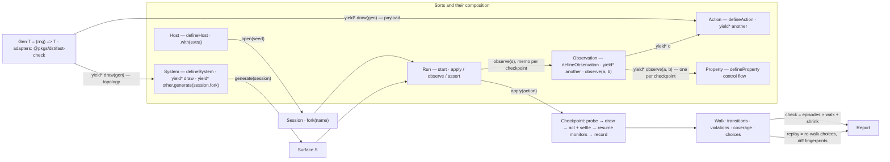

# DST redesign: an algebra of singular primitives, one body protocol

## Why

The current `@pkgs/dst` has the right seed but hard-codes non-primitives and lacks two primitives:

- **Topology is baked in.** `node` / `knob` / `nodes` / `edges` / `faults` / `ctx.peers` / `nodeIds(role)` are one way to build a multi-node system; single-node consumers carry them as dead weight.
- **Fidelity is not a framework concept.** `openWorld` mints virtual ports + model network itself; `sim`/`max` lives only in [product/test/src/setup/open-sim.ts](product/test/src/setup/open-sim.ts).
- **There is no named observation of state.** Properties are `check(surface) => boolean` doing ad-hoc live reads, so there is no recorded state sequence, no `before → action → after` trace, no coverage, no replay divergence check. Bombadil solves this with `extract` cells: small, named, JSON-valued reads against the live system that are the only thing properties see.
- **Properties are locked inside PBT.** Scripted sim tests assert one thing at the end; the invariants encoded in `properties<S>()` never run against the ~150 scripted sync / room / product scenarios.
- **Catalogs are plural records; surfaces leak the kernel; the API is wide and stale.** WeakMap runtime bags, `@deprecated` aliases, 25-member `WorldControls`, README documents a deleted API, `pkgs/dst/CONTEXT.md` missing.

## The algebra

Six sorts. Each has exactly one constructor (`defineX`) or is produced by a verb. System, Observation, Action and Property bodies are **generators** (sync or async — the driver accepts both) that speak one protocol with three requests — read an Observation, `draw` from a `Gen`, yield a function to act — plus `yield*` for composition, so control flow is plain TypeScript (`if`, `for`, `try / finally`) and the framework still sees every read (memo), every draw (repro / shrink) and every act (settle, enablement). Two plain function types carry the rest: `Gen<T>` (randomness) and `Act<S>` (what an action yields). Nothing else is public, and no third-party PBT library appears in any signature.



- **Host** (fidelity). `defineHost({ caps, open })`. Operator `host.with(session => extra)` adds ports (sql, ui, http). Laws: `h.with(f).with(g) ≡ h.with(s => ({ ...f(s), ...g(s) }))`; `h.with(() => ({})) ≡ h`.
- **Session** (opened Host). Kernel (`Clock`, `Scheduler`, `Rng`) + derived (`Timers`, `Network`, `Trace?`) + `caps`. Operator `session.fork(name)`: child Rng stream + network address `name`, shared scheduler / network / trace. Laws: forks are independent streams; adding a fork never perturbs siblings; deterministic per seed.
- **System** (recipe). `defineSystem({ name, *generate(session) { … return surface } })`. One body: it **draws** its knobs (`const clients = yield* draw(gen(fc.integer(…)))`), boots nodes on `session.fork(name)`, and returns `S`. A system is thus a generator of surfaces: different draws, different topologies — and because the draws are recorded, `check` shrinks the topology like any payload and `start(sys, { draws: [2] })` pins it. Systems nest by `yield* other.generate(session.fork(name))`. `S` is what observations read and actions act on; a `generate` that wants fault actions puts `session` on `S`.
- **Observation** (a named read of live state). `defineObservation({ name, observe(s) })` — `observe` may be a sync function, an async function, a generator or an async generator. A leaf reads the real surface (`observe: s => s.server.hash()` — a `SELECT md5(...)`, one actor's screen name, one client's pending count — never a whole-state dump); a composed observation is a generator that reads other observations with `yield*` and never touches `s`. `observe(a, b, …)` (the bare function) is the tuple observation: one request, one checkpoint. Laws: memoised per checkpoint (one read per name per step however many bodies ask); only observations some body asked for run at all; an observation is a pure function of the checkpoint. The observed values at a checkpoint are the recorded state, so `fingerprint`, transitions, coverage and replay divergence work on exactly the slice that was needed — Bombadil's `State` captured per step, with observations as the cells.
- **Gen** (randomness). `type Gen<T> = (rng: Rng) => T` — a deterministic function of draws from the session's `Rng` (`next(): number` in [0, 1), `fork(name)`). It is the only randomness interface the framework knows, and `draw(gen)` is the only way a body uses it — for a system's knobs and an action's payload alike. Composition is function composition; a library is a `Gen` factory behind an adapter (`gen(fcArbitrary)` in `@pkgs/dst/fast-check`; a `@pkgs/dst/<lib>` adapter for any other). Laws: same draws ⇒ same value; `gen(fc.constant(x)) ≡ () => x`. Because every `rng.next()` a `Gen` makes is recorded, shrinking is done by the framework over the draw sequence (Hypothesis-style internal shrinking) and re-running the `Gen`s — adapted libraries' own shrinkers are never used, so nothing is lost by adapting.
- **Action** (stimulus). `defineAction({ name, *generate() { … } })`. The body reads (`yield* o`), decides (`if (…) return`), draws (`yield* draw(gen)`), acts (`yield s => s.put(k, v)` or `yield { weight, act: s => … }`) and delegates (`yield* otherAction`). **Enablement is the probe rule**: the framework runs the body until its first act; if the body `return`s first, the action is not enabled at this checkpoint. That one rule covers data conditions (`if (ids.length === 0) return`), screen conditions (`if ((yield* route) !== 'home') return`) and host conditions alike — a fault action reads a spec-defined `caps` observation over `s.session.caps` and returns when the host cannot do what it needs, so there is no `requires` field and no fidelity branch anywhere. **Weight is what the first act says.** `yield { weight: c > 50 ? 8 : 2, act }` makes the pick probability a function of the state the body just observed — a Markov chain whose transition weights the spec computes, instead of a constant on the definition; a bare function is weight 1, `weight: 0` is another way to say "not enabled", and only the first act's weight is read (later acts, including those reached through delegation, are simply performed), so a macro inherits the weight of its first step. Because the weight is known only at the act, the probe drives through any draws before it on a per-probe rng fork; the chosen probe's draws become the step's `Choice`, the others are discarded. Each yielded act is awaited against the surface and followed by `session.settle()` before the body resumes, so a body may act, read the result, and act again. `yield* action` runs that action's body in place (its reads, draws and acts); if the inner is not enabled, neither is the outer — so macro actions (`openReset` then `confirmReset`) and "pick one of" actions (`const a = yield* draw(oneOf(…)); yield* a`) are ordinary bodies. A screen's actions vanish when the screen is not shown, so a flat list gives per-screen mixes with no tree combinator. Scripted `run.apply(a, ...draws)` answers the body's draws positionally, ignores weights, and throws `ActionNotEnabled` if the body returns before acting or yields `weight: 0`. Observation and Action are duals: one looks at the surface, the other acts on it — and only through `yield`, so the framework is always between them.
- **Property** (a monitor over checkpoints). `defineProperty({ name, *watch() { for (;;) { … } } })`. Each `yield*` in a `watch` body is answered at the **next checkpoint** — one `yield*` = one step, so several values at one checkpoint are read with `observe(a, b, …)`; carrying state across iterations gives `next` (keep the previous values), bounded liveness (read a clock observation), and model-based checks (an in-memory model beside the system) with no algebra. Throwing is the violation. Laws: a throw while the monitor is being resumed at a checkpoint is a **safety violation** at that step (`PropertyViolation`, fails the run); a throw while the framework is **closing** monitors (`return()` at dispose / episode end, i.e. from `finally`) is an **unmet obligation** (end-of-trace) — how `sometimes` / coverage is written; `check` fails the campaign only when an obligation is unmet in every episode.
- **Run** (opened System, with properties attached). Three methods, one per sort it touches: `apply(action, ...draws)`, `observe(observation)`, `assert(property)`. `apply` is the only **checkpoint**: probe the action (throw `ActionNotEnabled`), finish its body (draws from the session rng unless supplied — recorded as a `Choice`; acts + settle), resume every attached monitor with the observations it asked for (fresh reads, memoised), record the transition, throw `PropertyViolation`. `observe` is a memoised read at the current checkpoint — the scripted test's `expect` input. `assert` runs a property's `watch` for exactly one checkpoint (the current one) and closes it: any property doubles as a point assertion. Time, network, crashes and convergence are not methods: they are actions (`passTime`, `partition`, `heal`, `restart`) over `s.session`, applied like any other. `[Symbol.asyncDispose]` closes the attached monitors, so a scripted test's obligations are checked at `await using` scope end. This is what makes properties a force multiplier: a scripted sync test, a `@product/test` chess flow, a random walk and a replay are all just different sequences of `apply`; the monitors are resumed identically in all of them.
- **Verbs**. `start(system, { host, seed, draws?, properties? })`, `walk(run, { actions, … }) → Walk`, `check(system, …) → Report`, `replay(system, repro | walk, …) → Report`. `check ≡ shrink ∘ episodes ∘ (close ∘ walk ∘ start)`; `replay(walk(r)) ≡ walk(r)` up to fingerprints of observed state.

## Naming scheme (enforced by an export-snapshot contract test)

- **`defineX({ name, … }) → X`**, singular, one per sort: `defineHost`, `defineSystem`, `defineObservation`, `defineAction`, `defineProperty`. Every one takes one object with a `name` (except Host) and returns the noun type. `name` is the id everywhere (memo keys, coverage keys, `Choice.action`, transitions).
- **Body fields are verbs named for what the sort does**: a System and an Action `generate` (a surface; effects), an Observation `observe`s, a Property `watch`es. All are generators (sync or async); `observe` may also be a plain sync or async function, because a leaf read has nothing to yield.
- **Bare lowercase requests and verbs**: `observe`, `draw`, `start`, `walk`, `check`, `replay`, `parseRepro`, `stringifyRepro`. There is no `now` / `always` / `eventually` / `sometimes` / `next` / `not`: those are `if`, `for (;;)`, a clock read, `finally`, the previous iteration's values, and `!`. There is no `weighted` combinator and no `weight` field: composition of actions is `yield*`, choice is `if` / `draw`, mix is the `weight` a body puts on its first act.
- **Ready-made values are bare exports, owned by the package whose every use case would otherwise write them.** No `std` namespace. `@pkgs/dst` ships exactly two: `virtualHost()` — the default `host` for `start` / `check`, so most specs never name a host — and `wallHost()`. Fault actions are not framework values: `partition` / `heal` / `passTime` are four-line `defineAction`s over `s.session.network` / `s.session.scheduler`, guarded by the spec's own `caps` observation, written by the spec that wants them (the counter spec has none). `@pkgs/ui-testing/explore` ships what every UI spec needs and nothing else: observations `inventory(actor)`, `screen(actor)`, `errors(actor)`; actions `tap(actor)`, `fill(actor)`, `back(actor)`, `scroll(actor)`; properties `noErrorBoundary(actor)`, `noConsoleError(actor)`.
- **Bound spec constructors**: `System` exposes `defineObservation` / `defineAction` / `defineProperty` with `S` fixed; specs destructure them once (`const { defineObservation, defineAction, defineProperty } = kv`) and write no type arguments — `observe(s)` gets `s: S`, a yielded `s => …` is contextually typed as `Act<S>`, `yield* o` returns `o`'s `T`. The bare exports remain for library code generic over `S`.
- **Library adapters**: one entrypoint per library, named after it, exporting a lowercase constructor into our type and one back: `@pkgs/dst/fast-check` → `gen(arbitrary): Gen<T>`, `arbitrary(gen): fc.Arbitrary<T>`. The core entrypoints never import a PBT library.
- **Noun types only**: `Host`, `Session`, `System`, `Run`, `Observation`, `Action`, `Property`, `Effect`, `Act`, `Draw`, `Gen`, `Walk`, `Report`, `Repro`, `Choice`, `Capability`, `CapabilityError`, `PropertyViolation`, `ActionNotEnabled`, `Ports`, `Clock`, `Scheduler`, `Rng`. No plurals, no `Extractor` / `Cell` / `Formula` / `Arbitrary` / `Sut` / `World` / `Knobs`, no `*Def`, `*Catalog`, `*Extension`, `*Kit`, `*Controls`, `Base`, `Unbound*`, `Node*`, `Knob*`.

## Public API (the whole thing)

### `@pkgs/dst`

```ts
// kernel interfaces (impls in @pkgs/dst/kernel; hosts pick them)
type Clock = { now(): number }
type Scheduler = { schedule(task, atMs?): Disposable; advance(ms): Promise<void>; settle(): Promise<void>; virtual: boolean }   // settle: drain ready events without moving time
type Rng = { next(): number; fork(name: string): Rng }                     // next(): uniform in [0, 1). The one draw primitive.
type Gen<T> = (rng: Rng) => T                                              // randomness: a deterministic function of draws. No library type anywhere below.
type Ports = { clock; timers; rng; createId(); random(); network: Endpoint }
type Session<P extends Ports = Ports> = { ports: P; scheduler; network: Network; trace?: Trace; caps: ReadonlySet<Capability>; fork(name): Session<P>; dispose() }
type Capability = 'virtualTime' | 'partition' | 'trace'

// the body protocol — what a generator may yield
type Act<S> = ((s: S) => unknown) | { weight: number; act: (s: S) => unknown }   // act: awaited against the surface, then session.settle(); bare fn = weight 1; the first act's weight is the pick weight, 0 = not enabled
type Draw<P>                                                               // draw(gen): yield* returns P; every rng.next() is recorded
type Effect<S> = Observation<S, unknown> | Draw<unknown> | Act<S> | Action<S>   // Action: yield* delegates to its body
type Body<S, R> = Generator<Effect<S>, R, any> | AsyncGenerator<Effect<S>, R, any>
observe<S, O extends Observation<S, unknown>[]>(...o: O)                                → Observation<S, ValuesOf<O>>   // tuple read: one request, one checkpoint
draw<P>(g: Gen<P>)                                                                       → Draw<P>
// Observation<S, T>, Draw<P> and Action<S> are iterable (a one-shot generator yielding the request and returning the answer), so `const v = yield* o` is typed T and `yield* action` is typed void.

// constructors — one per sort
defineHost<P>({ caps, open(seed): Promise<Session<P>> })                                                  → Host<P>
defineSystem<S>({ name, generate(session): Body<never, S> })                                              → System<S>         // yields Draws only; S inferred from the return
defineObservation<S, T extends JsonValue>({ name, observe(s: S): T | Promise<T> | Body<S, T> })           → Observation<S, T> // a generator body may yield Observations only
defineAction<S>({ name, generate(): Body<S, void> })                                                      → Action<S>         // yields Observations, Draws, Acts, Actions; return before the first Act (or first Act with weight 0) = not enabled
defineProperty<S>({ name, watch(): Body<S, void> })                                                       → Property<S>       // yields Observations only; each yield* is answered at the next checkpoint; throw = violation

// System carries the three spec constructors pre-bound to its S — the same functions, S fixed:
type System<S> = { name; generate; defineObservation: <T>(def) => Observation<S, T>; defineAction: (def) => Action<S>; defineProperty: (def) => Property<S> }
// Spec code:     const { defineObservation, defineAction, defineProperty } = kv;   // zero type annotations after this line
// Library code:  bare defineObservation<S> / defineAction<S> / defineProperty<S> for values generic over S (@pkgs/ui-testing/explore)
// Unification:   start(kv, { properties }) / check(kv, { properties, actions }) require Property<S> / Action<S> for kv's S — mixing systems is a compile error.

// operators
Host.with<Q>(extra: (s: Session<P>) => Q)                                       → Host<P & Q>
Session.fork(name)                                                              → Session<P>

// hosts — the only ready-made values
virtualHost({ network?: NetworkFaults, startTime? })         // caps: virtualTime, partition, trace. The default host.
wallHost({ network: 'model' | 'none', settleMs? })           // caps: partition iff 'model'

// instances
type Run<S> = {                                                            // what tests receive: three methods, one per sort
  apply(action: Action<S>, ...draws: readonly unknown[]): Promise<void>,   // the checkpoint; draws answer the body's `draw`s in order, generated from the session rng when omitted (recorded as a Choice)
  observe<T>(o: Observation<S, T>): Promise<T>,                            // memoised at the current checkpoint
  assert(p: Property<S>): Promise<void>,                                   // run the watch for this one checkpoint, then close it; throws PropertyViolation
  [Symbol.asyncDispose](): Promise<void>,                                  // closes attached monitors: unmet obligations throw here
}
type Choice = { action: string; draws: readonly number[] }                 // one step: which action, and every rng.next() its draws consumed
type Walk = { system: readonly number[]; transitions: readonly { t; before: Record<name, JsonValue>; action: { name; payload: readonly JsonValue[] }; after: Record<name, JsonValue> }[]; violations: readonly { property; at; error }[]; coverage: { states; actions: Record<name, number> }; choices: readonly Choice[] }

// verbs
start(system, { seed, host?, draws?: readonly unknown[], properties?: readonly Property<S>[] })  → Run<S>   // host defaults to virtualHost(); `draws` answer the system's generate positionally (pinned topology); then checkpoint 0 (monitors' first reads)
walk(run, { actions: readonly Action<S>[], steps? | budgetMs?, stopOnViolation? })              → Walk     // in-trace violations collected into Walk (stopOnViolation ends the walk early instead of throwing)
parseRepro / stringifyRepro                                                                       // Repro v3: { seed, system: draws, choices, meta: { system, host } }
```

### `@pkgs/dst/fast-check` — the only module that imports `fast-check`

```ts
gen<T>(arbitrary: fc.Arbitrary<T>): Gen<T>          // rng => arbitrary.generate(new fc.Random(randomGeneratorOver(rng)), undefined).value
arbitrary<T>(g: Gen<T>): fc.Arbitrary<T>            // for code that still runs fc.assert / @pkgs/pbt with our generators; no shrink (shrinking is ours)
```

`randomGeneratorOver(rng)` is a pure-rand `RandomGenerator` (`clone`, `next`, `unsafeNext` → int32 from `rng.next()`), so every value fast-check produces is a function of recorded draws and replays / shrinks exactly like a hand-written `Gen`. fast-check's shrinkers are ignored by construction. Any other library gets the same shape of adapter in its own entrypoint; the core never grows a dependency for it.

Removed: `defineScenario`, `node`, `knob`, `knobs`, `boot`, `nodeCount`, `extend`, `nodes`, `edges`, `faults`, `id` (→ `name`), whole-state `observe(world) → O` on the system, `actions<S>()`, `properties<S>()`, `property.*` namespace, the whole `std` namespace, `weighted`, the static `weight` field (weight is now what a body yields on its first act), `requires`, the `Formula` algebra (`now` / `next` / `always` / `eventually` / `sometimes` / `not` / `.and` / `.or` / `.implies` / `.within`), `Observation.map`, action fields `when` / `from` / `generate(...values)` / `apply`, `Sut`, `World` / `openWorld` / `WorldControls` and every World member except what `Run` keeps (`world.ports`, `world.nodes`, `world.nodeIds`, `world.partition`, `world.heal*`, `world.hold`, `world.release*`, `world.network*`, `world.edges`, `world.startTime`, `world.resolve`, `world.propertyCoverage`, `world.advance`, `world.quiesce`, `world.converge`, `world.check`, `world.now`, `world.waitUntil`, `world.never`, `world.session`, `world.surface`, `world.walk`, `world.dispose`), `System.converge`, `openWorld({ onViolation })`, `WorldPorts`, `createWorldPorts`, `applyActions`, `STEP_MS`, `bindActionKind`, `Base`, `ScenarioDef`, `NodeDef`, `CountedNodeDef`, `NodeEntry`, `KnobDef`, `ActionCatalog`, `UnboundActionDef`, `PropertyCatalog`, `PropertyDef`; every `fc.Arbitrary` in a signature, `arbSeed`, `arbKnobs`, `runProperty`, `arbs.ts`, and the `@pkgs/pbt` dependency of `@pkgs/dst`.

### `@pkgs/dst/kernel` — host authors and `product/console` only

`createVirtualClock`, `createVirtualScheduler`, `createWallClock`, `createWallScheduler`, `createRng`, `createTimers`, `createNetwork` (+ `Network`, `Endpoint`, `NetworkFaults`, `RELIABLE_NETWORK`), `createTrace` (+ `Trace`), `fingerprint`, `canonicalJsonStringify`. Depcruise: only `pkgs/dst/**`, `sim/**`, `**/sim/**` may import it.

### `@pkgs/dst/pbt`

```ts
check(system, { host?, properties, actions, seed?, draws?, episodes?, steps?, shrink?, swarm?, budgetMs?, stopOnViolation? }) → Report   // throws CheckFailedError
replay(system, repro | walk | readonly repro[], { host?, properties, actions })                                                → Report   // re-walk; diffs fingerprint(observed) per step; trace gate when caps has trace
```

`check` owns episodes and shrinking natively: the campaign `seed` (default from `PBT_SEED` / wall entropy at the test entry) forks one `Rng` per episode; the system's `generate` draws (topology) come from that episode rng unless `draws` pins them; each step's action pick and payload draws are recorded as `Choice`s. An episode = `start` + `walk` + close monitors. A safety violation fails the episode and is shrunk: (1) delta-debug over steps (drop blocks of `Choice`s), then (2) per-draw minimisation toward 0 (binary search on each draw — the system's draws first, so a failure found with four clients is retried with one), re-running the affected `Gen` on the shrunk draws and re-walking — the same replaying `Rng` `replay` uses. An obligation unmet at close is recorded per property; `check` fails with `Vacuity` when a property's obligation was unmet in every episode (no shrink — there is no witness to minimise). Smaller topologies, fewer steps and smaller payloads fall out of one mechanism for every library or hand-written `Gen`.

### `@pkgs/ui-testing/explore` — Bombadil browser defaults for our drivers

```ts
Driver.inventory(): Promise<Inventory>                                   // fingerprinted pressables, inputs, back-able navigation
inventory(actor) / screen(actor) / errors(actor)            → Observation<S, …>   // actor: (s: S) => Driver | null
tap(actor) / fill(actor) / back(actor) / scroll(actor)      → Action<S>           // *generate() { const inv = yield* inventory(actor); if (!inv.pressables.length) return; const t = yield* draw(oneOf(inv.pressables)); yield s => actor(s)!.tap(t); }
noErrorBoundary(actor) / noConsoleError(actor)              → Property<S>         // *watch() { for (;;) if ((yield* errors(actor)).length) throw new Error(...) }
```

## A complete spec

Specs are free to use fast-check for generation through the `gen` adapter; the framework only ever sees `Gen<T>`.

```ts
import fc from 'fast-check';
import { gen } from '@pkgs/dst/fast-check';

// a system is a generator of surfaces: it draws its knobs, boots on forked sessions, returns S
const kv = defineSystem({ name: 'kv', *generate(session) {
  const clients = yield* draw(gen(fc.integer({ min: 1, max: 4 })));      // a knob is a draw — recorded, shrunk, pinnable
  const server = startServer(session.fork('server'));
  return { session, server, clients: range(clients).map(i => startClient(session.fork(`client:${i}`), 'server')) };   // `session` on S so fault actions can reach network / scheduler
}});
const { defineObservation, defineAction, defineProperty } = kv;   // constructors bound to this system's surface type; no <S> anywhere below

// observations: leaves are plain functions on the surface; composed ones are generators over other observations
const clientIds  = defineObservation({ name: 'clientIds',  observe: s => s.clients.map(c => c.id) });
const pending    = defineObservation({ name: 'pending',    observe: s => s.clients.map(c => c.pending()) });
const serverHash = defineObservation({ name: 'serverHash', observe: s => s.server.hash() });                         // async; SELECT md5(...) — not a dump
const clientHash = defineObservation({ name: 'clientHash', observe: s => Promise.all(s.clients.map(c => c.hash())) });
const quiet      = defineObservation({ name: 'quiet',      *observe() { return (yield* pending).every(n => n === 0); } });
const converged  = defineObservation({ name: 'converged',  *observe() { const [h, cs] = yield* observe(serverHash, clientHash); return cs.every(c => c === h); } });
const caps        = defineObservation({ name: 'caps',        observe: s => [...s.session.caps] });                      // what the host can do — ordinary state, read like any other
const partitioned = defineObservation({ name: 'partitioned', observe: s => s.session.network.partitions() });          // current cuts — the fault actions weigh themselves by it

// actions: read → decide → draw → act. `return` before the first act means "not enabled here"; the first act's `weight` is the pick weight (bare fn = 1).
const put = defineAction({ name: 'put', *generate() {
  const ids = yield* clientIds;
  if (ids.length === 0) return;
  const { client, key, value } = yield* draw(gen(fc.record({ client: fc.constantFrom(...ids), key: fc.string(), value: fc.string() })));
  yield { weight: 3, act: s => s.clients.find(c => c.id === client)!.put(key, value) };   // writes dominate the mix
}});
const restartAny = defineAction({ name: 'restartAny', *generate() {
  const ids = yield* clientIds;
  if (ids.length === 0) return;
  const id = yield* draw(rng => ids[Math.floor(rng.next() * ids.length)]!);        // hand-written Gen — no library at all
  yield s => s.clients.find(c => c.id === id)!.restart();
}});
// faults are ordinary actions over the session's network and clock — nothing built in; the host's capabilities gate them with the same `return` as any other condition
const partition = defineAction({ name: 'partition', *generate() {
  const [c, ids, cut] = yield* observe(caps, clientIds, partitioned);
  if (!c.includes('partition') || ids.length === 0) return;
  const id = yield* draw(rng => ids[Math.floor(rng.next() * ids.length)]!);
  yield { weight: cut.length === 0 ? 2 : 1, act: s => s.session.network.partition(['server'], [`client:${id}`]) };   // state-dependent: eager to cut a healthy network, gentler once it is already split
}});
const heal = defineAction({ name: 'heal', *generate() {
  const [c, cut] = yield* observe(caps, partitioned);
  if (!c.includes('partition')) return;
  yield { weight: cut.length, act: s => s.session.network.healAll() };            // weight 0 when nothing is cut = not enabled; more cuts, likelier to heal
}});
const passTime = defineAction({ name: 'passTime', *generate() {
  const [c, p] = yield* observe(caps, pending);
  if (!c.includes('virtualTime')) return;
  const ms = yield* draw(rng => Math.floor(rng.next() * 5_000));
  yield { weight: 1 + p.reduce((a, b) => a + b, 0), act: s => s.session.scheduler.advance(ms) };   // the more is in flight, the likelier time moves
}});
const outage = defineAction({ name: 'outage', *generate() { yield* partition; yield* passTime; yield* heal; } });   // a macro: delegation runs each body in place; if `partition` is not enabled, neither is `outage`; `outage` inherits `partition`'s weight (the first act)
const KV_ACTIONS = [put, restartAny, partition, heal, passTime, outage];   // a set, not a distribution: at each checkpoint the walk picks by the weights the enabled bodies yielded

// properties: monitors. One `yield*` per checkpoint; throw = violation.
const converges = defineProperty({ name: 'converges', *watch() {                    // always(quiet ⇒ converged)
  for (;;) {
    const [q, ok, h, cs] = yield* observe(quiet, converged, serverHash, clientHash);
    if (q && !ok) throw new Error(`quiet but diverged: server ${h}, clients ${cs.join(',')}`);
  }
}});
const agree = defineProperty({ name: 'agree', *watch() {                            // not attached (false mid-partition); used as a point assertion via run.assert
  for (;;) if (!(yield* converged)) throw new Error('clients disagree with the server');
}});
const writesHappen = defineProperty({ name: 'writesHappen', *watch() {              // sometimes(serverHash ≠ empty): an obligation, checked when monitors close
  let seen = false;
  try { for (;;) seen ||= (yield* serverHash) !== EMPTY_HASH; }
  finally { if (!seen) throw new Error('no write ever reached the server'); }
}});
const KV_PROPERTIES = [converges, writesHappen];

// 1. scripted test — three verbs; monitors resumed at every apply; host defaults to virtualHost(); `draws: [2]` pins two clients
await using run = await start(kv, { seed: 7, draws: [2], properties: KV_PROPERTIES });
await run.apply(put, { client: 'client:0', key: 'a', value: '1' });     // the argument answers the body's `draw`
await run.apply(partition, 'client:0');
await run.apply(put, { client: 'client:0', key: 'a', value: '2' });
await run.apply(heal);
await run.apply(passTime, 5_000);                                       // let retries fire; `converges` is re-checked here like at every apply
await run.assert(agree);                                                // point check: every client matches the server now
expect(await run.observe(quiet)).toBe(true);                            // ad-hoc expectation: read and compare
await run.apply(put);                                                   // no draws supplied: drawn from the session rng (deterministic per seed)
await run.apply(outage, 'client:1', 2_000);                             // a macro's draws are answered in order across its delegates
// scope end: monitors close → writesHappen's `finally` runs (satisfied here)

// 2. exploration — topology drawn per episode and shrunk with everything else
await check(kv, { properties: KV_PROPERTIES, actions: KV_ACTIONS, episodes: 50, steps: 40 });

// 3. same system, wall host, headless walk + replay
await using wall = await start(kv, { host: wallHost({ network: 'model' }), seed: 7, properties: KV_PROPERTIES });
const w = await walk(wall, { actions: KV_ACTIONS, budgetMs: 10_000 });   // passTime (and so outage) drops out: wall host lacks virtualTime; violations land in w.violations
expect(w.violations).toEqual([]);
await replay(kv, w, { host: wallHost({ network: 'model' }), properties: KV_PROPERTIES, actions: KV_ACTIONS });
```

## A second spec: SQL observations, SQL actions (sync-engine shape)

Observations are queries — aggregates and hashes, never row dumps. Actions are writes through the real write path (`mutate`) or a server-side SQL write that must publish. Handles come from today's `SimClientHandle` (`db: SqlClient`, `mutate`) and `SimServer`.

```ts
const sync = defineSystem({ name: 'sync', async *generate(session) {
  const clients = yield* draw(gen(fc.integer({ min: 1, max: 3 })));
  const server = await startSyncServer(session.fork('server'));                       // Postgres (pglite / embedded) via session.ports.sql
  const clientList = await Promise.all(range(clients).map(i => startSyncClient(session.fork(`client:${i}`), server)));   // local SQLite each
  return { session, server, clients: clientList };
}});
const { defineObservation, defineAction, defineProperty } = sync;

// --- observations: SQL against the live databases ------------------------------------------------
const clientIds   = defineObservation({ name: 'clientIds',   observe: s => s.clients.map(c => c.id) });
const pending     = defineObservation({ name: 'pending',     observe: s =>
  Promise.all(s.clients.map(c => c.db.query<{ n: number }>(sql`select count(*) as n from sync_engine_mutations where uploaded_at is null`).then(r => r[0].n))) });
const serverNotes = defineObservation({ name: 'serverNotes', observe: s =>
  s.server.db.query<{ h: string; n: number }>(sql`select md5(string_agg(id || ':' || coalesce(body,'') || ':' || coalesce(deleted_at::text,''), ',' order by id)) as h, count(*) as n from notes`).then(r => r[0]) });
const clientNotes = defineObservation({ name: 'clientNotes', observe: s =>
  Promise.all(s.clients.map(c => c.db.query<{ h: string; n: number }>(sql`select hex(md5(group_concat(id || ':' || coalesce(body,'') || ':' || coalesce(deleted_at,''), ','))) as h, count(*) as n from (select * from notes order by id)`).then(r => r[0]))) });
const liveNoteIds = defineObservation({ name: 'liveNoteIds', observe: s =>
  s.server.db.query<{ id: string }>(sql`select id from notes where deleted_at is null order by id limit 50`).then(r => r.map(x => x.id)) });
const clock       = defineObservation({ name: 'clock',       observe: s => s.session.ports.clock.now() });
const caps        = defineObservation({ name: 'caps',        observe: s => [...s.session.caps] });
const quiet       = defineObservation({ name: 'quiet',       *observe() { return (yield* pending).every(n => n === 0); } });
const converged   = defineObservation({ name: 'converged',   *observe() { const [sv, cs] = yield* observe(serverNotes, clientNotes); return cs.every(c => c.h === sv.h && c.n === sv.n); } });

// --- actions: writes through the real paths ------------------------------------------------------
const createNote = defineAction({ name: 'createNote', *generate() {
  const [ids, notes] = yield* observe(clientIds, liveNoteIds);
  if (ids.length === 0) return;
  const { client, body } = yield* draw(gen(fc.record({ client: fc.constantFrom(...ids), body: fc.string({ maxLength: 20 }) })));
  yield { weight: notes.length < 5 ? 4 : 1, act: s => s.clients.find(c => c.id === client)!.mutate(createNoteMutation, { id: s.session.ports.createId(), body }) };   // fill an empty table fast, then ease off
}});
const editNote = defineAction({ name: 'editNote', *generate() {
  const [ids, notes] = yield* observe(clientIds, liveNoteIds);
  if (ids.length === 0 || notes.length === 0) return;
  const { client, id, body } = yield* draw(gen(fc.record({ client: fc.constantFrom(...ids), id: fc.constantFrom(...notes), body: fc.string({ maxLength: 20 }) })));
  yield { weight: 3, act: s => s.clients.find(c => c.id === client)!.mutate(editNoteMutation, { id, body }) };
}});
const deleteNote = defineAction({ name: 'deleteNote', *generate() {                  // soft delete
  const [ids, notes] = yield* observe(clientIds, liveNoteIds);
  if (ids.length === 0 || notes.length === 0) return;
  const { client, id } = yield* draw(gen(fc.record({ client: fc.constantFrom(...ids), id: fc.constantFrom(...notes) })));
  yield { weight: notes.length > 10 ? 3 : 1, act: s => s.clients.find(c => c.id === client)!.mutate(deleteNoteMutation, { id }) };   // prune when the table grows
}});
const serverEdit = defineAction({ name: 'serverEdit', *generate() {                  // server-initiated write: raw SQL in one tx + notifyChannels (the rule the sim must enforce)
  const notes = yield* liveNoteIds;
  if (notes.length === 0) return;
  const { id, body } = yield* draw(gen(fc.record({ id: fc.constantFrom(...notes), body: fc.string({ maxLength: 20 }) })));
  yield s => s.server.db.transaction(async tx => {
    await tx.run(sql`update notes set body = ${body}, updated_at = ${s.session.ports.clock.now()} where id = ${id}`);
    await notifyChannels(tx, ['notes']);
  });
}});
const partition = defineAction({ name: 'partition', *generate() {                    // same shape as the kv spec, over sync's clientIds
  const [c, ids] = yield* observe(caps, clientIds);
  if (!c.includes('partition') || ids.length === 0) return;
  const id = yield* draw(rng => ids[Math.floor(rng.next() * ids.length)]!);
  yield { weight: 2, act: s => s.session.network.partition(['server'], [`client:${id}`]) };
}});
const heal     = defineAction({ name: 'heal',     *generate() { if (!(yield* caps).includes('partition')) return; yield { weight: 2, act: s => s.session.network.healAll() }; } });
const passTime = defineAction({ name: 'passTime', *generate() {
  const [c, p] = yield* observe(caps, pending);
  if (!c.includes('virtualTime')) return;
  const ms = yield* draw(rng => Math.floor(rng.next() * 30_000));
  yield { weight: 1 + p.reduce((a, b) => a + b, 0), act: s => s.session.scheduler.advance(ms) };   // backlog pulls time forward
}});
const SYNC_ACTIONS = [createNote, editNote, deleteNote, serverEdit, partition, heal, passTime];   // each body weighs itself at the checkpoint

// --- properties: monitors over the SQL observations ----------------------------------------------
const converges = defineProperty({ name: 'converges', *watch() {                    // always(quiet ⇒ converged)
  for (;;) { const [q, ok] = yield* observe(quiet, converged); if (q && !ok) throw new Error('quiet but diverged'); }
}});
const eventuallyConverges = defineProperty({ name: 'eventuallyConverges', *watch() {   // liveness with a bound: once writes stop, everyone matches within 10s of virtual time
  for (;;) {
    const [q, t0] = yield* observe(quiet, clock);
    if (!q) continue;
    for (;;) {
      const [q2, ok, t] = yield* observe(quiet, converged, clock);
      if (!q2 || ok) break;                                                         // writes resumed, or converged: back to watching
      if (t - t0 > 10_000) throw new Error(`still diverged ${t - t0}ms after going quiet`);
    }
  }
}});
const noHardDelete = defineProperty({ name: 'noHardDelete', *watch() {              // row counts never shrink anywhere: deletes are tombstones
  let [sv, cs] = yield* observe(serverNotes, clientNotes);
  for (;;) {
    const [sv2, cs2] = yield* observe(serverNotes, clientNotes);
    if (sv2.n < sv.n || cs2.some((c, i) => c.n < cs[i].n)) throw new Error('a notes row disappeared');
    [sv, cs] = [sv2, cs2];
  }
}});
const editsReachClients = defineProperty({ name: 'editsReachClients', *watch() {    // obligation
  let seen = false;
  try { for (;;) { const [sv, cs] = yield* observe(serverNotes, clientNotes); seen ||= sv.n > 0 && cs.some(c => c.h === sv.h); } }
  finally { if (!seen) throw new Error('no client ever matched a non-empty server'); }
}});
export const SYNC_PROPERTIES = [converges, eventuallyConverges, noHardDelete, editsReachClients];

// scripted sim test — same three verbs, same properties; two clients pinned
await using run = await start(sync, { seed: 3, draws: [2], properties: SYNC_PROPERTIES });
await run.apply(createNote, { client: 'client:0', body: 'a' });
await run.apply(partition, 'client:1');
await run.apply(serverEdit, { id: (await run.observe(liveNoteIds))[0], body: 'b' });
expect((await run.observe(clientNotes))[1].n).toBe(0);                 // the partitioned client has seen nothing
await run.apply(heal);
await run.apply(passTime, 10_000);
expect(await run.observe(converged)).toBe(true);                       // same observation the `converges` monitor reads

// exploration
await check(sync, { properties: SYNC_PROPERTIES, actions: SYNC_ACTIONS, episodes: 100, steps: 60 });
```

Only the observations the attached monitors ask for run at a checkpoint (`pending`, `serverNotes`, `clientNotes`, `clock` — four aggregate queries for two clients, each once however many monitors read it); `liveNoteIds` runs only while `walk` is probing an action whose body reads it.

## A third spec: an HTML counter app driven through the DOM (Bombadil's counter, grown into a small app)

Three screens, each with its own action set. The root element carries `data-screen` (the same attribute `ScreenBase` renders in the product), so one observation tells the walk where it is:

- `home` — `#count`, `#increment`, `#decrement`, `#step` (shows the current step), `#to-settings`, `#reset` (opens the confirm dialog)
- `settings` — `#step-1` / `#step-5` / `#step-10` radio buttons, `#back`
- `confirm-reset` — modal over home: `#confirm`, `#cancel`

No network, no virtual time; a real browser, so the host is wall + Playwright. Screen- and data-conditional actions are just `return`s at the top of the body; each body puts a `weight` on its act, and because that weight can depend on what the body just read (the count, the step) the mix shifts with the state — a Markov chain over screens whose transition weights the spec computes. Since only one screen is shown at a time, only that screen's actions compete — a flat list gives per-screen mixes with no tree.

```ts
import { errors, fill, inventory, noConsoleError, screen, tap } from '@pkgs/ui-testing/explore';

const browserHost = wallHost({ network: 'none' }).with(async () => ({ ui: await playwrightDrivers({ headless: true }) }));   // caps: none of virtualTime / partition / trace

const counter = defineSystem({ name: 'counter', async *generate(session) {           // nothing to draw: one topology
  const web  = await serveStatic(session.fork('web'), { root: 'fixtures/counter' });     // @pkgs/static-file-server on a loopback port
  const page = await session.ports.ui.open(`${web.origin}/index.html`);                  // Driver for this page
  return { page, origin: web.origin };
}});
const { defineObservation, defineAction, defineProperty } = counter;
const actor = (s: { page: Driver }) => s.page;   // adapter for the explore cells; structural, so they attach to any surface with a `page`

// --- observations: DOM reads --------------------------------------------------------------------
const route = screen(actor);                                                               // Observation<_, string | null>: the `data-screen` of the visible root
const count = defineObservation({ name: 'count', observe: async s => Number(await s.page.text('#count')) });   // #count is rendered on every screen
const step  = defineObservation({ name: 'step',  observe: async s => Number(await s.page.text('#step')) });
const SCREENS = new Set(['home', 'settings', 'confirm-reset']);

// --- actions: home ------------------------------------------------------------------------------
const increment = defineAction({ name: 'increment', *generate() {
  const [r, c] = yield* observe(route, count);
  if (r !== 'home') return;
  yield { weight: c < 50 ? 6 : 2, act: s => s.page.click('#increment') };               // push hard while the count is small, then let the other buttons in
}});
const decrement = defineAction({ name: 'decrement', *generate() {                         // data-conditional: the button is disabled at 0, so the action is too
  const [r, c] = yield* observe(route, count);
  if (r !== 'home') return;
  yield { weight: Math.min(c, 4), act: s => s.page.click('#decrement') };                 // weight 0 at count 0 = not enabled; the fuller the counter, the likelier we subtract
}});
const openSettings = defineAction({ name: 'openSettings', *generate() {
  if ((yield* route) !== 'home') return;
  yield s => s.page.click('#to-settings');                                                // bare fn: weight 1
}});
const openReset = defineAction({ name: 'openReset', *generate() {                          // only offered when there is something to reset
  const [r, c] = yield* observe(route, count);
  if (r !== 'home' || c === 0) return;
  yield { weight: c > 100 ? 3 : 1, act: s => s.page.click('#reset') };                    // resets get tempting once the count runs away
}});

// --- actions: settings --------------------------------------------------------------------------
const setStep = defineAction({ name: 'setStep', *generate() {
  const [r, cur] = yield* observe(route, step);
  if (r !== 'settings') return;
  const n = yield* draw(rng => [1, 5, 10][Math.floor(rng.next() * 3)]!);                  // hand-written Gen; shrinks toward step 1
  yield { weight: n === cur ? 0 : 2, act: s => s.page.click(`#step-${n}`) };              // a no-op draw yields weight 0: not enabled for this probe, re-drawn next checkpoint
}});
const leaveSettings = defineAction({ name: 'leaveSettings', *generate() {
  if ((yield* route) !== 'settings') return;
  yield s => s.page.click('#back');
}});

// --- actions: confirm dialog --------------------------------------------------------------------
const confirmReset = defineAction({ name: 'confirmReset', *generate() { if ((yield* route) !== 'confirm-reset') return; yield s => s.page.click('#confirm'); } });
const cancelReset  = defineAction({ name: 'cancelReset',  *generate() { if ((yield* route) !== 'confirm-reset') return; yield { weight: 2, act: s => s.page.click('#cancel') }; } });
const reset        = defineAction({ name: 'reset',        *generate() { yield* openReset; yield* confirmReset; } });   // macro via delegation; not enabled when openReset is not; inherits openReset's weight

// --- actions: everywhere ------------------------------------------------------------------------
const reload = defineAction({ name: 'reload', *generate() { yield { weight: 0.2, act: s => s.page.reload() }; } });   // no reads, no draws: always enabled, rarely picked
const monkey = defineAction({ name: 'monkey', *generate() {                                                          // Bombadil's blind `clicks` / `inputs` over inventory(actor)
  const a = yield* draw(rng => rng.next() < 0.75 ? tap(actor) : fill(actor));                                        // a mix inside one action: the draw is recorded and shrinks like any payload
  yield* a;                                                                                                          // inherits the weight tap / fill yield (1)
}});

const COUNTER_ACTIONS = [increment, decrement, openSettings, openReset, setStep, leaveSettings, confirmReset, cancelReset, reset, reload, monkey];
//   at any checkpoint only one screen's actions are enabled, and each of them weighs itself from what it just read — home at count 0 is increment 6 : openSettings 1 : reload 0.2 : monkey 1; at count 120 it is 2 : 4 : 1 : 3 (+ reset 3)

// --- properties: invariants ---------------------------------------------------------------------
const knownScreen = defineProperty({ name: 'knownScreen', *watch() {
  for (;;) { const r = yield* route; if (!SCREENS.has(r)) throw new Error(`unknown screen ${r}`); }
}});
const nonNegative = defineProperty({ name: 'nonNegative', *watch() {
  for (;;) if ((yield* count) < 0) throw new Error('count went negative');
}});
const stateMachine = defineProperty({ name: 'stateMachine', *watch() {                    // count moves by ±step, resets to 0, or stays
  let [c, st] = yield* observe(count, step);
  for (;;) {
    const [n, st2] = yield* observe(count, step);
    if (![c, c + st, c - st, 0].includes(n)) throw new Error(`count jumped ${c} → ${n} with step ${st}`);
    [c, st] = [n, st2];
  }
}});
const resetNeedsConfirm = defineProperty({ name: 'resetNeedsConfirm', *watch() {          // count only becomes 0 from the confirm dialog or by legitimately decrementing to 0
  let [c, st, r] = yield* observe(count, step, route);
  for (;;) {
    const [n, st2, r2] = yield* observe(count, step, route);
    if (n === 0 && c !== 0 && r !== 'confirm-reset' && c - st !== 0) throw new Error(`reset to 0 from ${r} without confirming`);
    [c, st, r] = [n, st2, r2];
  }
}});
const cancelKeepsCount = defineProperty({ name: 'cancelKeepsCount', *watch() {            // from the dialog: still in the dialog, reset to 0, or unchanged
  let [r, c] = yield* observe(route, count);
  for (;;) {
    const [r2, c2] = yield* observe(route, count);
    if (r === 'confirm-reset' && r2 !== 'confirm-reset' && c2 !== 0 && c2 !== c) throw new Error(`count changed ${c} → ${c2} leaving the dialog`);
    [r, c] = [r2, c2];
  }
}});
const stepPersists = defineProperty({ name: 'stepPersists', *watch() {                    // leaving settings keeps the chosen step
  let [r, st] = yield* observe(route, step);
  for (;;) {
    const [r2, st2] = yield* observe(route, step);
    if (r === 'settings' && st2 !== st) throw new Error(`step changed ${st} → ${st2} on leaving settings`);
    [r, st] = [r2, st2];
  }
}});
const noErrors = noConsoleError(actor);
const COUNTER_INVARIANTS = [knownScreen, nonNegative, stateMachine, resetNeedsConfirm, cancelKeepsCount, stepPersists, noErrors];

// --- properties: obligations (coverage) — attached to walks, not to short scripts ----------------
const getsBusy = defineProperty({ name: 'getsBusy', *watch() {                            // the walk must actually count
  let max = 0;
  try { for (;;) max = Math.max(max, yield* count); }
  finally { if (max <= 20) throw new Error(`count never exceeded 20 (max ${max})`); }
}});
const visitsAll = defineProperty({ name: 'visitsAll', *watch() {
  const seen = new Set<string>();
  try { for (;;) seen.add(yield* route); }
  finally { for (const r of ['settings', 'confirm-reset']) if (!seen.has(r)) throw new Error(`never visited ${r}`); }
}});
const resetsHappen = defineProperty({ name: 'resetsHappen', *watch() {
  let seen = false;
  let [r, c] = yield* observe(route, count);
  try { for (;;) { const [r2, c2] = yield* observe(route, count); seen ||= r === 'confirm-reset' && c > 0 && c2 === 0; [r, c] = [r2, c2]; } }
  finally { if (!seen) throw new Error('no confirmed reset ever happened'); }
}});
const COUNTER_COVERAGE = [getsBusy, visitsAll, resetsHappen];

// scripted — `apply` on an action whose body returns throws ActionNotEnabled, so the script cannot drift from the app's own rules
await using run = await start(counter, { host: browserHost, seed: 1, properties: COUNTER_INVARIANTS });
await run.apply(openSettings);
await run.apply(setStep, 5);
await run.apply(leaveSettings);
await run.apply(increment);
await run.apply(increment);
expect(await run.observe(count)).toBe(10);
expect(await run.observe(route)).toBe('home');
await run.apply(openReset);
await run.apply(cancelReset);
expect(await run.observe(count)).toBe(10);
await run.apply(reset);                                                          // the macro: openReset then confirmReset, one checkpoint
expect(await run.observe(count)).toBe(0);
await expect(run.apply(decrement)).rejects.toBeInstanceOf(ActionNotEnabled);   // nothing to decrement
await expect(run.apply(reset)).rejects.toBeInstanceOf(ActionNotEnabled);       // nothing to reset: the macro inherits openReset's rule

// exploration on a real browser: `check` is refused (no virtualTime / trace) — use `walk` + `replay`
await using x = await start(counter, { host: browserHost, seed: 42, properties: [...COUNTER_INVARIANTS, ...COUNTER_COVERAGE] });
const w = await walk(x, { actions: COUNTER_ACTIONS, budgetMs: 60_000 });
expect(w.violations).toEqual([]);
expect(w.coverage.actions.confirmReset).toBeGreaterThan(0);
await replay(counter, w, { host: browserHost, properties: COUNTER_INVARIANTS, actions: COUNTER_ACTIONS });   // diffs count / step / route / errors fingerprints per step
// scope end closes the monitors: getsBusy / visitsAll / resetsHappen throw here if the walk never got there
```

Same algebra, different sort instances: the "network" is a static file server, the "surface" is one Playwright page, and this spec imports no PBT library — its randomness is the walk's pick plus one hand-written `Gen`. Screen-conditional enablement is `if ((yield* route) !== 'home') return`; a product spec does the same with `screen(actorA)` to scope its lobby actions. The same spec runs on `virtualHost().with(jsdom)` if a jsdom `Driver` is added later, at which point `check` with shrinking becomes available with no spec change.

The product spec is the same shape: `simHost = virtualHost().with(s => ({ sql: pglite(s), ui: rntl(s), http: hono(s) }))`; observations `screen(actorA)`, `inventory(actorA)`, `errors(actorA)` from `@pkgs/ui-testing/explore` plus domain ones like `defineObservation({ name: 'spaceMembers', observe: s => s.session.ports.sql.query('select count(*) …') })`; `openSim` attaches `PRODUCT_PROPERTIES` so every existing chess / auth / spaces scenario checks `noErrorBoundary(actorA)` and domain invariants on every `actor.tap` that goes through `run.apply(tap(actorA), fingerprint)`; the drivers' `expect(...)` calls read through `run.observe(screen(actorA))` or reuse a property via `run.assert(p)`.

## The body driver, the checkpoint and the explore loop

```
drive(body, mode):                                                       // one driver for generate / observe / watch bodies; sync or async generators; plain functions are awaited directly
  loop: r = await body.next(answer)
    r.done                      → return r.value
    r.value is Observation      → answer = memo[o.name] ??= drive(o.observe(surface), 'observe')  // tuple observe(a, b) = drive each component
    r.value is Draw             → mode must be 'generate'; answer = g(rng)  where rng is recording (walk / check), replaying (replay / shrink) or scripted (start draws / run.apply draws, positional)
    r.value is Act              → mode must be 'action'; act = typeof value === 'function' ? value : value.act; await act(surface); await session.settle(); memo = {}; answer = undefined
    r.value is Action           → mode must be 'action'; drive(value.generate(), 'action') in place; if it returned before its first act → the outer is not enabled (close it)
    watch mode                  → a yielded Observation suspends the monitor; it is answered at the next checkpoint (below)

probe(action, rng):                                                      // drive g = action.generate() until its first Act, answering draws from `rng` (a fork per probe, draws buffered)
  return  → { enabled: false }; g.return()
  Act     → weight = typeof act === 'function' ? 1 : act.weight; weight > 0 ? { enabled: true, weight, parked: g, draws: buffer, act } : { enabled: false }; g.return() when disabled
  (only the first Act's weight is read; acts reached later — including through `yield* action` — are performed, not weighed)

run.apply(action, ...draws):                                             // the checkpoint — the only place state changes
  p = probe(action, scriptedRng(draws) | recording rng); if !p.enabled: throw ActionNotEnabled   // host capabilities are just another read the body may `return` on; weight is ignored here
  before = { ...memo }                                                   // whatever the probe read
  perform p.act, then finish the parked body: remaining draws answered positionally (scripted) or from the same rng (→ Choice.draws = p.draws ++ rest); acts settle
  for each attached monitor: answer its pending read from the fresh memo and drive to its next read; a throw → PropertyViolation { property, at: t }
  trace.push({ t, before, action: { name, payload: drawn values }, after: memo }); coverage.states += fingerprint(after) unseen
  throw the first PropertyViolation (walk catches and collects)

start(system, opts):  session = host.open(seed); surface = drive(system.generate(session), 'generate') with draws from opts.draws (positional) else the session rng (→ Walk.system); start every monitor and drive it to its first read; answer it (checkpoint 0)
run.observe(o):       drive(o.observe) against the current memo — valid until the next apply
run.assert(p):        start p's watch, answer its first read from the current memo, drive it to its next read, then p.return(); any throw → PropertyViolation
run dispose:          for each attached monitor: return() — a throw is an unmet obligation (PropertyViolation { at: 'end' }); then session.dispose()

walk(run, { actions }):
  loop until steps / budget / stopOnViolation:
    probes = actions.map(a => probe(a, walkRng.fork(a.name))).filter(p => p.enabled)   // reads memoised: N probes cost the distinct observations they touch (a `caps` read is one memo hit); each probe's draws sit in its own buffer
    pick p from probes with probability p.weight / Σ weight via walkRng; return() every other parked body and drop its buffer (those draws are never recorded)
    try run.apply(p) catch PropertyViolation → violations.push          // continues p's parked body; Choice = { action: p.name, draws: p.draws ++ the rest }
  return { system, transitions: trace, violations, coverage, choices }

replay / shrink: same loop with the recorded `Choice` fixing the action and a replayingRng serving its recorded (or shrunk) draws — the system's first, then each step's — so the same Gen yields the same topology and payloads; the other actions are not probed (their draws were never recorded), and the pick itself is not re-rolled.
```

Headless and headful differ only in which observations, actions and properties are in the lists. `run.apply` in a scripted test and `run.apply` inside `walk` are the same function; the trace, choices and coverage exist for both, and `walk` merely returns them.

## Design rules

1. **Observations are the only way state reaches actions and monitors.** Small, named, JSON, memoised per checkpoint, run on demand. No whole-state snapshot; the surface is touched only inside a leaf `observe` and inside a yielded act — tests never touch it.
2. **One protocol.** Everything a body does passes through `yield`: an Observation (read), a `Draw` (randomness), an Act (a function, or `{ weight, act }`), an Action (delegate). That is what lets the framework memoise, record, settle, weigh and decide enablement without any declarative field, and it is why there is no formula algebra, no `weighted` combinator / `weight` field / `requires`, no `knobs` / `boot` split, no `from` / `when` / `apply`, and no `.map`. Every `defineX` is `{ name, <verb> }` and nothing else.
3. **Four conventions, each a contract test.** (a) An action that returns before its first act, or whose first act carries `weight: 0`, is not enabled; the first act's weight is its pick weight (a bare function is 1) and later weights are ignored; a delegated action that is not enabled disables its caller. (b) In a `watch` body, one `yield*` is one checkpoint — read several values at once with `observe(a, b, …)`. (c) A throw while a monitor is resumed is a safety violation; a throw while it is closed is an unmet obligation. (d) A system's `generate` may yield draws only; an `observe` body may yield observations only.
4. **Properties attach to the Run, not to a verb.** Every `apply` resumes them; scripted tests, sim drivers, walks and replays share the same step; obligations are checked when the Run closes.
5. **Singular everything.** One `defineX` per sort; lists are the only aggregate; `yield*` is the only composition for System, Observation and Action; control flow the only Property composition; the `weight` a body computes for its first act the only mixing knob — a Markov chain whose transition weights are ordinary code over observed state, so the action list is a set. Every `defineX` is exactly `{ name, <verb> }`.
6. **The Run has three methods.** `apply` (Action), `observe` (Observation), `assert` (Property). Anything a test wants to *do* is an action; anything it wants to *know* is an observation; anything it wants to *hold* is a property. Time, network, crash and convergence controls are spec-defined actions over `s.session`, not Run methods.
7. **No runtime bags.** `bindSyncRuntime` / `bindRoomRuntime` deleted; `generate` returns handles (and `session`, when actions need it).
8. **Capabilities, not fidelity strings — and capabilities are state.** A host declares `caps`; a spec reads them through an ordinary observation (`observe: s => [...s.session.caps]`) and a fault action `return`s when the host lacks what it needs, exactly as it returns when there are no clients. No `requires` field, no `ctx.fidelity`. `scheduler.advance` on a wall scheduler is a real wait; calling a kernel fault the host cannot perform throws `CapabilityError` — the safety net behind a missing guard.
9. **Topology is drawn.** A System's `generate` draws its knobs exactly as an action draws a payload; `check` records and shrinks them, `replay` replays them, `start(sys, { draws })` pins them. There is no separate knobs type.
10. **Hierarchical determinism via `session.fork`.** Names are network addresses; systems nest by `yield* other.generate(session.fork(name))`.
11. **`apply` is the only step; `walk` is the only loop.** `check` and `replay` compose them.
12. **The export list is a test.** `public-api.contract.test.ts` snapshots `@pkgs/dst`, `@pkgs/dst/pbt`, `@pkgs/dst/kernel`, `@pkgs/dst/fast-check`, `@pkgs/ui-testing/explore`.
13. **Randomness is one function type; libraries are adapters.** `Gen<T> = (rng: Rng) => T` is the only thing `draw` speaks. `@pkgs/dst`, `/pbt`, `/kernel` import no PBT library (depcruise `dst-core-no-pbt-library` + `no-pbt-library.contract.test.ts` walking the module graph). Shrinking works on recorded draws, so an adapted library contributes generation only — swapping fast-check for anything else, or for hand-written `Gen`s, changes no framework code and loses no shrinking.
14. **No `std`.** A ready-made value earns a bare export only if every use case of its package would otherwise write it: `virtualHost` / `wallHost` in `@pkgs/dst` (virtual is the default, so it is usually unnamed); the nine UI cells in `@pkgs/ui-testing/explore`. Faults, time and domain stimuli are `defineAction`s in the spec — same sort, same four lines, no privileged namespace.

## Package layout after

```
pkgs/dst/src/
  index.ts        define* + observe / draw + virtualHost / wallHost + types + start + walk + repro (≈22 exports)
  kernel/         clock.ts, scheduler.ts (virtual + wall), rng.ts (Rng + recording / replaying / scripted Rng), timers.ts, network.ts, trace.ts, fingerprint.ts, json.ts → @pkgs/dst/kernel
  host/           host.ts (Host/Session/Capability/CapabilityError), define-host.ts, virtual-host.ts, wall-host.ts
  system/         define-system.ts, define-observation.ts, define-action.ts, define-property.ts, effect.ts (Effect / Act / Draw, observe, draw, iterable requests), gen.ts (Gen type), repro.ts
  run/            start.ts, drive.ts (the body driver: sync / async generators and plain functions; reads from the memo, draws from the rng, acts against the surface + settle, delegation), probe.ts, checkpoint.ts (apply: finish body → resume monitors → record), walk.ts
  pbt/            check.ts, shrink.ts (steps delta-debug + draw minimisation, system draws first), replay.ts
  fast-check/     index.ts (gen, arbitrary, randomGeneratorOver) → @pkgs/dst/fast-check — the only file importing fast-check
  test/acme-kv/   the spec above, as fixture + contract tests
pkgs/ui-testing/src/explore/   inventory.ts (Driver.inventory), observations.ts, actions.ts, properties.ts, index.ts (bare exports)
```

`pkgs/dst/package.json`: `exports` gain `./kernel` and `./fast-check`; `fast-check` moves from `dependencies` to `peerDependencies` (`optional: true`) + `devDependencies`; `@pkgs/pbt` is dropped. Consumers that use `gen(fc.…)` already depend on `fast-check` via the catalog.

## Migration (all in one change)

Codemod-able: `defineScenario` → `defineSystem`; `id:` → `name:`; `knob(d, arb)` → `const d = yield* draw(gen(arb))` at the top of `generate`; `extend:` / `boot` → the rest of `generate`, returning the surface; `node({ start })` → function called in `generate` with `session.fork(name)`; each key of `actions<S>()({ k: { generate(ctx), apply(surface, p) } })` → `defineAction({ name: 'k', *generate() { … } })` where every read the old `generate` did on `ctx.surface` becomes `yield* o` on an observation (add one if missing), `return fc.constant(null)` becomes `return`, the returned `fc.Arbitrary` becomes `const p = yield* draw(gen(arb))`, and `apply(surface, p)` becomes `yield s => …`; `std.weighted` / branch weights → `yield { weight, act: s => … }` on the body's first act (a constant for the old static weight, or an expression over the values the body observed), or a draw inside a composite action; each key of `properties<S>()({ k: property.always(check) })` → `defineProperty({ name: 'k', *watch() { for (;;) { const [...] = yield* observe(...); if (!check(...)) throw new Error(...) } } })` with `check`'s reads turned into observations (`observe: s => …`); in tests every direct read `world.<surfaceKey>…` → `run.observe(o)`; every direct control `world.partition(a, b)` / `world.advance(ms)` / `world.heal*()` / `world.quiesce()` / `world.converge()` / `world.waitUntil(p, …)` → `run.apply(partition, …)` / `run.apply(passTime, ms)` / `run.apply(heal)` / `run.apply(passTime, …)` + `expect(await run.observe(converged)).toBe(true)` with the spec's own actions (acme-kv shape); `std.network()` / `std.time()` → those same actions; `openWorld(s, { seed, knobs })` → `start(s, { seed, draws })` (no host on the virtual tier); `runExamples` / `assertDeterministic` → `replay`.

- **acme-kv**: the spec above.
- **sync-engine** ([define-sync-system.ts](pkgs/sync-engine/src/sim/scenario/define-sync-system.ts), `system.ts`, `node-kinds.ts`, `world-boot*.ts`): `defineSyncSystem(opts)` returns `defineSystem(...)` whose `generate` draws the client count and returns `{ session, server, clients }`; `sync-observations.ts` = `clientIds`, `pending`, `online`, `serverHash`, `clientHash`, `clock`, `quiet`, `converged`, `invariantViolations` (today's `checkInvariants` as a query returning `string[]`); `sync-actions.ts` one `defineAction` per stimulus (`mutate`, `addClient`, `crash`, `reconnect`, `partition`, `heal`, `passTime`, `tamperStorage`, `brokerCrash`, …: every method of today's `SystemWorldSurface` that changes state becomes an action body, every one that reads becomes an observation, `checkInvariants` / `assertConverged` become `watch` bodies); `sync-properties.ts` one `defineProperty` per invariant, exported as `SYNC_PROPERTIES`. Every sim test opens with `properties: SYNC_PROPERTIES` and is written with `apply` / `observe` / `assert` only — the ~126 scripted scenarios become invariant monitors. WeakMap runtime + aliases deleted.
- **room** ([define-room-system.ts](pkgs/room/src/sim/scenario/define-room-system.ts), `world.ts`): observations `serverHash`, `clientState(id)`, `connected`; actions `crash`, `restart`, `partition`, `heal`, `passTime`; `ROOM_PROPERTIES` attached in sim tests; `RoomSurface` keeps `session`, `clients`, `server`; drops kernel fields. Chess inherits.
- **matchmaking**: kit reads `session` in `generate`; drop `openMatchmakingWorld`.
- **auth / db-schema / db-indexes / sql-client**: single-`generate` systems, small observations; existing PBT properties become `defineProperty` watches.
- **@product/test**: replace [open-sim.ts](product/test/src/setup/open-sim.ts) with `product/test/src/host/{sim-host,max-host}.ts` built with `.with`; `defineProductSystem` → `defineSystem`; `openSim(testId, ctx)` attaches `PRODUCT_PROPERTIES` and returns the `Run`; driver helpers (`chess-flows.ts` etc.) go through `run.apply(tap(actor), fingerprint)` so each interaction is a checkpoint and read through `run.observe(screen(actor))`; add `product-walk.sim.test.tsx` (`walk` with `tap` / `fill` / `back` / `scroll` + a product `partition` action, `steps: 40`) on both tiers; `topology-partition.sim.test.tsx` relies on the product `partition` action's `caps` guard (the action is simply not enabled on a host without the capability; on `maxHost` the scripted `apply` throws `ActionNotEnabled` and the test asserts that).
- **@pkgs/ui-testing**: add `inventory()` to the `Driver` contract (RNTL from the host tree; Playwright from the DOM; same fingerprint shape: `testId`, `role`, `accessibleName`, `text`, `structuralPath`), plus the `explore/` entrypoint with its nine bare exports written as generator bodies.
- **product/console**: `createSim` takes a `Session`; Reports get a transitions view over `Walk` (observed state before / action / after) — the Bombadil `inspect` analog on the existing reporting UI.
- **Repro fixtures**: v3 `{ seed, system: draws, choices: [{ action, draws }], meta: { system, host } }`; parse rejects v<3.
- **fast-check call sites**: every `fc.Arbitrary` returned from an action `generate` or passed as a knob (sync-engine, room, matchmaking, auth, db-schema, db-indexes, sql-client, acme-kv) becomes `yield* draw(gen(…))` from `@pkgs/dst/fast-check`; `runProperty` / `arbSeed` callers move to `check` (seed via its `seed` option). `@pkgs/pbt` stays as-is for plain unit PBT that never touches a Run.

## Docs and guards

- Rewrite [pkgs/dst/README.md](pkgs/dst/README.md): algebra table (sort · constructor · composition · laws), the three-request protocol and its four conventions, the checkpoint / explore loop, the full spec above; add `pkgs/dst/CONTEXT.md`.
- Update [DETERMINISM.md](DETERMINISM.md), AGENTS.md DST paragraph (`node` / `knob` / `command` / `defineScenario` / `runScenario` / `runPins` / `createWorldPorts` / `openWorld` → `defineSystem` / `session.fork` / `defineObservation` / `defineAction` / `defineProperty` / `observe` / `draw` / `start` / `walk` / `check` / `replay` / `virtualHost`), [product/test/src/setup/TESTING.md](product/test/src/setup/TESTING.md).
- Depcruise: only `pkgs/dst/**`, `sim/**`, `**/sim/**` may import `@pkgs/dst/kernel`; `pkgs/dst/src/**` except `pkgs/dst/src/fast-check/**` and `*.test.ts` may not import `fast-check` or `@pkgs/pbt` (`dst-core-no-pbt-library`).
- Contract tests: `types` (tsd-style: a spec written with `const { defineObservation, defineAction, defineProperty } = kv` needs no type arguments; `yield* o` is typed `T`; a yielded `s => …` is typed `Act<S>`; `S` is inferred from `generate`'s return; a `Property<RoomSurface>` passed to `start(kvSystem, …)` is a compile error), `observation` (all four `observe` shapes — sync fn, async fn, generator, async generator — behave alike; memo per checkpoint; laziness — unrequested observations never run; composition via `yield*` and `observe` reads each component once; a leaf never runs twice at one checkpoint; a draw / act yielded from an `observe` body throws), `action` (probe rule: `return` before the first act → not enabled and the body is closed; a body that draws and then acts is enabled, and the probe's draws are the first entries of the step's `Choice`; a bare function has weight 1 and `{ weight, act }` reports its weight; `weight: 0` → not enabled; only the first act's weight is read — a second `{ weight }` in the same body is performed without changing the pick; scripted `apply` ignores weight, throws `ActionNotEnabled` on a disabled action, and answers draws positionally; each act is followed by `settle` and invalidates the memo; sync and async `generate` behave alike), `delegate` (`yield* action` runs the inner body in place; its draws are the outer's draws in order; a disabled inner disables the outer; a delegate may itself delegate), `monitor` (checkpoint 0 at `start`; one `yield*` per checkpoint — two consecutive single reads see two checkpoints; a throw during resume → `PropertyViolation` with `at`; a throw from `finally` at dispose → `PropertyViolation` with `at: 'end'`; `assert` runs one checkpoint and closes; a draw / act yielded from a `watch` body throws), `system` (`generate` draws come from the seed and are recorded in `Walk.system`; `start(sys, { draws })` pins them; `yield* other.generate(session.fork(n))` nests; a non-draw yield throws), `gen` (determinism: same draws ⇒ same value for a hand-written `Gen` and for `gen(fc.record(…))`; recording / replaying `Rng` round-trip; `gen(fc.constant(x))` law; `arbitrary(gen)` round-trip), `shrink` (a failing walk shrinks to a smaller topology, fewer steps and smaller payloads for a fast-check-generated and a hand-written payload alike), `checkpoint` (throw vs collect, transitions recorded from scripted `apply`, `before` / `after` slices), `walk` (enablement; weighted pick — over many steps an action yielding `weight: 3` is picked ~3× as often as one yielding a bare function, a disabled entry never; a weight computed from an observation shifts as the state changes; the pick is deterministic per seed; each probe draws from its own rng fork so an unpicked action's draws never enter `Choice.draws` and probing order does not perturb the chosen action's payload; coverage; stopOnViolation; choices recorded; unpicked parked bodies are closed), `vacuity` (`check` fails only when an obligation is unmet in every episode), `fork`, `wall-host`, `capability` (a fault action guarded by a `caps` observation is not enabled on a host without the capability — `walk` never picks it, scripted `apply` throws `ActionNotEnabled`; an unguarded kernel fault on such a host throws `CapabilityError`), `no-pbt-library` (module graph of the three core entrypoints), `public-api`; `apply-commands.contract.test.ts` folds into `checkpoint.contract.test.ts`.

## Verification

- `bun run --filter @pkgs/dst tc && bun test pkgs/dst`; `bun test pkgs/ui-testing`.
- Per consumer: `PBT_SAMPLE_RUNS=1 bun test <pkg>/…pbt.test.ts` + `*.sim.test.ts` (now with properties attached).
- `bun run --filter @product/test test` (sim) and `test:max` including `product-walk.sim.test.tsx`.
- `rg` for every removed name returns nothing outside git history.
- `bun run lint` (grit + depcruise) and `bun check`.

## Out of scope (follow-ups)

Novelty-guided selection (weight by unseen `fingerprint(after)`), resource-leak sliding-window watch over an observation, process-fate action, long-running CI walks on `maxHost` — all new `Observation` / `Action` / `Property` values or a `walk` option; no API change.
