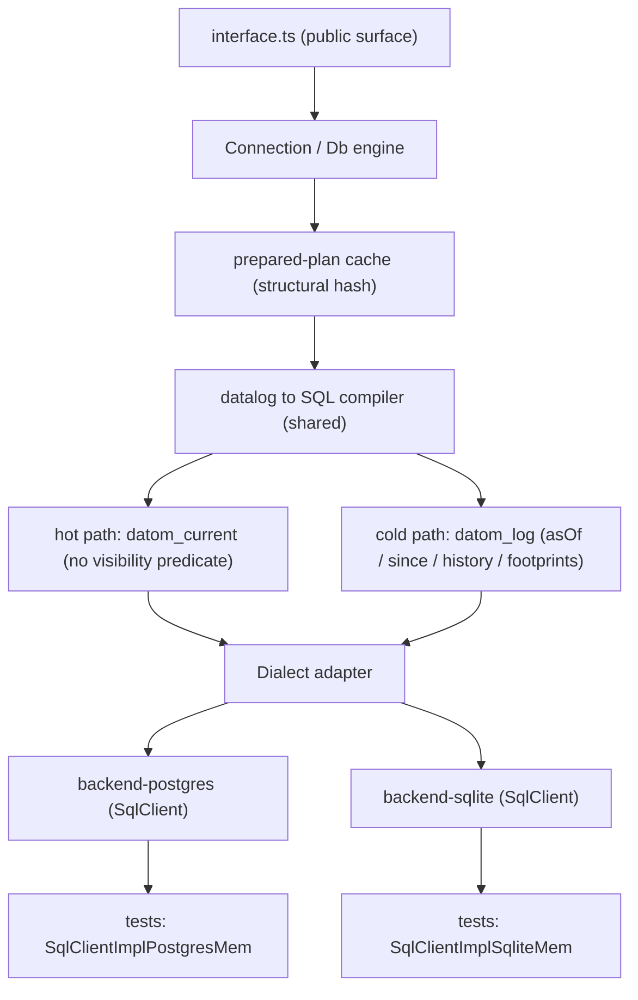

# Implement @pkgs/datom-db end to end

## What exists

- [pkgs/datom-db/src/interface.ts](pkgs/datom-db/src/interface.ts) — the complete public contract (types + declaration-only functions). It stays the single public surface; the declared functions get real bodies, everything else lives in internal modules.
- No `package.json`, no root tsconfig alias yet — full package scaffold needed.

## Priorities

1. **Performance** — falsifiable, budgeted, benchmarked from the second milestone on.
2. **Test suite is PBT + DST, tests only the public interface** — enforced by tooling, not convention.
3. **Architecture stays** — shared datalog→SQL compiler, dialect adapters, `SqlClient` — except where a change is performance-justified (the two-table layout below is one such change).

## Performance model & budgets

### Scaling model — what "web scale" means here

- **Writes serialize per logical database by spec** (total tx order is the contract). We do not fight that ceiling. Web scale = **many small databases** (per tenant / workspace / user), never one global hot DB. Nothing in the implementation may assume a single database:
  - Connection pooling, DDL, prepared-statement cache, and table naming must support N logical databases per Postgres instance cheaply. **Decision to be made by benchmark** (in the bench-harness milestone): `db_id` column on every table with composite indexes prefixed by `db_id` (hypothesis: wins — one shared prepared-plan cache, zero per-db DDL, opening a database is one row) vs schema-per-db (better vacuum/drop isolation, heavier open). SQLite naturally shards file-per-db; the decision mainly binds the Postgres dialect. The bench measures: cost to open the 1,000th database, and per-query overhead of the `db_id` prefix.
  - `open()` of an already-migrated database must be O(1) queries (read schema + basis), no DDL.
- **Reads scale horizontally.** History is append-only, so a lagging replica is a *valid older basis*, not stale data — `Db` is pinned to a basis by design. Read-replica routing is a supported deployment: a backend constructed over a replica `SqlClient` serves consistent snapshots at its replication point. The plan treats this as a documented deployment mode (no code beyond not assuming read-your-writes outside `Connection.db()` after `transact`).

### Non-goals

- Single-database write throughput beyond one writer's ceiling (no sharded tx counters, no multi-master).
- Distributed query across logical databases.

### Numeric budgets (acceptance criteria)

Measured by the bench harness on the **real engines** (PGlite for the Postgres dialect, `bun:sqlite` for the SQLite dialect — mem engines are correctness fixtures, not performance fixtures), on the fixed seeded workload, hot prepared-statement cache unless stated. A milestone that misses its budget does not close.

| Operation (at 100k datoms) | p50 | p99 |
| --- | --- | --- |
| Point query (1 indexed pattern, hot cache) | < 1 ms | < 5 ms |
| 3-pattern join | < 5 ms | < 25 ms |
| `page(limit: 50)` incl. keyset resume | < 5 ms | < 25 ms |
| `transact(10 ops)` | < 5 ms | < 25 ms |
| `pull` depth 3 (50 roots via `pullMany`) | < 10 ms | < 40 ms |
| Cold compile (cache miss, excl. SQL exec) | < 10 ms | < 30 ms |

Ratios and curves:

- `datoms(q)` ≤ **3×** the latency of `query(q)` (same query, same basis).
- **1M-datom scaling curve:** point query, page, and transact latency at 1M ≤ **2×** their 100k numbers (index-bound, never scan-bound); 3-pattern join ≤ 3×. Transact cost is O(ops), independent of database size.
- Prepared-cache hit does **zero SQL string building**; cache lookup ≤ 0.1 ms.
- Opening the 1,000th logical database ≤ 2× the cost of opening the 1st.

Numbers are defensible-but-strict for embedded/in-process engines; if the spike shows an engine-level floor (e.g. PGlite round-trip overhead), the budget is revised **in the plan file with the measurement attached**, not silently.

### Round-trip budget (hard rules, enforced in DST)

| Operation | SQL round trips |
| --- | --- |
| `query` | 1 |
| `page` | 1 |
| `datoms` (footprint) | 1 (UNION ALL plan) |
| `datoms` with `since` | 1 (seminaive delta plan) |
| `transact` | 1 SQL transaction |
| `ingest` | 1 SQL transaction (batched) |
| `pull` / `pullMany` | O(depth) frontier batches — one query per level, **never per entity** |
| `with()` | overlay setup + 1 per read |
| `scan` / `log` | streaming: 1 round trip per fixed-size keyset chunk (default 512 rows), constant memory, never fetch-all |

`SqlClient` exposes no driver cursor, so "streaming" is keyset-chunked prepared reads: bounded memory, resumable, O(n/512) round trips. These budgets are DST invariants (§ Test suite): the test-owned counting `SqlClient` decorator fails the run when an operation exceeds its budget — a performance regression becomes a failing test, interface-only.

## Architecture

One shared **datalog→SQL compiler** with a **dialect adapter** per backend (Postgres, SQLite), both speaking `SqlClient` from `@pkgs/sql-client`. All I/O injected: backend constructors take `{ sqlClient, clock, createId }`; `newId()` becomes `createNewId({ clock, random })` (the one interface deviation, documented in the file).



### Two-table storage layout (performance-justified change)

The single-table "compile visibility into every read" design taxes every hot query with an anti-join over history. Replaced with:

- **`datom_log`** — append-only source of truth: every assertion and retraction ever, `(e, a, v_kind, v_sort, typed cols, tx, op)`. Serves `asOf`, `since`, `history`, footprint deltas, `log()`, and replication. Append-only except `excise`. Cold path: allowed to be slower.
- **`datom_current`** — exactly the live facts, maintained **in the same SQL transaction** as the log append (transact, ingest, excise all update both atomically; card-one supersede and LWW resolve here at write time). Hot queries (`query`, `page`, `scan`, `pull` at the current basis) hit `current` with **no visibility predicate at all** — plain joins on live rows.
- A current-basis `Db` created *after* later transactions have committed compiles to the cold path (its basis is no longer current); `conn.db()` at head uses the hot path. The compiler picks per (table, visibility mode); the contract is unaffected.

### Indexes — index-only scans, byte-compare only

- Four covering sort orders on `current` (eavt/aevt/avet/vaet as composite key order + INCLUDE/covering columns per dialect); `avet` partial on `index`/`unique` attrs, `vaet` partial on ref attrs. Log gets `(tx)`, `(e, a, tx)` and `(a, tx)` covering indexes for time travel and deltas.
- `v_sort` is an **order-preserving byte encoding** (FoundationDB-tuple-style: type tag byte + big-endian / IEEE754-flipped numbers): one total value order as raw byte compares in SQL — `ORDER BY`, range predicates, and keyset cursors never decode per row. Typed columns exist only for lossless decode on projection.

### Prepared-plan cache

Queries are static data with named inputs **by design** — exploit it. Cache key: structural hash of (`Query` object canonical form, dialect, visibility mode, input *shapes* — scalar vs collection with length bucket). Hit ⇒ a `PreparedStatement` (via `SqlClient.prepare`) and a binder mapping named inputs to positions: zero SQL string building. Same cache for `page` (by/reverse/limit shape), `pull` (selector shape per level), and `scan` (index + prefix arity + bounds shape). LRU per connection, sized; cold compile is budgeted above.

### Compiled fragments

- **Patterns** → self-joins on `current` (hot) or visibility-filtered `log` (cold); cmp/arith inline; `not` → `NOT EXISTS`; rules → `WITH RECURSIVE` (capability-flagged fallback: engine-side seminaive fixpoint, same semantics); aggregation → `GROUP BY` with `array_agg` / `json_group_array` for `collect`; collection inputs → `IN` / values-list join, length-bucketed for cache reuse.
- **`datoms()` (footprints):** the same join plan compiled to project each pattern/fts alias's datom columns as one `UNION ALL` — 1 round trip, pre-aggregation per the contract.
- **`since` deltas — seminaive:** one pattern at a time restricted to `log` rows with `tx > since`, joined against full relations for the rest, unioned across pattern positions; plus retractions of datoms in the `asOf(since)` footprint. Never a full recompute of both bases.
- **`fts`:** postings maintained at write time by the pinned, versioned TS analyzer (NFKC casefold + segmentation) — `fts_current` for the hot path; historical fts served from log-backed postings (cold). Compiles to posting joins with term-prefix byte ranges; phrase/AND/prefix per the contract. No engine-native FTS extension (semantics must be identical on both dialects).
- **`re`:** JS RegExp is the pinned dialect (Postgres `~` is POSIX — different semantics). `re` is a filter: the compiler pushes all joins to SQL and applies `re` (and any aggregation over re-filtered tuples) engine-side, pre-aggregation. Everything else stays in SQL.
- **`page()`:** compiled `ORDER BY by, <remaining keys in lexicographic key order>` + keyset `WHERE` from `after` on `v_sort` bytes + `LIMIT` — 1 round trip.
- **`pull`/`pullMany`:** frontier traversal — collect the ref frontier per level, one batched query per level (eavt for attrs, vaet for reverse refs), cycle guard for `'...'`.
- **`with()`:** overlay datoms into a temp table (or dialect equivalent) once, union into the plan's source relations; persists nothing.
- **`watch()`:** on each `TxReport`, intersect the tx's attr set (+ bound entity ids) against the query's precomputed attr/entity signature (small set or bloom) — re-run only on intersection, never on every tx.

### Capability spike (first task, now four engines)

Verify on `@crvouga/postgres-mem`, `@crvouga/sqlite-mem`, PGlite, and `bun:sqlite`: `WITH RECURSIVE`, `NOT EXISTS`, `array_agg`/`json_group_array`, byte-range predicates on the `v_sort` encoding, `ON CONFLICT` upserts (current-table maintenance), temp tables. Every gap gets a semantics-identical compiler fallback selected by **dialect capability flags — never by test code**.

## Implementation layout

```
pkgs/datom-db/
  package.json            # @pkgs/datom-db, exports ./*, tc + test + bench scripts
  tsconfig.tc.json
  bench/                  # harness + seeded workloads + results.json (tracked)
  src/
    interface.ts          # unchanged types; declared fns get bodies (key, txEntity, entity, escapeRe, watch, open, TX, createNewId)
    engine/
      value.ts            # total value order, v_sort byte encode/decode, key()
      schema.ts           # attr registry, widening-only migrations, Derive eval
      analyzer.ts         # pinned fts tokenizer (versioned)
      transact.ts         # ops→datoms; log+current+postings in one SQL tx
      ingest.ts, excise.ts
      connection.ts       # Connection impl, log() streaming, on('tx'), watch signatures
      db.ts               # Db impl: query/datoms/scan/page/pull/asOf/since/history/with
      plan-cache.ts       # structural hash → prepared statement + binder
      compile/            # planner, clause compilers, hot/cold source selection, footprint projection, dialect interface
    backend-postgres.ts   # postgresBackend({ sqlClient, clock, createId }) → Backend
    backend-sqlite.ts     # sqliteBackend({ sqlClient, clock, createId }) → Backend
    spi.ts                # internal Backend brand ↔ engine contract
    testing/              # contract suite + arbitraries (importable by tests)
    tests/dst/            # DST world, action picker, counting SqlClient decorator
```

## Benchmarks workstream (early, continuous)

Lands immediately after the capability spike so **every subsequent milestone ships with numbers**:

- Fixed seeded workloads (via `createSimAdapters` ids/clock) at **10k / 100k / 1M datoms**; op mix mirrors the interface example (entities, refs, card-many, fulltext attrs, derived attrs).
- Runs every budgeted operation cold-compile and hot-cache, on **both real engines**, at all three scales; emits p50/p99.
- Results tracked in-repo (`bench/results.json`) with **regression thresholds**; a `bench` package script wired into CI as a turbo task. Milestones without their budget met don't close.
- First deliverable of this milestone: the **tenancy decision** (db_id column vs schema-per-db), justified by the open-cost and per-query-overhead measurements, recorded in this plan file.

## Test suite — PBT + DST, interface-only, mechanically enforced

### Boundary enforcement (tooling, not promise)

Test code may import **only**: `interface.ts`, `backend-postgres.ts` / `backend-sqlite.ts`, mem `SqlClient` constructors, `createSimAdapters`, and `src/testing/*`. `engine/` and `compile/` are unreachable from test files via a **depcruise rule** (repo already enforces layering with dependency-cruiser) plus an in-package fallback test that scans test-file imports and fails on violations — so the boundary breaks the build, not a code review.

### Contract suite (grows per milestone)

`runDatomDbContractTests(factory)` in `src/testing/contract.ts` (repo pattern: `runKvContractTests`, `runSqliteContractTests`); `src/interface.test.ts` runs the matrix via `describe.each` over `[postgres × SqlClientImplPostgresMem, sqlite × SqlClientImplSqliteMem]`. Covers every entry point: schema widening/rejection, every `Op` form, every `TxError` code, unique identity-vs-value, component cascade, derived attrs, `noHistory`, every clause form (patterns incl. 4th/5th positions, cmp, `re`, `fts`, arith, `not`, rules incl. recursion), aggregation/`with`/`collect`, collection inputs, all four `scan` orders + bounds, `page` tiling, `pull` grammar (`*`, reverse refs, `'...'`), time travel, `log` bounds, `ingest`, `excise`, `watch`, `TX` provenance. The interface's own `example()` runs as a smoke test.

**Surface-coverage check, mechanical:** the suite iterates the module's exports and a compile-checked exhaustive list of `TxError` codes (a literal array `satisfies TxError['code'][]`), and asserts every symbol and every code was exercised by at least one test — untested surface fails the suite.

### PBT (`@pkgs/pbt` / fast-check, `FC_SEED`-pinned; arbitraries in `src/testing/arbitraries.ts`)

- **Cross-backend equivalence:** same op sequence on both backends → identical query rows, footprints, scan order.
- **Sync round trip:** `ingest(footprint.datoms)` into a fresh peer → byte-identical rows; `since` delta on top of the old footprint ≡ fresh footprint.
- **Footprint minimality (sampled):** ingesting the footprint suffices — and removing a randomly sampled single datom from it breaks row equality on some generated case (leave-one-out, sampled not exhaustive).
- **Ingest commutativity:** permuted ingestion order → converged current views.
- **Time travel:** `asOf(report.tx)` after later writes ≡ the snapshot taken at that tx; history is append-only.
- **Metamorphic hypotheticals:** `db.with(ops)` then query ≡ transact those ops on a forked store then query, for generated (ops, query) pairs.
- **Excision totality:** after `excise`, the excised datoms are unreachable via *every* read form — query, scan (all orders), page, pull, `history()`, footprints.
- **Derived-attr consistency:** after any generated op sequence, every derived attr equals its `Derive` recomputed from sources, and exists exactly when all sources do.
- **Page tiling:** successive `page(after:)` slices tile `query()` exactly — no gaps, no repeats, total order respected.
- Pure functions: `key` injectivity, `escapeRe` self-match, `entity` sugar ≡ hand-written ops.

### DST (`src/tests/dst/`, modeled on `pkgs/room`)

Seeded world via `createSimAdapters` (clock/rng/ids), percentile action picker, seed echoed on failure for replay; `fc.commands` + `assertDstProperty` for shrinking, plus a scripted `*.sim.test.ts` determinism scenario.

- **World:** N peer connections on randomly assigned backends: transact, conflicting cas/onBasis, footprint exchange via `ingest`, time-travel reads, excise, close/reopen.
- **Per-step invariants:**
  - Basis monotonic; held `Db` reads stable across ticks; after full footprint exchange all peers answer a fixed query set identically.
  - **SQL round-trip budgets (§ Performance):** the world wraps each backend's mem `SqlClient` in a test-owned counting decorator (interface-only — the client is constructed by the test and handed to the backend constructor); any operation exceeding its round-trip budget fails the run.
- **Fault injection:** a decorator that fails `SqlClient` calls mid-transact/mid-ingest at seeded points; invariant: after reopen over the same storage, **no partial writes** — log, current, and postings are consistent, and the failed tx is absent everywhere (atomicity via the 1-SQL-transaction rule).
- **Determinism hash:** same seed on both backends → identical tx-log hash (datoms, tx ids, `tx/at` from the sim clock).

## Wiring

- Root [tsconfig.json](tsconfig.json): add `@pkgs/datom-db/*` path alias + `include` entries.
- `package.json` deps: `@pkgs/sql`, `@pkgs/sql-client`, `@pkgs/clock`, `@pkgs/uuid`; dev: `@pkgs/pbt`, `fast-check`, `@types/bun`. Scripts: `tc`, `test` (bun test), `bench`. Depcruise rule added for the test boundary. Biome size caps respected by splitting the compiler into per-clause modules.
- Verify with `bun run --filter @pkgs/datom-db tc && bun run --filter @pkgs/datom-db test`, `bun run --filter @pkgs/datom-db bench`, and root `bun run lint`.

## Sequencing

Dependency order, benchmarks second so every milestone ships with numbers: spike → bench harness (+ tenancy decision) → values/encoding → two-table DDL → transactor → compiler hot path (patterns/joins/agg/page against `current`, plan cache) → cold paths (asOf/history/footprints/deltas/fts) → remaining reads + sync + excise + watch → test-boundary enforcement → contract/PBT/DST hardening → final gate. The contract suite, PBT properties, and DST invariants grow **alongside each milestone** with that milestone's budget gates — a milestone closes only when its tests pass and its numbers are met.
