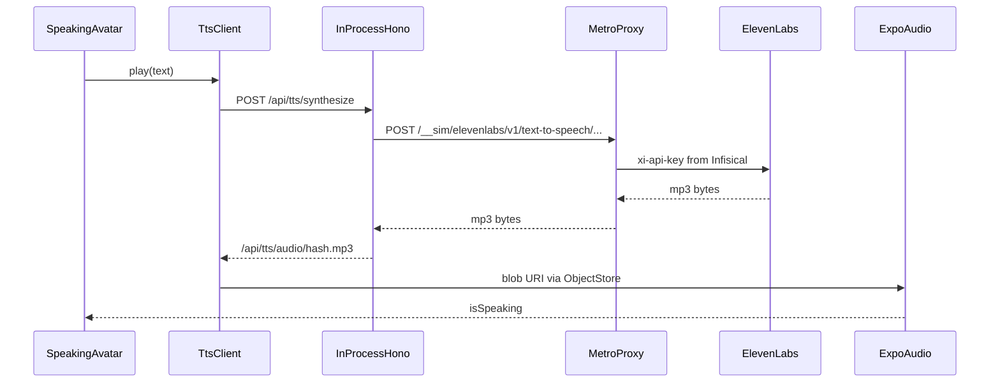

# Get voice synth working in the sim playground

The SpeakingAvatar bubble is already live. Audio is not: playground [`create-sim.ts`](product/console/src/sim/create-sim.ts) injects `InMemoryTtsProvider` (fake MP3, not decodable) and `createInMemoryAudioPlaybackPort()` (records `play()` but never hits speakers). The in-process sim server also runs **in the browser**, so it cannot call `api.elevenlabs.io` directly (CORS + API key must not ship in the client bundle).

`bun run dev` already injects Infisical secrets into the Metro/Node process (`SECRETS_ENV=dev` + `secrets-run`). That is the right place to hold `ELEVEN_LABS_API_KEY`.

## 1. Playground-only overrides on `createSim`

Keep tests deterministic. Extend [`CreateSimOptions`](product/console/src/sim/create-sim.ts) with optional `audio` and `tts` (and pass them through `buildServerEnv` / `makeSimClientEnv`). Defaults stay `InMemoryTtsProvider` + `createInMemoryAudioPlaybackPort`.

[`boot-playground.ts`](product/console/src/playground/boot-playground.ts) is already `@io-wall-ok` and an io-scan entry. Wire the real adapters only there:

- `audio: createExpoAudioPlaybackPort()` from [`expo-audio-playback-port.ts`](pkgs/sounds/src/audio-playback/expo-audio-playback-port.ts)
- `tts: new ElevenLabsTtsProvider({ apiKey: 'playground', fetch: globalThis.fetch, baseUrl: `${origin}/__sim/elevenlabs/v1` })`

Dummy `apiKey` is required by the constructor; the Metro proxy overwrites `xi-api-key` from env so the real secret never enters the bundle.

If `window.location` is missing, skip the override (keep stubs).

## 2. Metro same-origin ElevenLabs proxy

Extend [`product/console/metro.config.js`](product/console/metro.config.js) `enhanceMiddleware` (already used for COOP/COEP) to intercept `POST /__sim/elevenlabs/v1/*` **before** the default Metro handler.

Extract a small Node helper (e.g. [`product/console/scripts/elevenlabs-tts-proxy.ts`](product/console/scripts/elevenlabs-tts-proxy.ts), `@io-wall-ok`) that:

- Rewrites to `https://api.elevenlabs.io/v1/...`
- Sets `xi-api-key` from `process.env.ELEVEN_LABS_API_KEY`
- Forwards `Content-Type`, `Accept`, query string, and body
- Returns 503 with a short JSON error when the key is missing (matches production degrade)

Do not add `EXPO_PUBLIC_ELEVEN_LABS_API_KEY`. Unit-test the rewrite/header helper without hitting ElevenLabs.

## 3. Make `useAudioPlayer` actually load TTS URLs

[`useTtsPlayer`](pkgs/tts/src/client/use-tts-player.ts) starts with `currentUrl === null`, then sets a blob URI. The port wrapper in [`audio-playback-context.tsx`](pkgs/sounds/src/audio-playback/audio-playback-context.tsx) only uses `source` in `useState(() => createPlayer(source))` and never calls `replace`. Chess board sounds work because they pass a stable asset at first render; TTS never loads.

Fix: when the serialized source changes, call `player.replace(source)`. Key off the URI string (not a fresh `{ uri }` object each render) so chess players are not reset every frame.

## 4. Autoplay / mute retry

Web `play()` can throw `NotAllowedError` (already swallowed). Two small UX fixes so the first coach line is not lost:

- In [`useSpeak`](pkgs/tts/src/client/use-speak.ts), clear `lastSpokenRef` when `enabled` becomes false so mute-then-unmute (avatar tap is a user gesture) retries the same line.
- Optionally, in playground chrome, unlock audio on the first pointerdown (silent `AudioContext.resume` / expo `setAudioModeAsync`) so navigation itself counts as a gesture. Keep this in `boot-playground` / playground panel, not product code.

## 5. Out of scope

- `@product/test` / DST stay on in-memory TTS and silent audio.
- No SpeechSynthesis fallback (different voice, bypasses the product pipeline). If the Infisical key is missing, synthesize 503s and the bubble still shows text — same as production without secrets.
- Unused `SpeakingAvatar` props (`voice`, `speak`) are a separate drift; not required to hear audio.

## Verification

After implementation, in the playground: open a chess puzzle, confirm the coach line plays through speakers (Mark / ElevenLabs), waves on the sound indicator track playback, mute toggle silences and unmute speaks again. Alice/Bob both use the same wiring; check one actor is enough. Tests should not call ElevenLabs.
