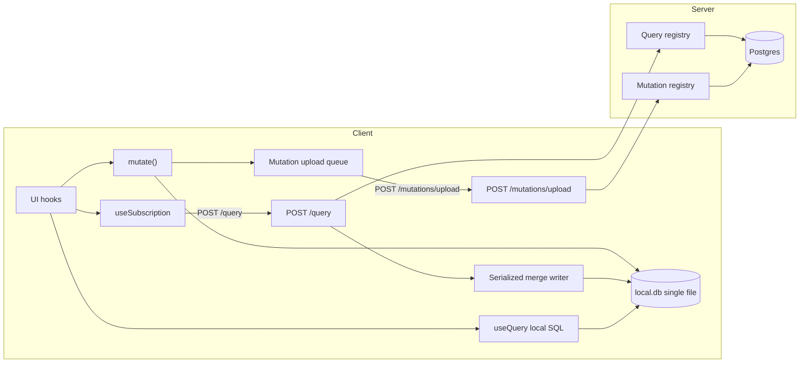

# Port off PowerSync → `defineQuery` sync

## Investigation inventory (removal checklist)

### Dependencies

- Catalog pins in root [`package.json`](package.json): `@powersync/common`, `@powersync/react-native`, `@powersync/web`, `@journeyapps/wa-sqlite`, `@journeyapps/react-native-quick-sqlite`
- Consumers: [`apps/client/package.json`](apps/client/package.json), [`pkgs/sync-engine-powersync/package.json`](pkgs/sync-engine-powersync/package.json)
- Dead deps: `@pkgs/sync-engine-powersync` in `libs/{auth,chess,friends,profile,spaces}/package.json` (declared, unused)
- Expo plugin: `@journeyapps/react-native-quick-sqlite` in [`apps/client/app.json`](apps/client/app.json)
- Scripts: `ps:deploy:*`, `ps:dev`, `ps:setup:*`, `bundle:powersync-web-assets`, `ci:no-local-tables`

### Client init / SDK

- [`apps/client/src/sync/create-power-sync-database.ts`](apps/client/src/sync/create-power-sync-database.ts) — opens `PowerSyncDatabase` (web UMD + RN)
- [`apps/client/src/sync/powersync-sdk-database.ts`](apps/client/src/sync/powersync-sdk-database.ts), [`create-powersync-sync-engine.ts`](apps/client/src/sync/create-powersync-sync-engine.ts), [`sync-engine-pool.ts`](apps/client/src/sync/sync-engine-pool.ts)
- [`apps/client/src/config/powersync-url.ts`](apps/client/src/config/powersync-url.ts), Metro platform split, [`scripts/bundle-powersync-web-assets.ts`](apps/client/scripts/bundle-powersync-web-assets.ts), `public/generated/powersync/**`
- Boot: [`sync-engine-boot.tsx`](apps/client/src/providers/local-database/sync-engine-boot.tsx), [`app-local-database-provider.tsx`](apps/client/src/providers/app-local-database-provider.tsx), wipe via `disconnectAndClear`
- Package: entire [`pkgs/sync-engine-powersync/`](pkgs/sync-engine-powersync/) (connector, schema-from-registry, sql-client-facade, sync engine)

### Connector / upload (still CRUD-mediated)

- [`pkgs/sync-engine-powersync/src/client/create-connector.ts`](pkgs/sync-engine-powersync/src/client/create-connector.ts) — `uploadData` / `getNextCrudTransaction`
- [`apps/client/src/sync/sync-api.ts`](apps/client/src/sync/sync-api.ts) — `prepareSyncUploadBatch` + `POST /api/sync/upload` + token cache
- Server: [`apps/api/src/sync/sync-routes.ts`](apps/api/src/sync/sync-routes.ts), [`libs/auth/src/server/sync-token-route.ts`](libs/auth/src/server/sync-token-route.ts) (PowerSync JWT `kid: powersync`)

### Watch / reactivity (engine-agnostic API, PS-backed)

- Port: [`pkgs/sync-engine/src/client/sync-engine-port.ts`](pkgs/sync-engine/src/client/sync-engine-port.ts) (`watch`, `subscribeSyncStream`, `waitForFirstSync`, `clearLocalData`)
- Hooks: `useWatch*` in [`sync-engine-context.tsx`](pkgs/sync-engine/src/client/sync-engine-context.tsx)
- **Consumers** (all read local SQL today): auth (`use-current-user`, devices, external_accounts), profile, spaces (~12 hooks), friends (3), chess puzzle (~5), inbox (2), client-config (1)

### Sync rules / infra

- [`libs/powersync/`](libs/powersync/) — `sync-config.yaml` (18 streams), `service.yaml`, `cli.yaml`, fetched/backup artifacts
- Infra: `powersync-secrets`, `PowerSyncResource`, `powersync-jwt`, `powersync-source-db.sql` (publication `powersync`), deploy phase, `tools/scripts/powersync-*.ts`
- Env/secrets: `PS_*`, `EXPO_PUBLIC_PS_URL`

### Schema residue

- `chess_puzzles.sync_pool` — exists solely to band the PowerSync puzzle stream
- PowerSync runtime tables (`ps_data__*`, `ps_crud`, …) — SDK-owned, not in app SQL
- `localOnly` / `local_*` API in [`table-definition.ts`](pkgs/sync-engine/src/shared/table-definition.ts) + [`check-no-local-tables.ts`](tools/scripts/check-no-local-tables.ts) — currently bans local tables; **contradicts** planned `_row_scopes` / DURABLE local tables

### Docs / agent / UX

- Root [`AGENTS.md`](AGENTS.md), [`.agents/skills/powersync/`](.agents/skills/powersync/), `.cursor/mcp.json` powersync MCP, diagnostics command, sync-screen “PowerSync URL”, i18n strings, README

### Current write pipeline (verified)

```
mutate() → PS SQLite (domain SQL + _mutations INSERT)
       → PowerSync CRUD queue (DOMAIN + FRAMEWORK)
       → prepareSyncUploadBatch → POST /api/sync/upload
       → processUploadWithMutations (replay _mutations; discard DOMAIN)
       → response { ok: true }  // NO per-mutation verdicts
write_rejections syncs down via PowerSync stream
```

Mutations themselves ([`@pkgs/mutations`](pkgs/mutations/)) match the target contract; only transport + confirmation UX are wrong. **Mutation bodies are NOT yet proven idempotent under rebase** — see Gap 2 / Pre-Phase-3 audit.

### Sync streams → replacement queries

| Stream | Suggested `defineQuery` | Notes |
| --- | --- | --- |
| `devices` | `ownDevices` | boot |
| `users` | `ownUser` | boot |
| `external_accounts` | `ownExternalAccounts` | boot |
| `profiles` | `ownProfile` + `profilesByIds` | **split full-table download** |
| `client_config` | `clientConfig` | boot |
| `write_rejections` | _(remove as sync)_ | verdicts in upload response |
| `spaces` / `space_users` | `mySpaces` / `mySpaceUsers` | + friend-public gap |
| `space_open_sessions` | `openSpaceSessions` | boot / miniplayer |
| `friend_*` / `user_blocks` | `friendships` / `friendRequests` / `userBlocks` | |
| `entity_store_*` | `entityStoreCatalog` / `entityStoreOwned` | |
| `inbox_interactions` | `inboxActive` | feature-scoped OK |
| `chess_*` | `chessPuzzlePool` / profile / interactions | heavy; **banded params**, not cursors |

REST exceptions stay (not sync): `POST /profile/ensure`, `POST /friends/search`, `POST /client-config/refresh`, room DO, stripe/tts/llm.

---

## Architecture (end state)



**Package layout**

- Extend [`pkgs/mutations`](pkgs/mutations) — mutations-only upload processor + response verdicts; keep dual-platform harness
- New [`pkgs/queries`](pkgs/queries) — `defineQuery`, registry, server `runQuery`, response types, authorize-first, checkpoint/hash
- Rewrite [`pkgs/sync-engine`](pkgs/sync-engine) — own SQLite lifecycle (migrations + epoch), table-change bus, merge applier, subscription runtime, `useQuery` / `useSubscription`
- Delete [`pkgs/sync-engine-powersync`](pkgs/sync-engine-powersync) in Phase 7 **only after** the handoff release (Gap 1)
- Local SQLite via existing [`SqlClientImplExpoSqlite`](pkgs/sql-client/src/sqlite/impl-expo-sqlite.ts) — **one file** `local.db` (see Local schema migrations)

**Compatibility default (Phase 2):** dual write endpoints — keep `POST /api/sync/upload` (CRUD) until PowerSync client is gone; add `POST /api/mutations/upload` for the mutations-only queue. New clients disable PS `uploadData` (drain/complete CRUD locally without POSTing) and use the new endpoint only — **same build** (Gap 7).

---

## Local schema migrations & version skew

### Single-file layout (decision)

One local database file (`local.db`). NOT two files: `mutate()`'s atomicity (optimistic effect + `_mutations` insert in one transaction) does not survive a two-file split under WAL. Wipe granularity is achieved by table category, not file boundary.

Table categories (extend the existing table registry / allowlist):

- **CACHE**: all domain tables, `_row_scopes`, views, indexes — wipeable, re-hydratable.
- **DURABLE**: `_mutations`, `_upload_state` (+ rejection cache if kept) — survives every wipe except auth-wipe.

### Migration mechanics

1. `pragma user_version` + ordered migration list, run pending steps in ONE transaction at DB open, before anything else touches the DB.
2. **Additive-only migrations** (`create table`, `alter table add column`, new indexes): normal tier — append a step, bump `user_version`.
3. **Anything non-additive** (drop/rename/retype, restructures): do NOT write a migration. Bump a `SCHEMA_EPOCH` constant instead → triggers **selective wipe**: in one transaction, drop and recreate every CACHE table at current shape; DURABLE tables untouched; then boot-hydrate. SQLite's weak `ALTER TABLE` is irrelevant because we never migrate destructively.
4. Views and indexes are derived: dropped and recreated on every migration run and every epoch wipe (idempotent `create ... if not exists` is not enough for changed definitions — drop first).
5. `_mutations` / `_upload_state` schema changes: additive-only, migrated in place, expected ~never (five columns; it is a wire format). If a breaking change is ever unavoidable it requires its own explicit plan — flag to operator, do not invent.
6. Auth-wipe remains file-delete of everything including DURABLE (revoked identity's queue must die).
7. `nextSeq()` durability: seq is monotonic per client across restarts — derive as `max(seq)+1` from `_mutations` at startup or persist counter in `_upload_state`. Epoch wipes preserve both, so monotonicity survives.

### Version skew rules (client ↔ server)

1. **Column-intersection merge (REQUIRED in the merge applier):** when applying response rows, insert only columns that exist in the local table (`pragma table_info`, cached per table, invalidated on migration/epoch). Unknown response columns are ignored. This makes every additive server change safe against every old client with zero coordination.
2. **Server ordering: expand-then-contract.** Server adds columns/queries first (old clients tolerate via rule 1) → clients upgrade → server removes old shapes last. Removed/renamed response columns are BREAKING → new query name (`fooV2`) + client `SCHEMA_EPOCH` bump.
3. **Mutation args contracts never change in place** (restate existing rule — it is the migration story for the write path): breaking args changes ship as `nameV2`; old handler kept until min-client-version clears. Old queued mutations replay against current server code — safe because the log carries `{name, args}`, not SQL.
4. Query `hydrates` lists and local table names are part of the contract: renaming a local table is an epoch bump.

---

## Contradictions / product decisions (do not invent)

Flagged for operator resolution during implementation; plan does not decide them:

| Item | Why it matters |
| --- | --- |
| Poll cadences per query | `pollMs` defaults unknown |
| Boot subscription set exact list | Suggested below; confirm |
| Subscription unmount TTL | Grace before tag purge |
| Scope-sweep TTL | Dead-scope reaping window (Gap 5) |
| Offline-revocation tolerance | How long `stale` before UX treats as revoked |
| `profiles` full-table → scoped | Product: which foreign profiles hydrate |
| `useFriendLiveSpaceId` | Friend’s public live space is outside today’s `spaces` stream filter — needs an explicit query or drop |
| `chess_puzzles.sync_pool` | Drop column after chess cutover, or keep for other ops? |
| `ci:no-local-tables` | Must allow framework local tables (`_row_scopes`, `_upload_state`, `_scope_meta`) |
| Auth-wipe trigger surface | Only `reason: 'revoked'` wipes; `expired` does not (Gap 6) |
| Handoff telemetry threshold | When Phase 7 may remove the PS SDK from the bundle (Gap 1) |
| `SCHEMA_EPOCH` policy | Who may bump it / release-notes requirement (it wipes every client's cache) |

**Suggested boot set (placeholder):** `ownUser`, `ownDevices`, `ownExternalAccounts`, `ownProfile`, `clientConfig`, `openSpaceSessions`. Shell after paint: spaces, friends+related profiles, inbox, entity_store. Feature: chess. Boot-set scopes are exempt from dead-scope sweep.

**Hard technical constraint:** merge applier and PowerSync download must never co-own the same table. Phase 5 cutovers are exclusive: remove stream → ship subscription (version-gate old clients).

---

## Phase 0 — Spec tests first (gates every later phase)

**Create before implementation code:**

1. **Scenario suite** (SQLite harness) — each as a failing test. Consolidated list:

   1. `offline-queued-mutation-rejected-on-drain`
   2. `poll-response-arrives-during-local-mutation`
   3. `crash-between-replace-and-rebase`
   4. `stale-response-after-newer-checkpoint`
   5. `pending-mutation-fails-on-rebase`
   6. `shared-row-across-two-scopes`
   7. `denied-purges-scope-and-stops-polling`
   8. `not_modified-causes-zero-writes`
   9. `unfriend-revocation-via-absence`
   10. `kicked-from-room-via-denied`
   11. `params-change-keeps-old-rows-until-hydrated`
   12. `auth-wipe-deletes-db-and-pending-log`
   13. `upgrade-with-pending-offline-mutations-handoff` — old PS DB contains N un-acked mutations; handoff runs; new DB drains them; server applies exactly once (Gap 1)
   14. `rebase-reruns-are-idempotent` — pending mutation touching tables inside AND outside merged scope; assert single-apply semantics (Gap 2)
   15. `schema-epoch-wipe-preserves-durable` — epoch bump with pending offline mutations: CACHE recreated empty, DURABLE intact, drain + re-hydrate succeed (Gap 3)
   16. `old-client-receives-new-columns` — response contains a column absent locally; merge succeeds; column ignored; row otherwise correct (Gap 3)
   17. `migration-runs-once-and-orders` — fresh DB fast-forwards; existing DB runs only pending; interrupted migration leaves `user_version` unbumped and reruns cleanly (Gap 3)
   18. `expired-token-does-not-wipe` (Gap 6)
   19. `dead-scope-sweep-reaps-untouched-tags` (Gap 5)

2. Keep / extend [`dual-platform-harness.test.ts`](pkgs/mutations/src/test/dual-platform-harness.test.ts) for mutation replay.

3. Query harness stubs: authorize-denied, hard-limit enforcement, hash/`not_modified`, `resync` clears basis and re-polls, registry duplicate-name.

**Done when:** tests exist and fail for the right reasons; CI runs them.

---

## Phase 1 — Query framework + endpoint + harness

**Create**

- `pkgs/queries/` — `defineQuery`, `QueryCtx`, registry (reject duplicate names), `QueryResponse` union (`ok/full`, `not_modified`, `denied`, `gone`, `resync`; `delta` typed but unimplemented)
- Server runner: parse → authorize (before run) → `run` → hash rows → respond
- `POST /api/query` in apps/api
- App query registry mirror pattern of [`app-mutations.ts`](apps/api/src/sync/app-mutations.ts)
- Enforce hard `limit` in every query def (lint/CI check like mutation determinism)

**Auth for new endpoints (do NOT resurrect `/sync/token`):**

- `actorId` / `deviceId` / `accountId` / `isAnon` come from **session auth + device registration** — the same `resolveReplayAuth` / `sessionAuth.resolveAuthContext` path used by today’s upload (Bearer + `x-anon-id`, or anon `x-anon-id` only). PowerSync JWT minting is irrelevant to `/api/query` and `/api/mutations/upload`.

**Checkpoint & hash (do not invent):**

1. **Checkpoint** = server-issued opaque monotonic token **per scope** (implementation: single Postgres sequence read per response is fine; comparison is only ever within one scope). Client stores `last_checkpoint` per scope in `_scope_meta`. Merge discards a response whose checkpoint ≤ stored checkpoint for that scope (`stale-response-after-newer-checkpoint`).
2. **Hash** = server-side content hash over the canonical serialization of the full result: tables sorted by name → rows sorted by primary key → columns in a stable declared order → stable JSON (no whitespace, sorted keys) → SHA-256. Canonicalization must be deterministic across server deploys; changing hash canonicalization is itself a protocol change → server may answer `resync`.
3. **`resync` semantics:** server returns it when it cannot honor the client's `lastHash`/checkpoint basis (hash protocol changed; future delta mode with expired change window). Client handling: clear stored hash/checkpoint for the scope, immediately re-poll with no `lastHash`, treat response as a normal full merge.
4. **Canonical params for `scope_hash`:** stable stringify (recursively sorted keys, no undefined, arrays order-significant) → hash. Stated once; both `useSubscription` identity and `_row_scopes` MUST use the same function.

**Structured auth errors (shared with Phase 2/6):** on `/api/query` (and later `/api/mutations/upload`) return `{ error: 'auth', reason: 'expired' | 'revoked' }` — never a bare undifferentiated 401 for wipe logic.

**Modify**

- Wire route in [`create-app.ts`](apps/api/src/app/create-app.ts)
- Auth context reuse from upload (`resolveReplayAuth` pattern) — session auth only

**Delete:** nothing PowerSync yet

**Tests / acceptance**

- Registry duplicate rejection
- Unauthorized → `denied` (authorization) or structured `{ error: 'auth', reason }` (transport)
- `lastHash` match → `not_modified` (empty body)
- `resync` clears client basis and re-polls full
- Missing/oversized limit rejected at define-time or run-time
- Actor never taken from params
- Checkpoint/hash canonicalization golden tests

**Risks:** none to production clients (additive endpoint)

---

## Phase 2 — Mutations-only upload transport (PowerSync reads stay)

**Create**

- Client `MutationUploadQueue`: durable drain `_mutations WHERE seq > last_acked_seq`, batch POST, exponential backoff, resume after crash
- Local watermark table (DURABLE): `_upload_state(last_acked_seq, handoff_complete, …)`
- Server `POST /api/mutations/upload`: body = ordered mutation rows only; replay via existing `replayMutation`; response = per-mutation verdicts + ack watermark; same session-auth derivation as Phase 1 (no PowerSync JWT)
- Client applies verdicts from response (no wait for `write_rejections` sync for new path)

**Modify**

- [`process-upload-with-mutations.ts`](pkgs/mutations/src/server/process-upload-with-mutations.ts) — extract mutations-only path; return verdicts (breaking for new endpoint only)
- [`mutation-status.ts`](pkgs/mutations/src/client/mutation-status.ts) — `rejected` from upload verdict / local rejection store; `confirmed` = acked **and** subsequent relevant query merge (Phase 4); drop PowerSync upload-latch deps
- PS connector `uploadData`: **no-op POST** — drain `getNextCrudTransaction` + `complete()` so CRUD does not stall; new queue owns network upload
- Keep legacy `POST /api/sync/upload` for old builds during compatibility window

**Double-POST guard (acceptance check):** the build that enables the mutations-only queue MUST ship the PS `uploadData` no-op in the **SAME build**. Network inspector / e2e: **zero** `/api/sync/upload` calls from new builds.

**Delete (later in this phase once new clients verify):** reliance on DOMAIN rows on the wire for new clients; stop calling `prepareSyncUploadBatch` from the live path

**Tests / acceptance**

- Offline queue → drain → reject permanent → ack advances, no retry of that id
- Infra 5xx → retry, idempotent via `_mutations_applied`
- Crash mid-batch → resume from watermark
- Dual-platform harness still green
- PowerSync downloads still work in manual smoke
- Zero `/api/sync/upload` from new-client builds

**Risks:** old clients still use CRUD upload — keep endpoint until Phase 7; same-build no-op is mandatory

---

## Pre-Phase-3 — Mutation idempotency audit (blocking)

**Authoring rule (enforce in review + lint where possible): mutation local writes MUST be idempotent under re-execution.**

- Inserts: `insert ... on conflict (id) do update` (never bare `insert`).
- Updates: absolute assignments only (`set count = ${value}`), never relative (`set count = count + 1`). Relative math is computed in JS from values read earlier in `run` — required for rebase correctness (already implied by determinism).
- Deletes are naturally idempotent.

**Blocking tasks before merge applier ships:**

1. Sweep all existing mutation bodies under `libs/*/src/shared/mutations/` (and framework mutations) for bare inserts / relative updates; convert them.
2. Extend existing determinism CI (`check-mutation-determinism` or sibling): flag bare `insert into` and `set <col> = <col>` patterns inside mutation `run` bodies.

Without this audit, rebase double-applies outside the merged scope.

---

## Phase 3 — Merge applier + `_row_scopes`

**Create**

- `_row_scopes` DDL (CACHE / local-only) + indexes per spec
- Single serialized writer: `applyFullResponse(scope, tables)` in one SQLite transaction:
  1. Scope-complete replace (SQL anti-join delete + upsert + tag maintain; delete row only when tag set empty)
  2. **Column-intersection:** upsert only columns present in local `pragma table_info` (cached; invalidate on migration/epoch)
  3. **Rebase:** re-run every pending (un-acked) mutation's `run` in `seq` order inside the merge transaction. With idempotent effects: effects still present → no-op; effects clobbered by the merge → restored. A pending mutation that THROWS during rebase: local effects stay absent (hidden), it REMAINS in the upload queue, server verdict on drain is authoritative — never delete from the queue on rebase failure.
  4. Commit; **then** emit table-change events — batched per transaction (one event set per merge/mutate, not per statement)
- Checkpoint / hash bookkeeping; discard stale checkpoints (≤ stored)
- `denied` / `gone`: purge tags, orphan-kill, mark subscription revoked (no retry loop)

**Modify**

- Revise [`check-no-local-tables.ts`](tools/scripts/check-no-local-tables.ts) → allow allowlisted framework local tables (`_row_scopes`, `_upload_state`, `_scope_meta`); still ban feature `local_*` domain tables; classify CACHE vs DURABLE
- Schema bootstrap for non-PS SQLite: generate CREATE TABLE from `SYNC_TABLE_REGISTRY` (new path; can land behind a test harness first)

**Delete:** nothing live yet

**Tests / acceptance:** Phase 0 merge scenarios green including `rebase-reruns-are-idempotent`, `old-client-receives-new-columns`, `pending-mutation-fails-on-rebase`

**Risks:** do not wire into production boot until Phase 5 cutovers; harness-only is fine

---

## Phase 4 — Subscription runtime + hooks

**Create**

- Subscription manager: identity = `hash(name + canonical params)` using the **same** canonical-params function as `_row_scopes`; refcount + dedupe; grace TTL on unmount
- `_scope_meta(scope_hash primary key, last_active_at, last_checkpoint, last_hash)` — `useSubscription` touches `last_active_at` while mounted
- **Dead-scope sweep:** boot-time + periodic — delete tags (and orphaned rows via existing orphan-kill) for scopes with `last_active_at` older than TTL **and** no active subscription. Boot-set scopes are exempt. TTL = operator decision.
- `useSubscription({ query, params, pollMs? })` — statuses `hydrating | live | stale | revoked | error`; sends `lastHash`; reconnect = immediate poll-all; on `resync` clear basis and re-poll
- `useQuery(sql)` — local reactive read on table-change bus; `isLoading` = first local read only
- Mutation-aware refresh: after upload ack, poll subscriptions whose `hydrates` ∩ mutation `writes`
- Confirmation primitive aligning with Phase 2 verdicts + merge

**Modify**

- Implement new APIs on rewritten `SyncEngine` (or parallel `LocalStore` port)
- Bridge: temporarily keep `useWatch*` as thin wrappers over `useQuery` for unported screens

**Delete:** `subscribeSyncStream` from the public port once unused

**Tests / acceptance**

- Refcount / params-change keeps old rows until new scope hydrates
- `not_modified` → zero merge writes
- Denied → stop polling
- Reconnect fan-out
- `dead-scope-sweep-reaps-untouched-tags`

**Risks:** dual reactivity (PS `watch` + our bus) until Phase 5 — prefer one bus per table ownership

---

## Phase 5 — Port read surfaces stream-by-stream

For each stream in order (boot → shell → feature):

1. Define query(ies) under `libs/<feature>/src/shared/queries/`
2. Register on client + server
3. Wire `useSubscription` at boot or screen
4. Verify UI
5. **Remove that stream from** [`sync-config.yaml`](libs/powersync/sync-config.yaml) and deploy
6. Delete obsolete `useWatch*` consumers for that slice

**Recommended order**

1. `client_config`, `users`, `devices`, `external_accounts`, `ownProfile` (split `profiles`)
2. `space_open_sessions`, `spaces`, `space_users` (+ profilesByIds for roster)
3. friends trio + blocks + friend profiles
4. `entity_store_*`, `inbox_interactions`
5. chess streams (pool last — largest)
6. Remove `write_rejections` stream (already unused as sync once Phase 2 verdicts ship)

**Chess pool:** use **banded query params** (`ratingMin` / `ratingMax`, etc.) rather than pagination cursors — cursors fight scope-complete merge semantics (each page would be its own scope); bands align with how `sync_pool` worked. Keep the operator flag on dropping `sync_pool`.

**Per-stream acceptance:** feature works offline-after-hydrate; absence revocation works; sync-config no longer lists the stream; grep for that stream name clean

**Risks**

- Version skew: old clients lose rows when stream removed → min client version / force update before each cutover wave
- Friend public space visibility gap
- Chess band sizing / limits still operator-tunable

---

## Phase 6 — Boot hydration, migrations, handoff, auth wipe

### Local migrations (land with boot)

- Implement `user_version` migration runner + `SCHEMA_EPOCH` selective CACHE wipe per “Local schema migrations & version skew”
- Derive `nextSeq()` from `_mutations` / `_upload_state` at startup
- Wire [`openMainSqlClient`](apps/client/src/storage/open-main-sql-client.ts) (or equivalent) as the sole **new-stack** DB opener; schema apply from registry

### Boot hydration

- Boot subscription set (operator-confirmed list); first-run UI gates on first hydration of boot set; subsequent launches paint from durable SQLite immediately
- Replace `waitForFirstSync` / paint gate with boot-subscription hydration gate

### Local data handoff (PowerSync DB → new local DB) — correctness-critical

The first client build that boots the new stack MUST still bundle the PowerSync SDK (**read-only role**). Handoff sequence on first launch of that build:

1. Open the old PowerSync DB via the SDK (its SQL views expose `_mutations` normally).
2. `SELECT * FROM _mutations WHERE seq > last_acked_seq` (watermark from old storage; if absent, select all and rely on server idempotency via `_mutations_applied`).
3. Insert those rows into the new local DB's `_mutations`, preserving `id/name/args/client_id/seq/created_at` (`INSERT OR IGNORE` on primary key).
4. Delete the PowerSync database file(s). Set `handoff_complete` in `_upload_state`.
5. Boot-hydrate normally. **Domain data is NOT migrated** — it is cache; re-hydration replaces it.

Handoff is idempotent: if interrupted, rerun from step 1; duplicate `_mutations` inserts are ignored; server replay is idempotent regardless.

**The PowerSync SDK can only be removed from the client bundle in the release AFTER the handoff build** (or after telemetry shows handoff completion above operator threshold). Phase 7's dependency removal is gated on this.

### Auth-revoked vs auth-expired

Server returns `{ error: 'auth', reason: 'expired' | 'revoked' }` on `/api/query` and `/api/mutations/upload`:

- **`expired`** → run token refresh / re-auth flow; subscriptions go `stale`; queue keeps waiting. **Does not wipe.**
- **`revoked`** (session invalidated, account deleted, device deregistered) → close SQLite, **delete DB file(s)** including DURABLE mutation log, re-init schema. Only `revoked` wipes.

**Tests:** auth-wipe scenario; `expired-token-does-not-wipe`; boot gate; offline relaunch paints cached data; `upgrade-with-pending-offline-mutations-handoff`; `schema-epoch-wipe-preserves-durable`; `migration-runs-once-and-orders`

---

## Phase 7 — Total PowerSync purge (definition of done)

**Gate:** handoff build has shipped AND (telemetry handoff completion ≥ operator threshold OR a full release cycle has elapsed with the handoff build as min client). Do not remove the PS SDK from the bundle in the same release as first handoff.

**Before deleting code:** turn on `ci:no-powersync` grep gate in the purge PR so regressions cannot reintroduce imports during review lag.

Execute against the investigation inventory; every item checked off:

1. **Stop cloud instance usage** (operator-authorized): undeploy/destroy per env policy; remove deploy phase
2. **Delete packages/dirs:** `pkgs/sync-engine-powersync`, `libs/powersync/`, `.agents/skills/powersync/`, generated web assets, connector/token code paths, handoff-only PS open path
3. **Remove deps** from all package.json + bun.lock; remove Expo quick-sqlite plugin if unused; remove catalog entries
4. **Remove infra:** secrets (`PS_*`, `EXPO_PUBLIC_PS_URL`), JWT mint route `/sync/token`, publication SQL + migrate hook, `wal_level` assert-if-only-for-PS, `ps:*` scripts, powersync deploy bins
5. **Remove client:** create-power-sync-\*, powersync-url, pool, metro PS splits, diagnostics command, sync-screen PS URL, i18n strings
6. **Schema notes/migrations:**
   - Drop Postgres publication `powersync`
   - Decide drop `chess_puzzles.sync_pool` (PS-only)
   - `write_rejections` remains server audit table; stop syncing; optional client local cache of last verdicts only
   - Legacy `/api/sync/upload` deleted once min client version clears
7. **Docs:** rewrite [`AGENTS.md`](AGENTS.md) (mutations + defineQuery, not PowerSync); README; remove MCP powersync; skills-lock entry
8. **CI:** replace `ci:no-local-tables` with framework-local allowlist (CACHE/DURABLE); `ci:no-powersync` green

**Verification gate (must all pass)**

- Case-insensitive repo grep for `powersync`, `journeyapps`, `PS_URL`, `EXPO_PUBLIC_PS_URL`, connector class names → **zero hits** outside changelog/history (or allowlist only `CHANGELOG`)
- App builds; boots offline from durable store; full test suite green with the dependency uninstalled
- Investigation inventory checklist 100% checked

---

## Rollout summary

| Phase | Ship to prod? | Old / mid clients |
| --- | --- | --- |
| 1 Query endpoint | Yes (unused) | Unaffected |
| 2 Mutations upload | Yes (new clients); same-build PS upload no-op | Keep CRUD upload |
| Pre-3 Idempotency audit | Land before merge | N/A |
| 3–4 Merge/subs | Behind harness / unused tables | Unaffected |
| 5 Per-stream cutover | Yes, gated | Force upgrade before each wave |
| 6 Boot + migrations + **handoff** | Yes — **still bundles PS SDK read-only** for handoff | Mid clients: handoff on first launch; old: force upgrade |
| 7 Purge | Yes — **gated on handoff telemetry / post-handoff release** | All clients past handoff; PS SDK removed from bundle |

---

## Key files (implementation anchors)

| Concern | Path |
| --- | --- |
| mutate() | [`pkgs/mutations/src/client/create-mutation-client.ts`](pkgs/mutations/src/client/create-mutation-client.ts) |
| Upload replay | [`pkgs/mutations/src/server/replay-mutation.ts`](pkgs/mutations/src/server/replay-mutation.ts), [`process-upload-with-mutations.ts`](pkgs/mutations/src/server/process-upload-with-mutations.ts) |
| Current upload route | [`apps/api/src/sync/sync-routes.ts`](apps/api/src/sync/sync-routes.ts) |
| Session auth (reuse, no PS JWT) | [`libs/auth/src/server/session-middleware.ts`](libs/auth/src/server/session-middleware.ts), upload `resolveReplayAuth` |
| Mutation registries (audit target) | `libs/*/src/shared/mutations/*`, [`apps/api/src/sync/app-mutations.ts`](apps/api/src/sync/app-mutations.ts) |
| Determinism lint | [`tools/scripts/check-mutation-determinism.ts`](tools/scripts/check-mutation-determinism.ts) |
| Table registry | [`libs/db/src/shared/table-registry.ts`](libs/db/src/shared/table-registry.ts) |
| Sync streams | [`libs/powersync/sync-config.yaml`](libs/powersync/sync-config.yaml) |
| SyncEngine port | [`pkgs/sync-engine/src/client/sync-engine-port.ts`](pkgs/sync-engine/src/client/sync-engine-port.ts) |
| Boot | [`apps/client/src/providers/local-database/sync-engine-boot.tsx`](apps/client/src/providers/local-database/sync-engine-boot.tsx) |
| New-stack SQLite opener | [`apps/client/src/storage/open-main-sql-client.ts`](apps/client/src/storage/open-main-sql-client.ts) |
| Old PS DB (handoff source) | [`apps/client/src/sync/create-power-sync-database.ts`](apps/client/src/sync/create-power-sync-database.ts) |
