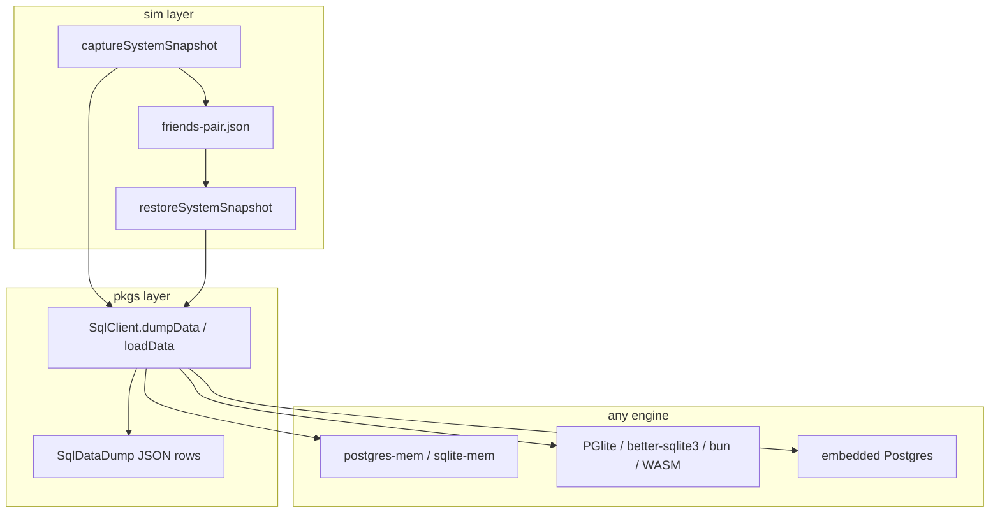

# Portable system snapshot file

Committed test snapshots are **one JSON file per world**. Capture/restore is **not** ad-hoc sim/test SQL — it is a first-class capability on `@pkgs/sql-client` (and thin Sim/KV facades on top), so the same dump works for fidelity `sim` (mem or PGlite), fidelity `max` (embedded real Postgres + real SQLite), and Playwright.

Opaque engine images (`exportBytes` / `importBytes` on [`SimSqlHandle`](sim/console/src/sim/sim-sql-handle.ts), PGMM/SQLM, PGlite dump) stay for **fast CoW seed cloning** only. They cannot load into real Postgres and must not be the committed fixture format.



## 1. First-class SQL dump/load (`@pkgs/sql-client`)

Extend the public SQL port so any product/sim code can unload and reload **logical table data** without knowing the engine.

### Types (new, next to [`interface.ts`](pkgs/sql-client/src/interface.ts))

```ts
/** JSON-canonical cell: null | boolean | number | string | nested JSON. */
type SqlDumpValue = null | boolean | number | string | SqlDumpValue[] | { [k: string]: SqlDumpValue };

type SqlTableDump = {
  readonly columns: readonly string[];
  readonly rows: readonly (readonly SqlDumpValue[])[];
};

/** Data-only dump. Schema always comes from migrate / existing DB. */
type SqlDataDump = {
  readonly version: 1;
  readonly tables: Readonly<Record<string, SqlTableDump>>;
};
```

Cell encoding aligns with [`type-map.ts`](pkgs/db-schema/src/core/type-map.ts): UUID/text → string, bool → boolean, timestamptz → ISO-8601 string, jsonb → nested JSON.

### API shape

Prefer **methods on `SqlClient`** (or a narrow extension every impl already satisfies) rather than free functions that poke `information_schema` from outside:

```ts
interface SqlClient {
  // existing: connect, disconnect, query, run, transaction, prepare
  /** List user tables (excludes sqlite_*/pg_catalog/information_schema). */
  listUserTables(): Promise<readonly string[]>;
  /** Dump all (or named) user table rows as portable JSON. */
  dumpData(opts?: { tables?: readonly string[] }): Promise<SqlDataDump>;
  /**
   * Replace dumped tables' contents. Assumes schema already migrated.
   * Disables FKs, clears tables, INSERTs, re-enables FKs.
   */
  loadData(dump: SqlDataDump): Promise<void>;
}
```

If bloating `SqlClient` is too invasive for production Workers, use a **capability interface** every sim/prod client implements and expose via the same package:

```ts
interface SqlDataSnapshotPort {
  listUserTables(): Promise<readonly string[]>;
  dumpData(opts?: { tables?: readonly string[] }): Promise<SqlDataDump>;
  loadData(dump: SqlDataDump): Promise<void>;
}
// SqlClient & SqlDataSnapshotPort for engines that support it
```

Either way: **one implementation path per dialect** (Postgres vs SQLite), shared by mem and real engines — not per-engine blob codecs.

### Dialect adapters (inside `@pkgs/sql-client`)

- **Postgres** (`PostgresSqlClient` / `dbScope`): list via `information_schema.tables` (same query spirit as [`listPlaygroundTables`](pkgs/sim-console/src/client/playground/playground-db-query.ts)); clear with `TRUNCATE … CASCADE` or `session_replication_role = replica` + `DELETE`; `INSERT` via `@pkgs/sql` tagged templates.
- **SQLite**: list via `sqlite_master` excluding `sqlite_%`; `PRAGMA foreign_keys=OFF`; clear + insert; restore `user_version` if we decide to store it on the dump metadata (optional field, not required for test worlds).

Reuse the insert pattern from [`sqlite-client-to-sqlm.ts`](pkgs/sim-console/src/server/sqlite-client-to-sqlm.ts), but lift it into sql-client so sim-console / playground stop owning copy logic.

### Contract tests

Add dump→load round-trips to the existing Postgres and SQLite contract suites (mem + at least one real engine each). Assert: empty → seed rows → `dumpData` → wipe → `loadData` → same row set (canonicalized).

### Keep opaque bytes separate

`SimSqlHandle.exportBytes` / `importBytes` remain fabric-specific for **schema seed CoW** (today’s `.cache/sim-backend-seed.*`). Do not teach real embedded Postgres to fake those. Max fidelity uses `loadData` on the live client instead of the current no-op `importBytes` stub in [`open-sim.ts`](sim/test/src/setup/open-sim.ts).

## 2. Sim system snapshot facade

On top of sql-client, one World type + two functions (live in `@sim/console` or `@pkgs/sim-console` shared):

```ts
type SimSystemSnapshot = {
  version: 1;
  localSchemaVersion: number;
  clockMs: number;
  clockPaused: boolean;
  clientIds: readonly string[];
  roomTopics: readonly string[];
  // fault fields as today
  server: SqlDataDump;
  clients: Record<string, { tables: SqlDataDump; kv: Record<string, string> }>;
  rooms: Record<string, SimCheckpointRoomDump>;
};

captureSystemSnapshot(sim /* + live client maps */): Promise<SimSystemSnapshot>;
restoreSystemSnapshot(sim, snapshot): Promise<void>;
```

- Capture: mutation drain → `serverSql.sqlClient.dumpData()` → per-client `dumpData()` + KV dump → rooms/clock.
- Restore: `loadData` on server + each client SQL → restore KV → rooms → clock → respawn clients.

Playground can keep OPFS sticky autosave on opaque blobs for latency, but should **also** be able to import/export this logical format (or migrate later). Test fixtures **only** use the logical JSON.

## 3. File format (committed fixtures)

One file: [`sim/test/fixtures/snapshots/<id>.json`](sim/test/fixtures/snapshots/) (pretty-printed). Example: `signed-in-alice.json`.

Zod-validate against `SimSystemSnapshot`. Stale `localSchemaVersion` fails closed with: run `bun run --filter @sim/test snapshot`.

No dialect SQL, no engine images, no fabric-keyed directories.

## 4. KV / auth dump (Node + web)

Playground dump today reads `localStorage` ([`dumpPlaygroundClientDurable`](sim/console/src/playground/playground-checkpoint-durable.ts)). Jest falls back to undumpable in-memory Maps.

- Install a process-wide `Storage` polyfill when `localStorage` is missing so namespaced KV/auth work in Node.
- Prefer first-class helpers next to the storage ports (`dumpNamespacedDurable` / `restoreNamespacedDurable`) so capture/restore does not scrape Storage ad hoc.

## 5. `openSim` + Playwright

```ts
await using sim = await openSim('space-create', { snapshot: 'signed-in-alice' });
```

- Fidelity `sim`: boot migrated schema seed → `restoreSystemSnapshot` (uses `loadData`).
- Fidelity `max`: wipe+`loadData` on live embedded Postgres; same for client SQLite engines.
- RNTL: client SQL + KV restored from the file.
- Playwright (default): after server `loadData`, inject bearer from `clients[id].kv` and wait for hydrate. Optional later: page hook calling the same `loadData` shape into browser SQLite if hydrate is too slow. Same file; no second format.

`PLAYWRIGHT_BASE_URL` must be this process’s sim server.

## 6. Builders (separate step)

AppDriver DSL scripts under `sim/test/src/snapshots/`, dedicated Jest config, package script `snapshot` (not a `test` dependsOn). Catalog: `signed-in-alice`, `signed-in-pair`, `friends-pair`, `both-in-space`. Empty world for auth / topology / guest profile.

Rewire scenarios to `{ snapshot: '…' }`; update template + [`TESTING.md`](sim/test/src/setup/TESTING.md).

## Out of scope

- Replacing playground sticky OPFS opaque autosave in the same PR (may keep blobs for speed)
- Dumping `CREATE TABLE` / migrate DDL into the fixture
- Fabric-specific committed copies of the same world
