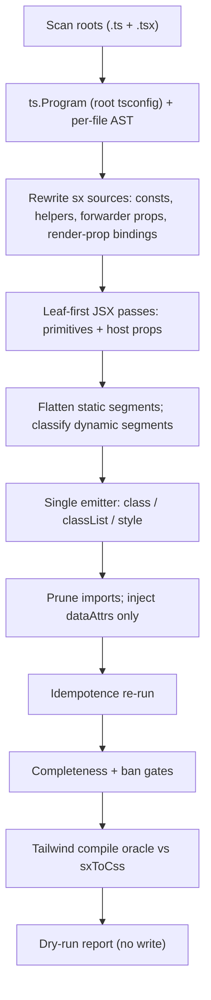

# Migrate-script readiness: one-shot Box/sx → web primitives + Tailwind

## Scope lock

**Deliverable:** `pkgs/ui/codemod/` can transform the **entire** repo in a single dry-run with zero leftovers and provable CSS parity. Every edge case that exists in the codebase is catalogued and tested.

**Not in this phase:** `--write`, deleting Box/sx runtime, hand-rewriting host implementations, wiring `base.css`/`theme.css` into apps, flipping AGENTS.md / Biome. Working tree stays unchanged.

**Styling contract (Solid builtins only, per [Solid class & style](https://docs.solidjs.com/concepts/components/class-style#dynamic-styling)):**

- `class` — static string or one ternary of static strings
- `classList={{ 'a b': cond }}` — any multi-conditional
- `style` — opaque/dynamic CSS only, object with **dash-case** keys
- Static `class` **before** `classList`; never a reactive `class` alongside `classList`
- **Banned everywhere in output:** `cn`, `clsx`, `classnames`, `twMerge`, `twJoin`, `cx`, `cva`, `joinClass`, or any string-merge helper

## Evidence (from repo audit, 2026-09-09)

- 1,158 sx-family JSX attrs: `sx` 1,125 · `frameSx` 33 · `enterSx` 5 · `exitSx` 1. `fieldSx`/`contentSx`/`wrapperSx` exist only as internal prop types.
- Shapes: static object 928 (6 with spreads) · identifier/member passthrough 130 · arrays 59 · ternary 10 · call-expression 32 · module-level `SxProps` constants 68 (45 in `pkgs/sim-console`, incl. `.ts` file `tokens.ts`) · 21 sx-returning helper functions · 31 files declare an `sx?: SxInput` forwarder prop (12 in `libs`).
- Receivers: Box 651 · Text 308 · Clickable 66 · ScrollView 29+30 · ExampleRoot 12 · Motion 8+6 · Center/Stack 7 each · Card 6 · lib wrappers (`SpaceCardGradientBox`, `UserUsername`, …) · Island/GradientBox/VirtualList/SpinnerBox/MenuList/FocusTrap/DataTable/icons.
- 25 `content={({ sx }) => …}` ScreenBase render props inject an `sx` binding merged as `[sx, {…}]`.
- Semantic readers of sx inside hosts: `Text` splits `color`; `ScrollView`/`VirtualList` sniff `frameSx.flex` (`requestsFlexFill`).
- `as=` is always a string literal (38 sites, 0 dynamic). `dataSet` 343 (122 with spreads, ~31 dynamic values).
- Values in the wild: `'100%'`, `calc(env(safe-area-inset-*))`, `var(--ui-duration-*)`, `'hairline'`, negative literals and negated identifiers, fractional scale steps, string `fontWeight`, raw `rgba()`/hex colors, `theme.colors.*` runtime colors, `transform: [{…}]` arrays, `fontVariant: ['tabular-nums']`, `absoluteFill`, `elevation`, `gridTemplateColumns` templates, `scrollSnap*`, `animationDelay`, `boxShadow` via conditional spread.
- Current dry-run: 518 files, A=767 B=271 manual=0, parseFailures=0 — **but** it emits `style={p.sx}` for passthroughs (wrong at runtime) and leaves all host `sx`/`frameSx` untouched. `manual=0` is not a correctness signal today.

## Correctness hazards the overhaul must close

1. **sx-typed values in `style`.** `style={props.sx}` / `style={paneSx}` ships `{ p: 4, color: 'primary' }` as CSS. Rule: an expression whose type is `SxInput`/`SxProps` may never land in `style`; it must be rewritten at its source (const, prop, helper) into class/style form.
2. **Merge semantics.** `flattenSx` is left-to-right last-wins; Tailwind class order is stylesheet order. Rule: (a) all-static arrays/spreads/ternary branches are flattened to one record **before** mapping; (b) when an unknown segment precedes a static override, the override is emitted as `style` (inline beats class ⇒ last-wins preserved); (c) when an unknown segment follows static segments, the unknown goes to `style` (same reason). Never emit two conflicting utilities for one property.
3. **Token-domain dynamics.** `color`, `background*`, `border*Color`, `borderRadius*`, `fontSize`, `lineHeight`, scaled shorthands (`p`/`gap`/…), `borderWidth: 'hairline'`, `elevation` take token keys, not CSS. A raw expression can't go into `style`. Resolution order: literal-branch expansion (ternary / `??` / `&&`) → `classList`; else type-checker classification (`ts.Program` from root `tsconfig.json`): union-of-token-literals → `var(--ui-…)` template or per-member `classList`; `number` → px template; plain `string` → raw; anything else → gate failure (never guess).
4. **Host semantics.** `Text` color split → `text-*` class; `requestsFlexFill(frameSx)` → contract becomes “`frameClass` contains `flex-1`/`grow`” (host impl update deferred, but the emitted classes must satisfy it); Motion `enterSx`/`exitSx` → `enterClass`/`exitClass` (+ `enterStyle`/`exitStyle` when opaque).
5. **Render-prop shadowing.** `({ sx }) => …` shadows the prop name; codemod must treat the binding as an SxInput source and rewrite to `({ bodyClass, bodyStyle })` with `class={bodyClass} style={bodyStyle}` (+ local overrides via rule 2).
6. **Forwarders.** `sx?: SxInput` props (and `BodyContentProps['sx']`) become `class?: string`, `classList?: Record<string, boolean>`, `style?: JSX.CSSProperties`; callers' static sx map to `class`, conditionals to `classList`, opaque to `style`. Spread carriers `{...(props.sx !== undefined ? { sx: props.sx } : {})}` are peeled the same way. `classList` is never forwarded through a spread (Solid limitation).
7. **Radix/quirk parity.** Preserve today's runtime CSS byte-for-byte (e.g. named `lineHeight` `px` quirk) — the oracle is `sxToCss`, not “what looks right”. Quirk fixes are a separate change.
8. **Corpus reach.** Roots must include `.ts` (const files) and `tests/` (`screen-base-logic.test.ts`, `button.test.tsx`), plus `apps/product`, `pkgs/sim-console`, `pkgs/collab-ui`, `pkgs/chess-board`, `pkgs/ui-testing-solid-dom`.

## Pipeline (target)



## Edge-case catalog (every row = at least one fixture; ids live in `codemod/tests/edge-case-catalog.ts`)

### A. Layout primitives (Box, Stack, Center, Spacer, Card, Divider)

- static sx → classes, attr removed, import pruned; no-sx Box keeps `.box`
- `as` literal renames open+close (all 13 tags seen: span/nav/h1/section/li/header/ul/main/h3/time/p/label/h2); non-intrinsic → default host
- nested primitives leaf-first (Text `label` wrapping Box; ≥3-deep nests; 64-pass ceiling)
- Stack direction/gap/align/justify/wrap static + dynamic; Center extras; Spacer `flex-1` + `aria-hidden`
- Card (`elevation ?? 1`, `[local.sx, {…}]` base-first) and Divider (`'hairline'`, orientation helper) → `div` + fixed classes
- existing literal `class` merge order; expression `class` → `classList`; static `class` precedes `classList`
- passthrough handlers / ARIA / `ref` / rest spreads verbatim; `{...rest}` after `splitProps` stripping sx
- shadowed local / param / nested const named `Box`; aliased imports; relative `../box` imports inside `pkgs/ui`; re-exports via `components/index.ts`

### B. sx value shapes

- pure literal; accessor call value `height()`; `props.*` value; ternary value; `??` value; template literal; arithmetic; `Math.*`; helper-call value; lookup-table value; `as const` value; comments inside literal; multiline `sx={\n …}`
- identifier passthrough (`sx`, `props.sx`, `local.sx`, `body.sx`, module const, function-local const)
- arrays: `[ident, {…}]`, `[{…}, ident]` (both orders), `cond && {…}`, ternary member, `false`/`undefined` member, fn-call member, nested arrays, `[CONST, {…}]`
- top-level ternary: ident:ident, `{…}:undefined`, `{…}:{}`, spread-in-branch, multiline
- call expressions: zero-arg accessor, positional helper, object-arg helper, wrapper-of-caller-sx
- object spreads: `...CONST` first, spread last, conditional spread `...(cond ? {…} : {})`, `...accessor()`
- spread attrs carrying sx; generic `{...props}` onto a purged primitive (must be resolvable or gate-fail)

### C. Key × value domain matrix (derived from `SxProps`)

- every key in `pkgs/ui/src/theme/sx-props.ts` has a static mapper and a dynamic classification; meta-test enumerates keys from the type via the checker so new keys fail CI
- scaled shorthands incl. fractional (`0.5`, `1.5`, `2.5`), negative literal, negated identifier
- dimensions: number, `'100%'`, `%` template, `'auto'`, `calc(env(...))`, `var(--ui-*)`
- colors: token, alias (`danger`→`destructive`), `'transparent'`, raw hex/rgba, `theme.colors.*` runtime, `onColor` context on Text
- radius keys vs numbers; fontSize/lineHeight keys vs numbers (px quirk preserved); fontWeight string vs number
- `borderWidth: 'hairline'` all four sides; `borderStyle`; per-corner radii
- `transform` arrays (translate/scale/rotate, static + dynamic members); `fontVariant` arrays; `absoluteFill` true/false; `elevation` static/dynamic with/without background; `boxShadow` vs elevation precedence; `background` vs `backgroundColor` precedence
- `display` grid/none/contents; `gridTemplateColumns` literal + template; `gridColumn` template; `inset`; `zIndex`; `pointerEvents` (incl. `'auto'`); `cursor` ternary; `userSelect`; `whiteSpace`; `letterSpacing` negative; `textTransform`; `fontStyle`; `lineClamp`
- transitions/animations: `transitionProperty` string concat, `transitionDuration`/`TimingFunction` `var()`, `animationDelay` dynamic
- `scrollSnapType`/`scrollSnapAlign` on `frameSx`; `aspectRatio` in helpers
- underscore-containing strings (Tailwind arbitrary-value escaping) never become classes

### D. Clickable / Text

- feedback tint/opacity/none/unknown/dynamic; explicit `type` vs default
- variant static → semantic host + `.text*`; dynamic variant `classList`; `as` over variant
- `label` + children `??`; `numberOfLines` static/dynamic; color extraction to `text-*`

### E. Hosts and forwarders

- ScrollView/VirtualList/ScreenBodyScrollView: `sx` only, `frameSx` only, both, neither; `frameSx={[{ flex: 1 }, local.frameSx]}`; `flex`/`flexGrow` presence maps to a class the host can detect
- Motion: `sx`, `enterSx`, `exitSx`, `DEFAULT_ENTER: SxInput`
- Island (`gridColumn` template), GradientBox, FocusTrap (`COVER_HOST_SX`/`SHEET_HOST_SX` ternary), SpinnerBox, MenuList (`[props.sx, cond ? { mx: -edgeStep } : false]`), DataTable (`dataTableShellSx(props.sx)`), icons (`ChevronDownIcon sx`), ExampleRoot, `TextInput.fieldSx` (declared, unused)
- lib wrappers: `SpaceCardGradientBox`, `UserUsername`, `SpaceTitleText`, guest/host name texts, `AccountDeviceList*Text`, `FriendUserScreenContent`, `ProfileHandleScreenBody` (`BodyContentProps['sx']`)
- forwarder prop declaration rewrite; call sites in other files updated in the same run (cross-file consistency assertion)
- ScreenBase `content={({ sx }) => …}` → `({ bodyClass, bodyStyle })`; `[sx, { gap: 5 }]` merge under rule 2

### F. Constants and helpers (non-JSX sx)

- `export const fooSx: SxProps = {…}` (typed) and `const fooSx = {…} as const` → `fooClass` string (+ `fooStyle` when needed); all readers updated
- helpers returning `SxProps` (`triggerSx`, `buttonSx`, `hitBoxSx`, `rowSx`, `useAppBodyContentSx`, …) → return `{ class, style }` shape or are inlined when single-use; consumers rewritten
- sx-shaped objects in tests (`buildBodyContentProps → { sx }`) rewritten

### G. dataSet

- static literal; spread `...props.dataSet`; dynamic values (ternary, template, `String(x)`, call); non-literal `dataSet={expr}`; keys that aren't valid `data-*` names → `dataAttrs(...)`

### H. Emission and bans

- output contains no class-helper identifier and adds no helper import; only `dataAttrs` may be injected
- `style` objects use dash-case keys; string `style` allowed only for pre-existing strings
- static `class` before `classList`; never both `class={expr}` (reactive) and `classList`

### I. Safety / CLI / determinism

- unparseable → parseError, original text, no throw; transform errors → parseError
- idempotence byte-for-byte; unrelated imports preserved; comments preserved
- no `TODO(sx-codemod)`; manual count stays 0 **and** is no longer the only signal
- completeness gate (below) is asserted in the corpus test

## Oracle and property tests

- **CSS equivalence oracle:** for every static sx literal in the corpus (≈900) and for fast-check-generated records over the full key space, compile `[base.css + theme.css + emitted classes]` with Tailwind v4 (`@tailwindcss/node`), resolve declarations for the element, normalize (`var()` refs kept symbolic, units normalized), and compare to `sxToCss(flattenSx(sx))`. Any diff fails. Extends `mapping-equivalence.test.ts`.
- **Dynamic classification property:** for generated ternary/`??`/`&&` expressions over token domains, the emitted `classList` evaluates to the same class set as mapping each branch statically.
- **Merge-order property:** random arrays of static/unknown segments → computed final declaration per property equals last-wins flatten.
- **Type-domain property:** every `SxProps` key's declared type is covered by exactly one classification; unions containing token literals never reach raw `style`.

## Completeness gate (fails dry-run / corpus test)

Transformed outputs across all roots contain **zero**:

- `sx=`, `frameSx=`, `fieldSx=`, `enterSx=`, `exitSx=` JSX attrs; `sx:` keys in objects spread onto JSX
- `<Box|Stack|Center|Spacer|Card|Divider|Clickable|Text` tags and their imports
- `SxInput` / `SxProps` / `flattenSx` / `sxToCss` / `tokens.css(` references outside `pkgs/ui/src/theme/**`
- `style={<expr typed SxInput|SxProps>}`
- class-helper calls or imports
- `TODO(sx-codemod)` markers

Plus: `parseFailures=0`, `unstable=[]`, working tree unchanged.

## Implementation work (script + tests only)

1. **Catalog module** with ids per row above; meta-test enforces coverage.
2. **`ts.Program` integration** in `run-codemod` (pure; files provided in memory, program from root `tsconfig.json`); checker-based classification helper.
3. **Source rewriters** (constants, helpers, forwarder props, render-prop bindings) run before JSX passes; cross-file edits tracked in one transaction.
4. **Static flattening + override rule** in `transform-node.ts` / `transform-shared.ts`; branch expansion into `classList`.
5. **Host converters** for every receiver in E; remove or wire dead `BEHAVIOR_HOSTS`.
6. **Emitter** hardening: dash-case, ordering, helper ban invariants.
7. **Gate** implementation + corpus roots widened in [`cli-io.ts`](pkgs/ui/codemod/cli-io.ts) and [`corpus.test.ts`](pkgs/ui/codemod/tests/corpus.test.ts) (include `.ts`, `tests/`, all listed packages).
8. **Oracle** test harness with Tailwind v4 compile.
9. Flip obsolete assertions (“ScrollView left untouched”, “identifier sx becomes style passthrough”) to the new contract.

## Success criteria

```bash
bun run --filter @pkgs/ui test      # catalog + oracle + properties + corpus
bun run --filter @pkgs/ui codemod   # dry-run only; never --write in this phase
```

- Every catalog id has a green fixture
- Oracle: 0 declaration diffs across corpus + generated records
- Gate: 0 leftovers of any kind; `parseFailures=0`; `unstable=[]`
- `git status --porcelain` empty after the run

## Deferred (next phase)

Land `--write`; update host implementations to the class-prop contracts (ScrollView `requestsFlexFill` on classes, Motion, Text); wire `base.css`/`theme.css`; delete Box/sx runtime + `joinClass`; rewrite AGENTS.md and Biome to ban `sx` and class helpers repo-wide.
