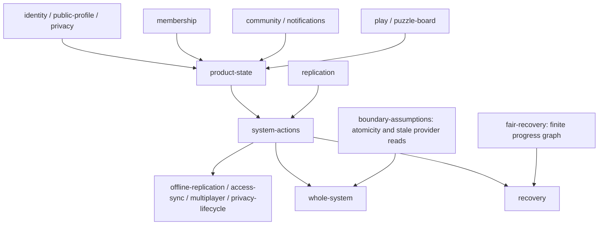

# Whole-system verification campaign

The Quint modules live in [specs/system](../../../../../specs/system/).
They compose the domain specifications; the runners and verification adapters
remain in this directory. Product semantics remain in
[specs](../../../../../specs/README.md), and every interpretation declares the
canonical spec domains it translates. Test-meta models carry `@spec-meta`.
Repository mechanisms remain in [README](../../../../../README.md). Moving
the modules does not change their modeled behavior.

The campaign is repeatable. `test:quint-system` checks type correctness, seeded
traces, literal adversarial paths and fault sensitivity. `test:contract` checks
bounded symbolic safety and the finite temporal model; both participate in Check.
`explore:quint-system` runs the extended campaign using the already installed,
pinned Rust evaluator. It refuses to download tools. Run these from `apps/product`.

## Composition and state map

Arrows from `fair-recovery` and `boundary-assumptions` denote verification
obligations, not imported executable transitions. Pure subsystems share their
semantics with the smaller schedulers and the whole-system scheduler. There is
one representation of each owned aggregate, rather than copies for each layer.

| Important state | Owner and durability | Ways it changes | Dependencies and forbidden states |
| --- | --- | --- | --- |
| Account availability, current capabilities, identity links | Auth authority; device capability copies | Registration, global revocation, new sign-in, forgetting a device session, deletion, link proposal/consent/expiry/unlink | Admission checks the current capability. Identity/provider uniqueness; no last-method removal; session-bound consent. Saved commands retain their actor, not an obsolete capability. |
| Subscription standings | Two outside providers; canonical projection and device copies | Provider callbacks, cancellation, refund, provider disagreement, time, snapshot delivery | Precedence and before/at/after grace; cached confirmation expires; paid decisions use the acting person's facts. |
| Space identity, host, membership references, selected game | Space authority; durable | Create, public join, leave/end, add/remove reference, game choice, deletion | Host differs from membership and live presence. A reference to a deleted account cannot restore access. |
| Friendship requests, directed blocks, cooldown, pending inbox events | Social authority; durable | Ask/accept/decline/cancel/remove/block/unblock, delayed repeated delivery, deletion | Mutual blocking cannot be undone by one actor. Delivery rechecks current request/block facts. |
| Public profile name and saved settings | Profile authority; device projections | Rename collisions, repeated save, short cooldown, normalized name classes, refused requests, deletion | Normalized names remain unique; refusals retain the accepted value. |
| Puzzle quota charges, first recorded result, repeated matches | SQL authority; durable | Start/finish/retry, day boundary, in-place guest upgrade, matchmaking wait/cancel/pair/finish/repeat, deletion | Limit plus one distinct puzzle is reachable; duplicate results count once; no actor in two live matches. |
| Room board and captured outcome delivery | Room authority; outcome delivery is a separate stage | Open/correct/wrong/reveal/skip/reset/leave/resume, offline optimism, retry, delayed SQL result | Host checks and valid board phases. Room and SQL commands have separate ordering; result delivery does not depend on the board still showing the old puzzle. |
| Account/export/cancellation/refund lifecycle | Privacy authority plus two providers | Recent proof/expiry, export preparation/failure/retry/expiry, confirmed deletion, retention deadline, separate provider confirmations, distinct/duplicate late charges and refunds | Deleted actors cannot write; exports stay private/unusable after deletion; duplicate refund of one charge cannot consume another charge. |
| Local baseline, speculative peer rows, queues, acknowledgements, checkpoints, push floors | Each device independently; queues and row images are durable, replies ephemeral | Disconnect/reconnect independently, enqueue, upload/retry/refusal/ack, capture/delay/drop/receive, push, peer speculation, crash/restart, account switch | No lost durable intent or duplicate effect. Acknowledgement preserves local rows and invalidates older replies. Delayed authoritative images cannot revive pushed deletions. Peer speculation is never authority. |

## Coverage ledger

“Safety” means a property of the abstraction. It does not mean its implementation
binding has been established. The whole-system models are not bound to an entire
live product harness. The confirmed sync regression below does run the real API.

| Domain | State / transitions | Failure and retry | Local safety | Cross-system safety | Temporal | Subsystem verification | Whole-system participation | Limits |
| --- | --- | --- | --- | --- | --- | --- | --- | --- |
| Authentication | Yes | Revocation, expired consent, stale/shared devices, conflicting links | Identity/provider exclusivity, last-method guard | Current capability + original actor + deletion | Existing auth models; no new universal auth liveness proof | `identity-machine` and existing auth models | Yes | Account generation/provider protocol details remain in existing focused suites; global revocation represents ending all account capabilities. |
| Billing | Yes | Duplicated/reordered facts, grace, refunds, multiple providers | Governing standing, confirmation and grace boundaries | Access/hosting/customization + offline acceptance + deletion | No unconditional provider completion | `membership-machine`, existing billing models | Yes | Provider-owned money arithmetic/credit/tax is abstracted to standing classes. Stale in-flight provider reads are a separate diagnostic obligation. |
| Permissions | Yes, shipped policy | Fresh server facts versus stale client hints | Quota/host/account decisions | Auth, membership, space roles, game/results | No permission revocation latency claim | `access-sync` plus existing decisions | Yes | Configured policy is fixed; policy-version history is covered by existing permission tests, not this whole-system graph. |
| Spaces | Yes | Lost acknowledgements, member removal, ended links, duplicate joins | Lifecycle/host/reference integrity | Deleted actors, board commands, hosting limits | Conditional visibility through recovery | `multiplayer`, existing space models | Yes | Public links permit rejoining; membership is not ephemeral socket presence. |
| Friends / inbox | Yes | Crossing requests, directed blocks, cancel/decline/cooldown, delayed repeated events | No blocked friendship/request | Current accounts and delivery-time block/request facts | Recovery covers projection transport; no unconditional inbox SLA | `multiplayer`, existing friends models | Yes | Inbox contents and search strings are equivalence classes; event retention/storage scheduling is external. |
| Notifications | Yes: source, active/read/archive/dismiss flags | Duplicate/reordered sent/closed delivery; old-source ABA in focused model and real regression | Recipient ownership, source identity, duplicate preference preservation | Current request/account, directed blocks, deletion | No inbox SLA; deactivation may lag | `notification-machine` | Yes | Whole composition folds repeated request generations for one pair; focused sources and real exact-id regression retain the distinction. Expiry/pagination and accepted-message presentation stay outside this graph. |
| Profile | Yes | Name collisions, case equivalence, repeated/refused saves | Unique names and unchanged refused state | Deletion and per-actor writes | Conditional projection visibility | Domain scheduler and existing username model | Yes | Text/avatar validation is a separate deterministic contract. |
| Chess / progress | Yes | Offline board, independent room/SQL delivery, repeated results, interrupted/resumed play, midnight, cache availability | Board phases, charge/rating idempotency, quota | Host, account conversion, room result delivery | No unconditional result delivery under a lost durable effect | `multiplayer`, `access-sync`, existing puzzle model | Yes | Correct/wrong move classes replace chess positions; rating arithmetic/feed ranking remain in focused tests. Guest limit is reduced from 20 to 2, with 3 distinct puzzles. |
| Matchmaking | Yes | Cancel, duplicate intent, overlapping actors, finish/rematch | One live match per actor | Current account and deletion | No claim of matching without eligible peers | `multiplayer`, existing matching model | Yes | Queue lease/claim/infrastructure phases remain in the package model/contracts. |
| Privacy | Yes | Offline/stale proof, pending/failed exports, cancellation not yet confirmed, distinct/duplicate refunds | Export lifetime, no account restoration, retained ordinary-data deadline | Auth, profile, spaces, progress, subscriptions | Deadline transitions are contract obligations, not verified production jobs | `privacy-lifecycle`, existing privacy model | Yes | Account deletion/export feature bindings are incomplete. Legal holds, restored backups and seven-year financial retention are not established here. |
| Sync / transport | Yes | Independent partitions, crashes, losses, duplicates, delayed snapshots and peer speculation, stale accounts | Queue conservation, exactly-once verdict/effect, fences | All modeled command domains | Finite fair recovery + sampled ranking argument | `offline-replication`, `recovery`, existing note models | Yes | One complete representative hydration scope per device; arbitrary overlapping partial scopes need separate evidence. |
| Room persistence / outbox | Explicit boundary model | Commit between log/retry/effect stages, restart, duplicate retry | Conditional atomic log + retry + durable effect obligation | Board/result scheduling | Lost scheduling has a diagnostic counterexample | `boundary-assumptions`, existing room/outbox contracts | Logical effects plus boundary obligations | Production room storage uses separate durable calls; their atomicity is not established by the whole-system pass. |
| Runtime / infrastructure / reports | Mechanism classes | Unavailable transport/provider/storage before commit; crash after commit; cached offline opening | Durable intent remains retained | Fixed ports, authority availability, compatible client | Fairness/return assumptions explicit | Existing runtime/platform/health/contracts | Through ports and failure actions | Protocol mismatch is equivalent to an unavailable server until upgrade; UI, infrastructure recovery, fleet capacity and generated reports are not verified by this logical model. |

## Audits and refinements

1. **State coverage:** inspected every specification domain, existing model
   inventory and product/framework layouts. Added separate canonical, projected,
   speculative, durable and ephemeral state, instead of an atomic reconnect-all.
2. **Transition coverage:** followed replay, merge/rebase, account provisioning,
   scope invalidation, room commit, provider projection, outbox and matchmaking.
   Added failure/retry and independently returning devices.
3. **Invariant coverage:** searched constraints, access decisions and regressions.
   Added uniqueness, effect conservation, original-actor fencing, quota limit plus
   one, first-result idempotency and immutable deletion monitors.
4. **Cross-system coverage:** added billing/permissions/hosting, space removal
   during offline edits, deleted accounts across aggregates, room/progress
   ordering, delayed outcome delivery and cancellation/refund stages.
5. **Adversarial coverage:** pinned losses, duplicate acceptance, stale reply
   fences, crash persistence, public rejoin, two-way block/unblock, name claims,
   rematching, late charges, inbox read/archive/dismissal and cached offline boards as literal paths.
6. **Abstraction soundness:** corrected three unsupported assumptions: an owner
   must always be a member; a membership reference equals live presence; an old
   saved command is invalid after a legitimate fresh sign-in to the same account.
   Source review supports current authorization and actor-scoped databases.
7. **Verification effectiveness:** nine isolated faulty model copies must
   produce assertion counterexamples. A weak acknowledgement-fence example was
   exposed by a surviving mutant and strengthened with an unrelated newer server
   revision. Parse errors, zero executed examples and timeouts cannot count as
   successful fault detection. Removing fairness must also produce a TLC
   starvation counterexample, rather than merely fail a safety assertion.
8. **Fresh review:** reread product entrypoints, queues, provider workflows,
   regressions and TODO/race comments without using the model inventory. Added
   optimistic peer rows, independent room/SQL ordering, missed result observation and notification lifecycle, and distinguished
   subscription/identity/space rows from usable access. Remaining findings are
   explicit boundary/implementation obligations below, not silently excluded
   transitions presented as verified guarantees.
9. **Post-refinement reviews:** compare the final state ownership map to schemas;
   compare every mutation, inbox REST write, room command and provider/outbox entry
   to the transition inventory; compare crash/retry and consent/deletion boundaries
   to the remaining abstraction obligations. Findings already represented or listed
   as unestablished implementation evidence are kept visible. These passes do not
   erase the implementation gaps or prove arbitrary cardinalities.
10. **Monitor audit:** guards alone are insufficient evidence of authorization.
    Added independent before/after assertions for the actor, current capability and
    permission of each newly accepted command, plus a monitor that a duplicate
    cannot change authority. This avoids proving security only through the same
    admission condition used by the transition.

## Counterexamples and classification

- **Confirmed product defect, fixed:** a cancelled request's delayed sent event
  recreated an active notification. The real consumer regression is
  [closed-request-delivery.test.ts](../../../../../libs/friends-server/tests/closed-request-delivery.test.ts),
  `friend-closed-request-late-notification`. It also pins a newer request between
  the same people, proving that the old event cannot substitute for the new id.
  Delivery now checks the exact current pending request before publishing.
  This establishes close-before-consumer ordering, not arbitrary database isolation.
- **Source-backed progress limitation, represented:** the puzzle recorder reacts
  to live status changes; restoring a finished state does not record the lost
  transition. `lostRoomObservationDoesNotPromiseARecordedResultTest` allows a lost
  notification, crash and restoration without rating. Captured saved work is
  protected separately; no unconditional puzzle-result completion is claimed.
- **Confirmed product defect, fixed:** an identical retry of a permanently
  rejected mutation returned an applied verdict. The real HTTP regression is
  [rejected-retry.test.ts](../../../../../pkgs/sync-engine-server/tests/rejected-retry.test.ts),
  `sync-rejected-retry-verdict`, registered in
  [known-bugs/](../../../../../libs/tools/goal/known-bugs/). Replay now reads
  the stored terminal rejection instead of treating every duplicate as applied.
- **Incorrect abstraction, corrected:** eight-device multiplayer exploration
  reached a delayed host addition after the target account's deletion. A durable
  reference alone is not presence or usable access. The minimized path remains
  `delayedMembershipReferenceCannotRestoreDeletedAccountTest`; access remains
  impossible without constraining the host action out of existence.
- **Missing implementation guarantee / possible product defect:** two independent
  read-count/write transactions can both admit a second hosted resource. The
  inspected create/quota paths do not visibly establish a shared actor lock or
  serializable isolation. `unprotectedCountRaceTest` preserves the schedule. This
  is a source-backed risk, not a completed concurrent Postgres reproduction.
- **Missing implementation guarantee / possible product defect:** room commit
  appends entries, then stores retry outcome, then applies effects. Restart
  between these stages can duplicate a command or lose scheduling. See
  `missingAtomicLogOutcomeTest` and `missingDurableEffectTest` and
  [room-server.ts](../../../../../pkgs/room-root-server/src/room-server.ts).
  The positive boundary model demonstrates the atomicity/durable-work obligations;
  it does not claim those obligations are already satisfied by production.
- **Missing implementation guarantee / possible product defect:** an old provider
  read may complete after a newer projection and overwrite it. `staleProviderReadTest`
  preserves the read/modify/project ordering. A fresh provider reread alone is not
  an ordering fence for independently in-flight reads.
- **Verification weakness, corrected:** a broken acknowledgement fence initially
  survived because another guard already rejected the old snapshot. The improved
  example requires a reply newer than the local checkpoint, so the broken fence
  now produces the intended assertion failure.

## Safety versus progress

Safety checks assert canonical integrity and preserved durable intent at each
explored state. They deliberately permit disconnected/stale/speculative views to
lag and temporarily disagree with authority. They do not assert that acknowledging
one write synchronizes every other row or that denial erases an offline cache.

`fair-recovery` uses TLC to explore its complete finite graph, including cycles,
under weakly fair recovery after quiescence. It includes permanent refusals,
lost acknowledgement, independent return, speculative dirt and later visibility.
It assumes finite pending work, stable permission facts and eventual service.
`recovery` checks a strictly decreasing natural rank on the richer protocol,
including longer queues. Extended exploration folds the absorbing recovered stutter suffix into one terminal state without removing any changing transition. Its unbounded temporal declaration is an obligation;
random safety exploration and bounded Apalache checks do not prove it.
There is no unconditional progress promise during permanent partition, endless
new writes, deleted-account quarantine or permanently unavailable providers.

## Exploration and evidence

An empty queue's settled-view invariant compares the baseline directly: pending
local effects are absent and speculative note images are either absent or masked
by denied scope. This preserves the predicate while avoiding repeated projection.
Large symbolic checks use three devices (two sharing actor zero, one for actor one,
any able to sign into actor two); all actors/resources/transitions remain. Their
transformed source sets and reductions are recorded. Simulation retains four and
eight devices. This is an explicit smaller cardinality bound, not an exhaustive
four/eight-device symbolic result. Four-client symbolic checks exceeded their
120-second deadline; that is missing evidence, not a successful verdict.

Final measurements are recorded below after the stable-source runs complete.
The cached campaign draws 2,350 deterministic traces, with at most 229,000
transitions in total. Symbolic depths are 5 for identities, 8 for membership,
notifications, atomicity obligations and finite recovery, and 2 for the large composed models.
The extended campaign draws 45,000 traces across three seeds and four/eight-client
bounds, each up to 250 transitions: at most 11.25 million transitions, not 10.5
million distinct states or an exhaustive whole-product proof.

Artifacts live in `apps/product/.cache/harness-report/models/`: evidence records,
source-set SHA256, seed/backend/bounds, last ITF traces and preserved failure
counterexamples. The digest covers both the interpretation modules and every
canonical spec domain they declare. Four-client and expanded eight-client source
sets are hashed separately. A run fails if either source set changes during
verification.

## Abstractions and outstanding evidence

- Three representative people, two spaces and three puzzles; four or eight
  independently failing devices, with multiple devices per account. This exposes
  shared-account races and third-party interactions, not arbitrary-cardinality
  correctness. Queues and sequence numbers are not silently capped; trace horizons
  are explicit. Finite temporal recovery instead bounds work to one edit per device.
- Server acceptance is a logical transaction. Separate SQL/room ordering and
  post-room result delivery are represented, but production isolation, durable
  room effects and provider projection ordering remain explicit obligations.
- Full logical snapshots preserve aggregate relations. They are not literal
  wire payloads containing everybody's private data. Scope access, old generations,
  push/ack fences and peer speculation are explicit; per-table SQL encodings,
  arbitrary overlapping scope mixes and Byzantine payload construction are not.
- Provider outages, rate limiting, incompatible protocol and pre-commit storage
  failure map to unavailable/failed attempts. Their precise timer/backoff/wire
  encoding is a port contract. A permanently incompatible client is outside the
  eventual-return assumption; no local wipe is modeled as its recovery.
- Days and boundary classes abstract wall time; arbitrary skew, exact calendar
  calculations and production scheduling budgets remain outside the proof.
  Privacy erasure/expiry transitions are intended contract behavior; the retained-data flag is not a per-table erasure proof; passing them
  cannot certify the missing production jobs or restored-backup deletion fences.
- Chess legality, rating arithmetic, text validation, payment amounts/credit and
  provider cryptographic protocols stay in existing focused tests/models. Their
  logical outcomes feed this composition; these passes do not replace those suites.

Additional limits made visible by the final repository inventory: developer-tool
notebook/checkpoint/report state machines are not composed here; room tally and
timed-match examples use their existing focused models; socket-presence leases
and arbitrary overlapping hydration scopes are not modeled as complete whole-system
state machines. The shipped game registry currently contains chess. These gaps
prevent claiming an exhaustive model of every repository surface.

## Confidence and release status

The campaign supplies strong evidence for the *modeled* safety properties under
its stated bounds and assumptions, and finite fair recovery under its stated
conditions. Fault sensitivity, concrete edge paths, source investigation,
independent device schedules and expanded-cardinality exploration support that
claim. They do not establish that every product requirement is modeled, that all
implementation bindings conform, or that the production application is correct.

The broader spec audit already has unbound privacy/deletion/retention/layout
behaviors and an unowned developer-tools domain. Those failures predate this
campaign and still prevent treating a model pass as a release decision. No remote
Check verdict for these uncommitted changes is claimed: `bun check` invokes the
repository's commit/push/trunk-sync flow, and this shared checkout contains other
in-progress work. The full local Check result is recorded with the measurements. The source-backed privacy audit gaps are reported separately from the local Check failure, which stopped in the existing room tally model on a timeout and a task-budget overrun.
