# Product map

The source is one hierarchical machine:
[`specs/product.machine.json`](../../specs/product.machine.json). There are no
separate capability charts to select in Atlas. State names and ids are
globally unique, and transitions can cross region boundaries by targeting
those names. The compiler attaches the exact business catalog without
changing the authored topology.

The root keeps identity and this device's navigation active in parallel.
Access belongs beneath the signed-in account. A capability region is active
while its owning navigation branch is active; its opening states observe
existing records when revisited. A visit does not create a new puzzle, game,
search or relationship.

```mermaid
flowchart TD
  product[Whole product] --> identity[Current person]
  identity --> access[The signed-in account’s access]
  product --> app[This device]
  app --> profile[Profile]
  app --> sign_in[Signing in]
  app --> sign_in_methods[Sign-in methods]
  app --> settings[Settings]
  app --> privacy[Privacy]
  app --> billing[Billing]
  app --> spaces[Spaces]
  app --> friends[Friends]
  app --> inbox[Notifications]
  app --> games[Games]
  app --> puzzles[Puzzles]
  app --> puzzle_feed[Puzzle feed]
  app --> puzzle_links[Puzzle links]
  app --> puzzle_history[Puzzle history]
  app --> multiplayer[Multiplayer]
  app --> custom_game[Custom game]
  app --> puzzle_ingest[Puzzle import]
  app --> feedback[Feedback]
  app --> tools[Tools]
  app --> connection[Opening without connection]
  tools --> test_worlds[Test worlds]
  tools --> notebook[Data notebook]
  tools --> reports[Automated reports]
  tools --> release[Release check]
  tools --> environment[Environment]
  tools --> notes[Notes example]
  tools --> room[Room example]
  tools --> matchmaking[Matchmaking example]
  tools --> chess_board[Chessboard example]
  tools --> database_maintenance[Maintenance contract]
  tools --> inspectors[Inspection scope and contract gaps]
```

| Region | Context contract | Purpose |
| --- | --- | --- |
| access | billing | Paid access follows the current person across every place in the app and is decided by permission policy. |
| app | runtime | This device starts at Spaces and keeps its own place while the person visits the product’s capabilities. |
| billing | billing | Plus checkout, renewals, cancellation, grace and refunds determine the person’s paid access. |
| chess-board | chess-board | Board controls support selecting, dragging, keyboard play, promotion, marks, sounds and independent boards. |
| connection | runtime | Opening offline distinguishes a device with saved app data from a fresh device, and recovery preserves the person’s place. |
| custom-game | chess | A host configures people or bots, gets readiness for the current choices, then plays and reviews an unrated Custom Game. |
| database-maintenance | db-indexes | The maintenance contract tracks planned, interrupted and retired work without creating a player-facing feature. |
| environment | runtime | The team keeps each declared environment reachable, isolated, observable and recoverable without exposing personal data. |
| feedback | feedback | The person keeps a draft, optionally records reproduction, and sees submission and management outcomes. |
| friends | friends | Searching, asking, accepting, declining, cancelling, removing and blocking keep relationships explicit. |
| games | chess | The host chooses puzzles, private multiplayer chess or a Custom Game; participants watch as permitted. |
| identity | profile | The device keeps its own current person while the person explores the app. |
| inspectors | developer-tools | Diagnostic and component-reference surfaces remain visible with their addresses and incomplete contracts. |
| inbox | friends | Inbox notices preserve an explicit choice and show when the underlying request has ended. |
| matchmaking | matchmaking | A person maintains one wait, compatible rating ranges and a durable complete-group outcome. |
| multiplayer | chess | A private multiplayer game joins opponent search, timed play, results and rematch into one continuous flow. |
| notebook | developer-tools | Each selected device keeps its notebook questions and their answers. |
| notes | sync-engine | The framework example keeps owned and shared notes across offline work, conflicts, deletion and refused edits. |
| privacy | profile | A person proves their account before exporting personal data or confirming permanent deletion. |
| product | system | Explore the whole product from one chart: the current person and this device’s place change together. |
| profile | profile | The person edits their public profile while refused edits leave the saved profile intact. |
| puzzle-feed | chess | Feed edits preview eligible choices; saving applies them and cancelling keeps the saved feed. |
| puzzle-history | chess | Puzzle history and statistics show the person’s recorded attempts and skill without changing earlier outcomes. |
| puzzle-ingest | chess | An allowed person adds puzzle material and sees accepted and broken items or a retryable failure. |
| puzzle-links | chess | A shared puzzle link opens that puzzle with the permitted rated or practice behavior. |
| puzzles | chess | The current puzzle stays connected to moves, hints, review, results, limits and offline watching. |
| release | developer-tools | Release decisions require a current automated pass for every obligation of the same edition. |
| reports | developer-tools | The team explores every spec and its current automated evidence, including missing or unavailable reports. |
| room | room | The framework example joins room ownership, presence, a shared tally and a timed match. |
| settings | runtime | Device preferences survive closing the app; account and product choices remain reachable from Settings. |
| sign-in | auth | Google and Apple identify the person; account matching always preserves the person’s choice. |
| sign-in-methods | profile | A person connects and removes sign-in methods without losing the last way into the account. |
| spaces | spaces | People create, join, share, rename, leave and end spaces, with clear limits and recovery. |
| test-worlds | developer-tools | The team selects independent devices, changes their arrangement and saves or restores compatible checkpoints. |
| tools | developer-tools | The testing tool reaches test worlds, notebooks, reports, release evidence and the framework example apps. |

The current machine has 350 states and 906 transitions.
[EXECUTION_NOTES.md](EXECUTION_NOTES.md) records complete graph traversal and
serialization checks; [SOURCES.md](SOURCES.md) explains the source catalog.
Framework contracts and inspection-scope choices retain their declared
boundaries and do not imply new player tabs.
