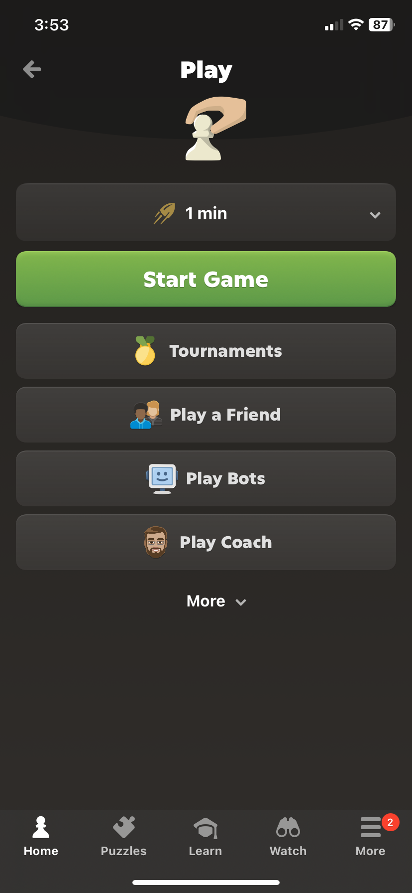
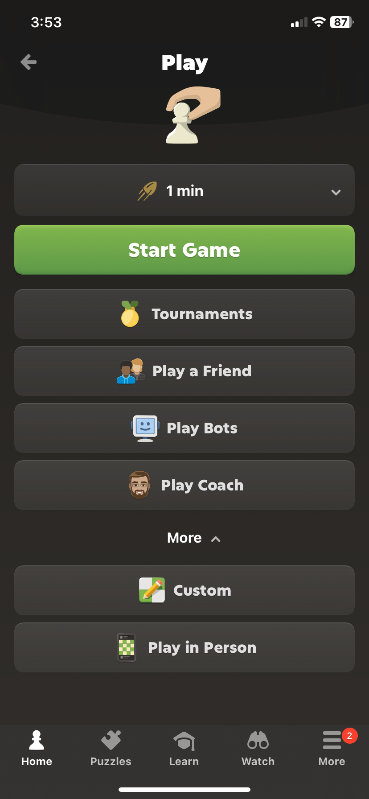
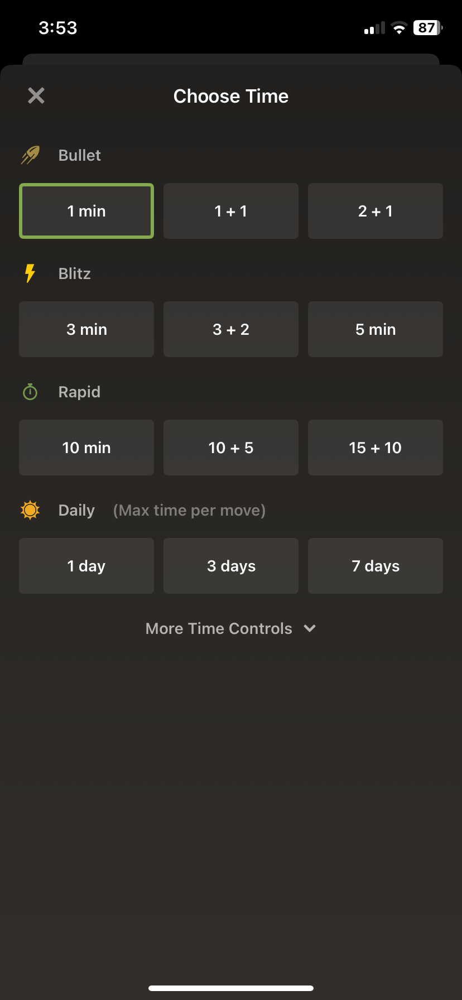

# Choose how to play a game

Observed on 2026-11-26 in three supplied screenshots of [Chess.com for iOS](https://apps.apple.com/us/app/chess-play-and-learn/id329218549), published by Chess.com.

IMG_0658. The current time control sits directly above Start Game. Other modes have full-width buttons with pictures. More is collapsed.

IMG_0659. Expanding More adds Custom and Play in Person below the existing modes. The primary action and bottom navigation keep their positions.

IMG_0660. A dismissible sheet groups presets by speed in three-column rows. An outline identifies the current choice.

## Design implications

Give the first available play mode a prominent full-width control. Show the remaining modes, history, settings and lessons as direct rows in catalog order. For timed games, group the existing presets by speed and keep the selected time visible. The screenshots leave desktop sizing and untimed games open. See the [stage references](../../games-shared-ts/docs/game-stage/MARKET_RESEARCH.md) for the transition into play.
