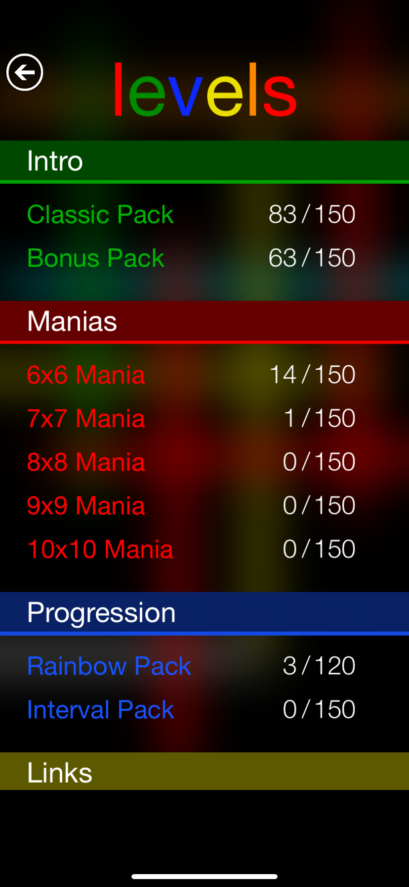
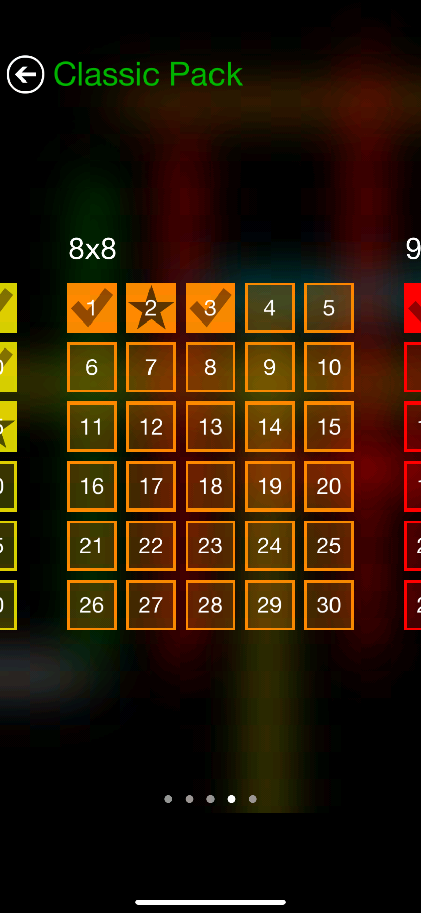
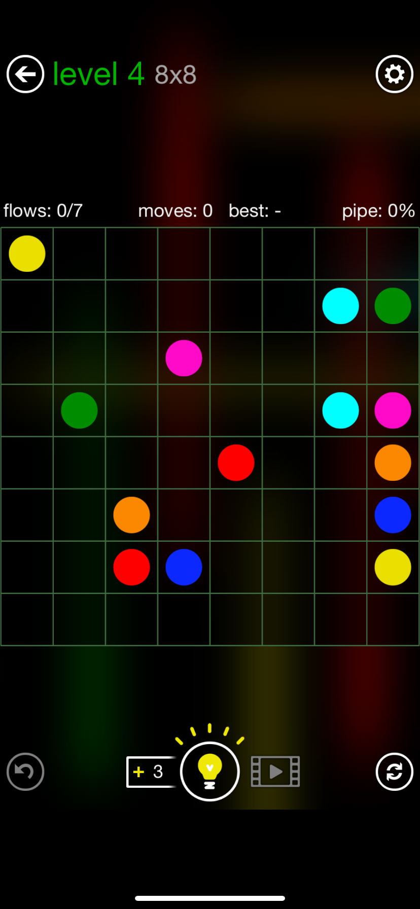

# Choose a pack and play a puzzle

Three screenshots supplied on 2026-11-26 follow a player from the pack list to level 4 of Classic Pack in Big Duck Games’ [Flow Free for iOS](https://apps.apple.com/us/app/flow-free/id526641427).

## Choose a pack

IMG_0661. Each row pairs a pack name with its progress. Classic Pack shows 83/150. A player can compare progress across packs before opening one.

## Choose a puzzle

IMG_0662. The 8×8 page shows puzzles 1–30 in six rows. The first three tiles have check or star marks behind their numbers. Level 4 is outlined. Page dots and the edges of the neighboring grids show that more groups are available.

## Play the puzzle

IMG_0663. The top row shows Back, the level number, board size and Settings. Immediately above the board are the connected pairs, moves, best and fill percentage. Undo, hint and restart sit below the board.

## Direction for Gamezilla

Keep the pack chooser as a list with progress beside each pack. Opening a pack should show its puzzles in a numbered grid where a player can recognize completed puzzles and choose the next one. Opening a tile should lead directly to a stage with space controls at the top, puzzle status above the centered board and puzzle actions in a stable bottom bar. See the [shared game-stage comparison](../../../games-shared-ts/docs/game-stage/MARKET_RESEARCH.md).

The captures show a pack grouped by board size. How should a pack of mixed puzzle sizes or named, user-authored puzzles identify each tile?
