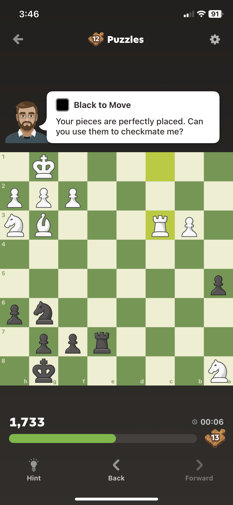
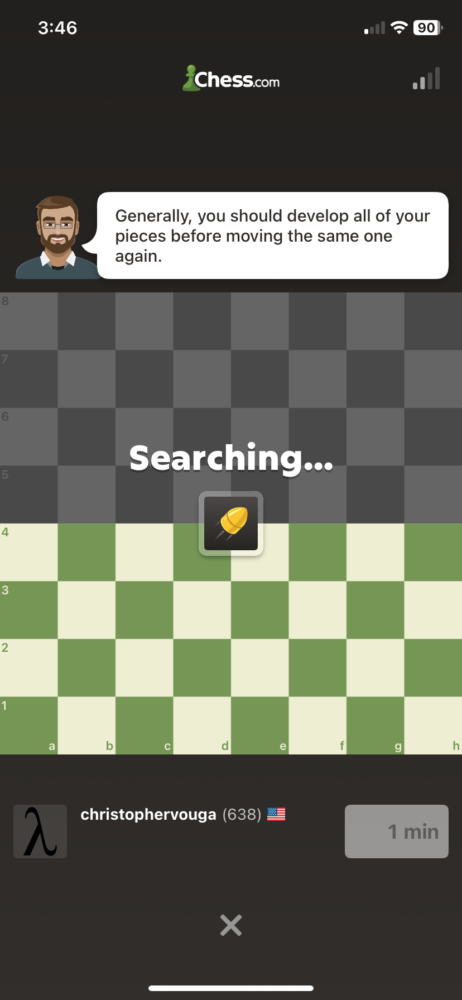
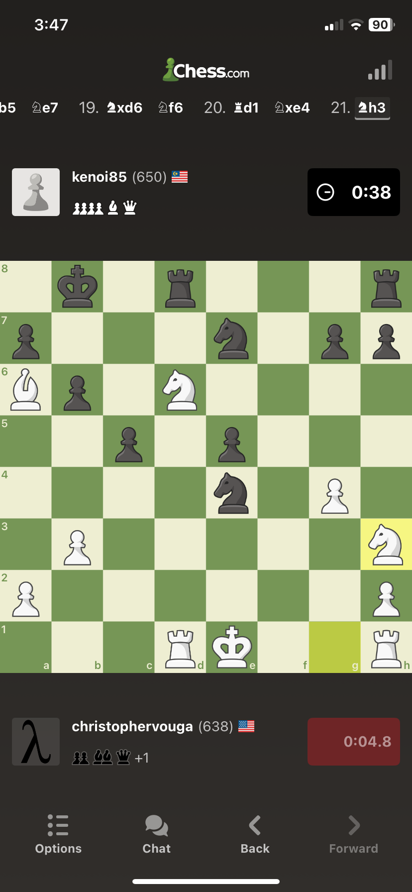
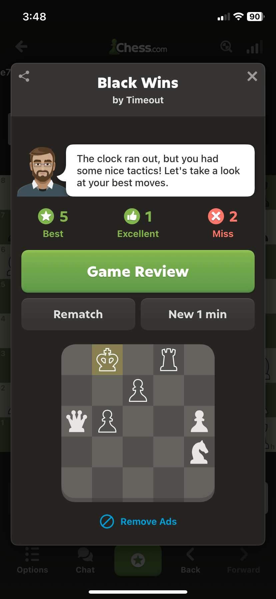
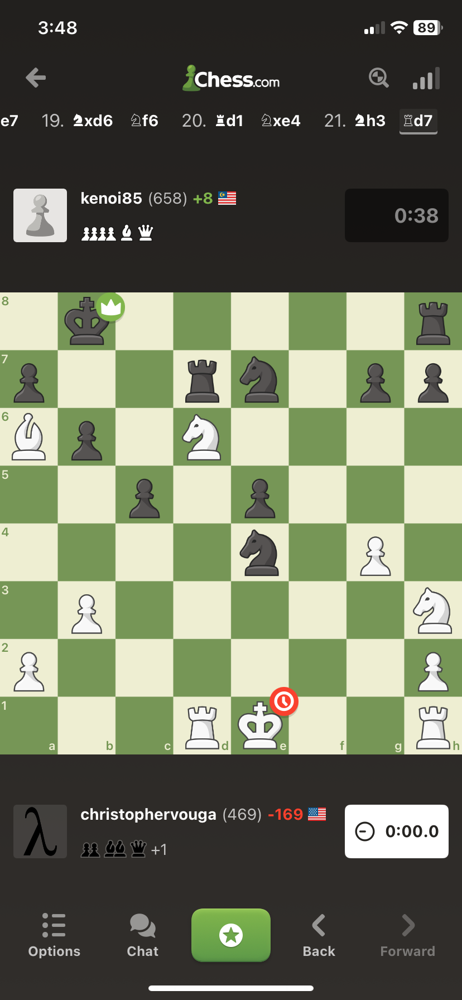

# Follow a game from the first prompt to the final position

Observed on 2026-11-26 in five supplied screenshots of [Chess.com for iOS](https://apps.apple.com/us/app/chess-play-and-learn/id329218549), published by Chess.com.

## Screens from the app

IMG_0653. The prompt identifies Black to move above the board. Rating progress and elapsed time sit below it. Hint and move navigation share the bottom bar.

IMG_0654. Searching is drawn across the board while the player identity stays visible. Cancel occupies the bottom bar.

IMG_0655. Move history, opponent and clock sit above the board. The player and their clock sit below it. Options, Chat, Back and Forward occupy the bottom bar.

IMG_0656. A dismissible dialog names the winner and the reason, then offers Game Review, Rematch and a new game over the dimmed final position.

IMG_0657. After dismissal the final position is visible with a winner marker and expired clock. A review action joins the bottom bar.

## Applying the comparison

The board gives the player a fixed point of reference. The prompt, move record and available commands change as the task changes. The top bar belongs to the space. Game status belongs above the centered playing surface, board tools below it, and session commands in a bottom bar. A result can open over the last position and be dismissed to inspect it.

The captures show portrait chess only. How much room do a four-player table, a tile rack and a landscape arena need for their controls? The [stage geometry checks](../../../../pkgs/ui-root-harness-ts/tests/storybook/stable-game-stage/integration.checks.ts) exercise those layouts.
