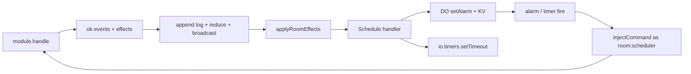

# `@pkgs/room-root-harness-ts`

Deterministic verification for server-authoritative multiplayer on a
**single topic** (e.g. `space:<uuid>`). This package supplies the shared
example game, loopback composition, virtual-time scenarios and module
conformance checks. Product integrations use the shared, client, server and
adapter packages rather than importing the harness.

Start with the [package map](../../README.md#room-packages) and the
[room API guide](../room-root-shared-ts/README.md) for architecture, public
interfaces and usage examples. This README describes harness behavior and
the implementation constraints its verifications enforce.

---

## Why it exists

| Need | How room solves it |
|------|--------------------|
| Shared live game / lobby state | One authoritative event log per topic; clients fold the same events |
| Snappy UX under latency / offline | Client applies commands optimistically, queues durable outbound, flushes after welcome |
| Multi-device / multi-tab | Roster keyed by `(identity, clientId)`; session take-over on reconnect |
| Time-sensitive rules (flag / deadline) | Modules emit `Schedule` effects; server wake injects commands; clients may arm optimistic timers |
| Cloudflare hosting | DO adapter multiplexes modules, hibernates sockets, persists per-key log + pending schedules |
| Deterministic regression | `@pkgs/room-root-harness-ts` — one seed → identical timeline |

**Out of scope:** cross-topic SQL sync, auth sessions, REST CRUD,
bandwidth/clock-drift compensation beyond server `command.ts`, broadcasting
effects on the wire, real chess competition UI clocks.

---

## Performance model

The engine is built for mouse-movement-rate traffic on Durable Objects and
low-end phones. Every steady-state step is **O(what changed)**, never O(log)
or O(queue):

| Hot path | Cost | How |
|----------|------|-----|
| `dispatch` | 1 `handle` + O(events) `reduce` + 1 notify + 1 send | `display` (= committed ⊕ optimistic) is maintained incrementally; no refold per read |
| Own-command echo (`committed` with our `commandId` at the queue head) | O(events) | Committed events are compared structurally with the optimistic prediction; when equal the rebase is skipped and the snapshot **reference is unchanged** (Solid does no work) |
| Foreign `committed` | O(pending queue) re-`handle` | Inherent optimistic rebase; nothing else is touched |
| Persistence | write-behind, coalesced | `ClientRoomStorage.appendCommitted` appends only the new entries; the outbound queue is persisted as a snapshot (ghost rows are impossible by construction) |
| `getLog()` | O(log) **only when read after a change** | Copy-on-read; the internal log is appended in place |
| Server commit | 1 dedup read + 2 writes | Tip is cached after hydrate; no `getLastSeq` per command |
| Server broadcast | 1 `JSON.stringify` per frame | One frame object fans out to every socket; the DO adapter memoizes its JSON per object |
| `hashRoomState` | sorted-copy + native stringify + FNV-1a on 32-bit limbs | No `BigInt`, no dictionary-mode objects |

Dev builds additionally validate state keys once per **new key** (cached
`Set`), not per reduce; production builds skip the check (hot asserts).

What stays inherent: a fresh joiner still replays the committed log from
`fromSeq` in 512-entry welcome pages, and the client keeps the full log in
memory / local storage for `getLog()` (segmented on disk, so appends stay
bounded). Rooms that log every cursor move grow without bound; use transient signals and bounded checkpoints for high-frequency simulation
updates instead of putting every update in the durable log.

Measure with `bun run --filter @pkgs/room-root-harness-ts bench` (`tests/hot-paths.bench.ts`).
To compare against a previous engine, snapshot it and point `ROOM_OLD_SRC` at
its `src` (default `<repo>/.bench-old-room/src`):

```bash
mkdir -p .bench-old-room && git archive <sha> pkgs/room/src | tar -x -C .bench-old-room --strip-components=2
bun run --filter @pkgs/room-root-harness-ts bench
```

---

## Mental model

```text
┌──────────── client ────────────┐         ┌──────── server (RoomServer) ────────┐
│ RoomClient.open + ClientTransport    │  wire   │ authenticate / authorize            │
│ incremental display + queue    │◄───────►│ append events (seq), dedup commandId│
│ ClientRoomStorage (write-behind)│        │ RoomStorage (committed log)         │
│ display = committed ⊕ queued   │         │ broadcast one frame / committed     │
│ optional effectHandlers        │         │ effectHandlers after successful ok  │
│  (io.timers Schedule)          │         │  (DO alarm / harness timers Schedule)   │
└────────────────────────────────┘         └─────────────────────────────────────┘
```

**Convergence rule:** after reconnect, `sync(fromSeq)` + server dedup by
`commandId` brings every synced client’s **domain** fold (module `hash`,
`room/*` meta stripped) in line with the server fold.

**Authority rule for domain expects in tests:** assert
`serverSnapshot()` / `serverHash()` first, then clients. Mid-partition
client-only checks (`never`, lagging peer) stay client-scoped.

**Provided on every normalized `RoomModule`:** `hash(state)` — deterministic domain hash
(see [`README.md`](../../README.md#correctness-machinery)). `defineRoomModule` defaults it to `hashRoomState`; supply a custom hash only
when a narrower domain projection is intentional. Used by harness settle and
by game modules in product.

---

## Product use cases (callers)

1. **Space / game sessions** — `@libs/spaces` opens a WebSocket room per space,
   injects composed game modules, reads `useRoomSelector` and other Solid bindings.
2. **Offline-first open** — `RoomClient.open` hydrates local storage and attaches
   transport even when connect fails; UI can dispatch while disconnected.
3. **In-process rooms** — tests and the Harness use `@pkgs/room-root-harness-ts`
   (`openLoopbackRoom`, the example game room) for multi-client rooms without
   a Worker; `@pkgs/room-adapter-bun-server-ts/bun-room-host` hosts rooms for the localhost stack.
4. **Authoring a game** — call `defineRoomModule` (`initialState` / `handle` /
   `reduce`), optionally emit `Schedule` / `CancelSchedule` effects for
   clocks; register in spaces’ module list + DO `modules: […]`.
5. **Module conformance** — games call `runModuleConformance` from
   `@pkgs/room-root-harness-ts/module-conformance` (hash / totality / fold / fuzz / optional deadline hooks).

---

## Entrypoints

The shared authoring contract is documented in
[`room-root-shared-ts`](../room-root-shared-ts/README.md). Every room package
has an explicit export map; implementation files are private.

| Import | Purpose |
|--------|---------|
| `@pkgs/room-root-shared-ts/module` | `defineRoomModule`, the common definition for turns and continuous play |
| `@pkgs/room-root-shared-ts/runtime` | Optional authoritative execution and its injected ports |
| `@pkgs/room-root-client-ts/room-client` | `RoomClient`, durable dispatch and transient signals |
| `@pkgs/room-root-server-ts/room-server` | `RoomServer`, authoritative decisions and owned execution |
| `@pkgs/room-root-client-ts/room-clients-context` | Solid room registry and subscriptions |
| `@pkgs/room-root-harness-ts/boot-loopback` | `openLoopbackRoom` |
| `@pkgs/room-root-harness-ts/boot` | `bootRoomHarness`, `roomSystemCatalog`, `roomVirtual` |
| `@pkgs/room-root-harness-ts/game-room` | The framework's single example game |
| `@pkgs/room-root-harness-ts/module-conformance` | Shared game conformance checks |

Games declare a `defineSystem` from `@pkgs/harness-root-shared-ts/define-system` over the
room boot and catalog, then use `system.run`, `.explore`, and `.replay`.
The room kit exposes `until` and `never` for virtual-time assertions.

Each transport/storage adapter remains a separate package so a host opts
into its runtime explicitly. Memory, web, Bun and Durable Object adapters
use the same module contract.

The browser transport requires injected `clock`, `timers`, `random` and an
`onRoundTrip(milliseconds)` observer. Its existing application heartbeat keeps
one outstanding ping on the ordered WebSocket; foreground probes share that
ping without changing its origin or deadline. Only its pong reports elapsed
client-clock time. Reconnect, close and disposal discard the pending measurement;
invalid/backward readings and unsolicited replies produce no sample. This is an
application-heartbeat round trip, including transport and immediate server
handling; it does not include a simulation tick or snapshot wait. The spaces
composition aggregates seconds as `app.room.round_trip.duration` without room,
URL, identity or game dimensions. Heartbeat contracts and probe-partition
properties live in `pkgs/room-adapter-web-shared-ts/tests/`.

---

## Core types (design surface)

- **`RoomModuleName`** — branded kebab id for DO routing (`module` query).
- **`RoomModule<S, C, E, Identity>`** — `name`, `initialState`, `handle`, `reduce`, **`hash`**.
- **`RoomCommand`** — `{ id, ts, payload }`; `id` is the server idempotency key;
  `ts` is commit/display time (server stamps on inject; client mints on dispatch).
- **`HandleResult`** — `{ ok: true, events, effects? }` or `{ ok: false, error }`.
  Effects are optional when a decision produces only events.
- **`RoomEffect`** — Message-shaped side-effect intent (**not** on the event log).
- **`RoomError`** — `ROOM_ERROR_TYPE.*` (`invalid-command`, `unauthorized`,
  `conflict`, `rate-limited`, `internal`).
- **State** — flat attribute map; domain keys + `room/*` meta (`RoomMetaAttr`).
  Domain keys must be namespaced Keywords; `room/*` is reserved for client meta.

### Message envelopes

Commands, events, and effects are `@pkgs/message-shared-ts` envelopes
(`isMessageEnvelope`). Prefer `createMessageNamespace('<prefix>')` in modules
(e.g. `game-room-cmd/start-match`, `room-effect/schedule`).

---

## Effects + schedules (clocks / deadlines)

### Model

```ts
type RoomEffect = Message;

type HandleResult =
  | { ok: true; events: E[]; effects?: readonly RoomEffect[] }
  | { ok: false; error: RoomError };
```

Built-ins (`createMessageNamespace('room-effect')`):

| Effect | Payload | Meaning |
|--------|---------|---------|
| `ScheduleEffect` | `{ id, at, payload }` | At epoch `at`, inject `payload` as a command |
| `CancelScheduleEffect` | `{ id }` | Drop pending schedule with that id |

- `id` is the module-chosen schedule key (e.g. `game-room:ran-out-of-time`).
- Fire uses identity **`room:scheduler`** (`ROOM_SCHEDULER_IDENTITY`).
- Effects run **after** successful commit (server) or optimistic apply (client).
  Rejected handles produce no effects.
- Effects are **not** broadcast on the wire. Clients derive schedules from local
  optimistic `handle` and/or re-derive from committed events in product code.

### Handlers

```ts
type RoomEffectHandler = {
  apply(effect, ctx): boolean | Promise<boolean>; // true = claimed
};
```

- Compose: first handler that returns `true` wins.
- No claim → Tiger throw (`Tiger: no RoomEffectHandler for effect type=…`).
- Config: `RoomServerConfig.effectHandlers?`, `RoomClientConfig.effectHandlers?`.
- DO adapter always installs the persisting Schedule handler; accepts extras.
- Harness / loopback install timer-backed Schedule stacks via `createTimerScheduleStack`.

### Schedule runtime

Shared `ScheduleRuntime` (`effects/schedule-runtime.ts`):

1. Map `id → { at, payload }` (upsert / cancel).
2. Arm wake to **earliest** pending `at`.
3. On fire: remove due entries, `injectCommand` with minted `commandId`,
   `ts = clock.now()`, identity `room:scheduler`.
4. Re-arm next earliest.
5. Persistence: DO KV under `room.do.v3.<module>.s.<id>`; memory for harness/client.

Helper stacks:

- `createTimerScheduleStack` — `io.timers` wake (client + harness + loopback).
- `openDoModuleSchedule` / `DoAlarmHub` — DO `setAlarm` + KV sync.

### Where wakes land

| Runtime | Wake | Inject path |
|------|------|-------------|
| Cloudflare DO | `storage.setAlarm` → `alarm()` | `RoomServer.injectCommand` |
| Harness / loopback server | `io.timers` (+ harness `serverQueue`) | `RoomServer.injectCommand` |
| Client optimistic | `io.timers` | `RoomClient.dispatch(payload)` (local UX) |

Server inject is socket-less: dedup by `commandId`, authorize, `handle`, commit,
broadcast, then apply nested effects. Actor metadata uses
`clientId: 'scheduler'`.

### Anti-cheat invariants (module + engine)

1. Remaining time / deadline lives in **committed events**, not client trust.
2. Elapsed time uses **server `command.ts`** (commit clock), never client wall.
3. Lagging client cannot gain time: late move after deadline → reject; only
   scheduled `FlagFall` / `Expire` terminates the race.
4. Client early `FlagFall` before `at` → module `conflict`; server alarm still
   fires once at the true `at`.
5. Cancel + reschedule on move so only the active seat’s flag is armed.

Reference: the example game room's timed match (`@pkgs/room-root-harness-ts/game-room`: two
players' time, `Move` re-arms the schedule, `ClaimOutOfTime` is terminal only
once due). Scenarios: `specs/room/match-clock.feature` and the
`specs/room/match-clock.qnt` model.



---

## Wire protocol

Versioned JSON (`v`). Kinds in `ROOM_WIRE_KIND`:

- Client → server: `command`, `signal`, `sync`, `ping`
- Server → client: `welcome`, `committed`, `rejected`, `signal`, `roster`, `pong`

Committed events carry monotonic **`seq`** per topic. Dedup outcomes are stored
per `commandId` (`committed` with entries, or `rejected` with error) so reconnect
replays are idempotent.

---

## Ports (inject; no singletons)

| Port | Role |
|------|------|
| `ClientTransport` | connect / sendJson / subscribe / lifecycle handlers |
| `ClientRoomStorage` | `loadCommitted` / `appendCommitted` / `resetCommitted`, `loadQueued` / `saveQueued`, and bounded `loadLiveCheckpoint` / `replaceLiveCheckpoint`. Calls stay on one persistence chain; live frames replace a value instead of growing either journal. Adapters use `createSegmentedCommittedLog` for history |
| `RoomStorage` | append/load log, lastSeq, command dedup and one bounded live checkpoint |
| Host admission / `RoomServerConfig.authorize` | hosts authenticate connections; command authorization receives the connection's grants |
| `RoomEffectHandler[]` | post-ok side effects (Schedule, custom) |
| `clock` / `timers` / `createId` | all nondeterministic I/O, injected |

---

## Durable Object adapter notes

- One DO class hosts one or more `RoomModule`s; client picks via `module` query.
- Topic comes from `topic` query; gateway should key DO id by topic.
- Persistence: per-event / per-dedup keys (`room.do.v3.*`); legacy v2 blob migrates.
- Schedules: KV `…s.<id>`, topic key for alarm wake without sockets, `alarm()`
  recreates servers if needed after eviction.
- Hibernation: socket attachment restores routing; `blockConcurrencyWhile` on boot.
- Session take-over: same `(identity, clientId)` replaces prior socket (close 4000).

---

## Testing

Policy: [`README.md`](../../README.md#correctness-machinery). Every test of the room
packages drives **one** example app, the game room (`gameRoomModule` in
`@pkgs/room-root-harness-ts/game-room`; `@pkgs/room-root-harness-ts` runs it as `exampleApp` /
`exampleSystem`). The example lives in this harness package; framework and
adapter tests exercise its public exports.

| Capability | Commands |
|------------|----------|
| A tally | `AddOne`, `TakeOne` |
| Ownership and refusal | `ClaimRoom` (conflict once owned), `TurnAway` (owner only, unauthorized otherwise); every command from someone turned away is refused as unauthorized |
| Timed match (Schedule effects) | `StartMatch`, `Move` (re-arms the schedule for the opponent), `ClaimOutOfTime` (the scheduled command; conflict before it is due) |

| Tool | When to use |
|------|-------------|
| Specs (`specs/room/*.feature`, `*.qnt`) | Behavior of the game room, run by `@pkgs/room-root-harness-ts`'s `test:spec`; technical faults are the models' `_`-prefixed actions |
| `openLoopbackRoom` (`@pkgs/room-root-harness-ts/boot-loopback`) | In-process real `RoomClient` + `RoomServer`, no net faults; Schedule via timers |
| `exampleSystem.run` / `.explore` (`@pkgs/room-root-harness-ts/system`) | Partitions, delays, soft disconnect, crash/restart, hash converge, Schedule wakes |
| Contract tests (`tests/room-client.contract.test.ts`, `tests/room-server.contract.test.ts`) | Wire, dedup, persistence, rebase, broadcast costs |
| Adapter tests (`room-adapter-*`) | Hibernation, session take-over, per-key storage, alarms, WS heartbeat |
| `runModuleConformance` | Game-module kit (purity, hash, totality, fold, fuzz) |

Games declare their own `defineSystem` over `bootRoomHarness` /
`roomSystemCatalog` / `roomVirtual` from `@pkgs/room-root-harness-ts/boot`. Settle with
`expectInSync(s)`: server-first, hashes equal the log fold, queues drained,
`lastSeq` equals the tip. Not simulated: real WebSockets and full DO
hibernation (covered by adapter tests).

Connectivity triad — do not conflate: transport session (`disconnect` /
`connect`, offline optimistic queue), mesh reality (`hold` / `down`, frames
not delivered), and offline dispatch (a Room feature; flushed on welcome).

---

## Design constraints (for contributors / agents)

- No `@pkgs/sync-engine` dependency (room stays a leaf).
- Domain hard-delete rules belong to sync-engine SQL; room uses event fold only.
- When changing `handle` / wire / schedule semantics, keep **server-first**
  asserts in the harness.

### Feedback / design checklist

When proposing a change, check:

1. Does domain truth still live only in the committed event log?
2. If time is involved, is the wake a `Schedule` effect (not a client-only timer)?
3. Are effects optional on success and absent on reject?
4. Will unknown custom effects fail loudly (handler claim protocol)?
5. Is there a harness scenario (or kit row) that would catch the regression?
6. Does `hash(state)` stay deterministic (see `README.md`)?

---

## Tiger Style

- Assert on hot paths where violation means impossible state.
- No bare `catch` — surface via `onError` or disconnect (broadcast drops dead sockets).
- Fail loudly on bad wire (unknown `kind` / version) and unhandled effects.
- Named invariants (`TIGER_INVARIANTS` in `tiger-invariants.ts`):
  - Mid-chaos: `log-seq-contiguity`, `live-vs-log`, `command-id-dedup-stable`,
    `durable-queue-matches-memory`
  - Post-converge: `healed-queue-drained`, `client-lastseq-equals-server-tip`
- Static bounds (`bounds.ts`): `MAX_PENDING_OUTBOUND_COMMANDS`,
  `MAX_WELCOME_ENTRIES_PER_FRAME`, `MAX_ROSTER_SIZE` — over-bound command
  enqueue → `room.error/rate-limited`; welcome batches truncate and client
  re-syncs; roster register throws when full.
- Client memory is applied synchronously per frame; durable writes ride one
  write-behind serial and the queue is persisted as a snapshot of memory, so
  an ack can never leave a ghost durable row.

## Security posture

- Auth at upgrade (401/403 before game frames).
- Optional authorize per topic/command (also applies to `injectCommand`).
- Connection grants: the host in front of the room (an API gateway) decides
  what the connecting actor may do and hands it over at upgrade
  (`ROOM_GRANTS_HEADER`, `encodeRoomGrants` / `decodeRoomGrants`; it must
  replace any client-supplied value). `registerConnection(…, { grants })`
  keeps them for the life of the connection (never broadcast, persisted in
  the DO socket attachment across hibernation) and passes them to
  `authorize(identity, topic, command, grants)` with every command the
  connection sends; injected commands carry none. Grants are opaque strings
  to the room — the product decides their meaning and when they go stale.
- Never trust client-only validation for integrity; server runs `module.handle`.
- Dedup by `commandId` limits replay amplification.
- Scheduler identity is a known system actor; modules decide whether to accept
  flag/expire from `room:scheduler` and/or any identity once `command.ts` is due.

---
