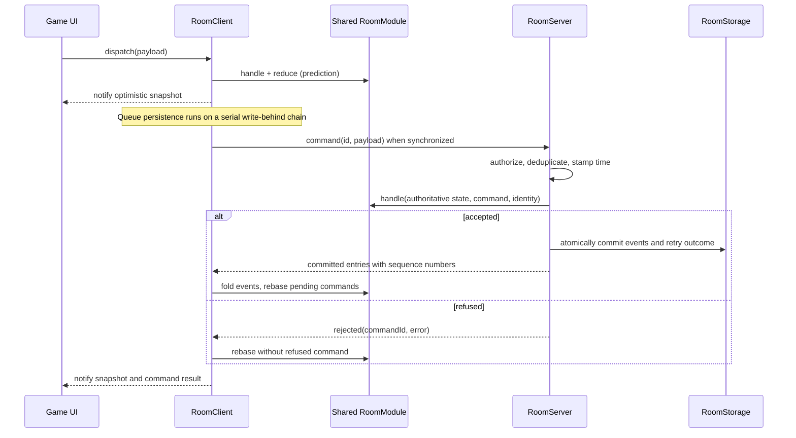
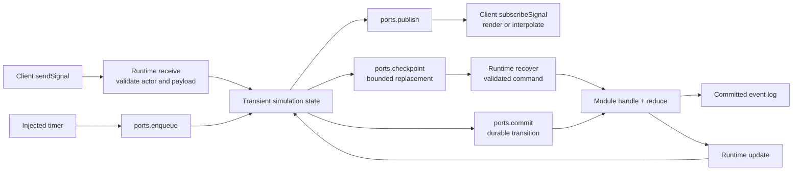

# Room packages: design and API guide

The room packages coordinate one live topic using shared game rules, an
optimistic client and an authoritative host. Turn-based and real-time games
use the same `RoomModule`; continuous execution is an optional capability of
that module. The [package map](../../README.md#room-packages) explains which
package owns each layer. Product behavior lives in [the room specs](../../specs/room/).

This guide covers [module authoring](#define-a-module), [clients](#open-a-client),
[hosting](#choose-a-host), [deadlines](#deadlines-and-effects),
[real-time execution](#real-time-execution), [storage](#storage-and-recovery)
and [verification](#verify-the-game). Imports use explicit package subpaths;
there is no `@pkgs/room` barrel import.

## How a room works

A **topic** identifies a particular room, such as `space:<id>`. A **module
name** identifies its rules, such as `space` or `chess-lobby`. An actor has a
stable `id` and a `clientId` for its tab or app instance. Several connections
can therefore represent the same person. Route all connections for a
`(topic, module)` to one authority.

The durable state is a fold of committed events. Commands express intent;
events record accepted facts; effects request work after a successful
decision. The client overlays pending commands on its committed state for
immediate feedback. When the server accepts or refuses a command, the client
reconciles that overlay against the authoritative log.



`handle` and `reduce` run on both sides and must be pure, synchronous and
repeatable. Do not mutate their input state. Use the command's `ts` for a
decision involving time: the client predicts with its clock, and the server
replaces that timestamp with authoritative time. The implementation rules
for determinism and injected I/O are in [Correctness machinery](../../README.md#correctness-machinery).

## Define a module

Import `defineRoomModule` and `RoomDefinition` from
`@pkgs/room-root-shared-ts/module`. The generic parameters are
`<State, CommandPayload, Event, Identity>`. Commands and events are validated
`Message` envelopes, usually created with `createMessageNamespace`.
State is a serializable flat map keyed by namespaced attributes. Reserve
`room/*` for client metadata.

| Definition member | Contract |
| --- | --- |
| `name` | Required routing name: lowercase ASCII letters separated by single hyphens; no digits or underscores. The factory validates and brands it. |
| `initialState(): State` | Required initial attribute map. |
| `handle(state, command, identity)` | Required decision: `{ ok: true, events, effects? }` or `{ ok: false, error }`. The command has `{ id, ts, payload }`. Validate message shape and domain rules here. |
| `reduce(state, event): State` | Required deterministic event fold. |
| `hash(state): string` | Defaults to `hashRoomState`; override only for a deliberate state projection. |
| `recoverEffects(state)` | Defaults to `[]`. Supply it for recoverable effects, including deadlines; reconstruct them from committed state. |
| `createRuntime(ports)` | Optional host-only execution. See [runtime contracts](#runtime-contracts). |
| `audience(event)` | Optional actor-ID list restricting who receives an event, or `null` for everyone served by the room. Other readers receive a withheld entry that preserves sequence position. |
| `presenceCommand(state, present)` | Optional command for a change in distinct connected actor IDs, or `null`. Runs as `ROOM_PRESENCE_IDENTITY`. |
| `availabilityChange(state, available, now)` | Optional events/effects for an explicit host availability change, or `null`. This is separate from a person's connection dropping. |
| `connectionView(grants)` | Optional connection policy: `full`, `authority`, `dependent`, `dependent-read`, or `presence`. The dependent/presence variants also carry a reason. |

The complete types are in the public [`/types`](src/types.ts) entry point.
Use `ROOM_ERROR_TYPE` for refusals: `invalidCommand`, `unauthorized`,
`conflict`, `rateLimited`, or `internal`.

### Example: a minimal durable rule

The following `tally.ts` demonstrates the decision/fold boundary. It is a
small authoring example; the framework's shared test fixture is the fuller
[game room](../room-root-harness-ts/src/game-room.ts), with ownership, timed
matches and private notes.

```ts
import { createAttrNamespace } from '@pkgs/attribute-shared-ts/attribute';
import type { Message } from '@pkgs/message-shared-ts/message';
import {
  createMessageNamespace,
  isPlainRecord,
} from '@pkgs/message-shared-ts/message';
import { defineRoomModule } from '@pkgs/room-root-shared-ts/module';
import {
  ROOM_ERROR_TYPE,
  type RoomState,
} from '@pkgs/room-root-shared-ts/types';

export const Count = createAttrNamespace('tally').integer('count', (value) =>
  typeof value === 'number' && Number.isSafeInteger(value) ? value : 0
);
const command = createMessageNamespace('tally-command');
const event = createMessageNamespace('tally-event');
const isEmpty = (value: unknown): value is Record<string, never> =>
  isPlainRecord(value) && Object.keys(value).length === 0;
export const AddOne = command('add-one', isEmpty);
const AddedOne = event('added-one', isEmpty);

export const tallyModule = defineRoomModule<RoomState, Message, Message, string>({
  name: 'tally',
  initialState: () => Count(0),
  handle: (state, cmd) => {
    if (!AddOne.is(cmd.payload)) {
      return {
        ok: false,
        error: { type: ROOM_ERROR_TYPE.invalidCommand, reason: 'Unknown command' },
      };
    }
    if (Count.from(state) === Number.MAX_SAFE_INTEGER) {
      return {
        ok: false,
        error: { type: ROOM_ERROR_TYPE.conflict, reason: 'Tally is full' },
      };
    }
    return { ok: true, events: [AddedOne({})] };
  },
  reduce: (state, evt) => AddedOne.is(evt)
    ? { ...state, ...Count(Count.from(state) + 1) }
    : state,
});
```

The definition allocates no timer, socket or storage. The same value can be
passed to a client, a server or a harness. A turn-based game's legal-move
check and move-applied event use exactly this pattern.

## Open a client

`RoomClient.open(config)` from `@pkgs/room-root-client-ts/room-client`
hydrates local state and pending commands, attaches the transport, and starts
connecting in the background. It does **not** wait for server admission.
Use `untilSynced(timeoutMs?)` when an operation requires the initial welcome;
ordinary durable commands can be dispatched offline.

`RoomClientConfig` requires `topic`, `module`, `identity`, `storage`,
`transport`, `clock`, `timers` and `createId`. Optional fields are `onError`,
`onDestroy` and `effectHandlers`. There are no implicit wall-clock or ID
factories.

This `browser-tally.ts` takes its environment from the composition root.
The socket URL (or async URL factory) must route to the correct topic and
module through the application's authenticated gateway. A factory is useful
when credentials need refreshing on reconnect.

```ts
import { WebClientStorage } from '@pkgs/room-adapter-web-shared-ts/client-storage';
import {
  WebSocketRoomTransport,
  type WebSocketRoomTransportOptions,
} from '@pkgs/room-adapter-web-shared-ts/websocket-transport';
import { RoomClient } from '@pkgs/room-root-client-ts/room-client';
import type { RoomError } from '@pkgs/room-root-shared-ts/types';
import type { CreateId } from '@pkgs/uuid-shared-ts/create-id';
import { tallyModule } from './tally';

export function openTallyRoom(args: {
  topic: string;
  identity: string;
  clientId: string;
  webStorage: Pick<Storage, 'getItem' | 'setItem' | 'removeItem'>;
  socket: WebSocketRoomTransportOptions;
  createId: CreateId;
  onError: (error: RoomError | Error) => void;
}, module = tallyModule) {
  // Keep histories and pending choices isolated by identity, device and room.
  const prefix = [args.identity, args.clientId, module.name, args.topic]
    .map(encodeURIComponent).join(':');
  return RoomClient.open({
    topic: args.topic,
    module,
    identity: args.identity,
    storage: new WebClientStorage(prefix, args.webStorage),
    transport: new WebSocketRoomTransport(args.socket),
    clock: args.socket.clock,
    timers: args.socket.timers,
    createId: args.createId,
    onError: args.onError,
  });
}
```

`WebSocketRoomTransportOptions` requires `url`, `clock`, `timers`, `random`
and `onRoundTrip`. It also exposes reconnect and heartbeat timing options.
For an async key-value store, use `KeyValueClientRoomStorage` from
`@pkgs/room-root-client-ts/storage` in place of `WebClientStorage`.

| Client interface | Use |
| --- | --- |
| `dispatch(payload): string \| null` | Predict and queue a durable command; returns its ID, or `null` if it cannot be queued. An ID is not server confirmation. |
| `subscribeCommandResult(listener)` | Observe `{ commandId, ok, error? }` from the server; correlate it with the returned dispatch ID. |
| `getSnapshot()` / `subscribe(listener)` | Read display state (committed plus optimistic) and receive change notifications. Treat snapshots as immutable. |
| `getLog()` / `getLastSeq()` | Read committed entries and their latest sequence number. |
| `getRoster()` | Read connected `{ id, clientId }` actors; do not treat connection count as participant count. |
| `sendSignal(payload): string \| null` / `subscribeSignal(listener)` | Send and observe transient payloads; see [real-time execution](#real-time-execution). |
| `getPendingQueueIds()` / `flushIo()` | Inspect queued choices and await scheduled persistence. `flushIo()` does not wait for server acceptance. |
| `loadLiveCheckpoint()` / `saveLiveCheckpoint(payload)` | Read/replace a bounded local recovery value, conditional on unchanged state and log tip. |
| `destroy()` | Unsubscribe and destroy the owned transport. It does not erase stored history. |

For example, given an opened `room`, attach listeners before dispatching:

```ts
import { AddOne, Count } from './tally';

const stopState = room.subscribe(() => renderCount(Count.from(room.getSnapshot())));
const stopResults = room.subscribeCommandResult(showCommandResult);
renderCount(Count.from(room.getSnapshot()));
const commandId = room.dispatch(AddOne({}));
// Correlate commandId with showCommandResult; handle null as a local refusal.

// When the owning view/session closes:
stopState();
stopResults();
await room.flushIo();
room.destroy();
```

Here `renderCount` and `showCommandResult` are application callbacks.
Read connection/error metadata with `RoomMetaAttr` from `/room-meta`:
`isConnected`, `isSynced`, `hasRoster`, and `lastError` are separate values.

For Solid, `/room-signals` exports `createRoomSnapshot`, `createRoomSelector`, `createRoomDispatch`,
`createRoomLog` and `createRoomRoster`, taking an accessor to the current
client. `/room-clients-context` adds `RoomClientsProvider`,
`useRoomFromRegistry`, `useRoomSelector`, `useRoomDispatch`,
`useNamedRoomLog` and `useNamedRoomRoster` for named rooms. Readers return
accessors; keep client/room-name inputs reactive. The dispatch helper is a
no-op if its room is absent; use the client directly when a command ID is
needed.

## Choose a host

| Host | Public interface | What the application supplies |
| --- | --- | --- |
| Durable Object | `createDurableObjectAdapter` from `@pkgs/room-adapter-durable-object-server-ts/adapter`; returns the class exported by the Worker | `modules`, `clock`, `createId`, `telemetry`, and `timers` when used; authenticated gateway routing by topic and module |
| Bun | `createBunRoomHost` from `@pkgs/room-adapter-bun-server-ts/bun-room-host` | `modules`, `clock`, `timers`, `createId`, `enqueueWake`; forward socket `accept`, `open`, `message`, `close` calls and dispose the host on shutdown |
| Custom host | `RoomServer` from `@pkgs/room-root-server-ts/room-server` | `RoomServerConfig`: `topic`, `module`, `storage`, `clock`; optional `timers`, `authorize`, `onError`, `effectHandlers` |
| In-process harness | `openLoopbackRoom` from `@pkgs/room-root-harness-ts/boot-loopback` | A module, topic, clock, timers and ID factory; see [verification](#verify-the-game) |

Durable Objects provide persistent per-module storage, socket hibernation
and alarm-backed schedules. Bun's host uses in-memory storage and requires
the caller's load balancer to keep each topic on one instance. Changing
transport or host does not change a game's rules.

A custom host first awaits `server.hydrateFromStorage()`, registers admitted
connections with `registerConnection`, then forwards parsed frames to
`handleClientMessage(connectionId, identity, raw)`. On close it calls
`unregisterConnection`; on shutdown it calls `dispose`. Server reads include
`getCommittedState`, serialized `readCommittedState`, and `getRoster`.
Trusted work uses `injectCommand`; private service integrations use
`injectServiceCommand` and the `/handle-room-service` entry point.

Authentication belongs at the gateway, before connection registration.
`authorize(identity, topic, command, grants)` is the host's per-command gate,
including injected commands (which carry no connection grants). The room
treats grants as opaque strings. Gateways must overwrite untrusted identity
and grant headers; `/grants-header` exposes `ROOM_GRANTS_HEADER`,
`encodeRoomGrants` and `decodeRoomGrants`. Optional `audience` and runtime
publish audiences restrict outbound payloads by actor ID.

`setAvailability(false)` is an explicit, awaited boundary for suspending
shared work. `setAvailability(true)` resumes it. Modules decide how that
changes their state and effects; this does not detect an unannounced crash.
See [server lifecycle](../room-root-server-ts/README.md).

## Deadlines and effects

Emit `ScheduleEffect({ id, at, payload })` to inject a command at an epoch
millisecond deadline, and `CancelScheduleEffect({ id })` to remove it. For
example, this helper arms a turn-expiration command supplied by the game:

```ts
import type { Message } from '@pkgs/message-shared-ts/message';
import {
  CancelScheduleEffect,
  ScheduleEffect,
} from '@pkgs/room-root-shared-ts/builtin';

export function armDeadline(id: string, at: number, payload: Message) {
  return [CancelScheduleEffect({ id }), ScheduleEffect({ id, at, payload })];
}
```

Return these effects alongside accepted events from `handle`. Record the
original deadline in state so `recoverEffects(state)` can restore the same
deadline after hydration. Recomputing it as “now plus a turn” would grant
extra time after a restart. The scheduled command still passes through the
normal rules; check the timestamp, current turn and identity there. The
scheduler uses `ROOM_SCHEDULER_IDENTITY`.

The Bun and Durable Object hosts wire schedule handling. When composing a
bare `RoomServer`, provide schedule handlers yourself: `/timer-schedule-stack`
exports `createTimerScheduleStack`, whose `handler` goes in `effectHandlers`
and whose `bindInject` connects wakes to `server.injectCommand`. Dispose the
schedule stack with its owner. `/schedule-runtime` exposes the lower-level
`ScheduleRuntime`, wake port and effect-handler composition.

Custom effects use `RoomEffectHandler.apply(effect, context)` from `/handler`.
Return `true` only when the handler claims the effect. Unclaimed effects fail
loudly. Effects are not committed events: use recoverable, idempotent delivery
where a restart must restore their work. Client effect handlers are optional
prediction aids; they do not replace server enforcement.

## Real-time execution

Add `createRuntime(ports)` to the same module when it needs transient inputs,
continuous simulation or host-owned work. There is one runtime per hosted
room instance, created only by the authority. The client continues using the
ordinary module for durable prediction and replay.



Signals use the same authenticated connection, but they are not predicted,
logged, durably deduplicated, or queued offline. `sendSignal` returns `null`
while disconnected or catching up. Its non-null ID means the client sent the
frame, not that the runtime accepted it. Games define any sequence numbers,
acknowledgements, bounded input buffers and interpolation inside their typed
payloads. Durable moves and results still go through commands.

### Runtime contracts

Import `RoomRuntime<State, CommandPayload, Identity>` and
`RoomRuntimePorts<CommandPayload>` from `/runtime`. All runtime hooks are
optional; a runtime without `receive` refuses signals.

| Hook | Responsibility |
| --- | --- |
| `receive(command, identity, actor)` | Validate and apply a transient input; return `null` or a `RoomError`, synchronously or asynchronously. The actor includes the sending device. |
| `update(state)` | Observe hydrated state and subsequent committed changes. |
| `presence(actors)` | Observe connections, including multiple devices per identity. The host supplies presence before the first state update. |
| `project(state): State` | Include current simulation progress in the state used for a durable decision. This alone does not append events. |
| `recover(state, payload): CommandPayload \| null` | Validate a saved checkpoint and translate it into an ordinary trusted command; return `null` when it is unusable. |
| `dispose()` | Release owned timers and other resources when the runtime is replaced or shut down. |

| Port | Responsibility |
| --- | --- |
| `clock`, `timers` | Injected time and scheduling. A host must supply timers if the runtime accesses them. |
| `enqueue(work)` | Serialize a synchronous simulation wake with commands and membership changes. Route timer callbacks through it. |
| `publish(payload, audience?)` | Send a transient snapshot, optionally only to the listed actor IDs. |
| `checkpoint(payload): Promise<boolean>` | Replace one bounded recovery value only if its captured log tip remains current and the runtime accepts it for recovery. Check success before exposing progress that relies on that checkpoint. |
| `commit(id, payload): Promise<void>` | Queue a trusted command through normal validation, deduplication and durable commit. Use a stable ID for a retried decision and observe rejection through the returned promise. |
| `onError(error)` | Surface failures to the host's error boundary. |

Hooks run on the room's serial chain. **Do not await `commit` or `checkpoint`
inside a hook:** those ports queue later work on that same chain. Start the
operation, handle its rejection, and serialize any follow-up state mutation
with `enqueue`. Keep simulation state local to the runtime instance; never
store mutable execution state on the shared module object.

### Example: transient snapshots without a second rules API

This `live-tally.ts` adds a request/snapshot exchange to the earlier module.
It deliberately needs no timer: adding a runtime does not require a loop.
Both peers must use this module (the same `tally` routing name) for this
example; a host should not register both versions under that name.

```ts
import type { Message } from '@pkgs/message-shared-ts/message';
import { createMessageNamespace, isPlainRecord } from '@pkgs/message-shared-ts/message';
import { defineRoomModule } from '@pkgs/room-root-shared-ts/module';
import type { RoomRuntime, RoomRuntimePorts } from '@pkgs/room-root-shared-ts/runtime';
import { ROOM_ERROR_TYPE, type RoomState } from '@pkgs/room-root-shared-ts/types';
import { Count, tallyModule } from './tally';

const signal = createMessageNamespace('tally-signal');
export const RequestSnapshot = signal('request-snapshot',
  (p): p is Record<string, never> => isPlainRecord(p) && Object.keys(p).length === 0);
export const TallySnapshot = signal('snapshot',
  (p): p is { count: number } => isPlainRecord(p) && Number.isSafeInteger(p['count']));

function createSnapshotRuntime(
  ports: RoomRuntimePorts<Message>
): RoomRuntime<RoomState, Message, string> {
  let current = tallyModule.initialState();
  return {
    update: (state) => { current = state; },
    receive: (command, identity) => {
      if (!RequestSnapshot.is(command.payload)) {
        return { type: ROOM_ERROR_TYPE.invalidCommand, reason: 'Unknown signal' };
      }
      ports.publish(TallySnapshot({ count: Count.from(current) }), [identity]);
      return null;
    },
  };
}

export const liveTallyModule = defineRoomModule({
  ...tallyModule,
  createRuntime: createSnapshotRuntime,
});
```

Open the browser helper with `openTallyRoom(args, liveTallyModule)`, subscribe
with `room.subscribeSignal`, narrow payloads with `TallySnapshot.is`, and send
`room.sendSignal(RequestSnapshot({}))` after synchronization. Durable
`AddOne` commands still use `dispatch` and the same reducer.

For a continuous game, `receive` updates validated controls, injected timer
wakes advance the simulation through `enqueue`, and `publish` emits snapshots.
Use `commit` for durable transitions such as completing a match. Persist
bounded progress with `checkpoint` and implement `recover` to validate it.
The production [custom simulation runtime](../../libs/game-session-shared-ts/src/simulation-custom-runtime.ts)
and [simulation session](../../libs/game-session-shared-ts/src/simulation-session-runtime.ts)
show these hooks together, including controller selection and disposal.

## Storage and recovery

Storage and transport are ports, independent of the rules. Adapters can
change without creating a second game implementation.

| Public contract | Operations and guarantees |
| --- | --- |
| `ClientTransport` (`/transport`) | `connect`, `sendJson`, `subscribe`, `onHandlers`, `destroy`, `isConnected`, and optional `probeLiveness`. The client owns its lifecycle. |
| `ClientRoomStorage` (`/core-storage`) | Load/append/reset committed history; load/replace queued commands; load/replace a live checkpoint. The client serializes these calls and appends changed log batches. |
| `RoomStorage` (`/server-core-storage`) | Read log entries/tip, atomically `commitCommand` with its retry outcome, store rejected outcomes, load/conditionally replace checkpoints, and atomically erase an identity with cache invalidation. |
| `RoomLiveCheckpoint` (`/live-checkpoint`) | A bounded replacement value tied to a log sequence. Use the exported constructor/parser and size limit; it is not a growing tick journal. |

Reconnect replays committed events and resends pending durable commands;
server command IDs make those retries idempotent. Signals are not replayed.
A host recovery checkpoint is accepted only against the current log tip and
validated by the runtime before becoming a trusted command. Client checkpoint
storage separately supports client-owned live execution; it does not by
itself give a client authority over the server.

Memory adapters expose `InMemoryRoomStorage`, `InMemoryClientStorage` and
`LoopbackRoomTransport`. Web client storage uses segmented committed history;
`createSegmentedCommittedLog` from `/segmented-committed-log` is available to
custom adapters. The Durable Object shared package exposes
`DurableObjectRoomStorage` through `/storage` and schedule persistence through
`/do-schedule`; most callers use the host factory instead of wiring these
pieces directly.

## Verify the game

The room harness uses real `RoomClient` and `RoomServer` instances with
injected time, storage and transport. This executable wiring example uses
the common game-room fixture and a seeded virtual clock. `transport.flush()`
drains loopback delivery; `room.flushIo()` drains local persistence. Neither
requires a wall-clock sleep.

```ts
import { expect, test } from 'bun:test';
import { openLoopbackRoom } from '@pkgs/room-root-harness-ts/boot-loopback';
import { AddOne, gameRoomModule, readTally } from '@pkgs/room-root-harness-ts/game-room';
import { createHarnessAdapters } from '@pkgs/uuid-shared-ts/harness-adapters';

test('a durable choice reaches the authority and the client', async () => {
  const { clock, timers, createId } = createHarnessAdapters({ seed: 'room-docs' });
  const { room, server, transport } = await openLoopbackRoom({
    topic: 'example:room-docs',
    module: gameRoomModule,
    identity: 'alice',
    clock, timers, createId,
  });
  try {
    await transport.flush();
    expect(room.dispatch(AddOne({}))).not.toBeNull();
    await transport.flush();
    expect(readTally(await server.readCommittedState())).toBe(1);
    expect(readTally(room.getSnapshot())).toBe(1);
    expect(room.getPendingQueueIds()).toEqual([]);
  } finally {
    await room.flushIo();
    room.destroy();
    server.dispose();
  }
});
```

Use the [harness guide](../room-root-harness-ts/README.md#testing) for scenario
composition through `bootRoomHarness`, `roomSystemCatalog` and `roomVirtual`.
`expectInSync` verifies server-first convergence after faults settle.
`runModuleConformance` checks module purity, hashing, totality and event folds.
Adapter harnesses cover sockets, hibernation, alarms and persistence; they
reuse the same game room rather than inventing separate rule fixtures.

## Further public entry points

The tables above cover normal game and host integration. For lower-level
extensions, the shared package also exports `/wire` (versioned frame types
and parsers), `/private-events` (audience filtering and withheld entries),
`/room-service` and `/service-identity` (trusted service contracts),
`/cache-invalidation`, `/hash-room-state`, `/ids`, `/bounds`,
`/plain-deep-equal`, `/signals` and `/tiger-invariants`.
The client package additionally exports `/keys`, `/room-connection-key` and
`/room-client-persist` for storage and lifecycle composition. Durable Object
integration types and telemetry helpers live in its shared package and the
server package's `/observability` entry point.

The package manifests are the authoritative export lists:
[shared](package.json), [client](../room-root-client-ts/package.json),
[server](../room-root-server-ts/package.json),
[harness](../room-root-harness-ts/package.json),
[web](../room-adapter-web-shared-ts/package.json),
[memory](../room-adapter-memory-shared-ts/package.json),
[Bun](../room-adapter-bun-server-ts/package.json),
[Durable Object server](../room-adapter-durable-object-server-ts/package.json),
and [Durable Object shared](../room-adapter-durable-object-shared-ts/package.json).
Import these public subpaths rather than implementation files under `src/`.
