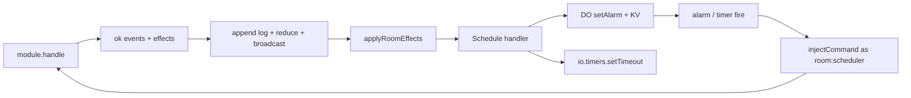

# `@pkgs/room`

Server-authoritative multiplayer for a **single topic** (e.g. `space:<uuid>`).

This package is the realtime session engine used by product features (primarily
`@libs/spaces` + game `RoomModule`s). It is **not** the app sync engine
(`@pkgs/sync-engine`): room is a lower-level `pkgs` leaf with its own wire
protocol, optimistic client queue, Durable Object host, and effect/schedule
runtime for time-sensitive rules (clocks, deadlines).

Use this README as the design surface when giving feedback or extending the
package. Prefer scenarios + fixtures over speculation about “how room works.”

---

## Why it exists

| Need | How room solves it |
|------|--------------------|
| Shared live game / lobby state | One authoritative event log per topic; clients fold the same events |
| Snappy UX under latency / offline | Client applies commands optimistically, queues durable outbound, flushes after welcome |
| Multi-device / multi-tab | Roster keyed by `(identity, clientId)`; session take-over on reconnect |
| Time-sensitive rules (flag / deadline) | Modules emit `Schedule` effects; server wake injects commands; clients may arm optimistic timers |
| Cloudflare hosting | DO adapter multiplexes modules, hibernates sockets, persists per-key log + pending schedules |
| Deterministic regression | Sim harness (`@pkgs/room-sim`) — one seed → identical timeline |

**Out of scope:** cross-topic SQL sync, auth sessions, REST CRUD,
bandwidth/clock-drift compensation beyond server `command.ts`, broadcasting
effects on the wire, real chess competition UI clocks.

---

## Mental model

```text
┌──────────── client ────────────┐         ┌──────── server (RoomServer) ────────┐
│ RoomClient.open + ClientTransport    │  wire   │ authenticate / authorize            │
│ optimistic fold + command queue│◄───────►│ append events (seq), dedup commandId│
│ ClientRoomStorage (local cache)│         │ RoomStorage (committed log)         │
│ display = committed ⊕ queued   │         │ broadcast welcome / committed       │
│ optional effectHandlers        │         │ effectHandlers after successful ok  │
│  (io.timers Schedule)          │         │  (DO alarm / sim timers Schedule)   │
└────────────────────────────────┘         └─────────────────────────────────────┘
```

**Convergence rule:** after reconnect, `sync(fromSeq)` + server dedup by
`commandId` brings every synced client’s **domain** fold (module `hash`,
`room/*` meta stripped) in line with the server fold.

**Authority rule for domain expects in tests:** assert
`serverSnapshot()` / `serverHash()` first, then clients. Mid-partition
client-only checks (`never`, lagging peer) stay client-scoped.

**Required on every `RoomModule`:** `hash(state)` — deterministic domain hash
(see [`docs/DETERMINISM.md`](../../docs/DETERMINISM.md)). Used by sim settle and
by game modules in product.

---

## Product use cases (callers)

1. **Space / game sessions** — `@libs/spaces` opens a WebSocket room per space,
   injects composed game modules, reads `useRoomSnapshot` / selectors.
2. **Offline-first open** — `RoomClient.open` hydrates local storage and attaches
   transport even when connect fails; UI can dispatch while disconnected.
3. **Simulators / widgets** — `@pkgs/room-widgets` and tests use
   `@pkgs/room-sim` (`openLoopbackRoom`, `TestCounterModule`) for in-process
   multi-client demos without a Worker.
4. **Authoring a game** — implement `RoomModule` (`initialState` / `handle` /
   `reduce` / `hash`), optionally emit `Schedule` / `CancelSchedule` effects for
   clocks; register in spaces’ module list + DO `modules: […]`.
5. **Module conformance** — games call `runModuleConformance` from
   `@pkgs/room-sim` (hash / totality / fold / fuzz / optional deadline hooks).

---

## Entrypoints

Core vs adapters stay split so callers opt into a runtime explicitly.

| Import | Purpose |
|--------|---------|
| `@pkgs/room` | Client core: `RoomClient`, `RoomMetaAttr`, Solid hooks/registry, ports, wire helpers, effect builtins / handlers |
| `@pkgs/room/server` | `RoomServer`, `RoomStorage`, `RoomAuth`, effect types/builtins |
| `@pkgs/room/client/adapters/storage/key-value` | `KeyValueClientRoomStorage` (async `Kv`) |
| `@pkgs/room-adapter-web` | `WebSocketRoomTransport` (+ heartbeat / `probeLiveness`), `WebClientStorage` (`localStorage`) |
| `@pkgs/room-adapter-memory` | `InMemoryRoomStorage`, `InMemoryClientStorage`, `LoopbackRoomTransport` |
| `@pkgs/room-adapter-durable-object` | `createDurableObjectAdapter`, DO storage + alarm schedule |
| `@pkgs/room-sim` | `openLoopbackRoom`, **`bootRoomSim` / `roomSystemCatalog` / `roomVirtual`**, kit (`runModuleConformance`, …), fixtures (counter / deadline / authz / match-clock) |

Each adapter is its own package so callers pull in only the runtime they
host on. Games should declare their own `defineSystem` from `@pkgs/sim` over
`bootRoomSim` / `roomVirtual` / `roomSystemCatalog` (`@pkgs/room-sim`)
and drive runs with `system.run` / `.explore` / `.replay`, not deep relative
`sim/` paths.

---

## Layout

```text
pkgs/room/
├── src/
│   ├── client/core/          RoomClient engine, fold, meta, ports, optimistic effects
│   ├── client/adapters/      key-value storage (async `Kv`)
│   ├── client/solid/         snapshot + registry hooks
│   ├── server/core/          RoomServer, auth/storage ports, injectCommand
│   ├── protocol/             wire frames + ids
│   └── effects/              Schedule/CancelSchedule + RoomEffectHandler port
└── tests/                    black-box against package exports

pkgs/room-adapter-web/            websocket transport + localStorage storage
pkgs/room-adapter-memory/         in-memory room/client storage + loopback transport
pkgs/room-adapter-durable-object/ DO adapter (alarms, KV schedules)
pkgs/room-sim/                    sim harness (`@pkgs/room-sim`)
└── src/scenario/                 boot + actions / properties / S
```

---

## Core types (design surface)

- **`RoomModuleName`** — branded kebab id for DO routing (`module` query).
- **`RoomModule<S, C, E, Identity>`** — `name`, `initialState`, `handle`, `reduce`, **`hash`**.
- **`RoomCommand`** — `{ id, ts, payload }`; `id` is the server idempotency key;
  `ts` is commit/display time (server stamps on inject; client mints on dispatch).
- **`HandleResult`** — `{ ok: true, events, effects? }` or `{ ok: false, error }`.
  Existing `{ ok: true, events }` callers remain valid (`effects` optional).
- **`RoomEffect`** — Message-shaped side-effect intent (**not** on the event log).
- **`RoomError`** — `ROOM_ERROR_TYPE.*` (`invalid-command`, `unauthorized`,
  `conflict`, `rate-limited`, `internal`).
- **State** — flat attribute map; domain keys + `room/*` meta (`RoomMetaAttr`).
  Domain keys must be namespaced Keywords; `room/*` is reserved for client meta.

### Message envelopes

Commands, events, and effects are `@pkgs/message` envelopes
(`isMessageEnvelope`). Prefer `createMessageNamespace('<prefix>')` in modules
(e.g. `deadline-cmd/start`, `room-effect/schedule`).

---

## Effects + schedules (clocks / deadlines)

### Model

```ts
type RoomEffect = Message;

type HandleResult =
  | { ok: true; events: E[]; effects?: readonly RoomEffect[] }
  | { ok: false; error: RoomError };
```

Built-ins (`createMessageNamespace('room-effect')`):

| Effect | Payload | Meaning |
|--------|---------|---------|
| `ScheduleEffect` | `{ id, at, payload }` | At epoch `at`, inject `payload` as a command |
| `CancelScheduleEffect` | `{ id }` | Drop pending schedule with that id |

- `id` is the module-chosen schedule key (e.g. `match-clock:flag`, `deadline:expire`).
- Fire uses identity **`room:scheduler`** (`ROOM_SCHEDULER_IDENTITY`).
- Effects run **after** successful commit (server) or optimistic apply (client).
  Rejected handles produce no effects.
- Effects are **not** broadcast on the wire. Clients derive schedules from local
  optimistic `handle` and/or re-derive from committed events in product code.

### Handlers

```ts
type RoomEffectHandler = {
  apply(effect, ctx): boolean | Promise<boolean>; // true = claimed
};
```

- Compose: first handler that returns `true` wins.
- No claim → Tiger throw (`Tiger: no RoomEffectHandler for effect type=…`).
- Config: `RoomServerConfig.effectHandlers?`, `RoomClientConfig.effectHandlers?`.
- DO adapter always installs the persisting Schedule handler; accepts extras.
- Sim / loopback install timer-backed Schedule stacks via `createTimerScheduleStack`.

### Schedule runtime

Shared `ScheduleRuntime` (`effects/schedule-runtime.ts`):

1. Map `id → { at, payload }` (upsert / cancel).
2. Arm wake to **earliest** pending `at`.
3. On fire: remove due entries, `injectCommand` with minted `commandId`,
   `ts = clock.now()`, identity `room:scheduler`.
4. Re-arm next earliest.
5. Persistence: DO KV under `room.do.v3.<module>.s.<id>`; memory for sim/client.

Helper stacks:

- `createTimerScheduleStack` — `io.timers` wake (client + sim + loopback).
- `openDoModuleSchedule` / `DoAlarmHub` — DO `setAlarm` + KV sync.

### Where wakes land

| Runtime | Wake | Inject path |
|------|------|-------------|
| Cloudflare DO | `storage.setAlarm` → `alarm()` | `RoomServer.injectCommand` |
| Sim / loopback server | `io.timers` (+ sim `serverQueue`) | `RoomServer.injectCommand` |
| Client optimistic | `io.timers` | `RoomClient.dispatch(payload)` (local UX) |

Server inject is socket-less: dedup by `commandId`, authorize, `handle`, commit,
broadcast, then apply nested effects. Actor metadata uses
`clientId: 'scheduler'`.

### Anti-cheat invariants (module + engine)

1. Remaining time / deadline lives in **committed events**, not client trust.
2. Elapsed time uses **server `command.ts`** (commit clock), never client wall.
3. Lagging client cannot gain time: late move after deadline → reject; only
   scheduled `FlagFall` / `Expire` terminates the race.
4. Client early `FlagFall` before `at` → module `conflict`; server alarm still
   fires once at the true `at`.
5. Cancel + reschedule on move so only the active seat’s flag is armed.

Reference fixtures: `DeadlineFixtureModule` (Schedule → `Expire`),
`MatchClockFixtureModule` (dual banks + `FlagFall`). Scenarios: kit M6/M7,
`match-clock-schedule.sim.test.ts` (MC-01..06).



---

## Wire protocol

Versioned JSON (`v`). Kinds in `ROOM_WIRE_KIND`:

- Client → server: `command`, `sync`, `ping`
- Server → client: `welcome`, `committed`, `rejected`, `roster`, `pong`

Committed events carry monotonic **`seq`** per topic. Dedup outcomes are stored
per `commandId` (`committed` with entries, or `rejected` with error) so reconnect
replays are idempotent.

---

## Ports (inject; no singletons)

| Port | Role |
|------|------|
| `ClientTransport` | connect / sendJson / subscribe / lifecycle handlers |
| `ClientRoomStorage` | committed tail + queued commands |
| `RoomStorage` | append/load log, lastSeq, command dedup |
| `RoomAuth` | upgrade auth; optional per-command `authorize` |
| `RoomEffectHandler[]` | post-ok side effects (Schedule, custom) |
| `Io` (`clock` / `timers` / `createId`) | all nondeterministic I/O — no bare wall clocks in apps/product/src/sim |

---

## Durable Object adapter notes

- One DO class hosts one or more `RoomModule`s; client picks via `module` query.
- Topic comes from `topic` query; gateway should key DO id by topic.
- Persistence: per-event / per-dedup keys (`room.do.v3.*`); legacy v2 blob migrates.
- Schedules: KV `…s.<id>`, topic key for alarm wake without sockets, `alarm()`
  recreates servers if needed after eviction.
- Hibernation: socket attachment restores routing; `blockConcurrencyWhile` on boot.
- Session take-over: same `(identity, clientId)` replaces prior socket (close 4000).

---

## Testing strategy (pick the right tool)

| Tool | When to use |
|------|-------------|
| **`openLoopbackRoom`** (`@pkgs/room-sim`) | Fast in-process unit/integration with injected `Io`; real `RoomClient` + `RoomServer`, no net faults; Schedule via timers |
| **`system.run`** (`@pkgs/sim`) | Room virtual runtime → `Run<RoomSim>` driven by `apply` / `read` / `until`: partitions, delays, soft disconnect, crash/restart, hash converge, Schedule wakes |
| **`system.explore` / `s.randomActions`** | Weighted walk over the registered pool (or an `actions:` slice) + shrink; seeded `s.randomActions` for determinism / long workloads |
| **DO / adapter tests** | Hibernation, session take-over, per-key storage, alarms, WS heartbeat |
| **`runModuleConformance`** | Game-module kit (purity, hash, totality, fold, fuzz) |

Scripts:

```bash
bun run --filter @pkgs/room test       # all package tests
bun run --filter @pkgs/room-sim test  # system scenarios + kit only
bun run test:pbt:random                # hunt beyond the pinned seed (not the gate)
```

### Shrinking system kernel (`@pkgs/room-sim` `src/scenario/`)

Runs and action replay are owned by `@pkgs/sim`. A room app declares its own
`defineSystem`, boots `S` with `bootRoomSim`, and spreads `roomSystemCatalog`
for the virtual runtime, shared library + domain action pool, and standing
properties:

```ts
// tests/apps/counter/system.ts
export const counterSystem = defineSystem<RoomSim, RoomArgs>({
  name: 'room.counter',
  args: ROOM_ARGS,
  sample: ROOM_DRAW,
  create: (session, args) => bootRoomSim(session, counterApp, args),
  ...roomSystemCatalog(counterApp),
});

// shrinking PBT — script + weighted walk + shrink
await counterSystem.explore({ episodes: 12, steps: 14 });

// focused slice PBT — only these registered actions are walked
await counterSystem.explore({
  seed: 31,
  episodes: 8,
  steps: 14,
  actions: ['hold', 'down', 'release', 'domain', 'restoreNetwork'],
});

// scripted pin
await using s = await counterSystem.run({
  seed,
  args: { clientCount: 2 },
});
await s.apply(pauseNetwork, 'c0');
await s.apply(domain, domainOp('c0', 'increment'));
await s.apply(resumeNetwork, 'c0');
await expectInSync(s);
```

1. Every library action (`hold`, `down`, `crash`, `armCrashAt`, `injectToServer`,
   …) is a pool action with its own `sample`; `app.domainOpArbs` feeds `domain`
2. Const fault catalogs (`NET_FAULT_PROFILES`, `MALFORMED_MESSAGE_INJECT_KINDS`,
   crash events) are drawn by the pool actions and exhausted by slice PBTs via
   `explore({ actions: [...] })`
3. Determinism / long workloads: `s.randomActions({ steps, time })` twice with the same
   seed must yield identical `choices` and inSync hashes

On find: `explore` returns a shrunk `Recording`; replay it with
`counterSystem.replay(repro)` → pin in `room-system.scenario.pbt.test.ts` or a
named example test marked `// regression: <id>` → register it in
[`known-bugs.json`](../../libs/tools/goal/known-bugs.json) ([`docs/TESTING.md`](../../docs/TESTING.md) § 3).

### System five concepts (room-shaped)

| Concept | API | Notes |
|---------|-----|-------|
| Time | `s.advanceTime` / `s.until` / `s.never` | Virtual clock + net queue; timers fire on scheduler advance |
| Network | `s.apply(pauseNetwork\|release\|…)` / mesh actions | Asymmetric `{ toServer, toClient }` links; restoreNetwork restores |
| Node | `disconnect` / `reconnect` / `takeOver` / `crash` / `restart` / `clearLocalData` | Soft session + hard crash with persisted client storage |
| Client | `dispatch`, `snapshot`, `hash`, `isSynced`, `isConnected`, `isCrashed`, inject helpers | Black-box |
| Server | `serverSnapshot()`, `serverHash()`, `serverCrash` / `serverRestart`, `storage` | Storage log fold (authority); hydrate on restart |
| Settle | `expectInSync(s)` / `recoverAll` + `s.until(inSync)` | Clear arms, recoverAll crashed nodes, restoreNetwork nets, soft-cycle, drain; hashes == log fold; queues drained; lastSeq == tip |
| Invariants | `s.read(invariantViolations)` / properties | Mid-chaos: seq contiguity, live-vs-log, dedup stable, durable≈memory queue |

Connectivity triad — do not conflate:

1. `client.disconnect()` / `connect()` — transport session (offline optimistic queue)
2. `world.net(id).set('hold'|'down')` — mesh reality (frames not delivered)
3. Offline dispatch while disconnected — Room feature; scenarios prove flush on welcome

**Not simulated:** real WebSocket, full CF DO hibernation runtime (covered by DO unit tests).

### Fixtures (`@pkgs/room-sim`)

| Fixture | Purpose |
|---------|---------|
| `TestCounterModule` | Increment/Decrement; hash converge check |
| `DeadlineFixtureModule` | Start → Schedule(Expire); Act vs Expire races (M6/M7) |
| `MatchClockFixtureModule` | Dual banks; Move reschedules; FlagFall terminal (MC-01..06) |
| `AuthzFixtureModule` | Claim/Bump owner authz across reconnect (M5) |

### Quick start (framework world)

```ts
import { describe, expect, test } from 'bun:test';
import { expectInSync } from '@pkgs/room-sim';
import { addClient, dispatch, pauseNetwork, resumeNetwork } from '@pkgs/room-sim';
import { counterSystem } from '../apps/counter/system';
import { Increment, counterValue } from '../fixtures/counter-module';
import { readClient, readServer } from '@pkgs/room-sim';

describe('room sim', () => {
  test('partition then restoreNetwork', async () => {
    await using s = await counterSystem.run({ seed: 3 });
    await s.apply(addClient, { id: 'alice' });
    await s.apply(addClient, { id: 'bob' });
    await s.apply(pauseNetwork, 'bob');
    await s.apply(dispatch, { clientId: 'alice', payload: Increment({}) });
    await s.apply(resumeNetwork, 'bob');
    await expectInSync(s);
    expect(counterValue(await readServer(s))).toBe(1);
    expect(counterValue(await readClient(s, 'alice'))).toBe(1);
  });
});
```

Games outside this package:

```ts
import {
  bootRoomSim,
  ROOM_ARGS,
  ROOM_DRAW,
  roomSystemCatalog,
  roomVirtual,
  runModuleConformance,
} from '@pkgs/room-sim';
import { defineSystem } from '@pkgs/sim';
```

---

## Design constraints (for contributors / agents)

- No `@pkgs/sync-engine` dependency (room stays a leaf).
- No bare wall I/O in sim or product paths — inject `createSimAdapters` / clock.
  Wall helpers only in tests / `@io-wall-ok` entry roots (repo-wide rule).
- Tiger size caps (`biome.json`) — split helpers; no size-rule ignores.
- Domain hard-delete rules belong to sync-engine SQL; room uses event fold only.
- Prefer extending `tests/*.test.ts` for multi-client / partition /
  offline / clock regressions before adding wall sleeps to loopback tests.
- When changing `handle` / wire / schedule semantics, update this catalog and
  keep **server-first** asserts in sim.

### Feedback / design checklist

When proposing a change, check:

1. Does domain truth still live only in the committed event log?
2. If time is involved, is the wake a `Schedule` effect (not a client-only timer)?
3. Are effects optional on success and absent on reject?
4. Will unknown custom effects fail loudly (handler claim protocol)?
5. Is there a sim scenario (or kit row) that would catch the regression?
6. Does `hash(state)` stay deterministic (see `docs/DETERMINISM.md`)?

---

## Tiger Style

- Assert on hot paths where violation means impossible state.
- No bare `catch` — surface via `onError` or disconnect (broadcast drops dead sockets).
- Fail loudly on bad wire (unknown `kind` / version) and unhandled effects.
- Named invariants (`TIGER_INVARIANTS` in `tiger-invariants.ts`):
  - Mid-chaos: `log-seq-contiguity`, `live-vs-log`, `command-id-dedup-stable`,
    `durable-queue-matches-memory`
  - Post-converge: `healed-queue-drained`, `client-lastseq-equals-server-tip`
- Static bounds (`bounds.ts`): `MAX_PENDING_OUTBOUND_COMMANDS`,
  `MAX_WELCOME_ENTRIES_PER_FRAME`, `MAX_ROSTER_SIZE` — over-bound command
  enqueue → `room.error/rate-limited`; welcome batches truncate and client
  re-syncs; roster register throws when full.
- Client durable queue + inbound welcome/committed/rejected share one IO
  serial (no ghost queue when ack races ahead of `appendQueued`).

## Security posture

- Auth at upgrade (401/403 before game frames).
- Optional authorize per topic/command (also applies to `injectCommand`).
- Never trust client-only validation for integrity; server runs `module.handle`.
- Dedup by `commandId` limits replay amplification.
- Scheduler identity is a known system actor; modules decide whether to accept
  flag/expire from `room:scheduler` and/or any identity once `command.ts` is due.

---

## Scenario / test catalog

Complete inventory of what this package currently proves. Prefer adding rows
here when you add coverage. Paths are under `pkgs/room/src/` unless noted.

### Engine sim — connectivity / converge (`tests/)

| File | ID | Asserts / use case |
|------|----|--------------------|
| `single-client-increment.sim.test.ts` | E1 | One client increments; settles; domain count/hash matches server |
| `two-client-converge.sim.test.ts` | E1 | Alice+Bob mutual increments → equal hashes, count=3, roster size 2 |
| `partition-then-restoreNetwork.sim.test.ts` | E1 | `net(bob).hold` during Alice write → Bob `never` sees update → restoreNetwork → converge |
| `offline-dispatch-then-sync.sim.test.ts` | E1/E6 | Soft disconnect → optimistic increment → peer `never` sees → reconnect → converge |
| `hold-during-flush.sim.test.ts` | E1/E6 | Offline queue + peer hold during flush → restoreNetwork → converge |
| `down-then-restoreNetwork.sim.test.ts` | E1 | `net.down` drops frames; soft cycle + restoreNetwork → converge |
| `down-during-welcome.sim.test.ts` | E1/E3 | Join under down; reconnect → converge |
| `hold-during-sync.sim.test.ts` | E1/E3 | Long hold then release mid catch-up → converge |
| `triad-matrix.sim.test.ts` | E1/E6 | Soft disconnect ∩ hold ∩ down remain independent |
| `lossy-profile-converge.sim.test.ts` | E1/E9 | Mild delay/loss/reorder/dup + soft cycle → converge |
| `n-client-partition.sim.test.ts` | E1 | Selective holds across ≥4 clients → converge |
| `sync-after-long-partition.sim.test.ts` | E1/E3 | 20 commits behind hold → catch-up converge |
| `stale-welcome-recover.sim.test.ts` | E3 | Stale tip welcome inject + soft storms → resync |
| `asymmetric-link.sim.test.ts` | P2 | Directional `toClient` hold vs `toServer` ok |
| `two-topic-shared-storage.sim.test.ts` | H | Shared storage, two topics; A faults leave B alone |
| `spectator-fanout-no-domain-perturb.sim.test.ts` | E1/H | Extra joiners do not change domain hash |

### Engine sim — ordering / offline queues / chaos

| File | ID | Asserts / use case |
|------|----|--------------------|
| `concurrent-increment-burst.sim.test.ts` | E1/E5 | Three-client burst under mild faults → count + hashes |
| `offline-queues-interleave.sim.test.ts` | E5/E6 | Dual offline queues + interim peer commits → server order |
| `inc-dec-conflict-order.sim.test.ts` | E5 | Inc/dec under jitter → final equals server fold |
| `seeded-workload-determinism.sim.test.ts` | E9 | Same seed (`SIM_SEED`) → identical multi-client hash twice (incl. mid hold) |
| `long-chaos-determinism.sim.test.ts` | E1/E9 | ≥3 clients seeded chaos (hold/down/soft) → hash ×2 |
| `crash-restart.sim.test.ts` | E8 | Client crash keeps queue; server crash+hydrate; boundary arm; invariants |

### Engine sim — shrinking PBT / fault catalogs (`tests/*.pbt.test.ts)

| File | Asserts / use case |
|------|--------------------|
| `room-world.pbt.test.ts` | `fc.commands` over counter + library chaos → converge; pin slots (incl. ghost-queue) |
| `net-faults.pbt.test.ts` | Exhaust hold/down/asymmetric/`NET_FAULT_PROFILES` → converge |
| `malformedMessages-wire.pbt.test.ts` | Exhaust `MALFORMED_MESSAGE_INJECT_KINDS` → settle restores server hash |
| `session-lifecycle.pbt.test.ts` | takeOver / crash / clearLocalData / serverCrash / commandId / multi-tab |
| `schedule-anticheat.pbt.test.ts` | MatchClock start/move/flag under hold; early FlagFall; lagging move |
| `authz-graph.pbt.test.ts` | Owner claim+bump; non-owner bump rejected across reconnect/takeOver |
| `long-chaos.pbt.test.ts` | `runRoomSeed` determinism + converge (replaces ad-hoc chaos loop) |
| `arm-crash-at.pbt.test.ts` | Scripted `armCrashAt` slice (out of random pool) → settle staysInSync |

### Engine sim — identity / dedup / authz / adversarial

| File | ID | Asserts / use case |
|------|----|--------------------|
| `command-id-replay-dedup.sim.test.ts` | E2 | Same `commandId` across take-over storm applies once |
| `session-takeover-sim.sim.test.ts` | E2/E7 | `node.takeOver` mid-command → no double-apply |
| `replay-flood-dedup.sim.test.ts` | E2 | 50× same `commandId` → single apply |
| `multi-tab-same-identity.sim.test.ts` | E7 | Same identity, different `clientId` → equal domain hashes |
| `malformed-frame-reject.sim.test.ts` | E4 | Non-Message / unknown kind → reject or ignore; no mutate |
| `authorize-reject.sim.test.ts` | E4/E7 | World `authorize` denies → unauthorized; no mutate |
| `unknown-command-reject.sim.test.ts` | E4 | Unknown message type → invalid-command |
| `malformedMessages-committed-inject.sim.test.ts` | E1/E3 | Forged committed → soft cycle restores server truth |

### Engine sim — match-clock / Schedule anti-cheat

File: `tests/match-clock-schedule.test.ts` (`MatchClockFixtureModule`).

| ID | Asserts |
|----|---------|
| MC-01 | Start arms schedule; `runFor` past flag → server `FlagFall` → terminal; clients converge on `serverSnapshot` |
| MC-02 | Move before flag cancels old schedule; opponent’s clock becomes active |
| MC-03 | Lagging held client cannot move after server flag (reject); hashes = server |
| MC-04 | Client early `FlagFall` → reject; server still flags at true `at` |
| MC-05 | Soft disconnect during tick; reconnect after flag → same terminal |
| MC-06 | Seeded clock workload ×2 identical `serverHash` |

### Module kit sim (`/room/sim` kit)

| File | ID | Asserts / use case |
|------|----|--------------------|
| `purity-and-seed.sim.test.ts` | M1/M8 | `runModuleConformance` on counter |
| `hash-canonicality.sim.test.ts` | M2 | Hash independent of key insertion order |
| `totality-sweep.sim.test.ts` | M3 | Handle never throws across corpus; ok ⇒ non-empty events |
| `fold-closure.sim.test.ts` | M4 | Reduce over ordered log stays valid |
| `authz-survives-reconnect.sim.test.ts` | M5 | Non-owner unauthorized after soft reconnect |
| `terminal-monotonicity.sim.test.ts` | M6 | Schedule Expire wins; late act/expire no-ops |
| `deadline-vs-action.sim.test.ts` | M7 | Lagging partitioned client cannot beat engine Schedule expire |
| `engine-fuzz-sequences.sim.test.ts` | E1/M* | Deadline fixture fuzz via real engine |

### Fixture-only sim

| File | ID | Asserts / use case |
|------|----|--------------------|
| `tests/fixtures/counter-module.sim.test.ts` | M8 | Pure `TestCounterModule` under `createSimAdapters` seed-stable |

### Game-layer sim (outside this package)

| File | ID | Asserts / use case |
|------|----|--------------------|
| `libs/chess/.../chess-puzzle.conformance.sim.test.ts` | Gp-01 | `ChessModule` via `runModuleConformance` |
| `libs/chess/.../scenarios/host-auth-partition.sim.test.ts` | Gp-02 | Non-host reject under hold; converge |
| `libs/chess/.../scenarios/solved-monotonic.sim.test.ts` | Gp-03 | Post-solved cmds leave terminal hash |
| `libs/chess/.../scenarios/wrong-vs-solved-race.sim.test.ts` | Gp-04 | Two host tabs race → one status |
| `libs/chess/.../scenarios/competition-races.template.sim.test.ts` | Gc template | Skipped stakes races until competition module exists |

### Loopback / client core

| File | Kind | Asserts / use case |
|------|------|--------------------|
| `room.test.ts` | Loopback | Welcome + increment staysInSync; unknown command rejected locally |
| `room-roster.test.ts` | Loopback | Roster grow/shrink; multi-tab same actor; actor+ts stamped on log |
| `client/core/room-offline-dispatch.test.ts` | Offline fake transport | `RoomClient.open` survives connect throw; optimistic queue while disconnected |
| `client/core/room-server-reset.test.ts` | Loopback / reset | Ignore duplicate committed ≤ tip; recover short/stale welcome; idempotent re-welcome |
| `client/core/room-ghost-queue.test.ts` | Ghost queue | Committed ack before `appendQueued` leaves durable queue empty |

### Server core

| File | Kind | Asserts / use case |
|------|------|--------------------|
| `server/core/room-server-envelope.test.ts` | Unit | Non-Message command payload → `rejected` / invalid-command |
| `server/core/room-server-welcome.test.ts` | Unit | Welcome `lastSeq` matches log tail even if storage tip read is wrong |

### Adapters (DO + client)

| File | Kind | Asserts / use case |
|------|------|--------------------|
| `room-adapter-durable-object` `storage.test.ts` | DO storage | Per-key append/load; dedup keys; v2→v3 blob migrate; reject seq gaps |
| `room-adapter-durable-object` `do-schedule.test.ts` | DO schedule | Schedule persists + arms alarm; `fireDue` injects and clears KV |
| `room-adapter-durable-object` `hibernation.test.ts` | DO host | After simulated eviction, passive peer still receives committed |
| `room-adapter-durable-object` `session-takeover.test.ts` | DO host | Same `(identity, clientId)` replaces socket; different `clientId` keeps both |
| `room-adapter-durable-object` `auth-upgrade.test.ts` | DO host | Missing identity header on upgrade → HTTP 401 |
| `room-adapter-web` `websocket-transport.test.ts` | WS transport | Heartbeat ping; reconnect on missed pong; `probeLiveness`; pong clears miss |
| `client/adapters/storage/key-value/storage.test.ts` | KV storage | Corrupt committed/queued blobs load empty and are zapped |

### Pure helpers

| File | Kind | Asserts / use case |
|------|------|--------------------|
| `hash-room-state.test.ts` | Unit | Canonical JSON key sort; insertion-order-independent FNV hash |
| `hash-room-state.pbt.test.ts` | PBT | Key-order + array significance + integer-like insertion independence |
| `protocol/wire.pbt.test.ts` | PBT | Client/server wire JSON round-trip; garbage → null; rate-limited error |
| `tests/client-storage.pbt.test.ts` | PBT | Memory/web/KV queue append/remove round-trip + serial remove |
| `tests/bench/hot-paths.bench.test.ts` | Hang-only | Dispatch burst, welcome-256, hash nested state |

Curated exports for games: `@pkgs/room-sim` (`bootRoomSim`,
`roomSystemCatalog`, `roomVirtual`, kit helpers, fixtures). Prefer adding a row above whenever you add coverage.
