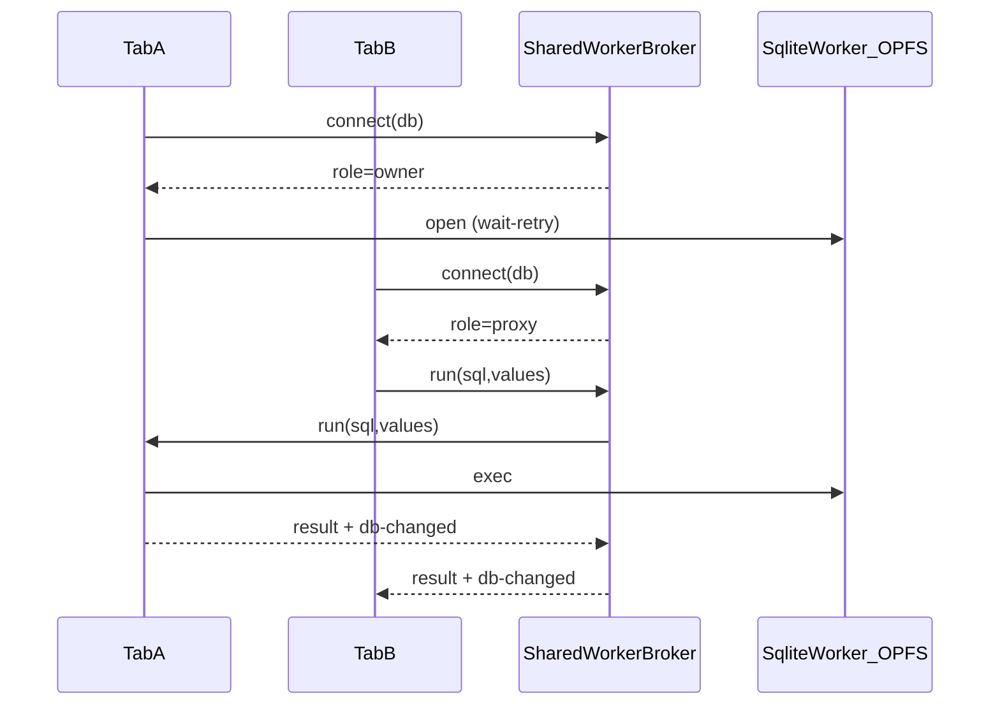
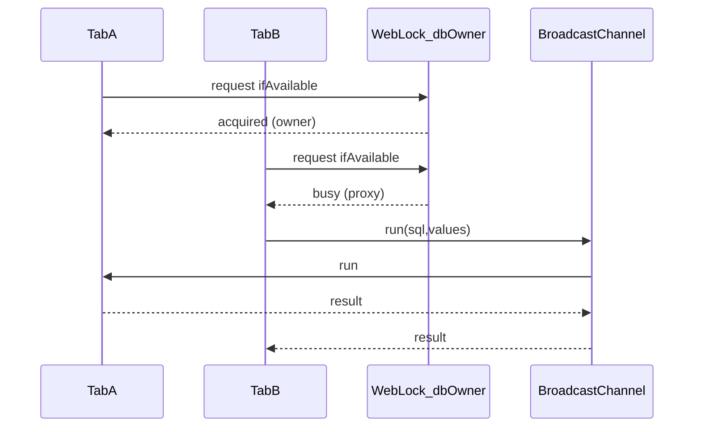
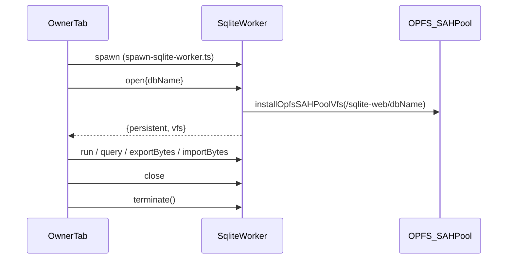

# Multi-tab web SqlClient

Browser tabs share one OPFS SQLite database per `dbName` without fighting exclusive
`createSyncAccessHandle` locks.

## Architecture

Exactly **one disposable iframe** owns the web SQLite (wa-sqlite + OPFS in its
dedicated worker). The product Window never imports the web SQLite module. Peers never call
`SQLite.openDatabaseAsync` on the Window.

### SharedWorker path (default)

- Broker script: `/sql-workers/db-host-shared-worker.js` (esbuild prebuild; no bundler worker config).
- Build: `bun run --filter @pkgs/sql-client-sqlite-web build:web-workers`
- Heartbeat: tabs ping every 5s; silent ports reaped after 15s; owner promoted.

### Leader-election fallback (no SharedWorker)

- Lock name: `db-owner:<dbName>`
- RPC channel: `db-rpc:<dbName>`
- Change notify: `db-changed:<dbName>`
- On timeout / leader loss: one transparent re-elect + retry (`E_LEADER_LOST`).

## Nested transactions

Flattened (`fn(tx)`), matching node-pg session clients — no `SAVEPOINT`.

## Recovery (local DB is a rehydratable cache)

The web SQLite AccessHandlePoolVFS pre-allocates **6** sync access handles under
OPFS `sqlite/`. Leftover files / pool exhaustion / corrupt headers make
`sqlite3_open_v2` fail. `closeAsync` does **not** release those handles — only
destroying the document that loaded the SQLite module does.

Product web therefore:

1. Loads the web SQLite **only** inside a disposable iframe (`/sql-workers/sql-host.html`)
2. On pool / corrupt / migrate / schema-epoch failure: peers drop iframes via
   BroadcastChannel → force-release SharedWorker → destroy owner iframe → wipe
   OPFS `sqlite/` **in-process** → remount iframe → reopen empty cache
3. Never navigates to a wipe HTML document; soft `sessionStorage` + reload loops
   are gone

User-initiated reset (`runWebOpfsRecoveryAndReload` / `?reset-db=1`) uses the
same in-process path, then `location.reload()` so Solid remounts.

SharedWorker instances are named `sql-db-host-v{protocolVersion}` so a deploy
that bumps `SQL_DB_HOST_PROTOCOL_VERSION` does not share a stale broker with
old tabs.

## Owners

The owner tab talks to SQLite through a `SqlOwner` (`open` / `close` /
`resetStore`). The production browser owner is:

| Owner | Engine | Storage | Used by |
| --- | --- | --- | --- |
| `createSqliteWorkerSqlOwner` (`src/sqlite-worker/`) | `@sqlite.org/sqlite-wasm` in a **dedicated module worker** | OPFS SyncAccessHandle **pool VFS**, one directory per db (`/sqlite-web/<dbName>`); memory fallback when OPFS is unavailable | Solid / Vite app |

### Dedicated-worker owner

- Wire protocol: `sqlite-worker/protocol.ts` (`{ id, op, args }` → `{ id, ok, result | error }`); requests are served strictly in order so `BEGIN … COMMIT` never interleave.
- Host (`sqlite-worker-host.ts`) and client (`sqlite-worker-client.ts`) are framework- and wall-free; tests drive them over a `MessageChannel` with the memory backend (`bun test`).
- `resetStore` spawns a throwaway worker that wipes the pool directory (`wipeFiles`) and terminates — this is the in-process recovery primitive.
- Only `sqlite-worker-entry.ts` (worker realm) and `spawn-sqlite-worker.ts` (`new Worker(new URL(...))`) touch browser globals; both are `@io-wall-ok`.

## Migration (`open-main-sql-client.ts`)

Web calls `createWebSqlClient(dbName, { timers, migrate?, schemaEpoch? })`.
Sync upload/push is gated by `sync-owner:<dbName>`.

### Legacy session lock

`web-session-lock*` remains for older clients and boot-error matching, but
**web open no longer acquires** that exclusive Web Lock. Multi-tab coordination
is SharedWorker (or leader-election fallback) only.
