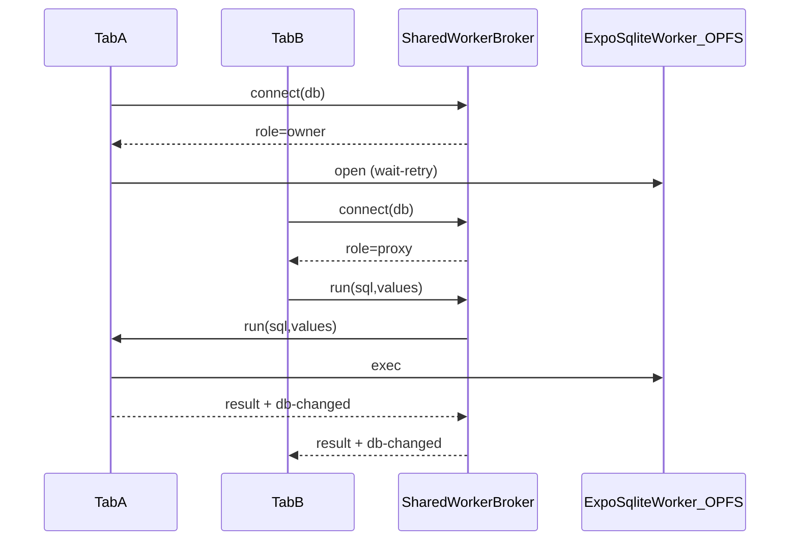
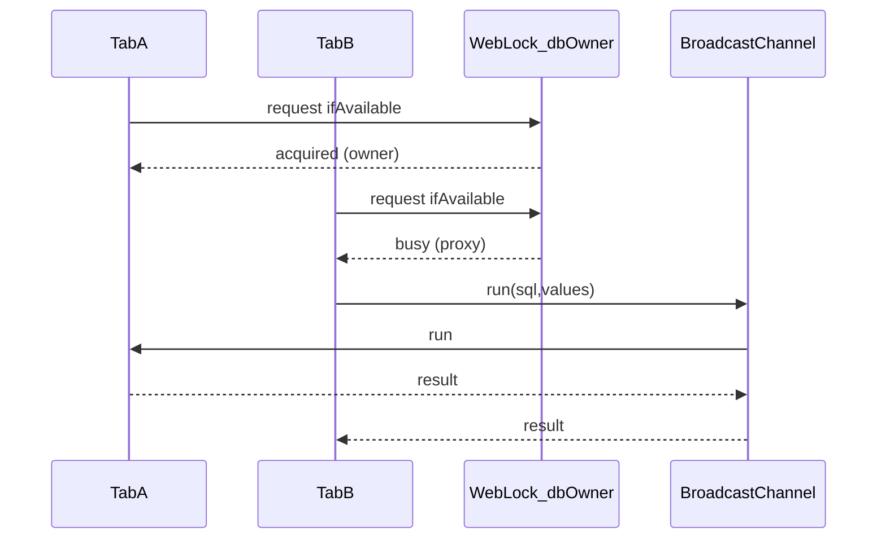

# Multi-tab web SqlClient

Browser tabs share one OPFS SQLite database per `dbName` without fighting exclusive
`createSyncAccessHandle` locks.

## Architecture

Exactly **one disposable iframe** owns expo-sqlite (wa-sqlite + OPFS in its
dedicated worker). The product Window never imports expo-sqlite. Peers never call
`SQLite.openDatabaseAsync` on the Window.

### SharedWorker path (default)

- Broker script: `/sql-workers/db-host-shared-worker.js` (esbuild prebuild; no Metro worker config).
- Build: `bun run --filter @pkgs/sql-client build:web-workers`
- Heartbeat: tabs ping every 5s; silent ports reaped after 15s; owner promoted.

### Leader-election fallback (no SharedWorker)

- Lock name: `db-owner:<dbName>`
- RPC channel: `db-rpc:<dbName>`
- Change notify: `db-changed:<dbName>`
- On timeout / leader loss: one transparent re-elect + retry (`E_LEADER_LOST`).

## Nested transactions

Flattened (`fn(tx)`), matching Expo / node-pg session clients — no `SAVEPOINT`.

## Recovery (local DB is a rehydratable cache)

expo-sqlite’s AccessHandlePoolVFS pre-allocates **6** sync access handles under
OPFS `expo-sqlite/`. Leftover files / pool exhaustion / corrupt headers make
`sqlite3_open_v2` fail. `closeAsync` does **not** release those handles — only
destroying the document that loaded expo-sqlite does.

Product web therefore:

1. Loads expo-sqlite **only** inside a disposable iframe (`/sql-workers/sql-host.html`)
2. On pool / corrupt / migrate / schema-epoch failure: peers drop iframes via
   BroadcastChannel → force-release SharedWorker → destroy owner iframe → wipe
   OPFS `expo-sqlite/` **in-process** → remount iframe → reopen empty cache
3. Never navigates to a wipe HTML document; soft `sessionStorage` + reload loops
   are gone

User-initiated reset (`runWebOpfsRecoveryAndReload` / `?reset-db=1`) uses the
same in-process path, then `location.reload()` so React remounts.

SharedWorker instances are named `sql-db-host-v{protocolVersion}` so a deploy
that bumps `SQL_DB_HOST_PROTOCOL_VERSION` does not share a stale broker with
old tabs.

## Migration (`open-main-sql-client.ts`)

Web calls `createExpoWebSqlClient(dbName, { timers, migrate?, schemaEpoch? })`.
Native is unchanged. Sync upload/push is gated by `sync-owner:<dbName>`.

### Legacy session lock

`expo-web-session-lock*` remains for older clients and boot-error matching, but
**web open no longer acquires** that exclusive Web Lock. Multi-tab coordination
is SharedWorker (or leader-election fallback) only.
