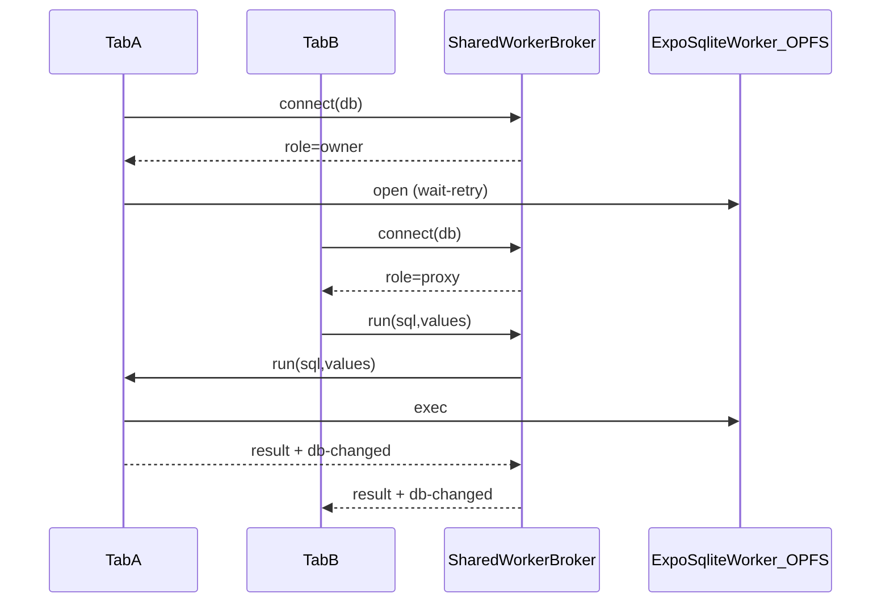
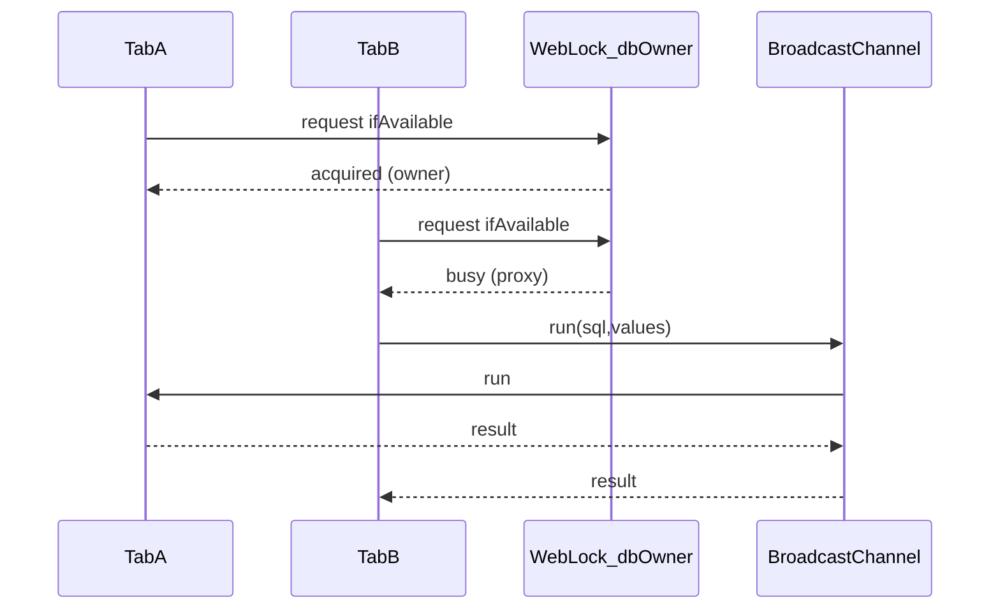

# Multi-tab web SqlClient

Browser tabs share one OPFS SQLite database per `dbName` without fighting exclusive
`createSyncAccessHandle` locks.

## Architecture

Exactly **one Window** owns expo-sqlite (which already runs wa-sqlite + OPFS in its
own dedicated worker). Peers never call `SQLite.openDatabaseAsync`.

### SharedWorker path (default)

- Broker script: `/sql-workers/db-host-shared-worker.js` (esbuild prebuild; no Metro worker config).
- Build: `bun run --filter @pkgs/sql-client build:web-workers`
- Heartbeat: tabs ping every 5s; silent ports reaped after 15s; owner promoted.

### Leader-election fallback (no SharedWorker)

- Lock name: `db-owner:<dbName>`
- RPC channel: `db-rpc:<dbName>`
- Change notify: `db-changed:<dbName>`
- On timeout / leader loss: one transparent re-elect + retry (`E_LEADER_LOST`).

## Nested transactions

Flattened (`fn(tx)`), matching Expo / node-pg session clients — no `SAVEPOINT`.

## Recovery (almost never wipe)

**Open never auto-deletes OPFS.** On lock/pool open failure the owner tab:

1. Force-releases SharedWorker owners
2. Reloads once (soft recovery — preserves DB files)
3. If that still fails → fatal boot error with “Reset local data”

Destructive wipe is **user-initiated only**:

- Boot-screen “Reset local data” CTA
- Product wipe command
- `?reset-db=1` (or `?opfs-wipe=1`) — `index.html` redirects to the wipe document before Expo mounts

Chrome keeps AccessHandlePoolVFS `FileSystemSyncAccessHandle`s open until the
document that loaded expo-sqlite is torn down — `closeAsync` alone is not enough.
User wipe therefore:

1. Navigate to `/sql-workers/opfs-wipe.html?opfs-wipe=1&return=…`
2. Boot script broadcasts `prepare-wipe`; peers park on the same wipe HTML with `opfs-wipe=park`
3. Force-release SharedWorker owners, delete OPFS `expo-sqlite/`, navigate home, `wipe-done`

## Migration (`open-main-sql-client.ts`)

Web now calls `createExpoWebSqlClient(dbName, { timers })` instead of
`SqlClientImplExpoSqlite.open` + the old exclusive session lock / per-tab DB suffix.
Native is unchanged. Sync upload/push is gated by `sync-owner:<dbName>`.

### Legacy session lock

`expo-web-session-lock*` remains in the package for older clients and boot-error
matching, but **web open no longer acquires** that exclusive Web Lock. Multi-tab
coordination is SharedWorker (or leader-election fallback) only.
