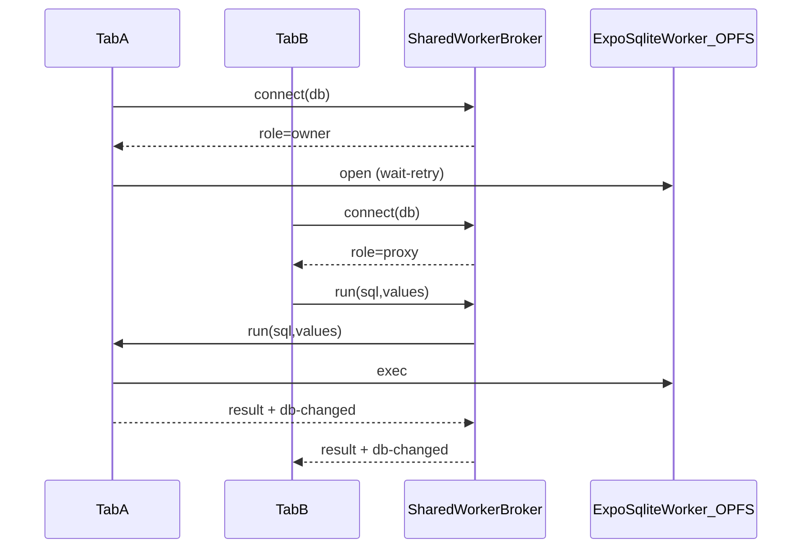
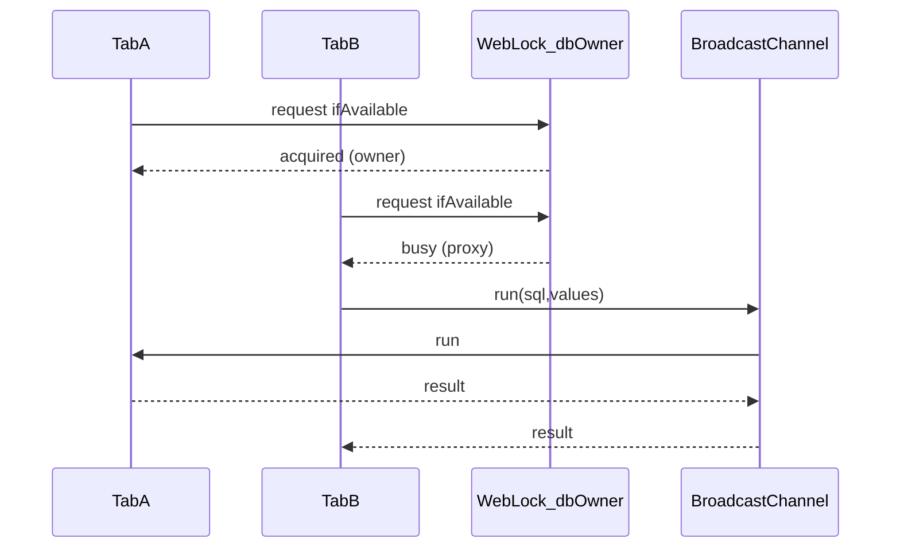

# Multi-tab web SqlClient

Browser tabs share one OPFS SQLite database per `dbName` without fighting exclusive
`createSyncAccessHandle` locks.

## Architecture

Exactly **one Window** owns expo-sqlite (which already runs wa-sqlite + OPFS in its
own dedicated worker). Peers never call `SQLite.openDatabaseAsync`.

### SharedWorker path (default)

- Broker script: `/sql-workers/db-host-shared-worker.js` (esbuild prebuild; no Metro worker config).
- Build: `bun run --filter @pkgs/sql-client build:web-workers`
- Heartbeat: tabs ping every 5s; silent ports reaped after 15s; owner promoted.

### Leader-election fallback (no SharedWorker)

- Lock name: `db-owner:<dbName>`
- RPC channel: `db-rpc:<dbName>`
- Change notify: `db-changed:<dbName>`
- On timeout / leader loss: one transparent re-elect + retry (`E_LEADER_LOST`).

## Nested transactions

Flattened (`fn(tx)`), matching Expo / node-pg session clients — no `SAVEPOINT`.

## Destructive reset

Open never auto-deletes OPFS. Use explicit `resetDatabase()` (owner RPC), the
boot-screen “Reset local data” CTA, `?reset-db=1`, or
`runWebOpfsRecoveryAndReload({ timers })` from `@pkgs/sql-client/sqlite/web`.

Chrome keeps AccessHandlePoolVFS `FileSystemSyncAccessHandle`s open until the
document that loaded expo-sqlite is torn down — `closeAsync` alone is not enough.
Recovery therefore:

1. App navigates to `/?opfs-wipe=1&return=…` (or `index.html` handles
   `?reset-db=1` the same way) without waiting on auth / SQLite open.
2. `index.html` replaces itself with a wipe shell + `/sql-workers/opfs-wipe-boot.js`
   so Expo never mounts (needed when SW/Cursor cannot navigate to a separate HTML).
3. Boot script broadcasts `prepare-wipe`; peers park on `/?opfs-wipe=park`.
4. Force-release SharedWorker owners, delete OPFS, broadcast `wipe-done`, return.

This is infrastructure, not a product confirm screen — the boot CTA /
`?reset-db=1` still own the user-facing entry.

## Migration (`open-main-sql-client.ts`)

Web now calls `createExpoWebSqlClient(dbName, { timers })` instead of
`SqlClientImplExpoSqlite.open` + the old exclusive session lock / per-tab DB suffix.
Native is unchanged. Sync upload/push is gated by `sync-owner:<dbName>`.

### Legacy session lock

`expo-web-session-lock*` remains in the package for older clients and boot-error
matching, but **web open no longer acquires** that exclusive Web Lock. Multi-tab
coordination is SharedWorker (or leader-election fallback) only.
