<!-- overhaul-loop:media-round-4-part-1 -->
## Board round 4 — screenshots and videos, part 1
Candidate `8a3538fca4c9d23ff931be3dfa85b1080ebc0041` · evidence `6829b284db795f67`.
[Manifest](https://github.com/crvouga/gamezilla/blob/902e8e2bde2eb7fa79f532554eaeb39e4e6d4241/round-4/manifest.json) · [Screenshot gallery](https://github.com/crvouga/gamezilla/blob/902e8e2bde2eb7fa79f532554eaeb39e4e6d4241/round-4/GALLERY.md) · [Before/after pairs](https://github.com/crvouga/gamezilla/blob/902e8e2bde2eb7fa79f532554eaeb39e4e6d4241/round-4/pairs) · [Exhaustive story inventory](https://github.com/crvouga/gamezilla/blob/902e8e2bde2eb7fa79f532554eaeb39e4e6d4241/round-4/story-inventory.json) · [Journey limits](https://github.com/crvouga/gamezilla/blob/902e8e2bde2eb7fa79f532554eaeb39e4e6d4241/round-4/journeys/mapping.json)
All 648 visual cases passed native readiness/play, browser-error and serious/critical axe stages. Eight font checks and the instrumented chess regression passed. Pixel comparisons, full bun verify, hosted safety and Ubuntu reference decisions are reported separately; no macOS references were accepted.
[Integration handoff and exact outcomes](https://github.com/crvouga/gamezilla/blob/902e8e2bde2eb7fa79f532554eaeb39e4e6d4241/round-4/HANDOFF.md). Hosted `verify:end` succeeded on this candidate. Full local `bun verify` failed at the existing `/more/troubleshooting` chart ownership gate; coverage reports 270 violations. Canonical Ubuntu authoring succeeded, same-head comparison was still running at the saved snapshot, and zero references are accepted.
Automated Storybook only. No manual QA, ratings or merge. Videos use native Storybook assertion checkpoints with recorder-only pacing. These are pinned WebM links, not embedded video players. Before images are immutable round-3 captures; absent-before states are explicit. Test viewports: 390×844 and 1440×844; gallery viewports: 390×844 and 1440×900.

J1: ChessGameBoard — Chess: select piece, legal destination, observe move; promotion and orientation

| View | Before | After |
|---|---|---|
| phone · light |  |  |
| phone · dark | 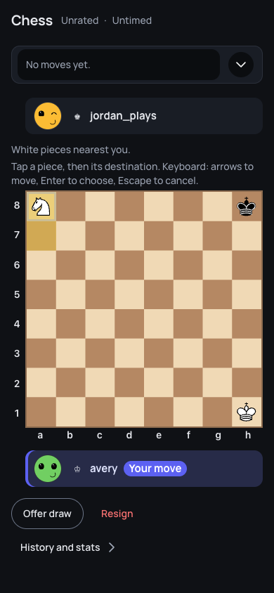 |  |
| desktop · light | 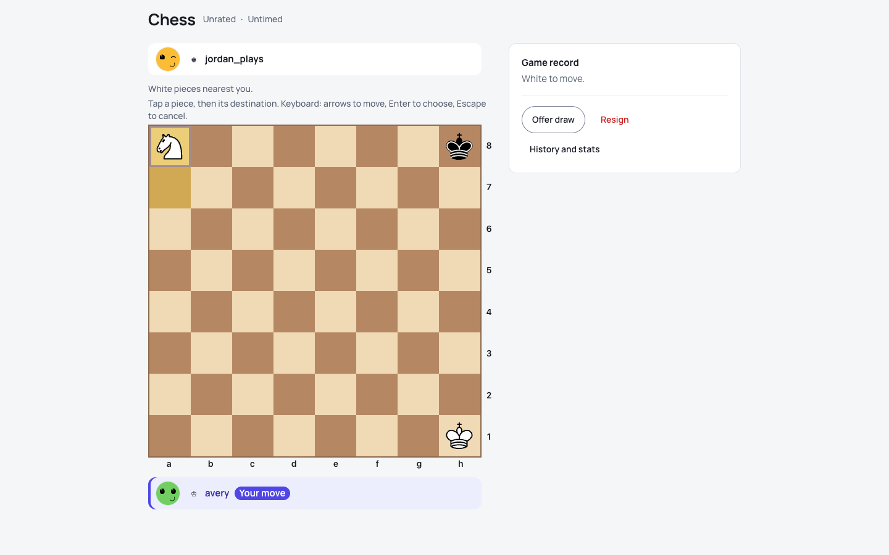 |  |
| desktop · dark |  | 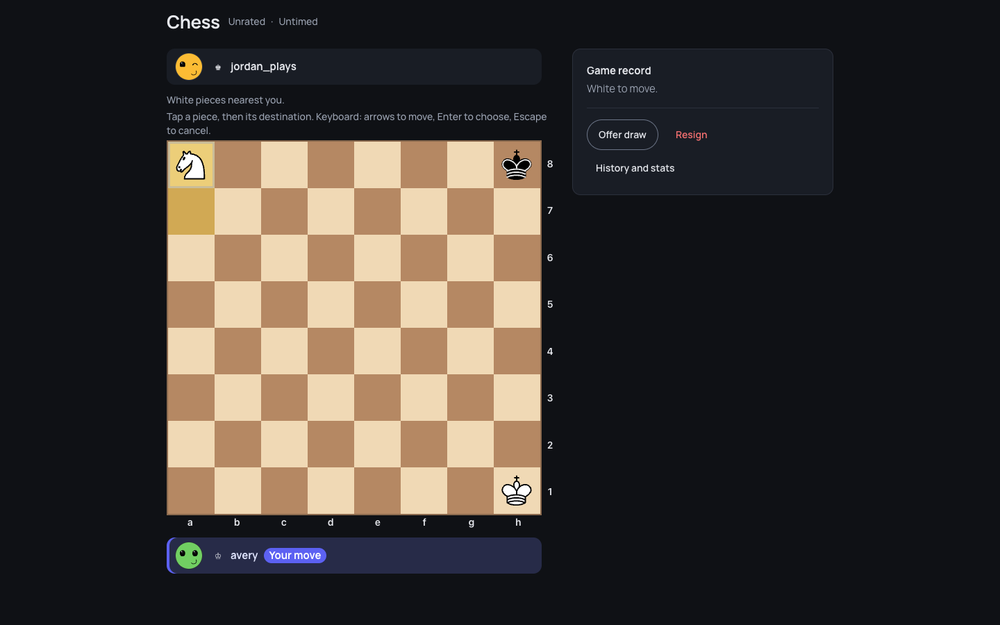 |

**Checks:** 40 canonical cases passed native readiness/play, browser-error and serious/critical axe. Pixels: 0 passed, 40 failed; no macOS acceptance.
**Limits:** Promotion choice and board guidance are exercised; ordinary full-match and network turn progression are not established.

**Automated journey:** `screens-games-chess-board--promotion-choice`
[Phone WebM](https://raw.githubusercontent.com/crvouga/gamezilla/902e8e2bde2eb7fa79f532554eaeb39e4e6d4241/round-4/journeys/recordings/videos/screens-games-chess-board--promotion-choice--phone--light.webm) · [Desktop WebM](https://raw.githubusercontent.com/crvouga/gamezilla/902e8e2bde2eb7fa79f532554eaeb39e4e6d4241/round-4/journeys/recordings/videos/screens-games-chess-board--promotion-choice--desktop--light.webm)
[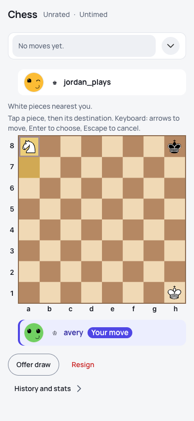](https://raw.githubusercontent.com/crvouga/gamezilla/902e8e2bde2eb7fa79f532554eaeb39e4e6d4241/round-4/journeys/recordings/videos/screens-games-chess-board--promotion-choice--phone--light.webm)

J2: ChessPuzzleBoard — Chess puzzle: make solution moves; recover wrong move; hint

| View | Before | After |
|---|---|---|
| phone · light |  | 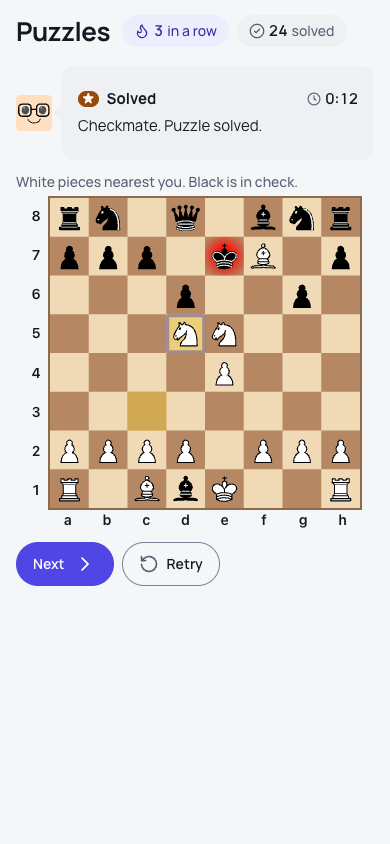 |
| phone · dark | 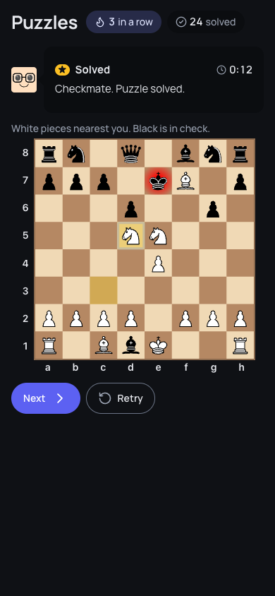 |  |
| desktop · light | 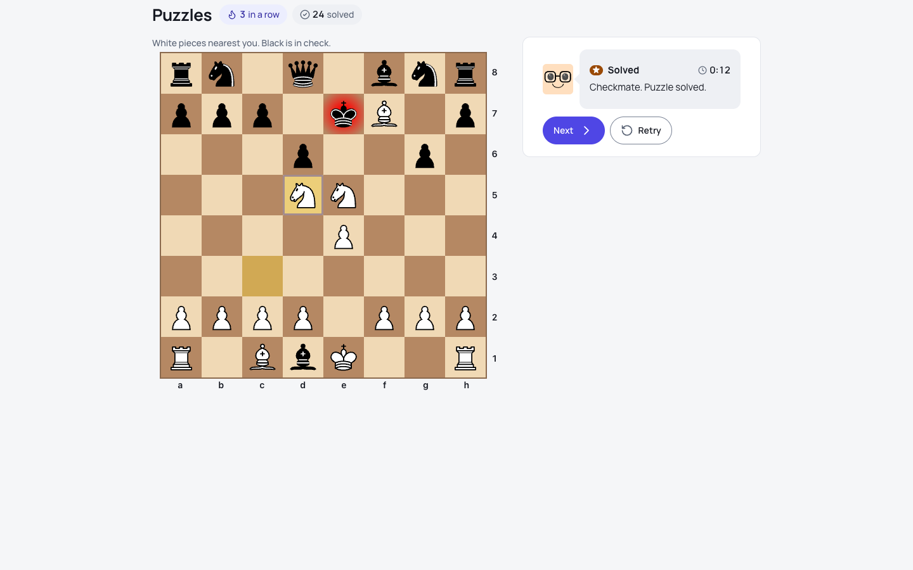 |  |
| desktop · dark | 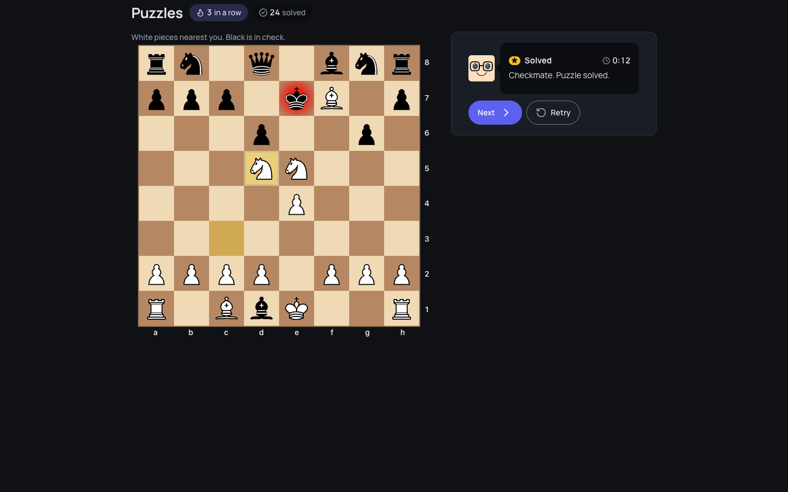 |  |

**Checks:** 23 canonical cases passed native readiness/play, browser-error and serious/critical axe. Pixels: 0 passed, 23 failed; no macOS acceptance.
**Limits:** Puzzle fixture completion and wrong-move recovery; persisted attempt history and overview navigation remain outside this Storybook evidence.

**Automated journey:** `screens-puzzles-chess-play--solve-journey`
[Phone WebM](https://raw.githubusercontent.com/crvouga/gamezilla/902e8e2bde2eb7fa79f532554eaeb39e4e6d4241/round-4/journeys/recordings/videos/screens-puzzles-chess-play--solve-journey--phone--light.webm) · [Desktop WebM](https://raw.githubusercontent.com/crvouga/gamezilla/902e8e2bde2eb7fa79f532554eaeb39e4e6d4241/round-4/journeys/recordings/videos/screens-puzzles-chess-play--solve-journey--desktop--light.webm)

**Automated journey:** `screens-puzzles-chess-play--wrong-move-recovery`
[Phone WebM](https://raw.githubusercontent.com/crvouga/gamezilla/902e8e2bde2eb7fa79f532554eaeb39e4e6d4241/round-4/journeys/recordings/videos/screens-puzzles-chess-play--wrong-move-recovery--phone--light.webm) · [Desktop WebM](https://raw.githubusercontent.com/crvouga/gamezilla/902e8e2bde2eb7fa79f532554eaeb39e4e6d4241/round-4/journeys/recordings/videos/screens-puzzles-chess-play--wrong-move-recovery--desktop--light.webm)

J3: ConnectFourGameBoard — Drop a disc into a non-full column and observe turn/result

| View | Before | After |
|---|---|---|
| phone · light |  |  |
| phone · dark |  | 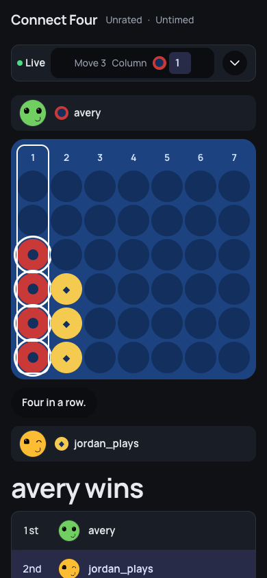 |
| desktop · light | 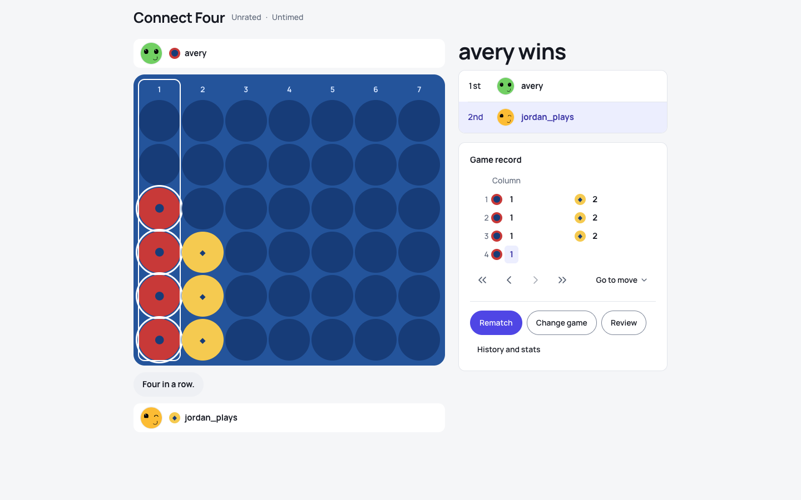 |  |
| desktop · dark | 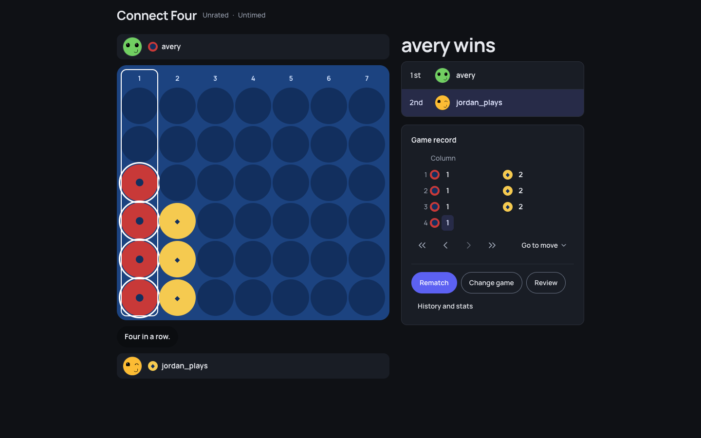 |  |

**Checks:** 40 canonical cases passed native readiness/play, browser-error and serious/critical axe. Pixels: 0 passed, 40 failed; no macOS acceptance.
**Limits:** Storybook exercises production components and deterministic fixture rules; live transport and persisted cross-session recovery are outside this board-only verification.

**Automated journey:** `screens-games-connect-four-board--connect-four-to-win`
[Phone WebM](https://raw.githubusercontent.com/crvouga/gamezilla/902e8e2bde2eb7fa79f532554eaeb39e4e6d4241/round-4/journeys/recordings/videos/screens-games-connect-four-board--connect-four-to-win--phone--light.webm) · [Desktop WebM](https://raw.githubusercontent.com/crvouga/gamezilla/902e8e2bde2eb7fa79f532554eaeb39e4e6d4241/round-4/journeys/recordings/videos/screens-games-connect-four-board--connect-four-to-win--desktop--light.webm)
[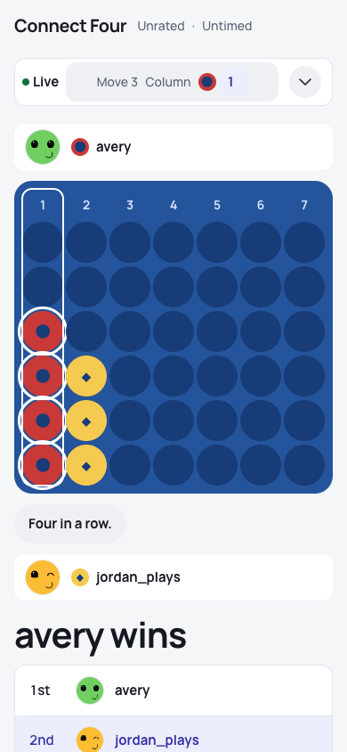](https://raw.githubusercontent.com/crvouga/gamezilla/902e8e2bde2eb7fa79f532554eaeb39e4e6d4241/round-4/journeys/recordings/videos/screens-games-connect-four-board--connect-four-to-win--phone--light.webm)

J4: BattleshipSetupBoard — Place and rotate full fleet; recover invalid placement; ready

| View | Before | After |
|---|---|---|
| phone · light | 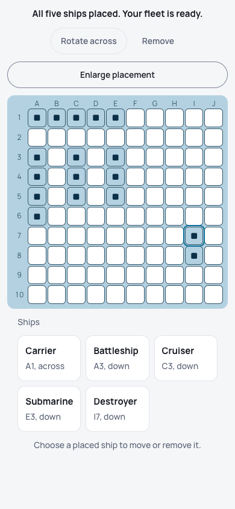 | 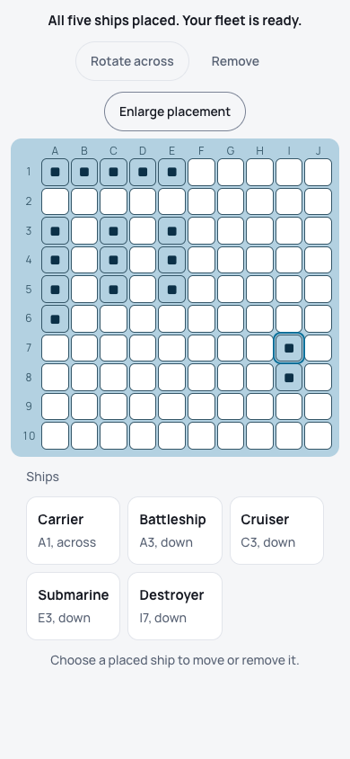 |
| phone · dark | 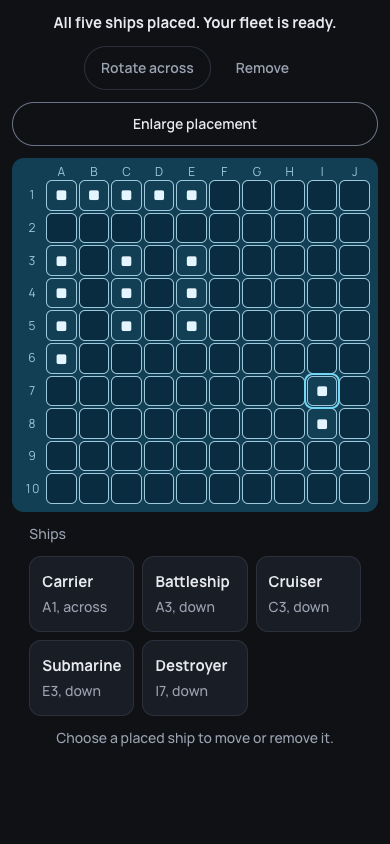 | 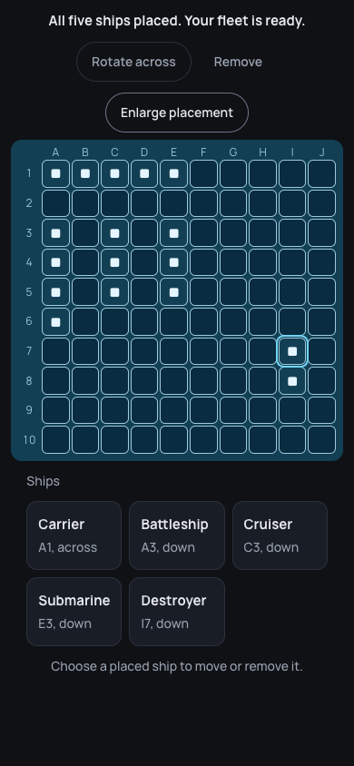 |
| desktop · light | 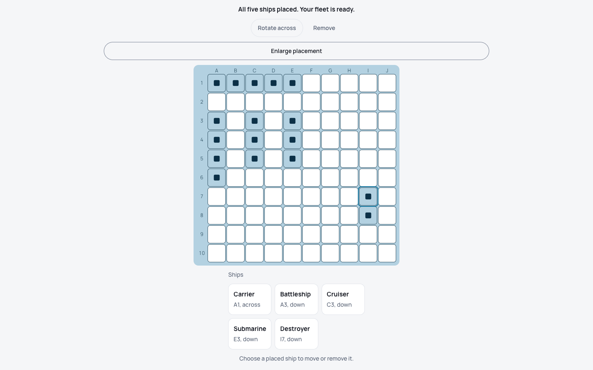 | 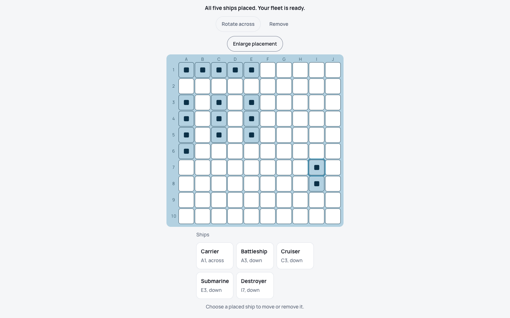 |
| desktop · dark | 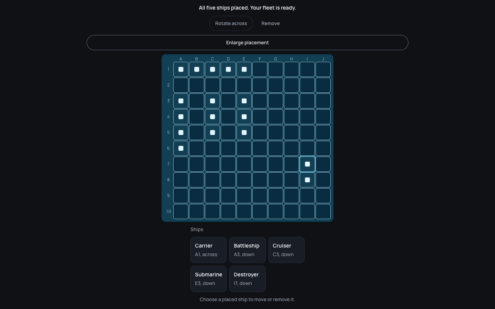 | 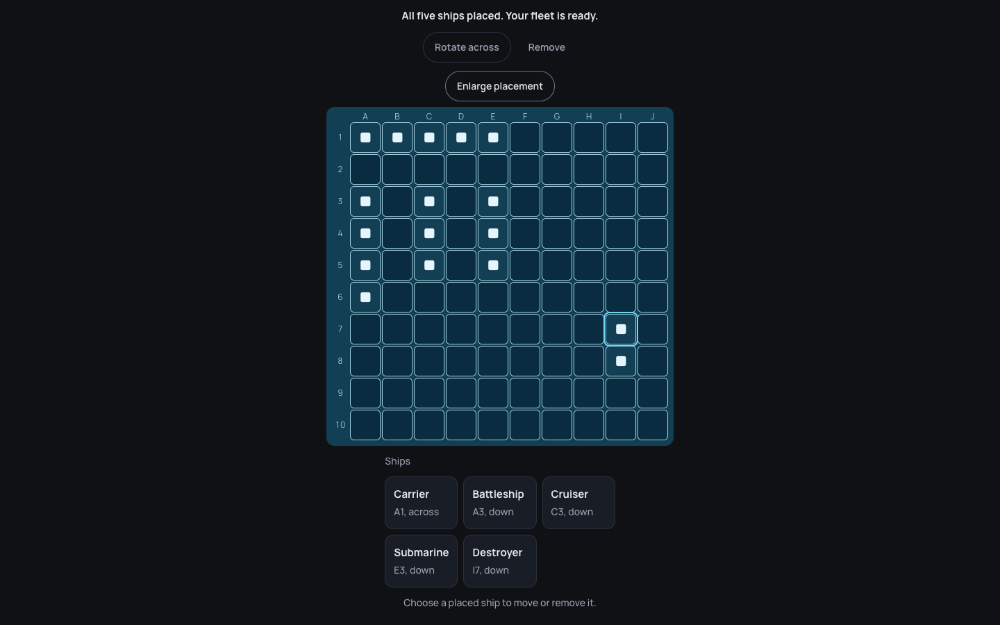 |

**Checks:** 35 canonical cases passed native readiness/play, browser-error and serious/critical axe. Pixels: 0 passed, 35 failed; no macOS acceptance.
**Limits:** Storybook exercises production components and deterministic fixture rules; live transport and persisted cross-session recovery are outside this board-only verification.

**Automated journey:** `screens-games-battleship-setup--arrange-full-fleet`
[Phone WebM](https://raw.githubusercontent.com/crvouga/gamezilla/902e8e2bde2eb7fa79f532554eaeb39e4e6d4241/round-4/journeys/recordings/videos/screens-games-battleship-setup--arrange-full-fleet--phone--light.webm) · [Desktop WebM](https://raw.githubusercontent.com/crvouga/gamezilla/902e8e2bde2eb7fa79f532554eaeb39e4e6d4241/round-4/journeys/recordings/videos/screens-games-battleship-setup--arrange-full-fleet--desktop--light.webm)
[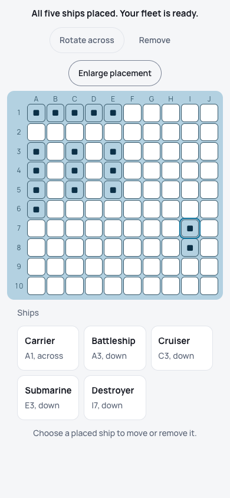](https://raw.githubusercontent.com/crvouga/gamezilla/902e8e2bde2eb7fa79f532554eaeb39e4e6d4241/round-4/journeys/recordings/videos/screens-games-battleship-setup--arrange-full-fleet--phone--light.webm)

**Automated journey:** `screens-games-battleship-setup--enlarged-placement`
[Phone WebM](https://raw.githubusercontent.com/crvouga/gamezilla/902e8e2bde2eb7fa79f532554eaeb39e4e6d4241/round-4/journeys/recordings/videos/screens-games-battleship-setup--enlarged-placement--phone--light.webm) · [Desktop WebM](https://raw.githubusercontent.com/crvouga/gamezilla/902e8e2bde2eb7fa79f532554eaeb39e4e6d4241/round-4/journeys/recordings/videos/screens-games-battleship-setup--enlarged-placement--desktop--light.webm)
[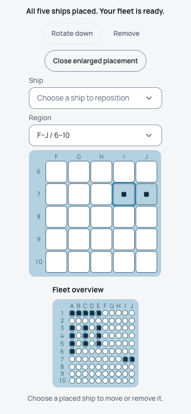](https://raw.githubusercontent.com/crvouga/gamezilla/902e8e2bde2eb7fa79f532554eaeb39e4e6d4241/round-4/journeys/recordings/videos/screens-games-battleship-setup--enlarged-placement--phone--light.webm)

J5: BattleshipBoard — Target untried square; observe hit/miss/sunk and turn

| View | Before | After |
|---|---|---|
| phone · light | 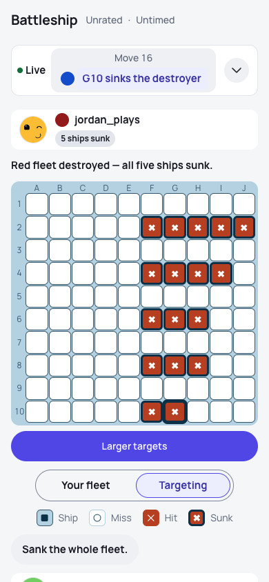 |  |
| phone · dark | 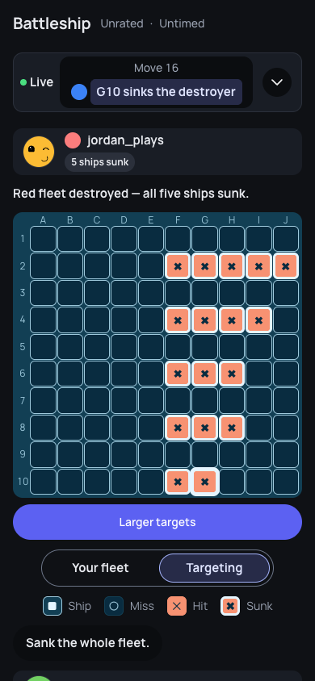 |  |
| desktop · light | 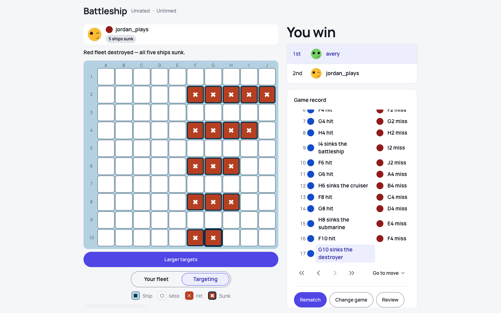 |  |
| desktop · dark | 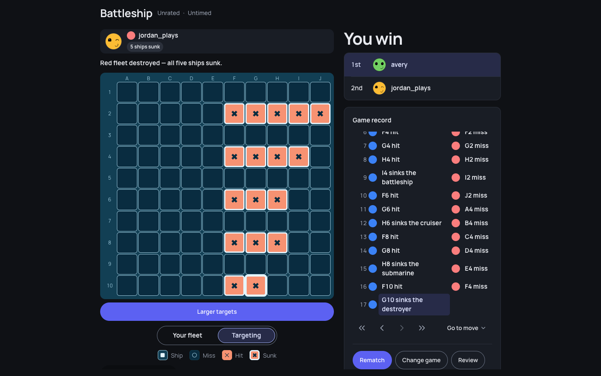 |  |

**Checks:** 46 canonical cases passed native readiness/play, browser-error and serious/critical axe. Pixels: 0 passed, 46 failed; no macOS acceptance.
**Limits:** Storybook exercises production components and deterministic fixture rules; live transport and persisted cross-session recovery are outside this board-only verification.

**Automated journey:** `screens-games-battleship-board--sink-the-fleet`
[Phone WebM](https://raw.githubusercontent.com/crvouga/gamezilla/902e8e2bde2eb7fa79f532554eaeb39e4e6d4241/round-4/journeys/recordings/videos/screens-games-battleship-board--sink-the-fleet--phone--light.webm) · [Desktop WebM](https://raw.githubusercontent.com/crvouga/gamezilla/902e8e2bde2eb7fa79f532554eaeb39e4e6d4241/round-4/journeys/recordings/videos/screens-games-battleship-board--sink-the-fleet--desktop--light.webm)

**Automated journey:** `screens-games-battleship-board--correct-target-before-firing`
[Phone WebM](https://raw.githubusercontent.com/crvouga/gamezilla/902e8e2bde2eb7fa79f532554eaeb39e4e6d4241/round-4/journeys/recordings/videos/screens-games-battleship-board--correct-target-before-firing--phone--light.webm) · [Desktop WebM](https://raw.githubusercontent.com/crvouga/gamezilla/902e8e2bde2eb7fa79f532554eaeb39e4e6d4241/round-4/journeys/recordings/videos/screens-games-battleship-board--correct-target-before-firing--desktop--light.webm)
[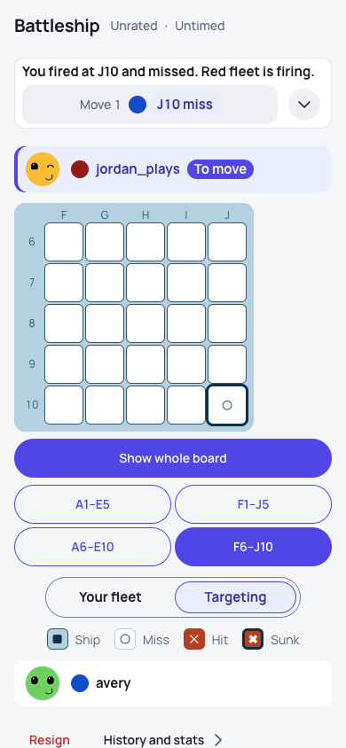](https://raw.githubusercontent.com/crvouga/gamezilla/902e8e2bde2eb7fa79f532554eaeb39e4e6d4241/round-4/journeys/recordings/videos/screens-games-battleship-board--correct-target-before-firing--phone--light.webm)

J6: NumberlinkPlayer — Draw all matching paths covering board; cancel/remove and recover

| View | Before | After |
|---|---|---|
| phone · light |  |  |
| phone · dark |  | 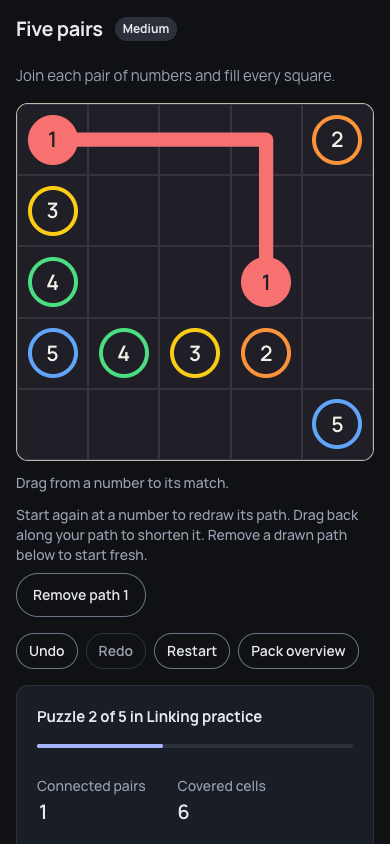 |
| desktop · light | 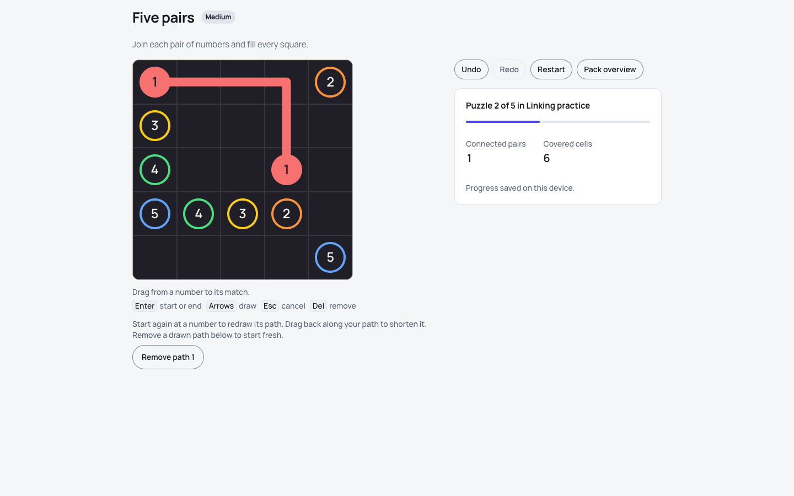 |  |
| desktop · dark | 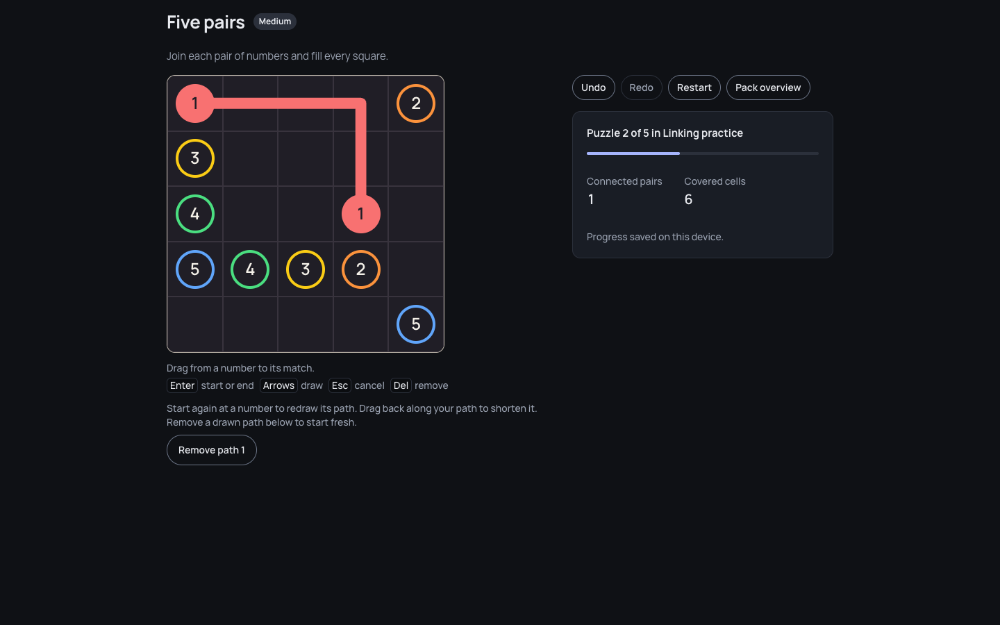 |  |

**Checks:** 30 canonical cases passed native readiness/play, browser-error and serious/critical axe. Pixels: 0 passed, 30 failed; no macOS acceptance.
**Limits:** Pointer recovery uses synthetic touch events with native pointer capture stubbed; trusted touch capture, cross-session persistence and shared undo/redo remain unproven. Keyboard completion has a separate matrix story.

**Automated journey:** `screens-games-numberlink-puzzle--recover-with-pointer`
[Phone WebM](https://raw.githubusercontent.com/crvouga/gamezilla/902e8e2bde2eb7fa79f532554eaeb39e4e6d4241/round-4/journeys/recordings/videos/screens-games-numberlink-puzzle--recover-with-pointer--phone--light.webm) · [Desktop WebM](https://raw.githubusercontent.com/crvouga/gamezilla/902e8e2bde2eb7fa79f532554eaeb39e4e6d4241/round-4/journeys/recordings/videos/screens-games-numberlink-puzzle--recover-with-pointer--desktop--light.webm)
[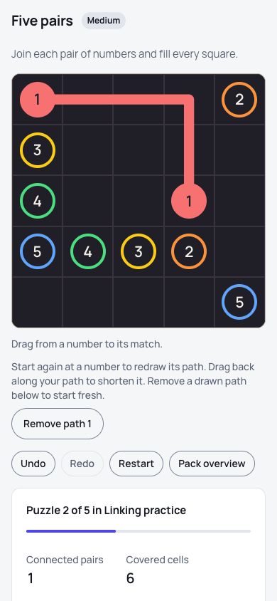](https://raw.githubusercontent.com/crvouga/gamezilla/902e8e2bde2eb7fa79f532554eaeb39e4e6d4241/round-4/journeys/recordings/videos/screens-games-numberlink-puzzle--recover-with-pointer--phone--light.webm)

J7: SokobanPlayer — Move and push every crate onto goals; recover blocked move; undo/redo

| View | Before | After |
|---|---|---|
| phone · light |  |  |
| phone · dark | 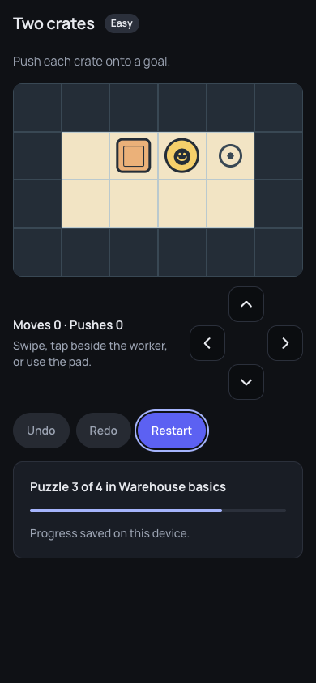 |  |
| desktop · light | 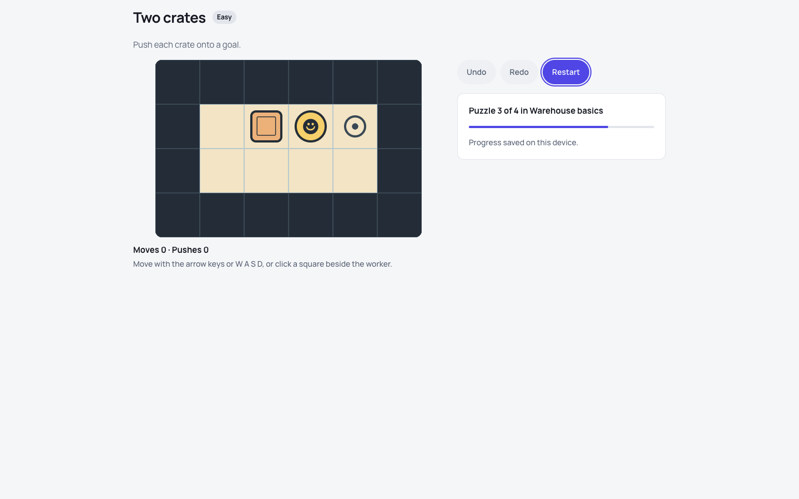 |  |
| desktop · dark | 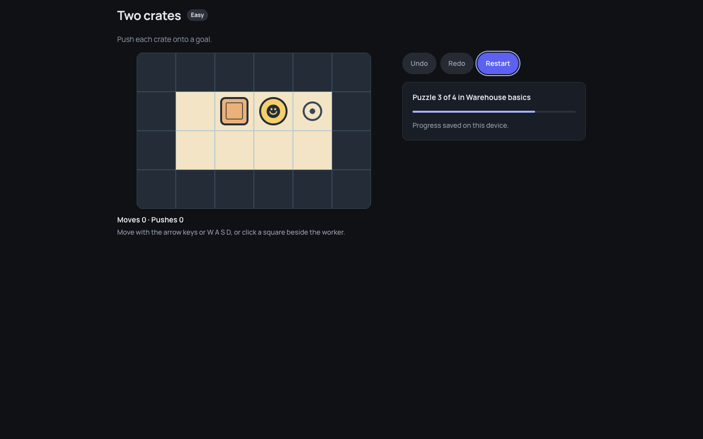 |  |

**Checks:** 35 canonical cases passed native readiness/play, browser-error and serious/critical axe. Pixels: 0 passed, 35 failed; no macOS acceptance.
**Limits:** Local production-rule history fixture exercises corner recovery, undo, redo, solving and restart; shared persisted mutation history and touch/swipe completion remain unproven.

**Automated journey:** `screens-games-sokoban-puzzle--corner-recovery`
[Phone WebM](https://raw.githubusercontent.com/crvouga/gamezilla/902e8e2bde2eb7fa79f532554eaeb39e4e6d4241/round-4/journeys/recordings/videos/screens-games-sokoban-puzzle--corner-recovery--phone--light.webm) · [Desktop WebM](https://raw.githubusercontent.com/crvouga/gamezilla/902e8e2bde2eb7fa79f532554eaeb39e4e6d4241/round-4/journeys/recordings/videos/screens-games-sokoban-puzzle--corner-recovery--desktop--light.webm)
[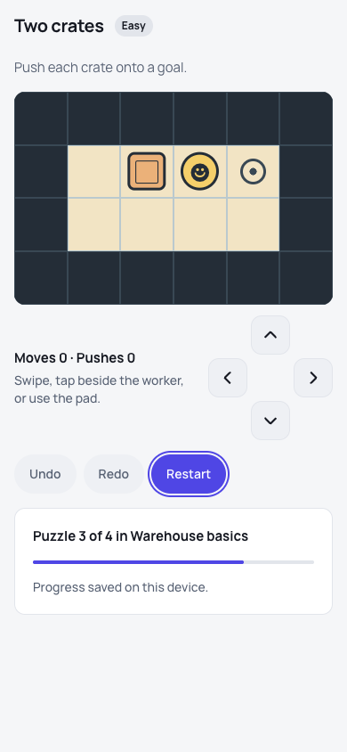](https://raw.githubusercontent.com/crvouga/gamezilla/902e8e2bde2eb7fa79f532554eaeb39e4e6d4241/round-4/journeys/recordings/videos/screens-games-sokoban-puzzle--corner-recovery--phone--light.webm)

