<!-- overhaul-loop:media-round-4-part-2 -->
## Board round 4 — screenshots and videos, part 2
Candidate `8a3538fca4c9d23ff931be3dfa85b1080ebc0041` · evidence `6829b284db795f67`.
[Manifest](https://github.com/crvouga/gamezilla/blob/902e8e2bde2eb7fa79f532554eaeb39e4e6d4241/round-4/manifest.json) · [Screenshot gallery](https://github.com/crvouga/gamezilla/blob/902e8e2bde2eb7fa79f532554eaeb39e4e6d4241/round-4/GALLERY.md) · [Before/after pairs](https://github.com/crvouga/gamezilla/blob/902e8e2bde2eb7fa79f532554eaeb39e4e6d4241/round-4/pairs) · [Exhaustive story inventory](https://github.com/crvouga/gamezilla/blob/902e8e2bde2eb7fa79f532554eaeb39e4e6d4241/round-4/story-inventory.json) · [Journey limits](https://github.com/crvouga/gamezilla/blob/902e8e2bde2eb7fa79f532554eaeb39e4e6d4241/round-4/journeys/mapping.json)
All 648 visual cases passed native readiness/play, browser-error and serious/critical axe stages. Eight font checks and the instrumented chess regression passed. Pixel comparisons, full bun verify, hosted safety and Ubuntu reference decisions are reported separately; no macOS references were accepted.
[Integration handoff and exact outcomes](https://github.com/crvouga/gamezilla/blob/902e8e2bde2eb7fa79f532554eaeb39e4e6d4241/round-4/HANDOFF.md). Hosted `verify:end` succeeded on this candidate. Full local `bun verify` failed at the existing `/more/troubleshooting` chart ownership gate; coverage reports 270 violations. Canonical Ubuntu authoring succeeded, same-head comparison was still running at the saved snapshot, and zero references are accepted.
Automated Storybook only. No manual QA, ratings or merge. Videos use native Storybook assertion checkpoints with recorder-only pacing. These are pinned WebM links, not embedded video players. Before images are immutable round-3 captures; absent-before states are explicit. Test viewports: 390×844 and 1440×844; gallery viewports: 390×844 and 1440×900.

J8: QuoridorBoard — Move pawn and place/rotate valid wall; reach opposite edge

| View | Before | After |
|---|---|---|
| phone · light | 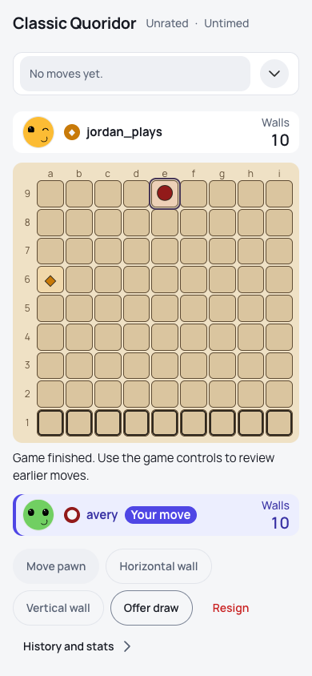 | 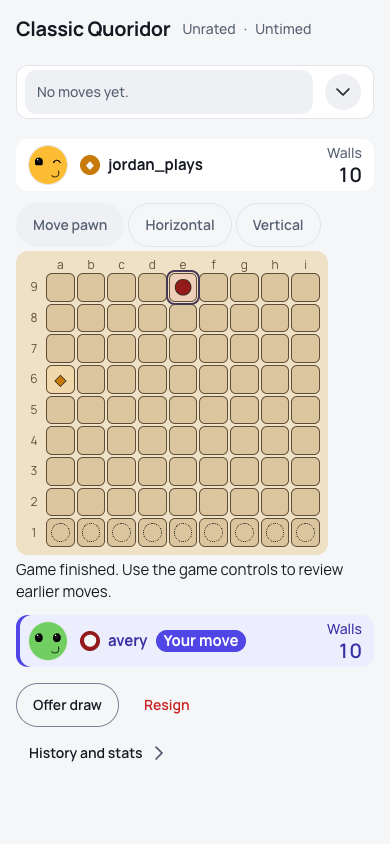 |
| phone · dark | 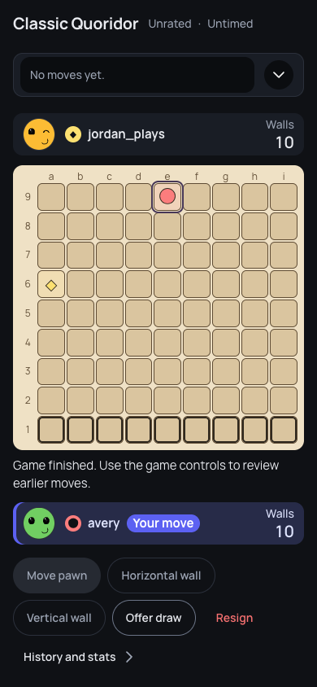 | 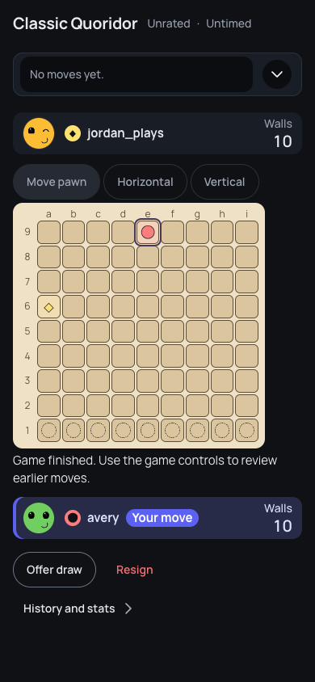 |
| desktop · light | 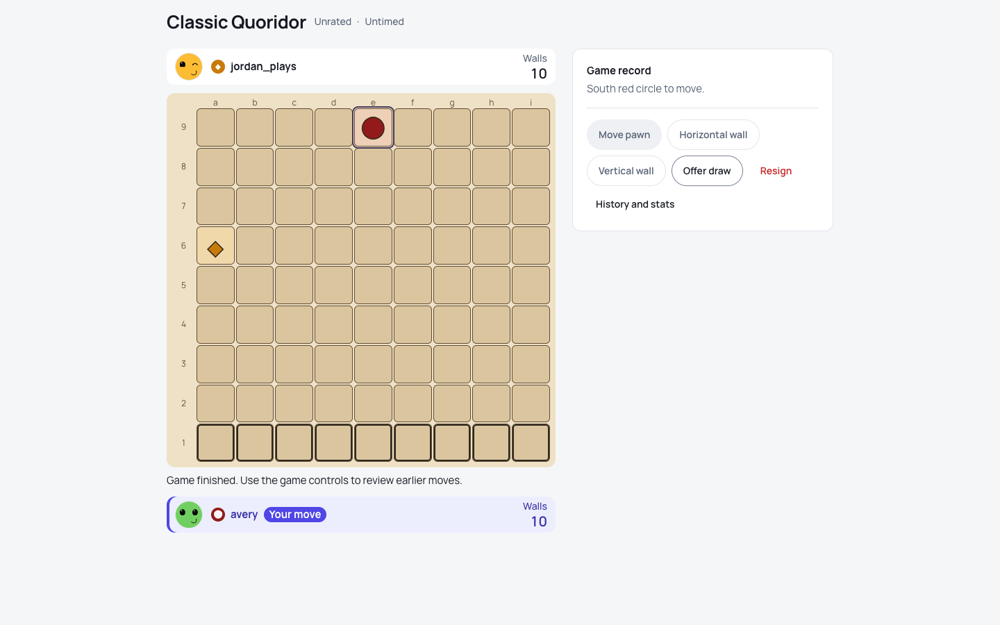 | 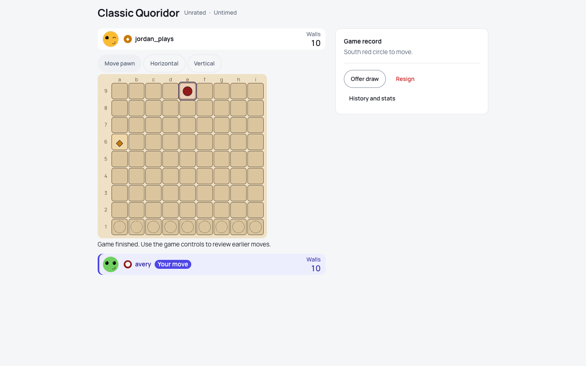 |
| desktop · dark | 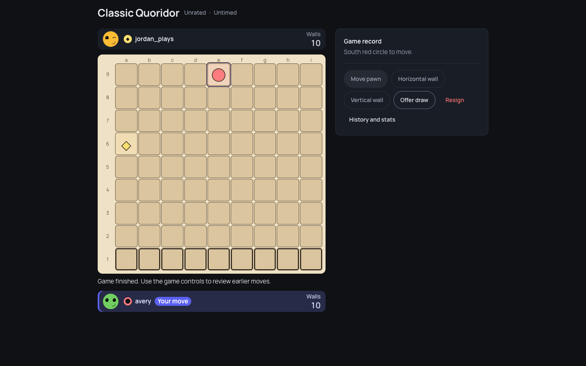 | 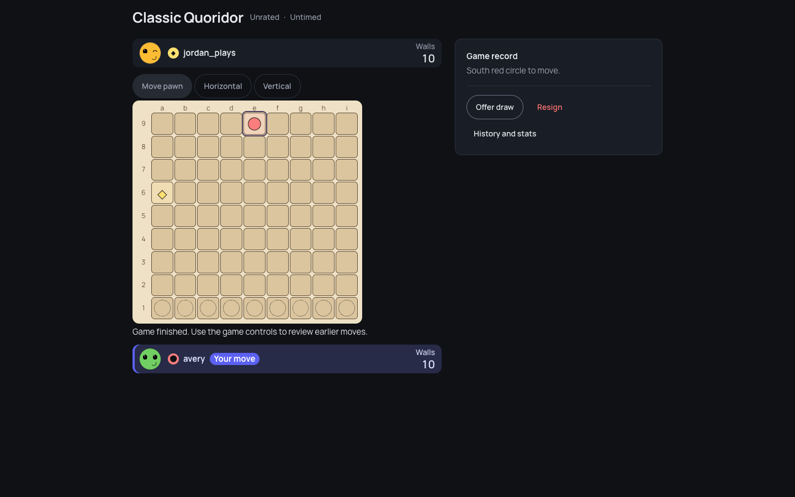 |

**Checks:** 47 canonical cases passed native readiness/play, browser-error and serious/critical axe. Pixels: 0 passed, 47 failed; no macOS acceptance.
**Limits:** Storybook exercises production components and deterministic fixture rules; live transport and persisted cross-session recovery are outside this board-only verification.

**Automated journey:** `screens-games-quoridor-classic--reach-opposite-edge`
[Phone WebM](https://raw.githubusercontent.com/crvouga/gamezilla/902e8e2bde2eb7fa79f532554eaeb39e4e6d4241/round-4/journeys/recordings/videos/screens-games-quoridor-classic--reach-opposite-edge--phone--light.webm) · [Desktop WebM](https://raw.githubusercontent.com/crvouga/gamezilla/902e8e2bde2eb7fa79f532554eaeb39e4e6d4241/round-4/journeys/recordings/videos/screens-games-quoridor-classic--reach-opposite-edge--desktop--light.webm)

**Automated journey:** `screens-games-quoridor-classic--place-a-wall`
[Phone WebM](https://raw.githubusercontent.com/crvouga/gamezilla/902e8e2bde2eb7fa79f532554eaeb39e4e6d4241/round-4/journeys/recordings/videos/screens-games-quoridor-classic--place-a-wall--phone--light.webm) · [Desktop WebM](https://raw.githubusercontent.com/crvouga/gamezilla/902e8e2bde2eb7fa79f532554eaeb39e4e6d4241/round-4/journeys/recordings/videos/screens-games-quoridor-classic--place-a-wall--desktop--light.webm)
[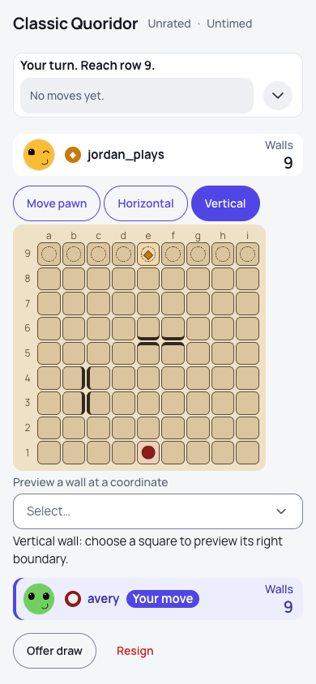](https://raw.githubusercontent.com/crvouga/gamezilla/902e8e2bde2eb7fa79f532554eaeb39e4e6d4241/round-4/journeys/recordings/videos/screens-games-quoridor-classic--place-a-wall--phone--light.webm)

**Automated journey:** `screens-games-quoridor-classic--precise-coordinates`
[Phone WebM](https://raw.githubusercontent.com/crvouga/gamezilla/902e8e2bde2eb7fa79f532554eaeb39e4e6d4241/round-4/journeys/recordings/videos/screens-games-quoridor-classic--precise-coordinates--phone--light.webm) · [Desktop WebM](https://raw.githubusercontent.com/crvouga/gamezilla/902e8e2bde2eb7fa79f532554eaeb39e4e6d4241/round-4/journeys/recordings/videos/screens-games-quoridor-classic--precise-coordinates--desktop--light.webm)
[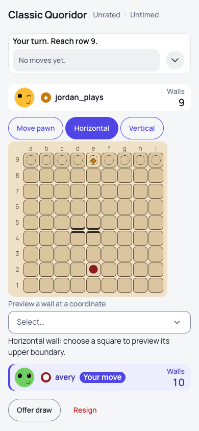](https://raw.githubusercontent.com/crvouga/gamezilla/902e8e2bde2eb7fa79f532554eaeb39e4e6d4241/round-4/journeys/recordings/videos/screens-games-quoridor-classic--precise-coordinates--phone--light.webm)

J9: QuoridorBoard — Move to hill, place walls and pass when required

| View | Before | After |
|---|---|---|
| phone · light | 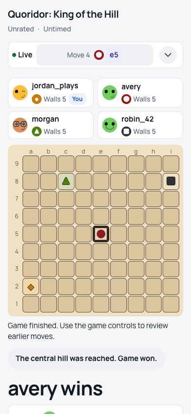 |  |
| phone · dark | 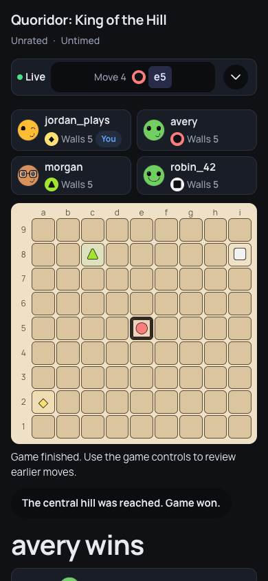 | 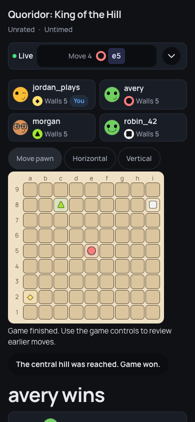 |
| desktop · light | 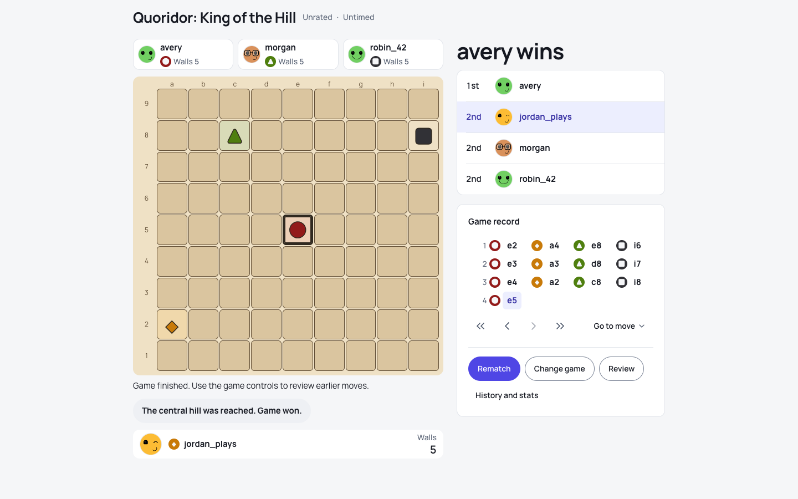 | 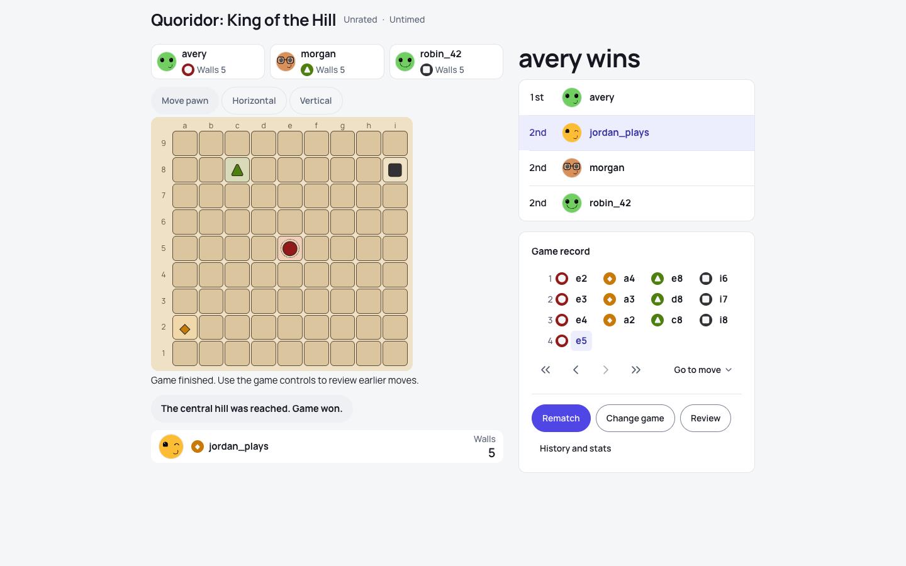 |
| desktop · dark | 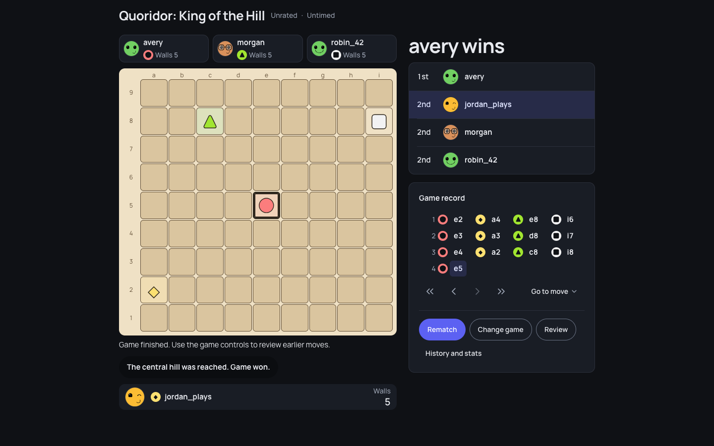 | 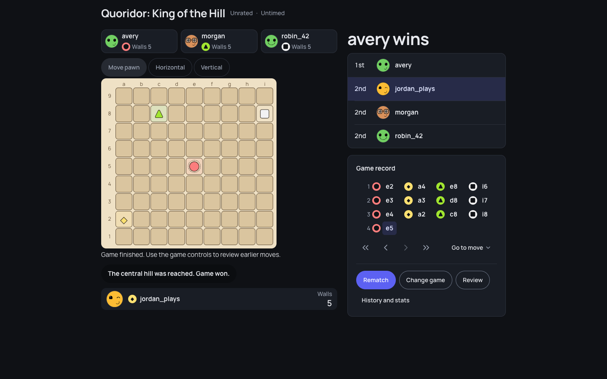 |

**Checks:** 42 canonical cases passed native readiness/play, browser-error and serious/critical axe. Pixels: 0 passed, 42 failed; no macOS acceptance.
**Limits:** Storybook exercises production components and deterministic fixture rules; live transport and persisted cross-session recovery are outside this board-only verification.

**Automated journey:** `screens-games-quoridor-hill--reach-the-hill`
[Phone WebM](https://raw.githubusercontent.com/crvouga/gamezilla/902e8e2bde2eb7fa79f532554eaeb39e4e6d4241/round-4/journeys/recordings/videos/screens-games-quoridor-hill--reach-the-hill--phone--light.webm) · [Desktop WebM](https://raw.githubusercontent.com/crvouga/gamezilla/902e8e2bde2eb7fa79f532554eaeb39e4e6d4241/round-4/journeys/recordings/videos/screens-games-quoridor-hill--reach-the-hill--desktop--light.webm)
[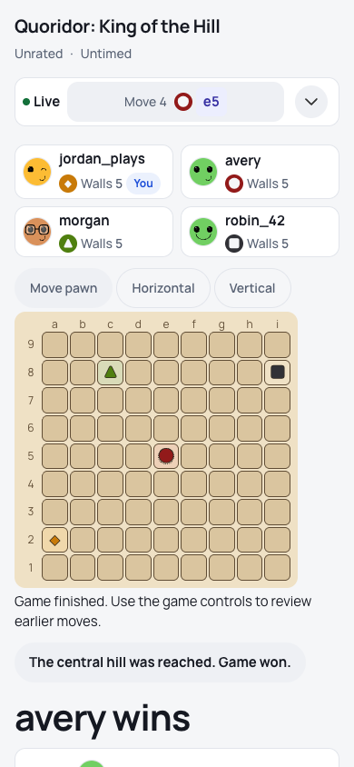](https://raw.githubusercontent.com/crvouga/gamezilla/902e8e2bde2eb7fa79f532554eaeb39e4e6d4241/round-4/journeys/recordings/videos/screens-games-quoridor-hill--reach-the-hill--phone--light.webm)

**Automated journey:** `screens-games-quoridor-hill--four-player-round`
[Phone WebM](https://raw.githubusercontent.com/crvouga/gamezilla/902e8e2bde2eb7fa79f532554eaeb39e4e6d4241/round-4/journeys/recordings/videos/screens-games-quoridor-hill--four-player-round--phone--light.webm) · [Desktop WebM](https://raw.githubusercontent.com/crvouga/gamezilla/902e8e2bde2eb7fa79f532554eaeb39e4e6d4241/round-4/journeys/recordings/videos/screens-games-quoridor-hill--four-player-round--desktop--light.webm)
[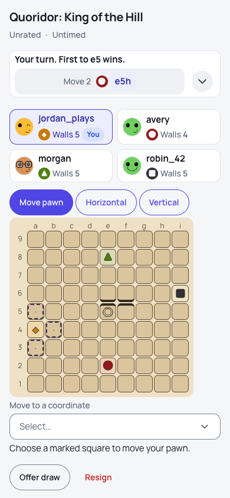](https://raw.githubusercontent.com/crvouga/gamezilla/902e8e2bde2eb7fa79f532554eaeb39e4e6d4241/round-4/journeys/recordings/videos/screens-games-quoridor-hill--four-player-round--phone--light.webm)

**Automated journey:** `screens-games-quoridor-hill--pass-and-continue`
[Phone WebM](https://raw.githubusercontent.com/crvouga/gamezilla/902e8e2bde2eb7fa79f532554eaeb39e4e6d4241/round-4/journeys/recordings/videos/screens-games-quoridor-hill--pass-and-continue--phone--light.webm) · [Desktop WebM](https://raw.githubusercontent.com/crvouga/gamezilla/902e8e2bde2eb7fa79f532554eaeb39e4e6d4241/round-4/journeys/recordings/videos/screens-games-quoridor-hill--pass-and-continue--desktop--light.webm)
[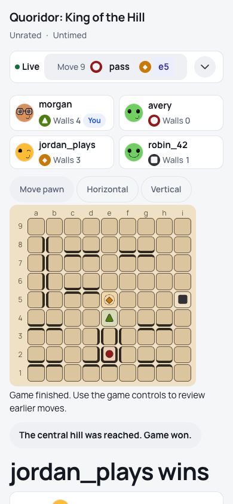](https://raw.githubusercontent.com/crvouga/gamezilla/902e8e2bde2eb7fa79f532554eaeb39e4e6d4241/round-4/journeys/recordings/videos/screens-games-quoridor-hill--pass-and-continue--phone--light.webm)

**Automated journey:** `screens-games-quoridor-hill--recover-wall-placement`
[Phone WebM](https://raw.githubusercontent.com/crvouga/gamezilla/902e8e2bde2eb7fa79f532554eaeb39e4e6d4241/round-4/journeys/recordings/videos/screens-games-quoridor-hill--recover-wall-placement--phone--light.webm) · [Desktop WebM](https://raw.githubusercontent.com/crvouga/gamezilla/902e8e2bde2eb7fa79f532554eaeb39e4e6d4241/round-4/journeys/recordings/videos/screens-games-quoridor-hill--recover-wall-placement--desktop--light.webm)
[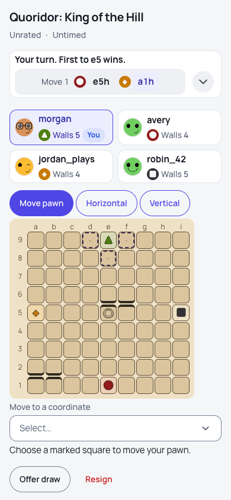](https://raw.githubusercontent.com/crvouga/gamezilla/902e8e2bde2eb7fa79f532554eaeb39e4e6d4241/round-4/journeys/recordings/videos/screens-games-quoridor-hill--recover-wall-placement--phone--light.webm)

**Automated journey:** `screens-games-quoridor-hill--precise-coordinates`
[Phone WebM](https://raw.githubusercontent.com/crvouga/gamezilla/902e8e2bde2eb7fa79f532554eaeb39e4e6d4241/round-4/journeys/recordings/videos/screens-games-quoridor-hill--precise-coordinates--phone--light.webm) · [Desktop WebM](https://raw.githubusercontent.com/crvouga/gamezilla/902e8e2bde2eb7fa79f532554eaeb39e4e6d4241/round-4/journeys/recordings/videos/screens-games-quoridor-hill--precise-coordinates--desktop--light.webm)
[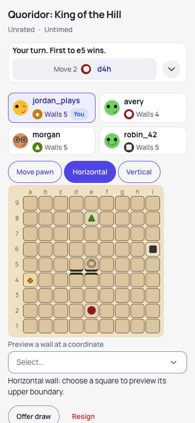](https://raw.githubusercontent.com/crvouga/gamezilla/902e8e2bde2eb7fa79f532554eaeb39e4e6d4241/round-4/journeys/recordings/videos/screens-games-quoridor-hill--precise-coordinates--phone--light.webm)

J10: WordTilesBoardView — Place and submit valid word; blank assignment; exchange/pass; recover word-list failure

| View | Before | After |
|---|---|---|
| phone · light | 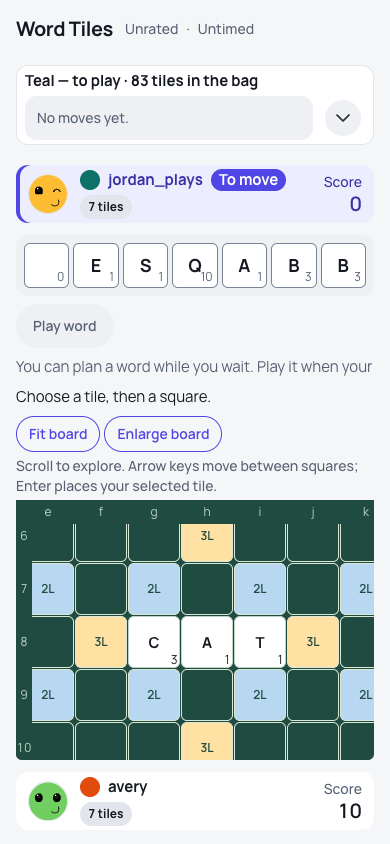 |  |
| phone · dark | 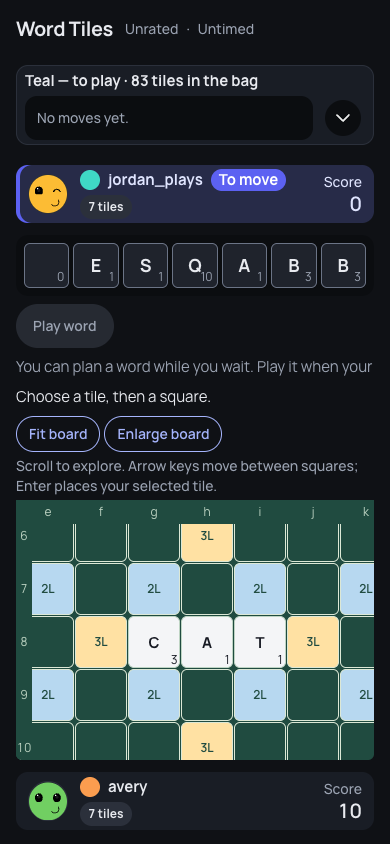 | 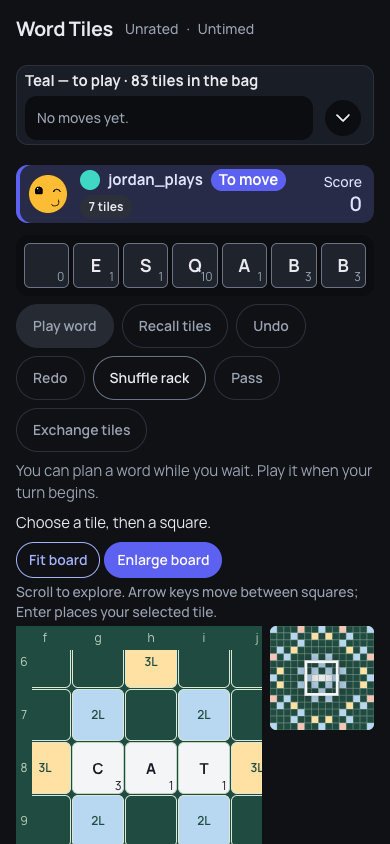 |
| desktop · light | 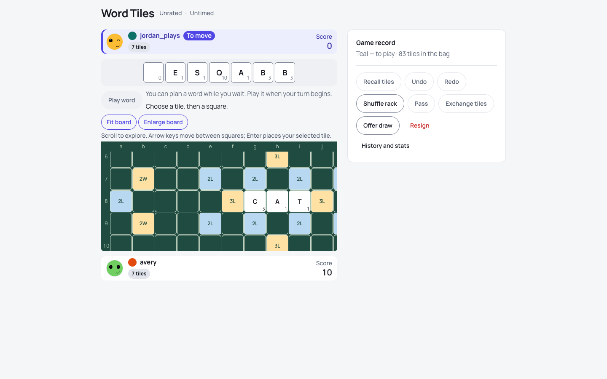 | 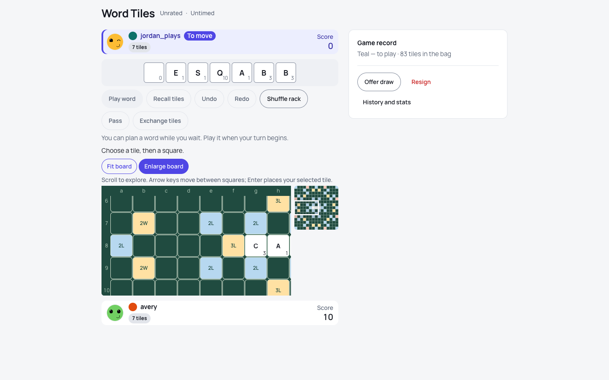 |
| desktop · dark | 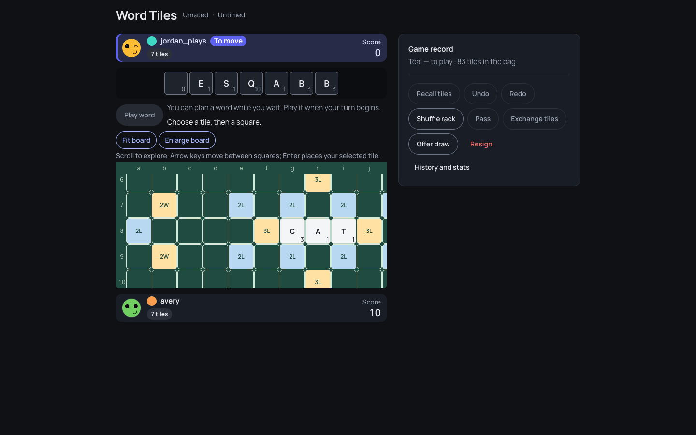 | 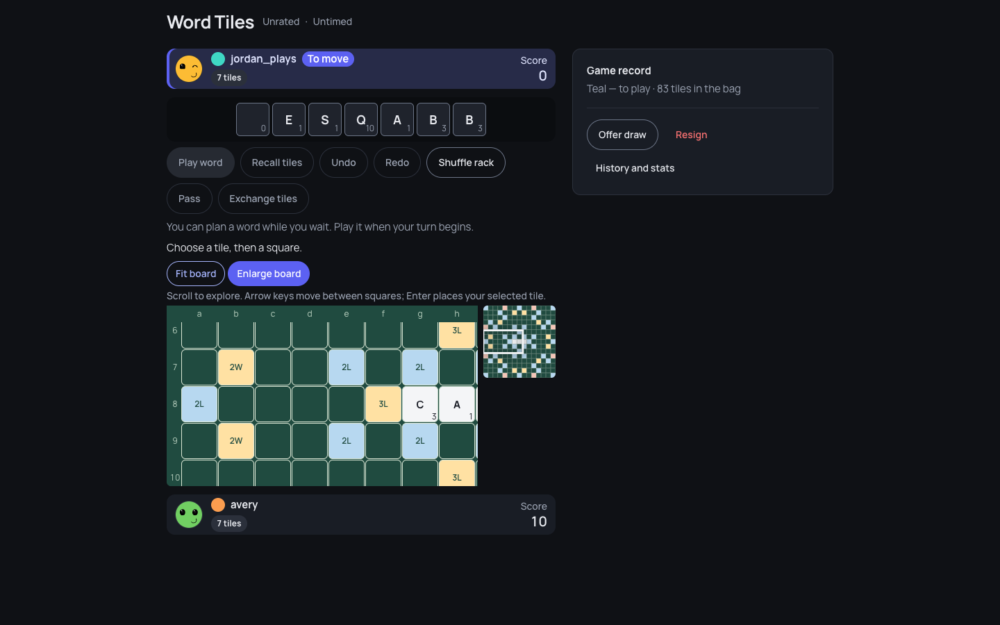 |

**Checks:** 74 canonical cases passed native readiness/play, browser-error and serious/critical axe. Pixels: 0 passed, 74 failed; no macOS acceptance.
**Limits:** Real resolveProposal/playEncoded fixture proves accepted CAT/score/turn, pass and exchange; retry is synchronous and does not prove asynchronous progress or live persistence.

**Automated journey:** `screens-games-word-tiles-board--recover-and-submit`
[Phone WebM](https://raw.githubusercontent.com/crvouga/gamezilla/902e8e2bde2eb7fa79f532554eaeb39e4e6d4241/round-4/journeys/recordings/videos/screens-games-word-tiles-board--recover-and-submit--phone--light.webm) · [Desktop WebM](https://raw.githubusercontent.com/crvouga/gamezilla/902e8e2bde2eb7fa79f532554eaeb39e4e6d4241/round-4/journeys/recordings/videos/screens-games-word-tiles-board--recover-and-submit--desktop--light.webm)
[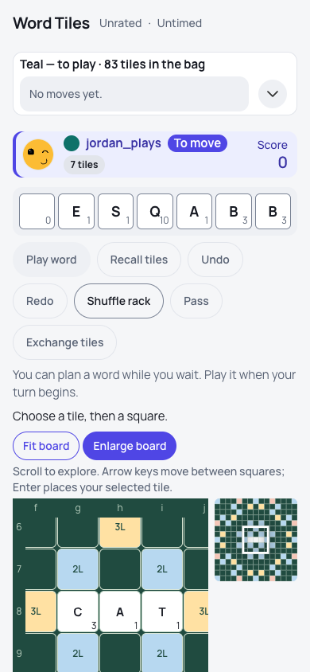](https://raw.githubusercontent.com/crvouga/gamezilla/902e8e2bde2eb7fa79f532554eaeb39e4e6d4241/round-4/journeys/recordings/videos/screens-games-word-tiles-board--recover-and-submit--phone--light.webm)

**Automated journey:** `screens-games-word-tiles-board--accepted-pass`
[Phone WebM](https://raw.githubusercontent.com/crvouga/gamezilla/902e8e2bde2eb7fa79f532554eaeb39e4e6d4241/round-4/journeys/recordings/videos/screens-games-word-tiles-board--accepted-pass--phone--light.webm) · [Desktop WebM](https://raw.githubusercontent.com/crvouga/gamezilla/902e8e2bde2eb7fa79f532554eaeb39e4e6d4241/round-4/journeys/recordings/videos/screens-games-word-tiles-board--accepted-pass--desktop--light.webm)
[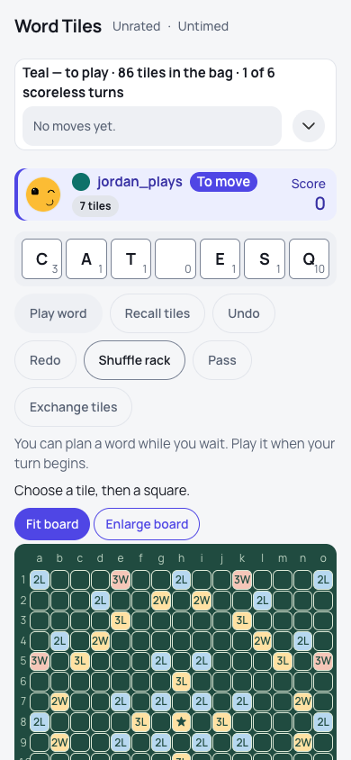](https://raw.githubusercontent.com/crvouga/gamezilla/902e8e2bde2eb7fa79f532554eaeb39e4e6d4241/round-4/journeys/recordings/videos/screens-games-word-tiles-board--accepted-pass--phone--light.webm)

**Automated journey:** `screens-games-word-tiles-board--accepted-exchange`
[Phone WebM](https://raw.githubusercontent.com/crvouga/gamezilla/902e8e2bde2eb7fa79f532554eaeb39e4e6d4241/round-4/journeys/recordings/videos/screens-games-word-tiles-board--accepted-exchange--phone--light.webm) · [Desktop WebM](https://raw.githubusercontent.com/crvouga/gamezilla/902e8e2bde2eb7fa79f532554eaeb39e4e6d4241/round-4/journeys/recordings/videos/screens-games-word-tiles-board--accepted-exchange--desktop--light.webm)
[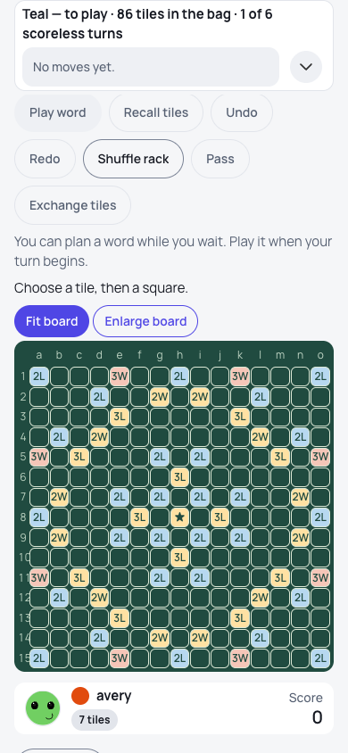](https://raw.githubusercontent.com/crvouga/gamezilla/902e8e2bde2eb7fa79f532554eaeb39e4e6d4241/round-4/journeys/recordings/videos/screens-games-word-tiles-board--accepted-exchange--phone--light.webm)

**Automated journey:** `screens-games-word-tiles-board--enlarged-coordinates`
[Phone WebM](https://raw.githubusercontent.com/crvouga/gamezilla/902e8e2bde2eb7fa79f532554eaeb39e4e6d4241/round-4/journeys/recordings/videos/screens-games-word-tiles-board--enlarged-coordinates--phone--light.webm) · [Desktop WebM](https://raw.githubusercontent.com/crvouga/gamezilla/902e8e2bde2eb7fa79f532554eaeb39e4e6d4241/round-4/journeys/recordings/videos/screens-games-word-tiles-board--enlarged-coordinates--desktop--light.webm)
[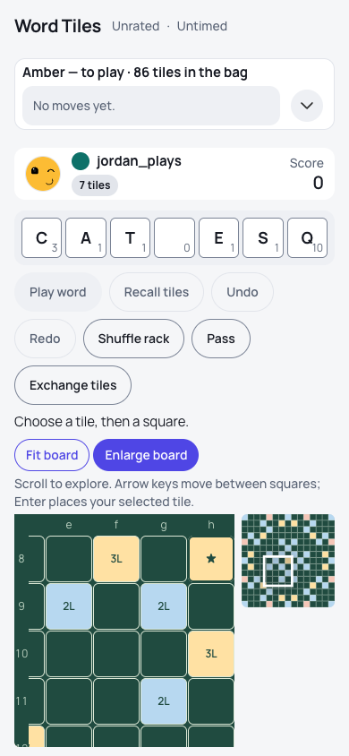](https://raw.githubusercontent.com/crvouga/gamezilla/902e8e2bde2eb7fa79f532554eaeb39e4e6d4241/round-4/journeys/recordings/videos/screens-games-word-tiles-board--enlarged-coordinates--phone--light.webm)

J11: WordTilesPuzzlePlayerView — Place a word meeting puzzle target; recover invalid placement

| View | Before | After |
|---|---|---|
| phone · light | 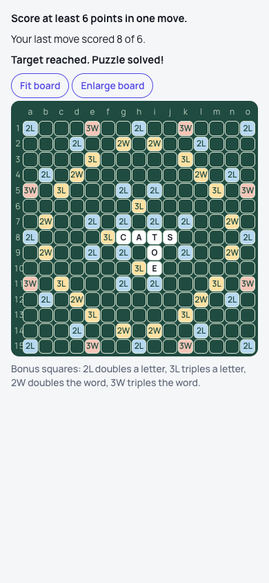 | 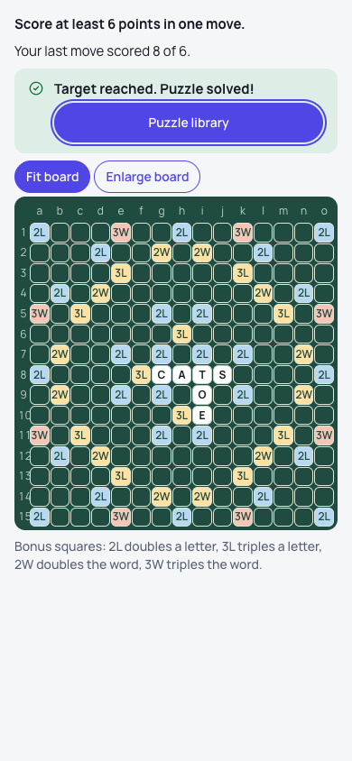 |
| phone · dark | 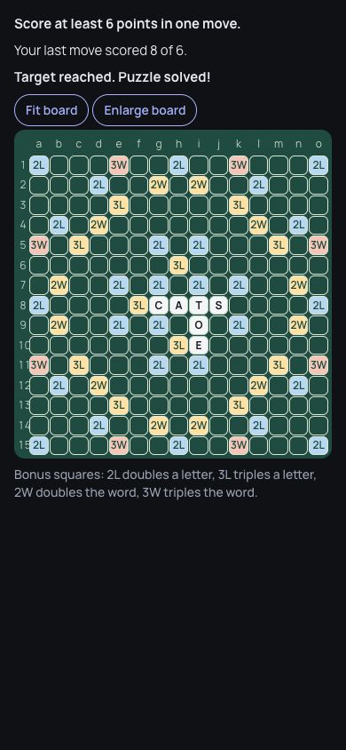 | 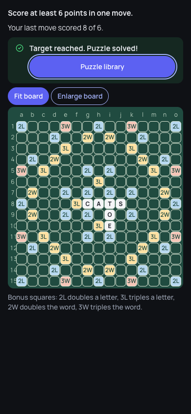 |
| desktop · light | 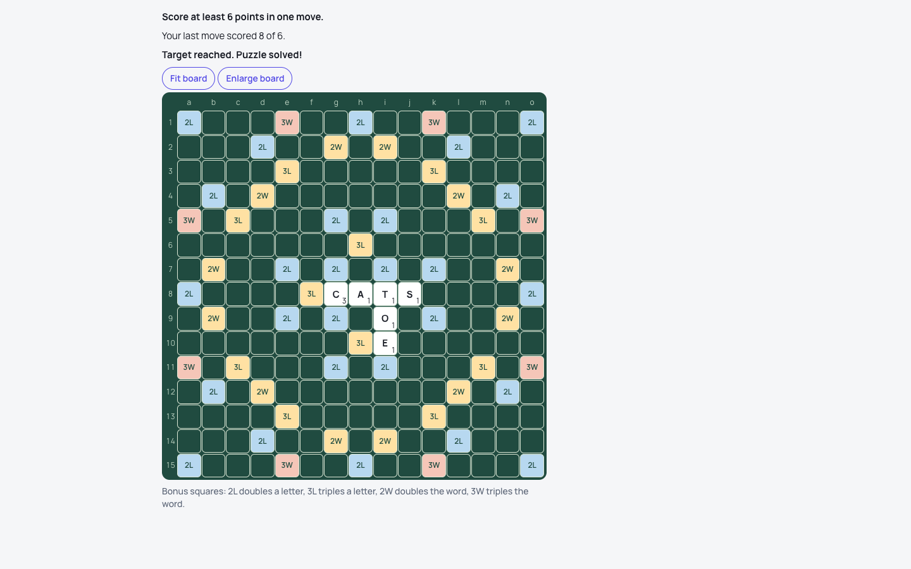 | 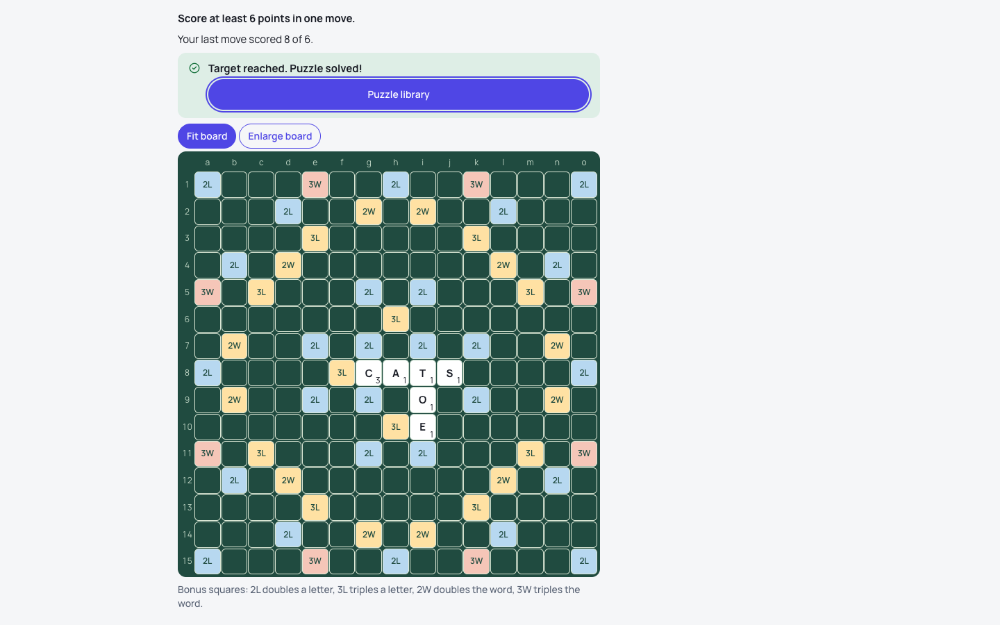 |
| desktop · dark | 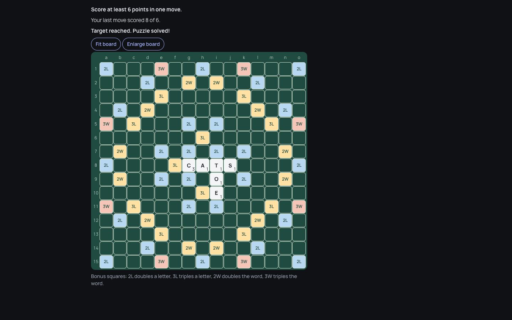 | 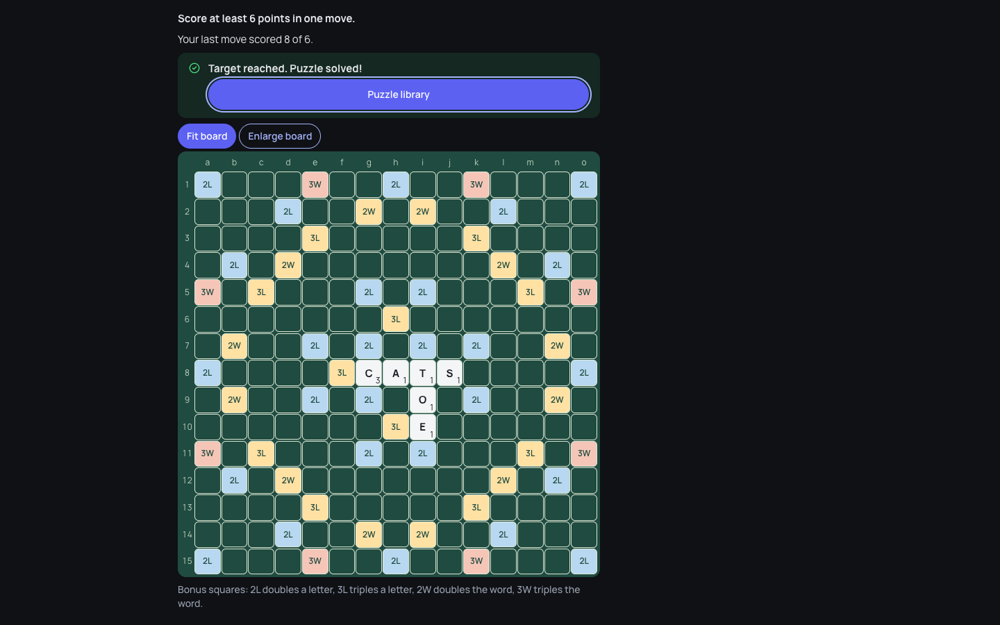 |

**Checks:** 38 canonical cases passed native readiness/play, browser-error and serious/critical axe. Pixels: 0 passed, 38 failed; no macOS acceptance.
**Limits:** Production placement evaluator proves retained draft retry and target completion; live lexicon loading and persisted attempts remain outside this evidence.

**Automated journey:** `screens-games-word-tiles-puzzle--reach-target`
[Phone WebM](https://raw.githubusercontent.com/crvouga/gamezilla/902e8e2bde2eb7fa79f532554eaeb39e4e6d4241/round-4/journeys/recordings/videos/screens-games-word-tiles-puzzle--reach-target--phone--light.webm) · [Desktop WebM](https://raw.githubusercontent.com/crvouga/gamezilla/902e8e2bde2eb7fa79f532554eaeb39e4e6d4241/round-4/journeys/recordings/videos/screens-games-word-tiles-puzzle--reach-target--desktop--light.webm)

**Automated journey:** `screens-games-word-tiles-puzzle--retry-word-list`
[Phone WebM](https://raw.githubusercontent.com/crvouga/gamezilla/902e8e2bde2eb7fa79f532554eaeb39e4e6d4241/round-4/journeys/recordings/videos/screens-games-word-tiles-puzzle--retry-word-list--phone--light.webm) · [Desktop WebM](https://raw.githubusercontent.com/crvouga/gamezilla/902e8e2bde2eb7fa79f532554eaeb39e4e6d4241/round-4/journeys/recordings/videos/screens-games-word-tiles-puzzle--retry-word-list--desktop--light.webm)
[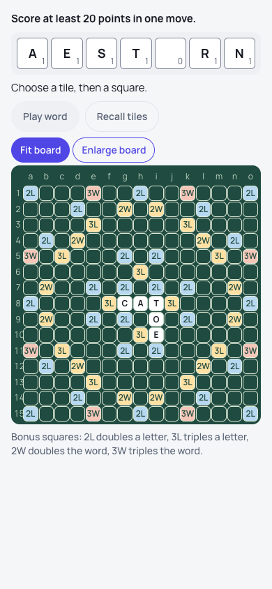](https://raw.githubusercontent.com/crvouga/gamezilla/902e8e2bde2eb7fa79f532554eaeb39e4e6d4241/round-4/journeys/recordings/videos/screens-games-word-tiles-puzzle--retry-word-list--phone--light.webm)

J12: HeartsBoard — Select and pass three cards, then play legal card through trick

| View | Before | After |
|---|---|---|
| phone · light | 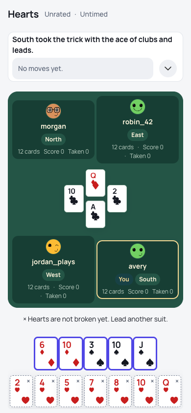 |  |
| phone · dark | 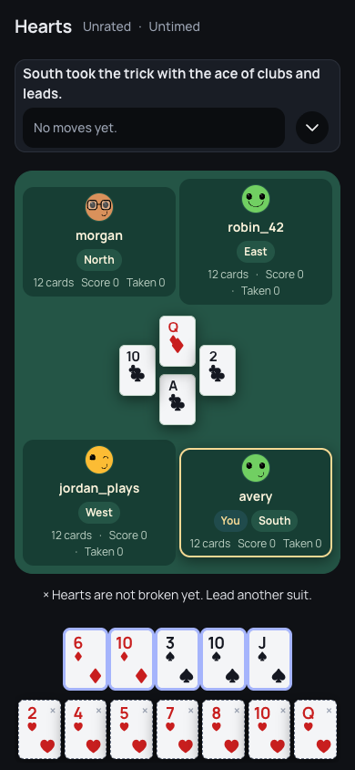 | 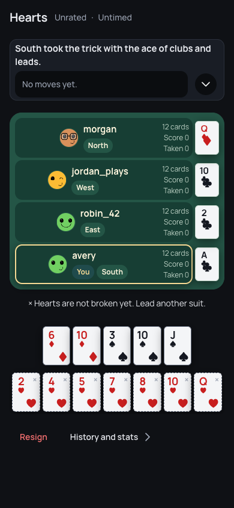 |
| desktop · light | 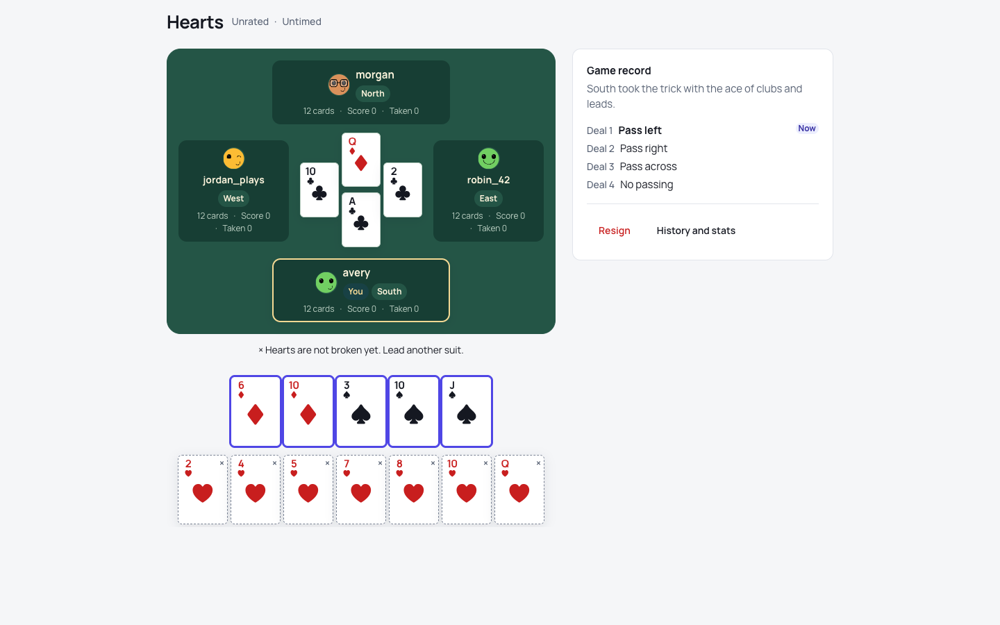 | 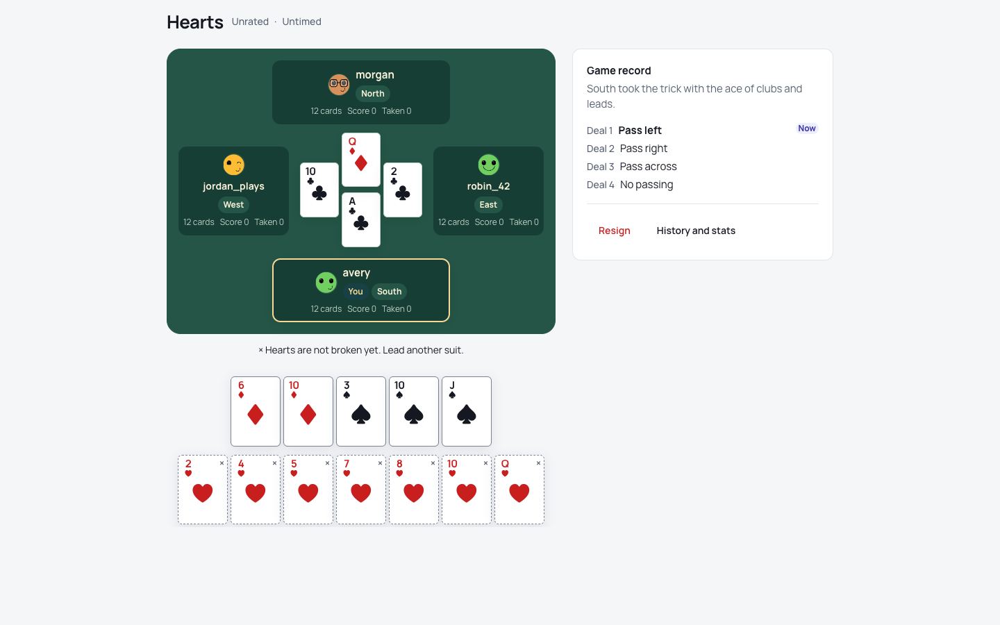 |
| desktop · dark | 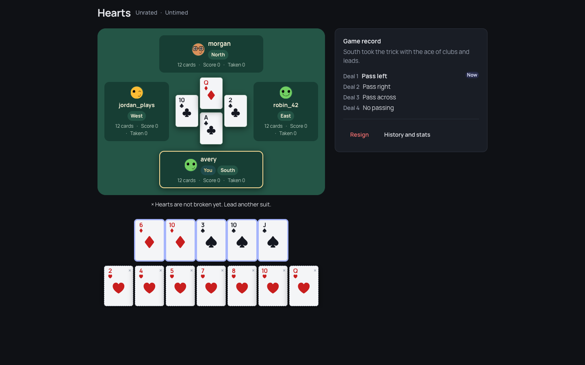 | 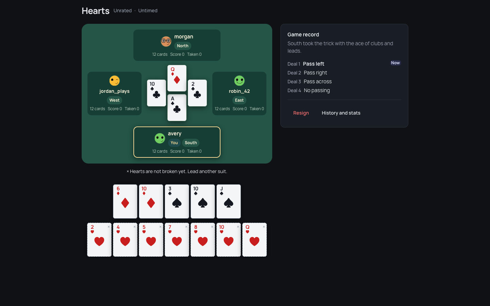 |

**Checks:** 55 canonical cases passed native readiness/play, browser-error and serious/critical axe. Pixels: 0 passed, 55 failed; no macOS acceptance.
**Limits:** Real legal-card rules drive accepted pass and first trick with rotating identities; a full hand/match and network acknowledgement remain unproven.

**Automated journey:** `screens-games-hearts-board--pass-through-first-trick`
[Phone WebM](https://raw.githubusercontent.com/crvouga/gamezilla/902e8e2bde2eb7fa79f532554eaeb39e4e6d4241/round-4/journeys/recordings/videos/screens-games-hearts-board--pass-through-first-trick--phone--light.webm) · [Desktop WebM](https://raw.githubusercontent.com/crvouga/gamezilla/902e8e2bde2eb7fa79f532554eaeb39e4e6d4241/round-4/journeys/recordings/videos/screens-games-hearts-board--pass-through-first-trick--desktop--light.webm)
[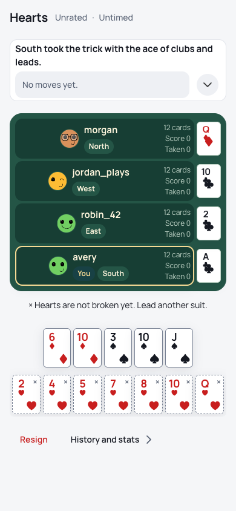](https://raw.githubusercontent.com/crvouga/gamezilla/902e8e2bde2eb7fa79f532554eaeb39e4e6d4241/round-4/journeys/recordings/videos/screens-games-hearts-board--pass-through-first-trick--phone--light.webm)

J13: PongBoardView — Control paddle, return ball, score; resume after reconnect

| View | Before | After |
|---|---|---|
| phone · light |  |  |
| phone · dark |  |  |
| desktop · light |  |  |
| desktop · dark |  |  |

**Checks:** 48 canonical cases passed native readiness/play, browser-error and serious/critical axe. Pixels: 0 passed, 48 failed; no macOS acceptance.
**Limits:** Controlled production-rule score/reconnect fixture; live real-time transport recovery remains unproven.

**Automated journey:** `screens-games-pong-court--return-score-and-reconnect`
[Phone WebM](https://raw.githubusercontent.com/crvouga/gamezilla/902e8e2bde2eb7fa79f532554eaeb39e4e6d4241/round-4/journeys/recordings/videos/screens-games-pong-court--return-score-and-reconnect--phone--light.webm) · [Desktop WebM](https://raw.githubusercontent.com/crvouga/gamezilla/902e8e2bde2eb7fa79f532554eaeb39e4e6d4241/round-4/journeys/recordings/videos/screens-games-pong-court--return-score-and-reconnect--desktop--light.webm)

J14: LightCyclesBoardView — Steer safely, crash/round result; reconnect and resume

| View | Before | After |
|---|---|---|
| phone · light |  |  |
| phone · dark |  |  |
| desktop · light |  |  |
| desktop · dark |  |  |

**Checks:** 72 canonical cases passed native readiness/play, browser-error and serious/critical axe. Pixels: 0 passed, 72 failed; no macOS acceptance.
**Limits:** Production step rules drive collision, result, next round and resumed steering; live transport reconnection remains unproven.

**Automated journey:** `screens-games-light-cycles-arena--collision-through-next-round`
[Phone WebM](https://raw.githubusercontent.com/crvouga/gamezilla/902e8e2bde2eb7fa79f532554eaeb39e4e6d4241/round-4/journeys/recordings/videos/screens-games-light-cycles-arena--collision-through-next-round--phone--light.webm) · [Desktop WebM](https://raw.githubusercontent.com/crvouga/gamezilla/902e8e2bde2eb7fa79f532554eaeb39e4e6d4241/round-4/journeys/recordings/videos/screens-games-light-cycles-arena--collision-through-next-round--desktop--light.webm)

**Automated journey:** `screens-games-light-cycles-arena--resumed-steering`
[Phone WebM](https://raw.githubusercontent.com/crvouga/gamezilla/902e8e2bde2eb7fa79f532554eaeb39e4e6d4241/round-4/journeys/recordings/videos/screens-games-light-cycles-arena--resumed-steering--phone--light.webm) · [Desktop WebM](https://raw.githubusercontent.com/crvouga/gamezilla/902e8e2bde2eb7fa79f532554eaeb39e4e6d4241/round-4/journeys/recordings/videos/screens-games-light-cycles-arena--resumed-steering--desktop--light.webm)

**Automated journey:** `screens-games-light-cycles-arena--shared-swipe`
[Phone WebM](https://raw.githubusercontent.com/crvouga/gamezilla/902e8e2bde2eb7fa79f532554eaeb39e4e6d4241/round-4/journeys/recordings/videos/screens-games-light-cycles-arena--shared-swipe--phone--light.webm) · [Desktop WebM](https://raw.githubusercontent.com/crvouga/gamezilla/902e8e2bde2eb7fa79f532554eaeb39e4e6d4241/round-4/journeys/recordings/videos/screens-games-light-cycles-arena--shared-swipe--desktop--light.webm)

