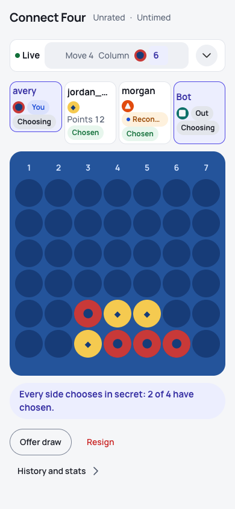
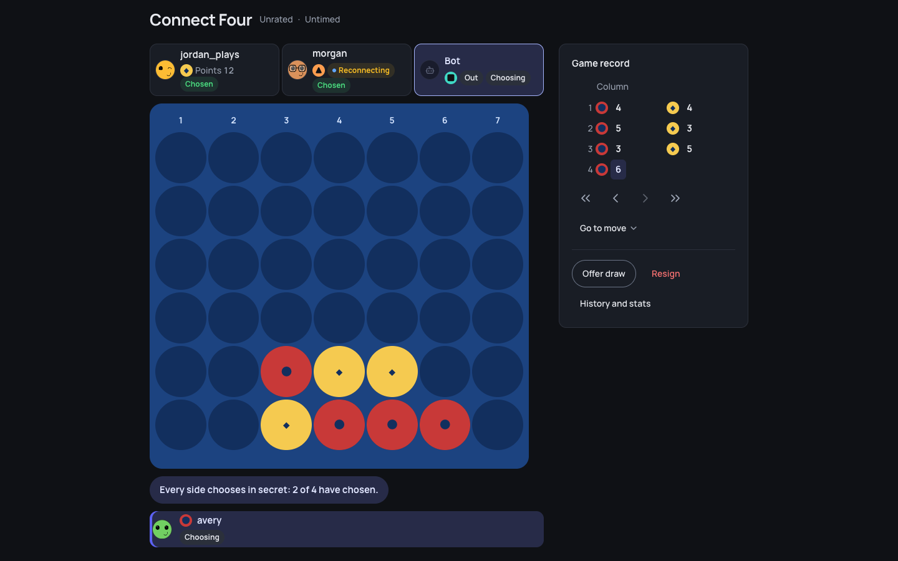
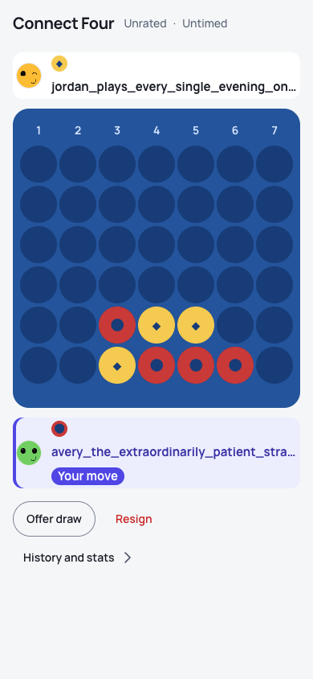
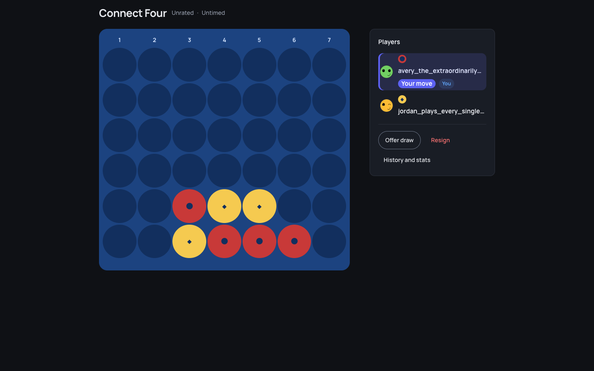
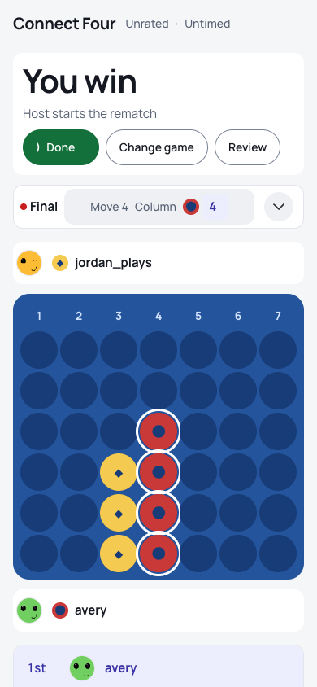
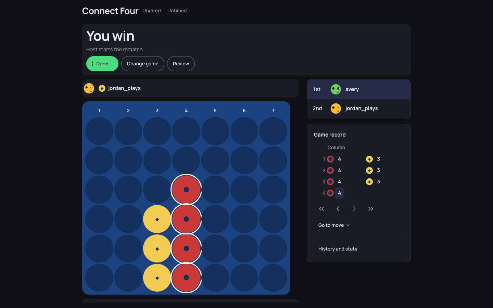
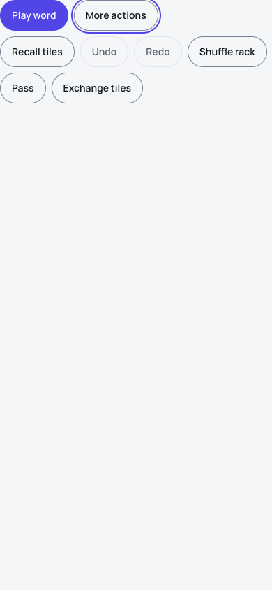
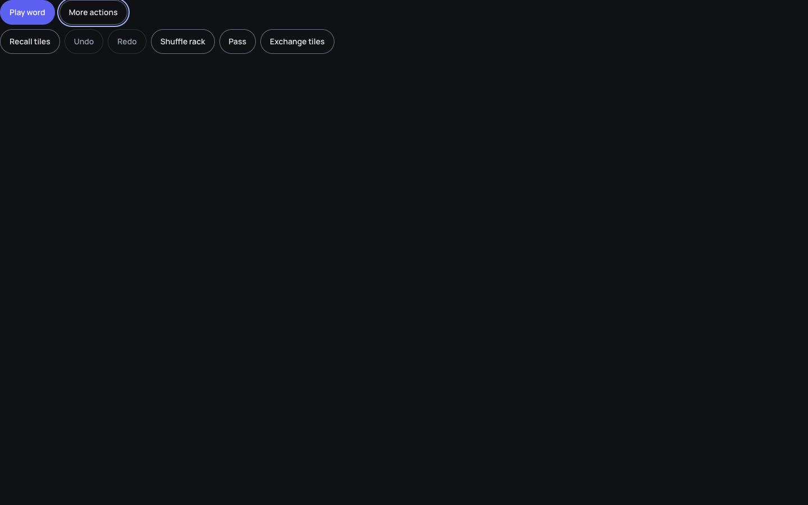

<!-- overhaul-loop:media-round-5-shared -->
## Round 5 — shared frame and secondary controls
Candidate `d2ee6467e23b84ffd7b5128fb993a614df68a7d2` · evidence `1459fd0b37554c88` · immutable media `b69dc3f7f93ddd7467c2057b56a974e60178b410`.
All 752 visual cases passed native readiness/play, browser-error and serious/critical axe stages. Eight font checks and the instrumented chess regression passed. Pixel comparisons, full bun verify, hosted safety and Ubuntu reference decisions are reported separately; no macOS references were accepted.

### `screens-games-frame-geometry--four-players`

### `screens-games-frame-geometry--long-name-rail`

### `screens-games-frame-geometry--win`

### `product-wordtileworkbench--secondary-tools`

[Complete phone recording](https://raw.githubusercontent.com/crvouga/gamezilla/b69dc3f7f93ddd7467c2057b56a974e60178b410/round-5/journeys/recordings/videos/product-wordtileworkbench--secondary-tools--phone--light.webm) · [Desktop recording](https://raw.githubusercontent.com/crvouga/gamezilla/b69dc3f7f93ddd7467c2057b56a974e60178b410/round-5/journeys/recordings/videos/product-wordtileworkbench--secondary-tools--desktop--light.webm)

Animations sample the asserted recordings at 2 fps. Replay pacing is automated, not natural user timing. See the immutable manifest for native geometry, pixel, Ubuntu and full-catalog outcomes.
