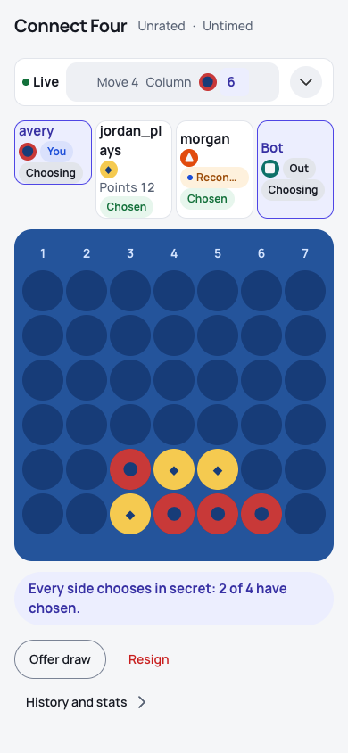
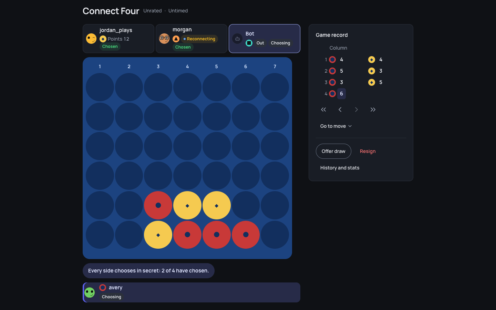
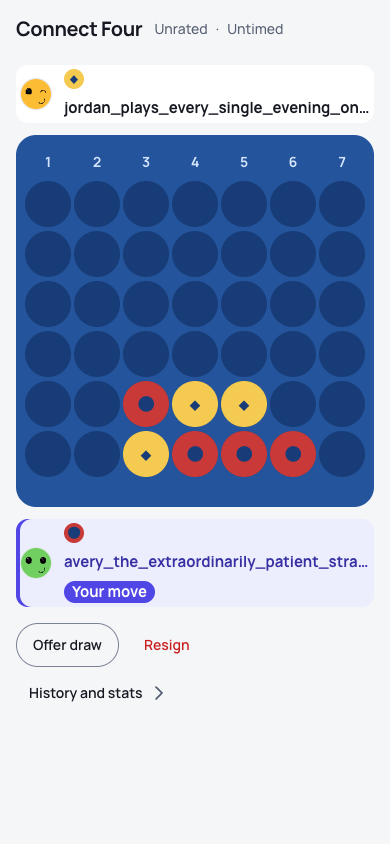
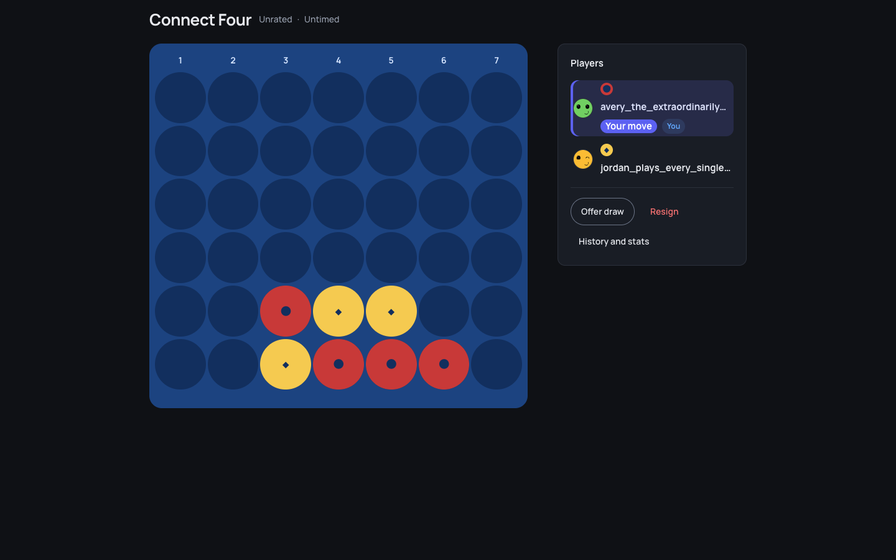
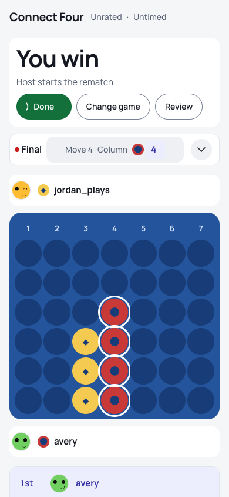
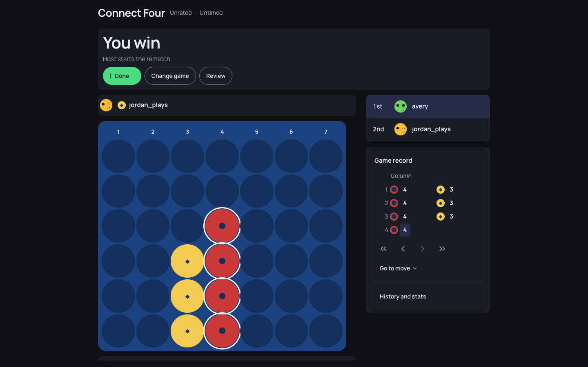
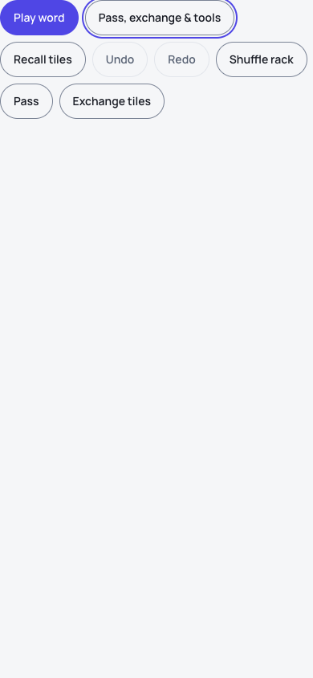
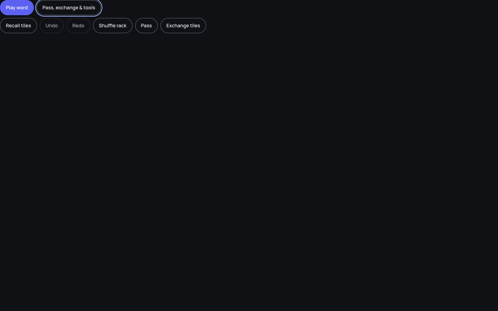

<!-- overhaul-loop:media-round-7-shared -->
## Round 7 — shared frame and secondary controls
Candidate `b606946642616ea53bbf11e8b4fb23e08fb55c5f` · evidence `46d72c8321c65c53` · immutable media `f05f61a51cd6961c7e5ae1883d3c9a1e6f384b0d`.
All 781 visual cases passed native readiness/play, browser-error and serious/critical axe stages. Eight font checks and the instrumented chess regression passed. Pixel comparisons, full bun verify, hosted safety and Ubuntu reference decisions are reported separately; no macOS references were accepted.

### `screens-games-frame-geometry--four-players`

### `screens-games-frame-geometry--long-name-rail`

### `screens-games-frame-geometry--win`

### `product-wordtileworkbench--secondary-tools`

[Complete phone recording](https://raw.githubusercontent.com/crvouga/gamezilla/f05f61a51cd6961c7e5ae1883d3c9a1e6f384b0d/round-7/journeys/recordings/videos/product-wordtileworkbench--secondary-tools--phone--light.webm) · [Desktop recording](https://raw.githubusercontent.com/crvouga/gamezilla/f05f61a51cd6961c7e5ae1883d3c9a1e6f384b0d/round-7/journeys/recordings/videos/product-wordtileworkbench--secondary-tools--desktop--light.webm)

Animations sample the asserted recordings at 2 fps. Replay pacing is automated, not natural user timing. See the immutable manifest for native geometry, pixel, Ubuntu and full-catalog outcomes.
