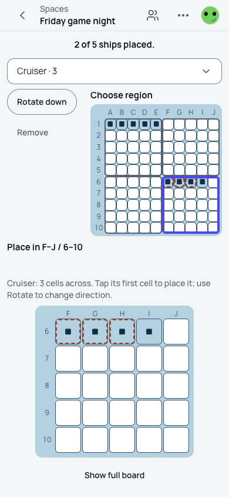
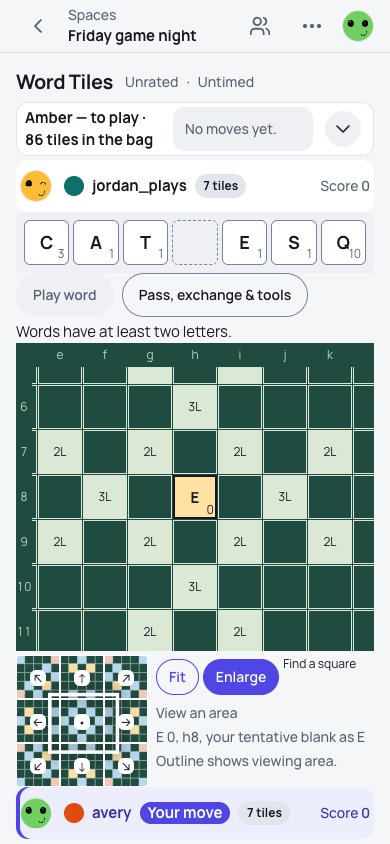
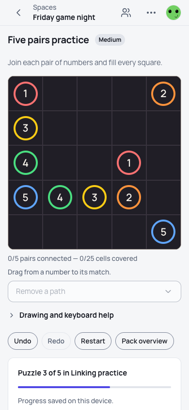

<!-- overhaul-loop:round-8-stopping-point -->
Round 8 stopping point: source `0e6f06190addaf9cf7610f9ba106d8be6d10fdc0`, media `dfd0858c51105d461d74f79ea0a5e5bfe83ba894`, evidence `eab9af9bebde1e36`.

Main conflicts are resolved by a normal merge. Final source is clean and pushed. No further redesign, score rounds, independent reviews or canonical/reference work under the user’s stopping instruction.

**Checks:** focused lint/type/test/build 97/97; final native-registration checks 3/3; configured brand policy 2/2; repaired native cases 67/67 functional (65 readiness/play/browser-error/serious-critical-axe, two layout-only). All 65 pixel comparisons remain different and unaccepted.

**Local full gate:** `bun verify` ran once on final source and failed at five inherited outside-board `ci:goals` registrations (20/30 tasks). No specs or gate rules changed. Latest-head hosted safety remains pending in [run 42342271919](https://github.com/crvouga/gamezilla/actions/runs/42342271919); PR is MERGEABLE but BLOCKED pending its required gate. Parent retains monitoring; this is not a ready-to-merge claim.

[Handoff and exact limitations](https://github.com/crvouga/gamezilla/blob/dfd0858c51105d461d74f79ea0a5e5bfe83ba894/round-8/stopping-point/HANDOFF.md) · [Manifest](https://github.com/crvouga/gamezilla/blob/dfd0858c51105d461d74f79ea0a5e5bfe83ba894/round-8/stopping-point/manifest.json) · [12-image gallery, both themes/sizes](https://github.com/crvouga/gamezilla/blob/dfd0858c51105d461d74f79ea0a5e5bfe83ba894/round-8/stopping-point/GALLERY.md) · [Artifact inventory](https://github.com/crvouga/gamezilla/blob/dfd0858c51105d461d74f79ea0a5e5bfe83ba894/round-8/stopping-point/ARTIFACT_INDEX.md)

The build is from `54ed1b515`; final source adds only native test-file registration. Published media uses those identical build bytes. New region/Next stories have no reconstructed before image. Numberlink Next/saving is fixture fidelity, **not persisted-navigation repair**.

| Ship-region selection | Contextual blank assignment | Next Puzzle fixture |
|---|---|---|
|  |  |  |
| [▶ Play phone video](https://raw.githubusercontent.com/crvouga/gamezilla/dfd0858c51105d461d74f79ea0a5e5bfe83ba894/round-8/stopping-point/recordings/videos/screens-games-battleship-setup--spatial-region-selection--phone--light.mp4) · [Desktop](https://raw.githubusercontent.com/crvouga/gamezilla/dfd0858c51105d461d74f79ea0a5e5bfe83ba894/round-8/stopping-point/recordings/videos/screens-games-battleship-setup--spatial-region-selection--desktop--light.mp4) | [▶ Play phone video](https://raw.githubusercontent.com/crvouga/gamezilla/dfd0858c51105d461d74f79ea0a5e5bfe83ba894/round-8/stopping-point/recordings/videos/screens-games-word-tiles-board--assign-a-blank--phone--light.mp4) · [Desktop](https://raw.githubusercontent.com/crvouga/gamezilla/dfd0858c51105d461d74f79ea0a5e5bfe83ba894/round-8/stopping-point/recordings/videos/screens-games-word-tiles-board--assign-a-blank--desktop--light.mp4) | [▶ Play phone video](https://raw.githubusercontent.com/crvouga/gamezilla/dfd0858c51105d461d74f79ea0a5e5bfe83ba894/round-8/stopping-point/recordings/videos/screens-games-numberlink-puzzle--next-puzzle--phone--light.mp4) · [Desktop](https://raw.githubusercontent.com/crvouga/gamezilla/dfd0858c51105d461d74f79ea0a5e5bfe83ba894/round-8/stopping-point/recordings/videos/screens-games-numberlink-puzzle--next-puzzle--desktop--light.mp4) |

All six pinned MP4s are byte-verified and automated browser playback decoded and advanced video frames; each asserted recording finishes with zero checkpoint failures. They are automated replays, not human timing. The [round-seven full gallery and all-family recordings](https://github.com/crvouga/gamezilla/blob/f05f61a51cd6961c7e5ae1883d3c9a1e6f384b0d/round-7/GALLERY.md) remain historical evidence at their original source.

Remaining gaps: no final whole-matrix rerun or new canonical comparison; live Battleship attempt stopped at application identity readiness before setup (0/24); unresolved Numberlink republication and older Hill root-cause diagnosis were not rerun. Full initial artifacts and the local gate archive remain preserved; the concise public bundle contains the final focused artifacts and initial classifications.

GitHub’s issue-comment renderer strips inline video tags; the pinned Play phone video/Desktop links above provide the six browser-verified playable recordings.
